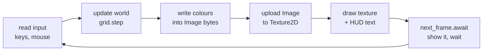
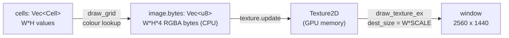

# Lesson 01: Setup, Cargo and the game loop

> Source for this lesson: commit `8da72fa`, files `sand/Cargo.toml` and `sand/src/main.rs`.
> Read them with `git show 8da72fa:sand/Cargo.toml` and `git show 8da72fa:sand/src/main.rs`.

---

## 1. What you will build

By the end of this lesson you will have a window that shows a grid of coloured pixels. You paint on it with the mouse: number keys pick a colour, right-click erases. Nothing falls yet. This is the empty canvas that every later lesson draws on.

Where this sits in the project: the first commit of the sand game (`8da72fa`) is one file, `sand/src/main.rs`, about 620 lines. Roughly 500 of those lines are the simulation (lessons 02 to 04). The other ~120 lines form the shell around it:

- a `Cargo.toml` that pulls in the `macroquad` crate,
- a function that describes the window,
- an `async fn main` with a `loop` that runs once per frame,
- an `Image` (pixels on the CPU) and a `Texture2D` (the same pixels on the GPU),
- input handling (keys and mouse),
- a line of on-screen text built with `format!`.

That shell is what you build here. It barely changes for the rest of the CPU part of the course.



---

## 2. Concepts

### 2.1 One idea to start from

Here is the fact the whole lesson rests on, and it has no exceptions:

> **A game is a loop. Each pass of the loop produces one picture (a frame), and the screen shows those pictures one after another.**

Everything else follows from asking "what has to happen inside one pass?" The answer is: read what the player did, change the world, draw the world, then hand the picture to the screen. If you drew 60 such pictures a second, the world appears to move. A falling-sand game is nothing more than this loop with a grid of colours as "the world".

### 2.2 Installing Rust: rustup, rustc, cargo

There are three programs to know about:

| Program | What it is |
|---|---|
| `rustup` | The installer and version manager. It downloads compilers and switches between them. |
| `rustc` | The compiler. It turns `.rs` files into a program. You rarely call it directly. |
| `cargo` | The build tool and package manager. It calls `rustc` for you, downloads libraries, runs tests. |

Install (macOS / Linux):

```sh
curl --proto '=https' --tlsv1.2 -sSf https://sh.rustup.rs | sh
# restart the shell, then:
rustc --version
cargo --version
rustup update        # later, to get a newer compiler
```

On Windows, download `rustup-init.exe` from rustup.rs. This project uses **edition 2024**, which needs Rust 1.85 or newer. Any recent `rustup update` gives you that.

### 2.3 `cargo new` and the project layout

```sh
cargo new hello
cd hello
cargo run
```

This creates:

```
hello/
├── Cargo.toml      # the project description (name, version, dependencies)
└── src/
    └── main.rs     # fn main() { println!("Hello, world!"); }
```

`cargo run` compiles and runs. The compiled program lands in `target/debug/hello`. `cargo build` only compiles, `cargo check` only type-checks (fastest; use it constantly while writing code), and `cargo run --release` builds with full optimisation into `target/release/`.

### 2.4 Cargo.toml: crates, dependencies, profiles

A **crate** is one Rust compilation unit: a library or a program. Libraries published to crates.io are pulled in by naming them under `[dependencies]`. Here is the project's whole `Cargo.toml` at `8da72fa`:

```toml
# sand/Cargo.toml @ 8da72fa
[package]
name = "sand"
version = "0.1.0"
edition = "2024"

[dependencies]
macroquad = "0.4.16"

# Optimise dependencies and our own code a bit even in debug builds.
[profile.dev]
opt-level = 1

[profile.dev.package."*"]
opt-level = 3
```

Line by line:

- `edition = "2024"` picks which version of the language's rules applies. Editions change small things (keywords, some defaults). Crates on different editions still work together.
- `macroquad = "0.4.16"` means "any version compatible with 0.4.16", which for a `0.x` crate means `>=0.4.16, <0.5.0`. The exact version chosen is written to `Cargo.lock`, so builds are repeatable. You can also add it with `cargo add macroquad`.
- **Profiles** are named sets of compiler settings. `cargo build` uses the `dev` profile, `cargo build --release` uses `release`. By default `dev` has `opt-level = 0` (no optimisation: fast to compile, very slow to run), and `release` has `opt-level = 3`.

**The opt-level trick.** A falling-sand game touches every cell every frame. At 640 x 360 that is 230,400 cells, 60 times a second. Unoptimised Rust code can easily be 10 to 50 times slower than optimised code, so a plain debug build would crawl. But a release build is slow to compile and drops debug checks you want while learning (for example, integer overflow panics are on in `dev` and off in `release`).

The two profile sections split the difference:

- `[profile.dev] opt-level = 1` — your own code gets light optimisation. It still compiles quickly and keeps debug assertions and overflow checks.
- `[profile.dev.package."*"] opt-level = 3` — `"*"` means every dependency (not your own crate). Dependencies like macroquad are compiled once and then cached, so paying for full optimisation there costs you almost nothing on later builds.

You get a fast-running debug build that still recompiles quickly when you edit `main.rs`.

### 2.5 `use` paths and the prelude

Items in Rust live in a tree of modules, addressed with `::`. `macroquad::window::next_frame` is the function `next_frame` in module `window` of crate `macroquad`. Writing the full path every time is tedious, so `use` brings names into scope:

```rust
use std::collections::HashMap;      // one item
use std::io::{self, Write};         // several items; `self` = the module `std::io` itself
use macroquad::prelude::*;          // everything the module exports (a glob)
```

Many crates offer a `prelude` module that re-exports the things you nearly always need. The sand game's first real line is:

```rust
// sand/src/main.rs @ 8da72fa
use macroquad::prelude::*;
```

That one line gives you `Conf`, `Image`, `Texture2D`, `Color`, `BLACK`, `WHITE`, `vec2`, `draw_texture_ex`, `draw_text`, `mouse_position`, `is_key_pressed`, `KeyCode`, `MouseButton`, `next_frame`, `get_fps` and more. Rust also has its own standard prelude, which is why `Vec`, `Option`, `String` and `println!` work without any `use`.

### 2.6 Functions, `let`, `mut` and basic types

A function declares its parameter types and its return type. The last expression without a semicolon is the return value:

```rust
fn area(w: u32, h: u32) -> u32 {
    w * h            // no `;` so this value is returned
}

fn main() {
    let a = area(3, 4);   // a: u32, inferred
    println!("{a}");      // 12
}
```

Variables are **immutable by default**. `let x = 5;` cannot be changed later. To allow change, say so with `mut`:

```rust
let count = 0;
// count += 1;          // error[E0384]: cannot assign twice to immutable variable
let mut total = 0;
total += 1;             // fine
```

This is a deliberate default: when you read `let` without `mut`, you know that value never changes, which makes code easier to follow. In the sand game `let mut grid = Grid::new();` is `mut` because the loop changes it every frame, while `let texture = Texture2D::from_image(&image);` is not, because the texture handle itself is never replaced (its *contents* are updated through a method, which we will come back to).

The basic number types you will see in this project:

| Type | Meaning | Used for |
|---|---|---|
| `u8` | unsigned 8-bit, 0..=255 | colour channels, small counters |
| `u16` | unsigned 16-bit | macroquad image width/height |
| `u32` | unsigned 32-bit | RNG state, frame counter |
| `i32` | signed 32-bit | grid coordinates (can go negative near edges) |
| `usize` | unsigned, pointer-sized (64-bit on your machine) | **every index into a `Vec` or array** |
| `f32` | 32-bit float | screen pixels, mouse position |
| `bool` | `true` / `false` | flags |

Rust never converts between number types silently. `u32 + i32` is a compile error. That is the next concept.

### 2.7 `as` casts

`as` converts one primitive number type to another. You must write it out:

```rust
fn main() {
    let w: usize = 640;
    let scale: f32 = 4.0;

    let px = w as f32 * scale;        // 2560.0
    println!("{}", px as i32);        // 2560

    println!("{}", 3.9_f32 as i32);   // 3     float -> int truncates toward zero
    println!("{}", -3.9_f32 as i32);  // -3
    println!("{}", 300.0_f32 as u8);  // 255   float -> int saturates at the limits
    println!("{}", 300_i32 as u8);    // 44    int -> smaller int keeps the low bits (300 - 256)
    println!("{}", -1_i32 as u32);    // 4294967295
}
```

Why does the sand game need so many casts? Because it mixes three worlds:

- array indices must be `usize`,
- grid coordinates are `i32` so that "one to the left of x = 0" can be `-1` and be detected as off-grid,
- the screen and mouse are `f32`.

Here is the window size, computed from `usize` and `f32` constants and handed to macroquad as `i32`:

```rust
// sand/src/main.rs @ 8da72fa
window_width: (W as f32 * SCALE) as i32,
```

And the mouse position (`f32` screen pixels) turned into a grid cell (`i32`):

```rust
// sand/src/main.rs @ 8da72fa
let (mx, my) = mouse_position();
let (cx, cy) = ((mx / SCALE) as i32, (my / SCALE) as i32);
```

Note `as` binds tighter than `*` and `/`, so `W as f32 * SCALE` means `(W as f32) * SCALE`.

### 2.8 `const`

A `const` is a value fixed at compile time. Its type must always be written, and by convention its name is `SCREAMING_CASE`:

```rust
// sand/src/main.rs @ 8da72fa
const W: usize = 640;
const H: usize = 360;
const SCALE: f32 = 4.0;
const BRUSH: i32 = 3;
const MAX_PARTICLES: usize = 30_000;   // `_` is just a visual separator
```

Each constant has the type it is *used* as most: `W` and `H` are `usize` because they size the `Vec` (`vec![Cell::Empty; W * H]`), and `BRUSH` is `i32` because it is added to `i32` coordinates. Picking the right type up front means fewer casts later. A `const` is copied into each place it is used; it is not a variable in memory you can change.

### 2.9 Structs and `..Default::default()`

A **struct** groups named fields into one type:

```rust
struct Settings {
    title: String,
    width: i32,
    height: i32,
    resizable: bool,
}

fn main() {
    let s = Settings {
        title: "demo".to_owned(),
        width: 800,
        height: 600,
        resizable: true,
    };
    println!("{} is {}x{}", s.title, s.width, s.height);
}
```

You must give *every* field a value. That is a problem for a struct like macroquad's `Conf`, which has a dozen fields (title, width, height, `high_dpi`, `fullscreen`, `sample_count`, `window_resizable`, `icon`, `platform`, ...). You only care about four of them.

The **`Default` trait** is how a type says "here is a sensible value for me". If a type implements it, `Default::default()` (or `Conf::default()`) produces that value. The **struct update syntax** `..other` then means "take every field I did not list from `other`". Put together:

```rust
// sand/src/main.rs @ 8da72fa
fn window_conf() -> Conf {
    Conf {
        window_title: "sand".to_owned(),
        window_width: (W as f32 * SCALE) as i32,
        window_height: (H as f32 * SCALE) as i32,
        window_resizable: false,
        ..Default::default()
    }
}
```

Four fields are set; the rest come from `Conf`'s default. The `..` part must come last. You will see the same pattern again for `DrawTextureParams`. Your own structs can join in with `#[derive(Default)]`, which fills each field with its type's default (`0`, `false`, empty `String`, ...):

```rust
#[derive(Default, Debug)]
struct Settings { width: i32, height: i32, resizable: bool }

fn main() {
    let s = Settings { width: 800, ..Default::default() };
    println!("{s:?}");   // Settings { width: 800, height: 0, resizable: false }
}
```

`"sand".to_owned()` turns the string literal (a borrowed `&'static str`) into an owned `String`, because the `window_title` field is a `String`. Lesson 02 covers the difference.

### 2.10 `#[macroquad::main]`, `async` and `.await` (beginner level)

Every Rust program starts at `fn main()`. The sand game instead has:

```rust
// sand/src/main.rs @ 8da72fa
#[macroquad::main(window_conf)]
async fn main() {
    // ...
    loop {
        // ...
        next_frame().await; // hand control back to macroquad until the next frame
    }
}
```

Two things are going on.

**The attribute.** `#[macroquad::main(window_conf)]` is a macro that rewrites your function at compile time. It renames your `async fn main` and generates a real, ordinary `fn main()` that opens the window using `window_conf()`, then runs your function inside macroquad's machinery. You can pass a plain title instead of a config function: `#[macroquad::main("sand")]`.

**`async` / `.await`.** Here is the problem macroquad has to solve. The operating system owns the window. It wants to call *your* code every time it is ready for a new frame (that is how macOS, Windows and browsers all work). But it is far nicer to write the game as one straight `loop` that *you* control.

An `async fn` is a function that can **pause in the middle and be resumed later**, keeping all its local variables (`grid`, `brush`, `image`) intact. `.await` is the pause point. So:

1. Your loop reads input, updates, draws.
2. `next_frame().await` pauses your function. Control goes back to macroquad.
3. Macroquad presents the picture to the screen, waits for the display (vsync, usually 60 Hz), and collects new keyboard and mouse events.
4. Macroquad resumes your function right after the `.await`, and the loop goes around again.

For this course that is all you need to know about async: **`next_frame().await` means "show this frame and come back when it is time for the next one."** If you forget the `.await`, nothing pauses, nothing is ever shown, and the compiler warns that the future is unused (see Common mistakes).

### 2.11 The frame loop pattern

Inside the loop, the order matters. From the real code:

```rust
// sand/src/main.rs @ 8da72fa
loop {
    pick_brush(&mut brush);                       // 1. input
    if is_key_pressed(KeyCode::E) { /* bomb */ }
    paint(&mut grid, brush);
    grid.step();                                  // 2. update the world
    draw_grid(&grid, &mut image);                 // 3. world -> pixels (CPU)

    texture.update(&image);                       // 4. pixels -> GPU
    draw_texture_ex(&texture, 0.0, 0.0, WHITE, DrawTextureParams { /* ... */ });
    draw_text(&format!(/* ... */), 10.0, 24.0, 24.0, WHITE);   // 5. HUD on top

    next_frame().await;                           // 6. present, wait
}
```

Why this order? Input first, so that what the player did this frame affects this frame. Update before draw, so you draw the newest state. The texture is drawn before the text so that the text is painted on top (later draws cover earlier ones). And `next_frame` is last because it is the "I am done with this picture" signal.

Two input styles appear:

- `is_key_pressed(key)` is true only on the **one frame** the key went down. Good for toggles and picking a brush.
- `is_mouse_button_down(button)` / `is_key_down(key)` is true on **every frame** while held. Good for painting a continuous stroke.

`mouse_position()` returns `(f32, f32)` in window pixels, with `(0, 0)` at the top-left and y growing downward. That matches how the grid is stored (row 0 at the top), so converting is a single divide by `SCALE`.

### 2.12 Drawing a coloured pixel buffer: `Image`, `Texture2D`, `draw_texture_ex`

The fastest way to draw 230,400 cells is not 230,400 `draw_rectangle` calls. It is: **write all the colours into one block of bytes, send it to the GPU once, and draw it as a single stretched picture.**

```rust
// sand/src/main.rs @ 8da72fa
// A W x H image on the CPU, and a matching texture on the GPU.
let mut image = Image::gen_image_color(W as u16, H as u16, BLACK);
let texture = Texture2D::from_image(&image);
texture.set_filter(FilterMode::Nearest); // crisp square cells when scaled up
```

- `Image` is a plain struct on the CPU with public fields `width: u16`, `height: u16` and `bytes: Vec<u8>`. The bytes are **RGBA, 4 bytes per pixel, row by row**. Pixel `(x, y)` starts at byte `(y * width + x) * 4`. `gen_image_color` allocates `width * height * 4` bytes filled with one colour.
- `Texture2D` is a handle to an image living in GPU memory. `from_image` copies the bytes up once to create it.
- `FilterMode::Nearest` says "when you stretch this, do not blur". With the default (`Linear`) each 4x4 block of screen pixels would be smoothed into a soft blob.

Every frame you change `image.bytes`, then upload:

```rust
// sand/src/main.rs @ 8da72fa  (inside draw_grid, simplified)
let p = i * 4;
image.bytes[p] = r;
image.bytes[p + 1] = g;
image.bytes[p + 2] = b;
image.bytes[p + 3] = 255;   // alpha: fully opaque
```

```rust
// sand/src/main.rs @ 8da72fa
texture.update(&image); // upload pixels to the GPU
draw_texture_ex(
    &texture,
    0.0,
    0.0,
    WHITE,
    DrawTextureParams {
        dest_size: Some(vec2(W as f32 * SCALE, H as f32 * SCALE)),
        ..Default::default()
    },
);
```

`draw_texture_ex(texture, x, y, tint, params)` draws the texture with its top-left at `(x, y)`. The tint `WHITE` means "multiply each pixel by white", which leaves colours unchanged. `dest_size` stretches the 640 x 360 texture to fill the 2560 x 1440 window, so each cell becomes a 4 x 4 block. Here is `..Default::default()` again: `DrawTextureParams` also has `source`, `rotation`, `flip_x`, `flip_y` and `pivot`, and we want the defaults for all of them.

`texture.update(&image)` takes `&self`, not `&mut self`, which is why `texture` did not need `mut`: the handle stays the same, only the GPU memory it points to changes.



### 2.13 Text with `format!` and `draw_text`

`format!` builds a `String` using the same `{}` placeholders as `println!`:

```rust
let name = "sand";
let fps = 60;
let s = format!("brush: {} | {} fps", name, fps);   // positional
let t = format!("brush: {name} | {fps} fps");       // inline variable names (Rust 2021+)
let u = format!("{:>5}|{:.2}|{:?}", 42, 3.14159, "hi"); // "   42|3.14|\"hi\""
```

The sand game builds the HUD line every frame and passes a reference to `draw_text`:

```rust
// sand/src/main.rs @ 8da72fa
draw_text(
    &format!(
        "1 sand 2 water 3 stone 4 erase 5 wood 6 fire 7 gunpowder | E bomb | brush: {} | {} fps",
        brush.name(),
        get_fps()
    ),
    10.0,   // x
    24.0,   // y of the text baseline, not its top edge
    24.0,   // font size
    WHITE,
);
```

In the next commit (`a022b3c`) this grew into its own function, `draw_hud`, which first draws a translucent black bar with `draw_rectangle(0.0, 0.0, W as f32 * SCALE, 78.0, Color::new(0.0, 0.0, 0.0, 0.6))` so the text stays readable over bright sand, then draws three lines at `y = 22.0 + i as f32 * 24.0`. Pulling the HUD out into a function is a good habit; the build below does the same.

---

## 3. Build it yourself

Goal: a 160 x 90 grid, each cell drawn as an 8 x 8 block, that you paint with the mouse.

The grid here stores a **colour number** (`u8`) per cell and looks it up in a palette. That is the same shape as the real game, where each cell is a `Cell` enum and `cell.color()` gives its RGB. Lesson 02 replaces the `u8` with the enum.

### Step 1: create the project

```sh
cargo new pixels
cd pixels
cargo add macroquad@0.4.16
```

### Step 2: Cargo.toml

Make it look like this (the profile sections are the speed trick from 2.4):

```toml
[package]
name = "pixels"
version = "0.1.0"
edition = "2024"

[dependencies]
macroquad = "0.4.16"

[profile.dev]
opt-level = 1

[profile.dev.package."*"]
opt-level = 3
```

### Step 3: constants, palette and window config

Start `src/main.rs` with:

```rust
use macroquad::prelude::*;

const W: usize = 160;   // grid width in cells
const H: usize = 90;    // grid height in cells
const SCALE: f32 = 8.0; // screen pixels per cell
const BRUSH: i32 = 2;   // brush radius in cells

// RGB for each colour number. A const array of arrays: [[u8; 3]; 5].
const PALETTE: [[u8; 3]; 5] = [
    [20, 20, 28],    // 0 background
    [220, 190, 110], // 1 sand
    [50, 110, 220],  // 2 water
    [110, 110, 115], // 3 stone
    [200, 60, 40],   // 4 red
];

fn window_conf() -> Conf {
    Conf {
        window_title: "pixels".to_owned(),
        window_width: (W as f32 * SCALE) as i32,
        window_height: (H as f32 * SCALE) as i32,
        window_resizable: false,
        ..Default::default()
    }
}
```

`[u8; 3]` is a fixed-size array of three bytes. `[[u8; 3]; 5]` is five of those. Arrays have their length in the type; `Vec` (next step) can grow.

### Step 4: the main loop

```rust
#[macroquad::main(window_conf)]
async fn main() {
    // One colour number per cell, row by row. vec![value; count] fills a Vec.
    let mut cells: Vec<u8> = vec![0; W * H];
    let mut brush: u8 = 1;

    let mut image = Image::gen_image_color(W as u16, H as u16, BLACK);
    let texture = Texture2D::from_image(&image);
    texture.set_filter(FilterMode::Nearest);

    loop {
        // 1. input
        pick_brush(&mut brush);
        paint(&mut cells, brush);
        if is_key_pressed(KeyCode::C) {
            cells.fill(0);
        }

        // 2. world -> pixels
        draw_cells(&cells, &mut image);

        // 3. pixels -> GPU -> screen
        texture.update(&image);
        draw_texture_ex(
            &texture,
            0.0,
            0.0,
            WHITE,
            DrawTextureParams {
                dest_size: Some(vec2(W as f32 * SCALE, H as f32 * SCALE)),
                ..Default::default()
            },
        );
        draw_hud(brush);

        next_frame().await;
    }
}
```

`&mut brush` and `&cells` are **references**: you lend the function access to your variable instead of handing it over. `&` lends read-only access, `&mut` lends permission to change it. Lesson 04 goes deep into this; for now, read `&mut x` as "this function may modify `x`".

### Step 5: picking a colour

```rust
fn pick_brush(brush: &mut u8) {
    let choices = [
        (KeyCode::Key1, 1),
        (KeyCode::Key2, 2),
        (KeyCode::Key3, 3),
        (KeyCode::Key4, 4),
        (KeyCode::Key0, 0),
    ];
    for (key, colour) in choices {
        if is_key_pressed(key) {
            *brush = colour;   // `*` writes through the reference
        }
    }
}
```

This is the same table-driven trick the sand game uses in its `pick_brush`: an array of `(key, value)` tuples and one loop, instead of five `if` blocks. `for (key, colour) in choices` destructures each tuple into two variables.

### Step 6: mouse to cell, with bounds checking

```rust
/// (x, y) -> index into `cells`, or None if off the grid.
fn index(x: i32, y: i32) -> Option<usize> {
    if x < 0 || y < 0 || x >= W as i32 || y >= H as i32 {
        None
    } else {
        Some(y as usize * W + x as usize)
    }
}

fn paint(cells: &mut [u8], brush: u8) {
    let colour = if is_mouse_button_down(MouseButton::Left) {
        brush
    } else if is_mouse_button_down(MouseButton::Right) {
        0
    } else {
        return; // no button held: nothing to do this frame
    };
    let (mx, my) = mouse_position();
    let (cx, cy) = ((mx / SCALE) as i32, (my / SCALE) as i32);

    for dy in -BRUSH..=BRUSH {
        for dx in -BRUSH..=BRUSH {
            if dx * dx + dy * dy > BRUSH * BRUSH {
                continue; // outside the circle: round brush
            }
            if let Some(i) = index(cx + dx, cy + dy) {
                cells[i] = colour;
            }
        }
    }
}
```

Points worth noticing:

- `if` is an **expression**: `let colour = if ... { brush } else if ... { 0 } else { return; };` picks a value. The `return` branch works because `return` never produces a value, so it fits anywhere.
- The grid is one flat `Vec`, row by row. Cell $(x, y)$ lives at index $i = y \cdot W + x$. This is exactly `Grid::index` in the sand game.
- Coordinates are `i32` so `cx + dx` can be negative near the left edge. `index` then returns `None` and the `if let Some(i)` simply skips it. Without this, you would index out of bounds and the program would panic.
- The round brush keeps offsets with $dx^2 + dy^2 \le r^2$, the equation of a filled circle.
- `-BRUSH..=BRUSH` is an inclusive range: -2, -1, 0, 1, 2. `a..b` excludes `b`.
- The parameter is `&mut [u8]` (a slice: "some run of `u8`s") rather than `&mut Vec<u8>`. A `&mut Vec<u8>` turns into a `&mut [u8]` automatically, and a slice is all the function needs.

### Step 7: cells to pixels, and the HUD

```rust
fn draw_cells(cells: &[u8], image: &mut Image) {
    for (i, &c) in cells.iter().enumerate() {
        let [r, g, b] = PALETTE[c as usize];
        let p = i * 4;
        image.bytes[p] = r;
        image.bytes[p + 1] = g;
        image.bytes[p + 2] = b;
        image.bytes[p + 3] = 255;
    }
}

fn draw_hud(brush: u8) {
    let text = format!(
        "1-4 colour, 0 eraser, right-click erase, C clear | brush {} | {} fps",
        brush,
        get_fps()
    );
    draw_text(&text, 10.0, 24.0, 24.0, WHITE);
}
```

`.iter().enumerate()` yields `(index, &value)` pairs; the pattern `(i, &c)` copies the `u8` out of the reference. `let [r, g, b] = PALETTE[...]` destructures a 3-element array into three variables, the same line the sand game uses. `c as usize` is needed because array indices must be `usize`.

### Step 8: run it

```sh
cargo run
```

The first build compiles macroquad and takes a little while; after that, edits to `main.rs` rebuild in a second or two. You should see a dark window; hold the left button and drag to paint sand-coloured strokes, press 2 for blue, right-drag to erase, C to clear.

The complete file is just Steps 3 to 7 pasted in order. It was compiled against macroquad 0.4.16 with edition 2024.

---

## 4. Live examples

**A. Run the original game at the lesson's commit.** Do this in a separate copy so you do not disturb your working tree:

```sh
cd /Users/anujbarve/Documents/rusty
git worktree add /tmp/sand-8da72fa 8da72fa
cd /tmp/sand-8da72fa/sand
cargo run
# when finished:
cd /Users/anujbarve/Documents/rusty && git worktree remove /tmp/sand-8da72fa
```

Paint with keys 1 to 7, press E for a bomb. Watch the fps counter in the HUD.

**B. Feel the opt-level trick.** In your `pixels` project (or the worktree above), delete the two `[profile.dev...]` sections and `cargo run` again. Then try `cargo run --release`. In the full sand game the debug fps drops sharply without the trick; `--release` is fastest but slowest to build.

**C. Watch `Nearest` versus `Linear`.** Change `FilterMode::Nearest` to `FilterMode::Linear` and paint. Each cell edge turns into a blurry gradient because the GPU blends neighbouring texels when stretching.

**D. Change the resolution trade-off.** Set `W = 320, H = 180, SCALE = 4.0`: same window, four times as many cells, finer strokes. Set `W = 40, H = 22, SCALE = 32.0` and the "pixels" become big tiles. Nothing else needs editing, because everything is computed from the constants.

**E. Prove the loop runs every frame.** Add `let mut frame: u32 = 0;` before the loop, `frame += 1;` inside it, and add `frame` to the HUD text. At 60 fps it climbs by 60 a second. Now remove `.await` from `next_frame()` and read the compiler warning.

**F. Integer casts in isolation.** A plain program, no macroquad:

```sh
cargo new casts && cd casts
```

```rust
fn main() {
    const SCALE: f32 = 4.0;
    for mx in [0.0_f32, 3.99, 4.0, 2559.9, -1.0] {
        let cx = (mx / SCALE) as i32;
        println!("mouse x {mx:>7} -> cell {cx}");
    }
    println!("{}", 300_i32 as u8);
    println!("{}", 255_u8.saturating_sub(30));
    println!("{}", 10_u8.saturating_sub(30));
}
```

Notice `-1.0 / 4.0 = -0.25` truncates to cell `0`, not `-1`. That is why the real game is careful about mouse positions just outside the window, and why `index` checks bounds anyway.

---

## 5. Exercises

1. **(Easy) Your own palette.** Add a sixth colour (any RGB you like) on key 5. What two things must change?
   *Hint:* the array type includes its length.

2. **(Easy) A start pattern.** Before the loop, fill `cells` with diagonal stripes so the window is not empty at start.
   *Hint:* loop over `y in 0..H` and `x in 0..W`; compute a colour from `(x + y) / 8 % 4 + 1`.

3. **(Medium) Adjustable brush.** Replace the `BRUSH` constant with a `let mut brush_size: i32` that `[` and `]` (and the mouse wheel) shrink and grow, clamped to 0..=20. Show the size in the HUD.
   *Hint:* `KeyCode::LeftBracket`, `KeyCode::RightBracket`, `mouse_wheel()` returns `(f32, f32)`; `.min()` and `.max()` clamp.

4. **(Medium) Cursor outline.** Draw a white circle outline around the mouse showing the brush radius.
   *Hint:* `draw_circle_lines(x, y, radius, thickness, color)`, in screen pixels, after the texture.

5. **(Medium) HUD with a backing bar.** Rewrite `draw_hud` like the real one in `a022b3c`: a translucent black rectangle, then two lines of text.
   *Hint:* `Color::new(r, g, b, a)` takes `f32` values from 0.0 to 1.0.

6. **(Stretch) Make it fall.** Add a `fall(cells: &mut [u8])` that runs once per frame: any non-zero cell whose cell below is 0 swaps with it. Add Space to pause. Then try scanning top-to-bottom instead of bottom-to-top and explain what you see.
   *Hint:* `cells.swap(a, b)`; iterate `for y in (0..H - 1).rev()`.

---

## 6. Common mistakes and compiler errors

**Mixing number types.**

```
error[E0308]: mismatched types
  |     let i = y * W + x;
  |                 ^ expected `i32`, found `usize`
```

`y` is `i32` and `W` is `usize`. Rust will not guess which you meant. Cast deliberately: `y as usize * W + x as usize`, and only after checking that `y` and `x` are not negative.

**Indexing with the wrong type.**

```
error[E0277]: the type `[[u8; 3]]` cannot be indexed by `u8`
```

Indices must be `usize`. Write `PALETTE[c as usize]`.

**Forgetting `mut`.**

```
error[E0384]: cannot assign twice to immutable variable `brush`
help: consider making this binding mutable: `mut brush`
```

The compiler tells you the fix. Similarly, `cannot borrow 'cells' as mutable, as it is not declared as mutable` (E0596) means you wrote `&mut cells` but declared `let cells`.

**Forgetting `.await`.**

```
warning: unused implementer of `Future` that must be used
  |         next_frame();
  = note: futures do nothing unless you `.await` or poll them
```

It is only a warning, but the window will freeze or stay blank because your loop never yields to macroquad. Treat this warning as an error.

**Missing struct fields.**

```
error[E0063]: missing fields `fullscreen`, `high_dpi`, `icon` and 4 other fields in initializer of `Conf`
```

You left out `..Default::default()`. It must be the last thing inside the braces, and it must not have a comma after it. A trailing comma there is an error: "cannot use a comma after the base struct".

**Index out of bounds at runtime.**

```
thread 'main' panicked at src/main.rs:..: index out of bounds: the len is 14400 but the index is 14523
```

This compiles fine and crashes when you paint near the bottom or right edge. Always go through a bounds-checked function like `index` that returns `Option`.

**Overflow panics in debug builds.**

```
thread 'main' panicked at src/main.rs:..: attempt to subtract with overflow
```

For example `r - shade` when `shade > r` on `u8`. Debug builds (even with `opt-level = 1`) check this. Use `r.saturating_sub(shade)` (clamps at 0, as the real `draw_grid` does) or `wrapping_sub` if wrap-around is what you want.

**Blurry cells.** Not an error, just a forgotten `texture.set_filter(FilterMode::Nearest)`.

**Text hidden behind the grid.** You called `draw_text` before `draw_texture_ex`. Later draws cover earlier ones.

**Very low fps in debug.** Missing the `[profile.dev]` sections, or you ran a debug build of a heavy scene. Check `Cargo.toml`, or use `--release`.

---

## 7. Recap

- `rustup` installs toolchains, `cargo` builds, runs, tests and fetches crates. `cargo new`, `cargo check`, `cargo run`, `cargo run --release`.
- `Cargo.toml` names dependencies and profiles. Setting `opt-level = 1` for your code and `3` for `"*"` dependencies in `[profile.dev]` gives fast-running debug builds that still compile quickly.
- `use macroquad::prelude::*;` imports the common names. Paths are `crate::module::item`.
- `let` is immutable unless `mut`. Number types never convert silently; `as` converts explicitly (truncating floats, saturating float to int, keeping low bits int to int). Indices are `usize`.
- `const` values have explicit types chosen to match how they are used.
- Struct literals need every field, and `..Default::default()` fills the rest. That is how `Conf` and `DrawTextureParams` are built.
- `#[macroquad::main(window_conf)]` generates the real `main`. `async fn` can pause; `next_frame().await` means "show this frame and resume me for the next one".
- The frame loop: input, update, write pixels into `Image.bytes` (RGBA, 4 bytes per cell), `texture.update`, `draw_texture_ex` scaled with `Nearest` filtering, HUD text from `format!`, `next_frame().await`.

**Next: Lesson 02 — The grid: enums, structs, `Vec`, `Option`.** You will replace the `u8` colour numbers with a `Cell` enum (`Empty`, `Sand`, `Water`, `Fire { life }`, ...), wrap the cells in a `Grid` struct with `get`/`set`/`index` methods, and see why `index` returning `Option<usize>` is the cleanest way to deal with the edges of the world.

---

## Solutions

<details><summary>Solution 1: sixth colour</summary>

The array length is part of its type, so both the type and the contents change, plus the key table:

```rust
const PALETTE: [[u8; 3]; 6] = [
    [20, 20, 28],
    [220, 190, 110],
    [50, 110, 220],
    [110, 110, 115],
    [200, 60, 40],
    [80, 200, 90],   // 5 green
];
```

and in `pick_brush`, add `(KeyCode::Key5, 5),` to `choices`. If you forget to change `5` to `6` in the type, you get `error[E0308]: mismatched types ... expected an array with a size of 5, found one with a size of 6`.

</details>

<details><summary>Solution 2: start pattern</summary>

```rust
fn stripes(cells: &mut [u8]) {
    for y in 0..H {
        for x in 0..W {
            cells[y * W + x] = ((x + y) / 8 % 4 + 1) as u8;
        }
    }
}
```

Call `stripes(&mut cells);` right after creating `cells`. `x` and `y` are `usize` here (ranges over `usize` constants), so no casts are needed for the index; only the final colour is cast to `u8`. `(x + y) / 8 % 4` gives 0..=3 in bands 8 cells wide; `+ 1` skips the background colour.

</details>

<details><summary>Solution 3: adjustable brush</summary>

Delete `const BRUSH` and change `paint` to take the size: `fn paint(cells: &mut [u8], brush: u8, size: i32)`, replacing every `BRUSH` inside it with `size`. In `main`:

```rust
let mut brush_size: i32 = 2;   // before the loop

// inside the loop, in the input section:
if is_key_pressed(KeyCode::RightBracket) {
    brush_size = (brush_size + 1).min(20);
}
if is_key_pressed(KeyCode::LeftBracket) {
    brush_size = (brush_size - 1).max(0);
}
let (_, wheel) = mouse_wheel();
if wheel > 0.0 {
    brush_size = (brush_size + 1).min(20);
}
if wheel < 0.0 {
    brush_size = (brush_size - 1).max(0);
}
paint(&mut cells, brush, brush_size);
```

And make the HUD take it: `fn draw_hud(brush: u8, size: i32)` with `format!("brush {brush} size {size} | {} fps", get_fps())`. `let (_, wheel)` ignores the horizontal scroll value with `_`.

</details>

<details><summary>Solution 4: cursor outline</summary>

After `draw_texture_ex` (so it is on top):

```rust
let (mx, my) = mouse_position();
draw_circle_lines(mx, my, (brush_size as f32 + 0.5) * SCALE, 1.0, WHITE);
```

The radius is in screen pixels, so the cell radius is multiplied by `SCALE`. The `+ 0.5` makes the ring hug the outer edge of the painted cells rather than their centres. Use `BRUSH as f32` if you did not do exercise 3.

</details>

<details><summary>Solution 5: HUD with a backing bar</summary>

```rust
fn draw_hud(brush: u8) {
    draw_rectangle(0.0, 0.0, W as f32 * SCALE, 54.0, Color::new(0.0, 0.0, 0.0, 0.6));
    let lines = [
        format!("brush {} | {} fps", brush, get_fps()),
        "1-4 colour, 0 eraser, right-click erase, C clear".to_string(),
    ];
    for (i, text) in lines.iter().enumerate() {
        draw_text(text, 10.0, 22.0 + i as f32 * 24.0, 22.0, WHITE);
    }
}
```

Both array elements must be the same type, `String`, which is why the literal gets `.to_string()`. `draw_text` accepts `text: &String` because its first parameter is `impl AsRef<str>`. `i as f32` converts the `usize` line number for the y position. This mirrors `draw_hud` in `sand/src/main.rs @ a022b3c`.

</details>

<details><summary>Solution 6: make it fall</summary>

```rust
fn fall(cells: &mut [u8]) {
    // Skip the bottom row: nothing below it.
    for y in (0..H - 1).rev() {
        for x in 0..W {
            let here = y * W + x;
            let below = (y + 1) * W + x;
            if cells[here] != 0 && cells[below] == 0 {
                cells.swap(here, below);
            }
        }
    }
}
```

In `main`, before the loop `let mut paused = false;`, and in the loop:

```rust
if is_key_pressed(KeyCode::Space) {
    paused = !paused;
}
if !paused {
    fall(&mut cells);
}
```

Place it after `paint` and before `draw_cells` (input, update, draw).

Why bottom-to-top: going upward, a cell that just moved down lands in a row you have *already* processed, so it moves one cell per frame. If you scan top-to-bottom, the cell moves into the next row, which you then visit, so it moves again, and again: it drops all the way to the floor in a single frame. Bottom-to-top is exactly why the sand game's `step` says `// Bottom to top, so a falling grain is not processed twice.` You have just written the first falling-sand rule; lesson 03 makes it proper with sliding, water and randomness.

</details>
