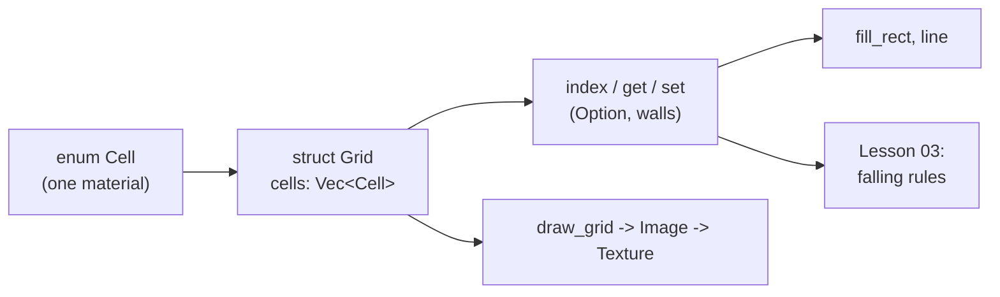
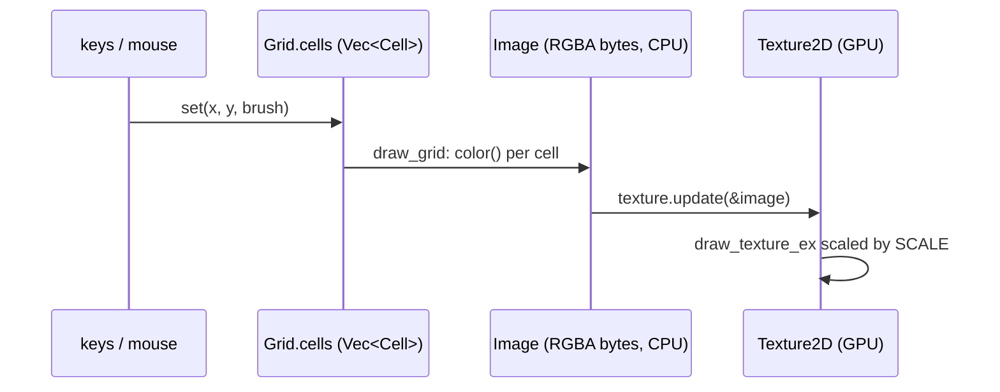

# Lesson 02: The grid (enums, structs, `Vec`, `Option`)

> Source for this lesson: commit `8da72fa`, file `sand/src/main.rs`.
> See it with `git show 8da72fa:sand/src/main.rs`.

---

## 1. What you will build

A falling-sand game is a **grid of cells**, and every cell holds **one material**. Every rule you write later ("sand falls", "fire spreads", "water flows") works by reading and writing cells in this grid. So the grid is the base layer of the whole project.

By the end of this lesson you will have:

- a `Cell` type that names each material. Some materials carry extra data, such as how long a fire has left to burn.
- methods on `Cell` that answer questions: what colour is it, what is it called, can a falling grain push into it?
- a `Grid` struct that stores $W \times H$ cells in one `Vec`.
- safe `get`/`set` helpers. Anything outside the grid counts as a stone wall.
- `fill_rect` and `line` helpers for drawing scenes.
- a macroquad window that draws the grid, with a stone floor, and lets you paint with the mouse.

Nothing moves yet. Lesson 03 adds the falling rules on top of exactly this code.



---

## 2. Concepts

### 2.1 Three facts to build on

Everything below rests on these three statements. Each one holds with no exceptions:

1. **A value of an enum is exactly one of its variants at any moment.** A `Cell` is `Sand` or `Water` or `Fire { .. }`. It is never two at once, and never "nothing" unless you declare a variant for that.
2. **Every value in Rust has exactly one owner.** Assigning or passing a value either *moves* it (the old name can no longer be used) or *copies* it (both names stay usable). Which one happens is decided by the type: the type is `Copy` or it isn't.
3. **Rust never converts between number types for you.** `usize` and `i32` are different types. Mixing them needs a cast written with `as`.

The rest of the lesson is consequences of these three facts.

### 2.2 Enums: "one of these things"

**The problem.** A cell can hold sand, water, stone, or nothing. You could store this as a number (`0 = empty, 1 = sand, ...`), but then `7` is a legal value that means nothing, and nothing stops you mixing up the codes. What you want is a type whose only legal values are the materials.

That type is an **enum**:

```rust
enum Cell {
    Empty,
    Sand,
    Water,
}

fn main() {
    let c = Cell::Sand; // the variant name is written Type::Variant
    let _ = c;
}
```

**Variants can carry data.** Fire needs to know how long it has left to burn. You could keep a separate `fire_life` array beside the grid. But that number only means something when the cell *is* fire, so it belongs inside the fire variant:

```rust
enum Cell {
    Empty,
    Fire { life: u8 }, // a "struct-like" variant with a named field
}

fn main() {
    let f = Cell::Fire { life: 70 };
    let _ = f;
}
```

Fact 1 tells you why this is safe: a `life` value exists only when the cell is `Fire`. You can't read a fire lifetime off a sand cell. The type makes that impossible.

Here is the real enum from the project (`sand/src/main.rs @ 8da72fa`):

```rust
/// What a single cell contains. `Copy` lets us pass cells around by value.
#[derive(Clone, Copy, PartialEq, Eq, Debug)]
enum Cell {
    Empty,
    Sand,
    Water,
    Stone,
    Wood,
    Gunpowder,
    // Variants can carry data. `life` counts down every step; at 0 the cell
    // turns into something else.
    Fire { life: u8 },
    Smoke { life: u8 },
}
```

`u8` is an unsigned 8-bit integer (0 to 255). That is plenty for a lifetime counted in frames, and it keeps each cell small: this enum is 2 bytes (one byte for the tag that says which variant, one for `life`).

### 2.3 `#[derive(...)]`: asking the compiler to write code for you

A new type can do almost nothing at first. You can't compare it with `==`, print it with `{:?}`, or copy it. Each of those abilities is a **trait**. `#[derive(...)]` asks the compiler to write the obvious implementation of each listed trait:

| Derive | What it gives you | Where the project needs it |
|---|---|---|
| `Clone` | `.clone()`: make a duplicate | `vec![Cell::Empty; W * H]` clones the value into every slot |
| `Copy` | assignment duplicates the value instead of moving it | `let c = self.cells[i];` reads a cell out of the Vec |
| `PartialEq`, `Eq` | `==` and `!=` | `if *cell == Cell::Empty` |
| `Debug` | `{:?}` printing | `assert_eq!` in tests prints both sides when it fails |

`Copy` requires `Clone`, which is why both appear. `Eq` says "`==` is a true equivalence", which holds for an enum with integer fields. (`f32` is only `PartialEq`, because `NaN != NaN`.)

### 2.4 Copy versus move: why `Cell` is `Copy`

Fact 2 says every value has one owner. Here is what that means for a type that is **not** `Copy`:

```rust
#[derive(Debug)]
enum Label {
    Text(String), // String owns heap memory, so it can't be Copy
}

fn main() {
    let a = Label::Text(String::from("sand"));
    let b = a; // ownership MOVES from a to b
    // println!("{:?}", a); // error[E0382]: borrow of moved value: `a`
    println!("{:?}", b);
}
```

Why have moves at all? `String` points at heap memory. If `let b = a;` copied only the pointer, `a` and `b` would both own the same memory, and both would try to free it. Rust prevents that by making `a` unusable after the move.

`Cell` owns no heap memory. It is two plain bytes, so duplicating it is cheap and harmless. Deriving `Copy` tells Rust: "assignment copies this value; the old name stays valid."

```rust
#[derive(Clone, Copy, PartialEq, Eq, Debug)]
enum Cell {
    Empty,
    Fire { life: u8 },
}

fn burn(c: Cell) -> Cell {
    // `c` is a private copy; changing it can't affect the caller
    match c {
        Cell::Fire { life } => Cell::Fire { life: life.saturating_sub(1) },
        other => other,
    }
}

fn main() {
    let a = Cell::Fire { life: 3 };
    let b = a; // a COPY: a is still usable
    println!("{:?} {:?} {:?}", a, b, burn(a));
    // Fire { life: 3 } Fire { life: 3 } Fire { life: 2 }
}
```

This is why the methods on `Cell` take `self` (by value), not `&self`. Passing a 2-byte copy costs about the same as passing a pointer, and the code reads more simply. The source comment says this directly: *"`Copy` lets us pass cells around by value."*

The most important consequence shows up in the grid. `self.cells[i]` *reads* a cell out of a `Vec`. With a non-`Copy` type you can't move an element out of a `Vec` by indexing (error E0507). With `Copy` it just copies:

```rust
fn get(&self, x: i32, y: i32) -> Cell {
    match Self::index(x, y) {
        Some(i) => self.cells[i],   // copies the Cell out; needs Copy
        None => Cell::Stone,
    }
}
```

### 2.5 `impl` blocks and `match`

**Methods** go in an `impl Type { ... }` block. A method whose first parameter is `self` is called with dot syntax: `cell.color()`.

**`match`** chooses a branch according to which variant a value is. The compiler checks that the match is **exhaustive**: every possible variant must be handled. This is the most useful property of enums. When you add a new material, the compiler lists every `match` that forgot about it.

```rust
fn color(self) -> [u8; 3] {
    match self {
        Cell::Empty => [20, 20, 28],
        Cell::Sand => [220, 190, 110],
        Cell::Water => [50, 110, 220],
        Cell::Stone => [110, 110, 115],
        Cell::Wood => [110, 70, 35],
        Cell::Gunpowder => [60, 60, 60],
        // Young fire is yellow, dying fire is deep red.
        Cell::Fire { life } => [255, 40 + life.min(70) * 3, 20],
        // Smoke fades into the background as it dies.
        Cell::Smoke { life } => {
            let v = 20 + life / 2;
            [v, v, v + 4]
        }
    }
}
```
*(`sand/src/main.rs @ 8da72fa`)*

Three details in this code:

- **`Cell::Fire { life } =>` binds the field.** Inside that arm, `life` is a `u8` variable holding the fire's lifetime. This is *destructuring*: taking a value apart as you match on it.
- **`match` is an expression.** Each arm produces a value, so the whole `match` is the return value of the function. There is no `return` and no `;` after it.
- **`life.min(70) * 3` guards against overflow.** `u8` arithmetic must stay within 0 to 255. Without the cap, `40 + 255 * 3` would be far too large. In a debug build that panics with "attempt to add with overflow"; in release it silently wraps around. Capping at 70 gives at most $40 + 70 \cdot 3 = 250$, which fits. The smoke arm is safe for the same kind of reason: $20 + 255/2 + 4 = 151$.

A match can also ignore fields with **`..`**:

```rust
fn name(self) -> &'static str {
    match self {
        Cell::Empty => "erase",
        Cell::Sand => "sand",
        // ...
        Cell::Fire { .. } => "fire", // `..` = ignore the fields
        Cell::Smoke { .. } => "smoke",
    }
}
```

`&'static str` means "a reference to text that lives for the whole program". String literals like `"sand"` are stored inside the program binary, so they live that long, and you can return them without allocating.

### 2.6 Tuple patterns, `|`, `_` and order

`is_displaceable_by` answers: "if `mover` wants to move into this cell, is it allowed?" The answer depends on **two** cells at once. Rather than nesting two `match`es, the code puts both values in a tuple and matches on the pair:

```rust
/// Can a moving particle push into this cell?
fn is_displaceable_by(self, mover: Cell) -> bool {
    match (mover, self) {
        (_, Cell::Empty) => true,
        // Powders sink through water.
        (Cell::Sand | Cell::Gunpowder, Cell::Water) => true,
        // Falling things push smoke out of the way.
        (Cell::Sand | Cell::Gunpowder | Cell::Water, Cell::Smoke { .. }) => true,
        _ => false,
    }
}
```
*(`sand/src/main.rs @ 8da72fa`)*

Read it as a table of rules:

- `_` matches anything and binds nothing. `(_, Cell::Empty)` means "any mover may enter an empty cell".
- `A | B` matches either pattern. `Cell::Sand | Cell::Gunpowder` means "a powder".
- **Arms are tried top to bottom, and the first match wins.** The final `_ => false` is the "everything else" rule, and it makes the match exhaustive. If you moved it to the top, every other arm would be unreachable, and the compiler would warn you.

So `Cell::Water.is_displaceable_by(Cell::Sand)` is `true` (sand sinks into water), and `Cell::Sand.is_displaceable_by(Cell::Water)` is `false` (water can't push sand out of the way). Lesson 03 builds density on this asymmetry.

Related: `matches!(value, pattern)` is a one-line `match` that returns `bool`. The project uses it in `paint`:

```rust
let sprinkle = matches!(
    cell,
    Cell::Sand | Cell::Water | Cell::Fire { .. } | Cell::Gunpowder
);
```

### 2.7 Structs: the world as one value

An enum means "one of these". A **struct** means "all of these together". The world state is a struct (`8da72fa`):

```rust
/// The whole simulation state.
struct Grid {
    cells: Vec<Cell>, // W * H cells, row by row, row 0 at the top
    moved: Vec<bool>, // did this cell already move this frame?
    rng: u32,         // state for our tiny random number generator
    frame: u32,
    particles: Vec<Particle>,
    pending: Vec<(i32, i32)>, // explosions to set off next step
}
```

In this lesson you only need `cells`. The other fields come in lessons 03 and 04.

A **`Vec<T>`** is a growable array stored on the heap. `vec![value; n]` builds one with `n` copies of `value`. That needs `Clone`, which `Cell` derives.

### 2.8 Row-major layout: why one `Vec`, and `index = y * W + x`

**The problem.** The world is 2-D, but memory is a 1-D line of bytes. You could use `Vec<Vec<Cell>>` (a vector of rows). But that makes `H` separate heap allocations scattered around memory, every access chases two pointers, and nothing stops two rows having different lengths.

**How you could discover the formula.** Lay the rows end to end: row 0, then row 1, then row 2. To reach cell $(x, y)$ you skip $y$ complete rows of $W$ cells each, then step $x$ more:

$$\text{index}(x, y) = y \cdot W + x$$

For a tiny $W = 4$, $H = 3$ grid:

```
          x=0  x=1  x=2  x=3
  y=0  [   0,   1,   2,   3 ]
  y=1  [   4,   5,   6,   7 ]      (1, 2) -> 2*4 + 1 = 9
  y=2  [   8,   9,  10,  11 ]
```

Going the other way: $x = i \bmod W$ and $y = \lfloor i / W \rfloor$.

This layout is called **row-major**. It is also exactly the layout an image uses: pixel $i$ starts at byte $4i$ in an RGBA image. That is why `draw_grid` can walk the cells and the image bytes together with a single index.

### 2.9 `Option`, and why `index` returns one

**The problem.** The rules constantly look at neighbours: "what is below me? down-left?" A cell on the bottom row has no "below". You need some way to say "there is no index for that position".

Many languages answer with a sentinel value such as `-1`, which you then have to remember to check. Rust has a type for it:

```rust
enum Option<T> {
    None,
    Some(T),
}
```

`Option` is an ordinary enum from the standard library, already imported for you. Fact 1 applies to it: an `Option<usize>` is *either* `None` *or* `Some(i)`. You can't use the `usize` inside until you have checked which one it is. So "forgot to check for off-grid" becomes a compile error, not a crash.

```rust
/// Convert (x, y) into an index into `cells`, or None if off the grid.
fn index(x: i32, y: i32) -> Option<usize> {
    if x < 0 || y < 0 || x >= W as i32 || y >= H as i32 {
        None
    } else {
        Some(y as usize * W + x as usize)
    }
}
```
*(`sand/src/main.rs @ 8da72fa`)*

`index` has no `self` parameter. It is an **associated function**: it belongs to `Grid` but doesn't need a grid value, because it only does arithmetic. You call it as `Grid::index(x, y)`, or as `Self::index(x, y)` inside the `impl`.

### 2.10 Two ways to unpack an `Option`: `match` and `if let`

`get` must return a cell in every case, so it handles both variants with a full `match`. Off-grid positions are reported as `Stone`:

```rust
fn get(&self, x: i32, y: i32) -> Cell {
    match Self::index(x, y) {
        Some(i) => self.cells[i],
        None => Cell::Stone, // treat the outside world as solid wall
    }
}
```

`set` only does something in the `Some` case. Writing `None => {}` would be noise, so it uses **`if let`**, which means "if this pattern matches, run the block":

```rust
fn set(&mut self, x: i32, y: i32, cell: Cell) {
    if let Some(i) = Self::index(x, y) {
        self.cells[i] = cell;
    }
}
```

Treating the outside as wall is a design choice, and an important one. Every rule in lesson 03 can look at `get(x, y + 1)` without ever checking the edges. The edge looks like stone, so sand piles up against it as if it were a real wall. A whole class of bugs disappears because one function returns a sensible default.

Notice the receivers too. `get` takes `&self` because it only reads. `set` takes `&mut self` because it writes. Lesson 03 covers `&mut self` in depth.

A third form appears in later code, **`let ... else`**. It means "unpack this or leave":

```rust
let (Some(a), Some(b)) = (Self::index(x, y), Self::index(nx, ny)) else {
    return false;
};
```

### 2.11 `usize` vs `i32`, and why the casts are everywhere

Fact 3 explains every `as` in the grid code.

- **`usize`** is the type Rust uses for indexing and lengths. It is unsigned (never negative) and as wide as a pointer: 64 bits on your Mac. `cells[i]` *requires* `i: usize`. `W` and `H` are `usize` because they are sizes.
- **`i32`** is a signed 32-bit integer. Coordinates need to go negative: `x - 1` at the left edge is $-1$, which is exactly the "off-grid" case `index` must detect. In `usize`, `0 - 1` panics in debug and wraps to $2^{64} - 1$ in release.

So the convention is:

> **Coordinates are `i32`. Indices are `usize`. Convert only inside `index`, after checking the bounds.**

Inside `index`, the bounds check comes first and uses `W as i32`. The conversion `y as usize` happens only after the code knows `y >= 0`. That order matters, because `as` never fails. It reinterprets the bits:

```rust
let x: i32 = -1;
println!("{}", x as usize); // 18446744073709551615 on a 64-bit machine
```

That is why the cast to `usize` must come *after* the `< 0` check. It is also why the floor loop in `Grid::new` reads `grid.set(x as i32, (H - 1) as i32, Cell::Stone)`: `x` comes from `0..W`, which is a `usize` range, and `set` wants `i32`.

### 2.12 Drawing: from cells to pixels

macroquad draws a `Texture2D` (an image on the GPU). The project keeps a CPU-side `Image` of exactly $W \times H$ pixels. Each frame it writes one pixel per cell, uploads the image, and draws it stretched by `SCALE`. `FilterMode::Nearest` keeps the stretched cells as crisp squares instead of a blur.

```rust
fn draw_grid(grid: &Grid, image: &mut Image) {
    for (i, cell) in grid.cells.iter().enumerate() {
        let [r, g, b] = cell.color();
        // ...
        let p = i * 4;
        image.bytes[p] = r.saturating_sub(shade);
        // ...
        image.bytes[p + 3] = 255;
    }
}
```

`.iter().enumerate()` yields pairs `(index, &Cell)`. `let [r, g, b] = ...` destructures an array, just as `match` destructures an enum. `cell.color()` works on a `&Cell` because Rust auto-dereferences method calls, and `color(self)` then copies the `Cell` out (it is `Copy`).

---

## 3. Build it yourself

Goal: a window showing a $160 \times 90$ grid with a stone floor, a small scene, and mouse painting. Starting from the lesson 01 setup:

**Step 1 — create the project.**

```bash
cargo new grid02
cd grid02
cargo add macroquad@0.4
```

Then make `Cargo.toml` match this. The profile sections make debug builds run fast, as in the real project:

```toml
[package]
name = "grid02"
version = "0.1.0"
edition = "2024"

[dependencies]
macroquad = "0.4.16"

[profile.dev]
opt-level = 1

[profile.dev.package."*"]
opt-level = 3
```

**Step 2 — constants and the `Cell` enum.** Start from the materials alone. Write the enum, `color`, `name` and `is_displaceable_by`. Compile after each method; when you forget an arm, the compiler will say so.

**Step 3 — the `Grid` struct, `new`, `index`, `get`, `set`.** Get `index` right first, because everything else uses it.

**Step 4 — helpers.** `fill_rect` loops over a rectangle and calls `set`. Because `set` ignores off-grid writes, a rectangle that hangs over the edge is simply clipped. `line` walks `steps = max(|dx|, |dy|)` points from one end to the other, using integer interpolation $x_0 + \frac{dx \cdot s}{\text{steps}}$.

**Step 5 — drawing and the main loop.**

Here is the complete `src/main.rs`. It compiles with macroquad 0.4.16 on edition 2024:

```rust
use macroquad::prelude::*;

// Grid size in cells, and how many screen pixels each cell takes up.
const W: usize = 160;
const H: usize = 90;
const SCALE: f32 = 6.0;

/// What a single cell contains.
#[derive(Clone, Copy, PartialEq, Eq, Debug)]
enum Cell {
    Empty,
    Sand,
    Water,
    Stone,
    Fire { life: u8 },
}

impl Cell {
    /// Base colour as RGB bytes.
    fn color(self) -> [u8; 3] {
        match self {
            Cell::Empty => [20, 20, 28],
            Cell::Sand => [220, 190, 110],
            Cell::Water => [50, 110, 220],
            Cell::Stone => [110, 110, 115],
            // Young fire is yellow, dying fire is deep red.
            Cell::Fire { life } => [255, 40 + life.min(70) * 3, 20],
        }
    }

    /// Short name for the on-screen label.
    fn name(self) -> &'static str {
        match self {
            Cell::Empty => "erase",
            Cell::Sand => "sand",
            Cell::Water => "water",
            Cell::Stone => "stone",
            Cell::Fire { .. } => "fire",
        }
    }

    /// Can `mover` push into this cell? (Used by the falling rules next lesson.)
    fn is_displaceable_by(self, mover: Cell) -> bool {
        match (mover, self) {
            (_, Cell::Empty) => true,
            (Cell::Sand, Cell::Water) => true,
            _ => false,
        }
    }
}

/// The whole world: W * H cells, row by row, row 0 at the top.
struct Grid {
    cells: Vec<Cell>,
}

impl Grid {
    fn new() -> Self {
        let mut grid = Grid {
            cells: vec![Cell::Empty; W * H],
        };
        // A stone floor along the bottom row.
        for x in 0..W {
            grid.set(x as i32, (H - 1) as i32, Cell::Stone);
        }
        grid
    }

    /// (x, y) -> index into `cells`, or None if off the grid.
    fn index(x: i32, y: i32) -> Option<usize> {
        if x < 0 || y < 0 || x >= W as i32 || y >= H as i32 {
            None
        } else {
            Some(y as usize * W + x as usize)
        }
    }

    /// Read a cell. Outside the grid counts as solid stone.
    fn get(&self, x: i32, y: i32) -> Cell {
        match Self::index(x, y) {
            Some(i) => self.cells[i],
            None => Cell::Stone,
        }
    }

    /// Write a cell. Writes outside the grid are silently ignored.
    fn set(&mut self, x: i32, y: i32, cell: Cell) {
        if let Some(i) = Self::index(x, y) {
            self.cells[i] = cell;
        }
    }

    /// Fill the rectangle x0..x1, y0..y1 (end excluded).
    fn fill_rect(&mut self, x0: i32, y0: i32, x1: i32, y1: i32, cell: Cell) {
        for y in y0..y1 {
            for x in x0..x1 {
                self.set(x, y, cell);
            }
        }
    }

    /// A straight line from (x0, y0) to (x1, y1), both ends included.
    fn line(&mut self, x0: i32, y0: i32, x1: i32, y1: i32, cell: Cell) {
        let (dx, dy) = (x1 - x0, y1 - y0);
        let steps = dx.abs().max(dy.abs()).max(1);
        for s in 0..=steps {
            self.set(x0 + dx * s / steps, y0 + dy * s / steps, cell);
        }
    }

    /// How many cells hold exactly `cell`?
    fn count(&self, cell: Cell) -> usize {
        self.cells.iter().filter(|c| **c == cell).count()
    }
}

/// Copy every cell's colour into the image's RGBA bytes.
fn draw_grid(grid: &Grid, image: &mut Image) {
    for (i, cell) in grid.cells.iter().enumerate() {
        let [r, g, b] = cell.color();
        let p = i * 4;
        image.bytes[p] = r;
        image.bytes[p + 1] = g;
        image.bytes[p + 2] = b;
        image.bytes[p + 3] = 255;
    }
}

fn window_conf() -> Conf {
    Conf {
        window_title: "grid".to_owned(),
        window_width: (W as f32 * SCALE) as i32,
        window_height: (H as f32 * SCALE) as i32,
        window_resizable: false,
        ..Default::default()
    }
}

#[macroquad::main(window_conf)]
async fn main() {
    let mut grid = Grid::new();
    // A little scene so there is something to look at.
    grid.fill_rect(20, 60, 50, 89, Cell::Water);
    grid.line(60, 40, 120, 70, Cell::Stone);
    grid.fill_rect(80, 10, 100, 25, Cell::Sand);
    grid.set(130, 50, Cell::Fire { life: 70 });
    grid.set(132, 50, Cell::Fire { life: 0 });

    let mut brush = Cell::Sand;
    let mut image = Image::gen_image_color(W as u16, H as u16, BLACK);
    let texture = Texture2D::from_image(&image);
    texture.set_filter(FilterMode::Nearest);

    loop {
        if is_key_pressed(KeyCode::Key1) {
            brush = Cell::Sand;
        }
        if is_key_pressed(KeyCode::Key2) {
            brush = Cell::Water;
        }
        if is_key_pressed(KeyCode::Key3) {
            brush = Cell::Stone;
        }
        if is_key_pressed(KeyCode::Key4) {
            brush = Cell::Empty;
        }
        if is_mouse_button_down(MouseButton::Left) {
            let (mx, my) = mouse_position();
            grid.set((mx / SCALE) as i32, (my / SCALE) as i32, brush);
        }

        draw_grid(&grid, &mut image);
        texture.update(&image);
        draw_texture_ex(
            &texture,
            0.0,
            0.0,
            WHITE,
            DrawTextureParams {
                dest_size: Some(vec2(W as f32 * SCALE, H as f32 * SCALE)),
                ..Default::default()
            },
        );
        draw_text(
            &format!(
                "1 sand 2 water 3 stone 4 erase | brush: {} | sand cells: {}",
                brush.name(),
                grid.count(Cell::Sand)
            ),
            10.0,
            24.0,
            24.0,
            WHITE,
        );
        next_frame().await;
    }
}

#[cfg(test)]
mod tests {
    use super::*;

    #[test]
    fn floor_and_walls() {
        let grid = Grid::new();
        assert_eq!(grid.get(0, H as i32 - 1), Cell::Stone);
        assert_eq!(grid.get(5, 5), Cell::Empty);
        assert_eq!(grid.get(-1, 5), Cell::Stone);
        assert_eq!(Grid::index(3, 2), Some(2 * W + 3));
        assert_eq!(Grid::index(W as i32, 0), None);
        assert!(Cell::Empty.is_displaceable_by(Cell::Sand));
        assert!(!Cell::Stone.is_displaceable_by(Cell::Sand));
    }
}
```

Run it:

```bash
cargo run      # opens the window
cargo test     # runs floor_and_walls without a window
```

`cargo run` prints two warnings: `method 'is_displaceable_by' is never used` and `method 'get' is never used`. That is expected and harmless. The test uses both, but the normal build doesn't yet. Lesson 03's falling rules call both. The two fire cells show the colour formula: `life: 70` is yellow, `life: 0` is red.

How the pieces fit each frame:



---

## 4. Live examples

**4.1 Run the original game at this commit** (without disturbing the working tree):

```bash
cd /Users/anujbarve/Documents/rusty
git worktree add /tmp/sand-8da72fa 8da72fa
cd /tmp/sand-8da72fa/sand && cargo run
# afterwards: git worktree remove /tmp/sand-8da72fa
```

Look at the stone floor (`Grid::new`) and the ledge drawn by `for x in 80..160 { grid.set(x, 120, Cell::Stone); }`.

**4.2 Experiments with your `grid02`:**

- Change `W`, `H` and `SCALE`. The window size follows automatically, because `window_conf` derives it from these constants.
- In `index`, replace `y as usize * W + x as usize` with `x as usize * H + y as usize` (column-major). Painting still lands in the right place, because `set` and `index` agree, but the picture comes out scrambled: `draw_grid` assumes row-major, as images do. That one experiment shows why the layout has to match the image.
- Remove the `None => Cell::Stone` arm from `get`. Read the "non-exhaustive patterns" error, then put it back.
- Change `life.min(70) * 3` to `life * 3` and paint `Cell::Fire { life: 200 }` with `grid.set`. A debug build panics: `attempt to multiply with overflow`.

**4.3 A standalone playground for Copy versus move** (`cargo new copy_play`, then paste into `src/main.rs`):

```rust
#[derive(Clone, Copy, PartialEq, Eq, Debug)]
enum Cell {
    Empty,
    Sand,
    Fire { life: u8 },
}

fn main() {
    let cells = vec![Cell::Empty; 4]; // needs Clone
    let first = cells[0];             // needs Copy
    println!("{first:?} of {}", cells.len());

    let b = Cell::Fire { life: 3 };
    if let Cell::Fire { life } = b {
        println!("fire with life {life}");
    }
    println!("{}", matches!(b, Cell::Fire { .. } | Cell::Sand)); // true

    let x: i32 = -1;
    println!("{}", x as usize); // 18446744073709551615
}
```

Now delete `Copy` from the derive and read the error on `let first = cells[0];`.

---

## 5. Exercises

1. **(Easy) Add `Wood`.** Add a `Wood` variant (colour `[110, 70, 35]`, name `"wood"`) and bind it to key `5`. Hint: add the variant first, then let the compiler's E0004 errors point you to every `match` that needs an arm.
2. **(Easy) `in_bounds`.** Write `fn in_bounds(x: i32, y: i32) -> bool` in one line, reusing `index`. Hint: `Option` has an `is_some()` method.
3. **(Medium) Smoke with a fading colour.** Add `Smoke { life: u8 }` whose colour is grey $v = 20 + \text{life}/2$, as `[v, v, v + 4]`. Prove that no `u8` overflow is possible for any `life`. Hint: the largest `life` is 255.
4. **(Medium) `coords` and `replace_all`.** Write the inverse of `index`, `fn coords(i: usize) -> (i32, i32)`. Then write `fn replace_all(&mut self, from: Cell, to: Cell) -> usize`, which returns how many cells it changed. Hint: `iter_mut()` gives `&mut Cell`; write through it with `*c = to`.
5. **(Medium) `swap` with `let ... else`.** Write `fn swap(&mut self, x0: i32, y0: i32, x1: i32, y1: i32) -> bool` that swaps two cells and returns `false` (changing nothing) if either position is off the grid. Hint: `Vec` has `.swap(a, b)`, and you can match a tuple of two `Option`s.
6. **(Stretch) Round brush and `is_solid`.** Write `fill_circle(cx, cy, r, cell)` and use it for mouse painting with radius 3. Also add `fn is_solid(self) -> bool` (true for `Stone` and `Wood`) using `matches!`. Hint: a point is inside the circle when $dx^2 + dy^2 \le r^2$. Loop `dx` and `dy` over `-r..=r`.

---

## 6. Common mistakes and compiler errors

**E0004: non-exhaustive patterns**

```
error[E0004]: non-exhaustive patterns: `Cell::Wood` not covered
```

You added a variant and a `match` doesn't handle it. This error is helping you: fix every place it lists. Don't silence it with `_ => ...` in `color` or `name`, or the next new material will quietly get the wrong colour.

**E0382: use of moved value / E0507: cannot move out of index**

```
error[E0507]: cannot move out of index of `Vec<Cell>`
```

You removed `Copy` (or never added it), so `self.cells[i]` would *move* the cell out of the vector. Derive `Copy, Clone` for small, heap-free types like `Cell`.

**E0369: binary operation `==` cannot be applied to type `Cell`**

You forgot `PartialEq`. Derive it.

**E0277: `Cell` doesn't implement `Debug`**

`assert_eq!` and `{:?}` need `Debug`. Derive it.

**E0308: mismatched types, expected `usize`, found `i32`** (or `the type [Cell] cannot be indexed by i32`, E0277)

You indexed `cells[x]` with an `i32`, or passed `W` where an `i32` is expected. Follow the convention: coordinates `i32`, indices `usize`, convert inside `index` only.

**Runtime panic: `index out of bounds: the len is 14400 but the index is 14400`**

You indexed `self.cells[...]` directly with an unchecked computed index (for example `y * W + x` with `x == W`, which wraps onto the next row or past the end). Go through `get`/`set`. Note also that `x == W` on a middle row does *not* panic: it silently lands on the first cell of the next row. The explicit `x >= W` check in `index` is what stops that.

**Runtime panic: `attempt to subtract with overflow`**

This is usually `usize` arithmetic going below zero (`x - 1` with `x: usize`), or `u8` arithmetic leaving 0 to 255. Use `i32` for coordinates, and `min` or `saturating_sub` for small counters.

**Unreachable pattern warning**

`_ => false` placed above other arms. Arms are tried top to bottom; keep the catch-all last.

---

## 7. Recap and next lesson

- An **enum** is "exactly one of these variants". Variants can carry data (`Fire { life: u8 }`), and `match` must handle every variant.
- **Patterns** destructure values: `Fire { life }` binds, `..` ignores fields, `|` means "or", `_` means "anything", and tuples let you match two values at once. The first matching arm wins.
- **`#[derive(Clone, Copy, PartialEq, Eq, Debug)]`** gives `Cell` duplication, copy-on-assign, `==`, and printing. Because `Cell` is `Copy`, cells are passed by value and read straight out of the `Vec`.
- A **struct** groups the world state. One `Vec<Cell>` in **row-major** order, $i = yW + x$, matches the image layout.
- **`Option<usize>`** makes "off the grid" a value you are forced to handle. `get` treats it as a stone wall, so later rules need no edge checks. `set` ignores it via `if let`.
- **Coordinates are `i32`, indices are `usize`**, and `as` casts happen only after the bounds check, because `as` never fails.

**Next, lesson 03 — Falling-sand rules.** You will add `step`, `try_move` (built on `get`, `is_displaceable_by` and `Vec::swap`), the bottom-to-top scan, a `moved` buffer, and a tiny xorshift random number generator. Along the way you'll see why those methods take `&mut self`. The grid you built here starts to move.

---

## Solutions

<details><summary>Solution 1: Wood</summary>

```rust
enum Cell {
    Empty,
    Sand,
    Water,
    Stone,
    Wood, // new
    Fire { life: u8 },
}

// in color():
Cell::Wood => [110, 70, 35],
// in name():
Cell::Wood => "wood",
// is_displaceable_by needs no change: its `_ => false` already covers Wood
// (wood is never displaced), which is correct here.

// in the main loop:
if is_key_pressed(KeyCode::Key5) {
    brush = Cell::Wood;
}
```

The compiler flagged `color` and `name` but not `is_displaceable_by`. The catch-all `_` swallowed `Wood` there. That is fine for a "default false" rule, but it shows why catch-alls should be avoided in matches where every material needs its own answer.
</details>

<details><summary>Solution 2: in_bounds</summary>

```rust
fn in_bounds(x: i32, y: i32) -> bool {
    Self::index(x, y).is_some()
}
```

One source of truth for the bounds: if `index` changes, `in_bounds` stays correct.
</details>

<details><summary>Solution 3: Smoke</summary>

```rust
Smoke { life: u8 },

// color():
Cell::Smoke { life } => {
    let v = 20 + life / 2;
    [v, v, v + 4]
}
// name():
Cell::Smoke { .. } => "smoke",
```

Worst case `life = 255`: `life / 2 = 127` (integer division), `v = 147`, `v + 4 = 151`. Everything is at most 255, so there is no overflow. `Cell::Smoke { life: 255 }.color()` returns `[147, 147, 151]`.
</details>

<details><summary>Solution 4: coords and replace_all</summary>

```rust
fn coords(i: usize) -> (i32, i32) {
    ((i % W) as i32, (i / W) as i32)
}

fn replace_all(&mut self, from: Cell, to: Cell) -> usize {
    let mut n = 0;
    for c in self.cells.iter_mut() {
        if *c == from {
            *c = to;
            n += 1;
        }
    }
    n
}
```

Check: `Grid::coords(2 * W + 3) == (3, 2)`, the inverse of `index(3, 2)`. In the loop, `c` is a `&mut Cell`; `*c` is the cell itself, so `*c == from` compares and `*c = to` writes. Try `grid.replace_all(Cell::Water, Cell::Sand)` on a key press.
</details>

<details><summary>Solution 5: swap</summary>

```rust
fn swap(&mut self, x0: i32, y0: i32, x1: i32, y1: i32) -> bool {
    let (Some(a), Some(b)) = (Self::index(x0, y0), Self::index(x1, y1)) else {
        return false;
    };
    self.cells.swap(a, b);
    true
}
```

The pattern `(Some(a), Some(b))` matches only if *both* are `Some`; anything else takes the `else` branch, which must leave the function (`return`). The real project's `try_move` uses exactly this shape.
</details>

<details><summary>Solution 6: round brush and is_solid</summary>

```rust
impl Cell {
    fn is_solid(self) -> bool {
        matches!(self, Cell::Stone | Cell::Wood)
    }
}

impl Grid {
    fn fill_circle(&mut self, cx: i32, cy: i32, r: i32, cell: Cell) {
        for dy in -r..=r {
            for dx in -r..=r {
                if dx * dx + dy * dy <= r * r {
                    self.set(cx + dx, cy + dy, cell);
                }
            }
        }
    }
}

// in the main loop, replacing the single-cell set:
if is_mouse_button_down(MouseButton::Left) {
    let (mx, my) = mouse_position();
    grid.fill_circle((mx / SCALE) as i32, (my / SCALE) as i32, 3, brush);
}
```

`-r..=r` is an inclusive range, so the circle is symmetric. Painting near the edge is safe because `set` drops off-grid writes. The real `paint` in `8da72fa` uses the same circle test (`dx * dx + dy * dy > BRUSH * BRUSH` → skip).
</details>
