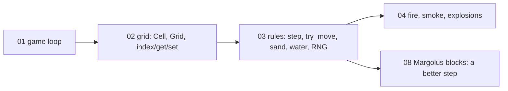
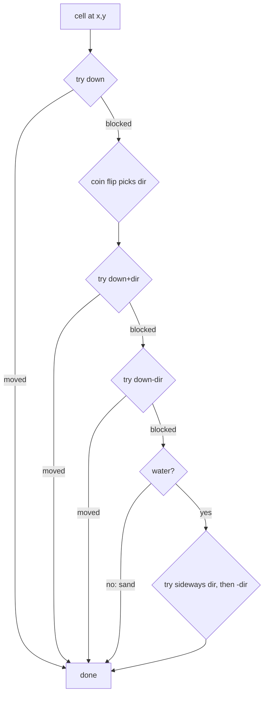

# Lesson 03 — Falling-sand rules: methods, `&mut self`, RNG

> Source for this lesson: commit `8da72fa`, file `sand/src/main.rs`.
> View it any time with `git show 8da72fa:sand/src/main.rs`.

---

## 1. What you will build

In lesson 02 you built the **world**: a `Cell` enum, a `Grid` struct holding a `Vec<Cell>`, and `index` / `get` / `set` so you can read and write cells by `(x, y)`. That grid just sits there. Nothing moves.

This lesson makes the world **behave**. When you finish you will have:

- **Sand** that falls and builds pyramid-shaped piles.
- **Water** that falls, spreads sideways and ends up with a flat surface.
- Sand that **sinks through water**.

All of it comes from about 80 lines: one `step` function that visits every cell, one `try_move` helper, two tiny rule functions (`update_sand`, `update_water`), and a 6-line random number generator.

Where this sits in the project:



Every later material (fire, smoke, lava, acid) plugs into the `step` loop you write here. The GPU engine in lessons 06–14 replaces this loop with a different design, and the reason is a flaw that you will see in this one.

---

## 2. Concepts

### 2.1 The idea: a cellular automaton

A **cellular automaton** is a grid of cells where every cell follows the same small set of local rules, and the rules only look at nearby cells. That is the whole definition. No cell knows about piles or water levels. Each cell only asks: "is the cell below me free?"

Sand gets two rules:

1. If the cell below is empty, move down.
2. Otherwise, if down-left or down-right is empty, move there.

Water gets those two, plus one more:

3. Otherwise, if left or right is empty, move there.

What rule 2 does over time: a grain that lands on a pile can only slide one cell sideways for each cell it falls. So the slope of a pile can never be steeper than 1 cell across per 1 cell down, which is 45°. Nobody wrote "make 45° pyramids". The piles come out of the rules. This is called **emergent behaviour**.

Rule 3 makes water level out. A water cell on a surface that has a "step" in it can keep moving sideways until it finds a hole to fall into. So the bumps fill in and the surface goes flat.

Here is the real output of the text-mode program from §4.1: 40 grains of sand poured at column 6, 40 grains of water poured at column 18.

```
|      #                 |
|     ###                |
|    ##### ~    ~  ~  ~  |
|   ########~~~~~~~~~~~~~|
|  ##########~~~~~~~~~~~~|
|#############~~~~~~~~~~~|
|========================|
```

The sand made a 45° pyramid. The water spread across the floor and is filling the space up one row at a time. The few `~` on the top row are still moving.

One important detail: we update cells **in place, one at a time**. When cell A moves, cell B (visited later in the same frame) already sees A's new position. A "textbook" automaton such as Conway's Game of Life computes every new cell from a frozen copy of the old grid. Updating in place is simpler and uses less memory. But it means **the order you visit cells changes the result**. Most of `step` exists to deal with that.

---

### 2.2 `impl` blocks: methods and associated functions

**Unconditional truth:** in Rust, a function written inside `impl SomeType { … }` belongs to that type. If its first parameter is some form of `self`, it is a **method** and you call it with a dot: `value.method()`. If it has no `self` parameter, it is an **associated function** and you call it with the type's name: `Type::function()`.

Tiny example:

```rust
struct Counter {
    n: u32,
}

impl Counter {
    // Associated function: no `self`. Usually used as a constructor.
    fn new() -> Self {
        Counter { n: 0 }
    }

    // Method that only reads.
    fn get(&self) -> u32 {
        self.n
    }

    // Method that changes the struct.
    fn bump(&mut self) {
        self.n += 1;
    }
}

fn main() {
    let mut c = Counter::new(); // Type::function()
    c.bump();                   // value.method()
    c.bump();
    println!("{}", c.get());    // 2
}
```

Inside an `impl`, `Self` is just another name for the type (`Counter` here). A method call `c.bump()` is shorthand for `Counter::bump(&mut c)`. Rust takes the reference for you.

In the project, `index` is an associated function. Converting `(x, y)` to a position in the `Vec` only needs the constants `W` and `H`, not any particular grid, so it takes no `self`:

```rust
// sand/src/main.rs @ 8da72fa
fn index(x: i32, y: i32) -> Option<usize> {
    if x < 0 || y < 0 || x >= W as i32 || y >= H as i32 {
        None
    } else {
        Some(y as usize * W + x as usize)
    }
}

fn get(&self, x: i32, y: i32) -> Cell {
    match Self::index(x, y) {      // associated fn: called through `Self::`
        Some(i) => self.cells[i],
        None => Cell::Stone, // treat the outside world as solid wall
    }
}
```

`get` is a method: it needs `self.cells`. Look at the `None => Cell::Stone` line. Off-grid positions read as stone, so every rule treats the edge of the world as a wall. You never have to write a bounds check inside a rule.

The drawing code, which sits outside the `impl`, calls the same function as `Grid::index(x, y)`. Inside the `impl`, `Self::index` and `Grid::index` mean exactly the same thing.

---

### 2.3 `&self` vs `&mut self`

**Unconditional truth:** `&self` borrows the struct **read-only**, and `&mut self` borrows it **with permission to change it**. Rust lets many `&` borrows exist at the same time, but only one `&mut` borrow, and no other borrows while that `&mut` exists. The type of the `self` parameter tells the caller what the method is allowed to do.

So the choice is not about style. **If the method changes any field, it must take `&mut self`**, and the compiler checks this.

Here are the methods from the project, sorted by what they need:

| Method | Signature | Why |
|---|---|---|
| `index` | `fn index(x, y)` | uses no grid data at all |
| `get` | `&self` | only reads `cells` |
| `set` | `&mut self` | writes `cells` |
| `random` | `&mut self` | **writes `rng`**, even though it looks like a "getter" |
| `try_move`, `step`, `update_*` | `&mut self` | swap cells, set `moved` flags, call `random` |

The surprising one is `random()`. It returns a number, so it looks like it only reads. But every call has to move the generator's state forward, otherwise it would return the same number forever. Changing state means `&mut self`. One result: any method that wants a random number must also take `&mut self`. That is why `coin_flip` and every `update_*` method take `&mut self`.

There is a knock-on effect for the caller. You can only call `&mut self` methods on a variable declared `let mut`:

```rust
let grid = Grid::new();
grid.step();          // error[E0596]: cannot borrow `grid` as mutable
let mut grid = Grid::new();
grid.step();          // fine
```

---

### 2.4 Early `return` and `let … else`

**Unconditional truth:** `return` leaves the function immediately, and the code after it does not run. A function whose last expression has no `;` returns that value without needing the keyword.

The rule functions are a list of "try this. If it worked, we're done." Early `return` is the natural way to write that:

```rust
// sand/src/main.rs @ 8da72fa
fn update_sand(&mut self, x: i32, y: i32) {
    if self.try_move(x, y, 0, 1) {
        return; // fell straight down
    }
    // Blocked: slide down-left or down-right (random order).
    let dir = if self.coin_flip() { 1 } else { -1 };
    if !self.try_move(x, y, dir, 1) {
        self.try_move(x, y, -dir, 1);
    }
}
```

Notice that `if … { 1 } else { -1 }` is an **expression** with a value, so it can sit on the right-hand side of `let`. Rust has no `? :` ternary operator because `if` already does that job.

`let … else` is a newer tool for the same pattern. It means "match this pattern. If it doesn't match, run the `else` block, **which must leave**" (with `return`, `continue`, `break` or a panic).

Standalone:

```rust
fn first_even(v: &[i32]) -> i32 {
    let Some(x) = v.iter().find(|n| *n % 2 == 0) else {
        return -1; // the else branch must diverge
    };
    *x // here `x` is a plain value: the Some was unwrapped
}
```

Without it you would write a `match` with one arm that does the work and one arm that returns. `let … else` keeps the normal path flat and un-indented. The project uses it in `try_move` to unwrap **two** `Option`s at once by matching a tuple:

```rust
let (Some(a), Some(b)) = (Self::index(x, y), Self::index(nx, ny)) else {
    return false;
};
```

---

### 2.5 `try_move` and `Vec::swap`

Every movement in the game goes through one function:

```rust
// sand/src/main.rs @ 8da72fa
/// Try to move the cell at (x, y) to (x + dx, y + dy). Returns true on success.
fn try_move(&mut self, x: i32, y: i32, dx: i32, dy: i32) -> bool {
    let (nx, ny) = (x + dx, y + dy);
    let mover = self.get(x, y);
    let target = self.get(nx, ny);
    if !target.is_displaceable_by(mover) {
        return false;
    }
    // Both indices are valid: get() returned a non-wall cell for the target.
    let (Some(a), Some(b)) = (Self::index(x, y), Self::index(nx, ny)) else {
        return false;
    };
    self.cells.swap(a, b);
    self.moved[b] = true;
    true
}
```

Four ideas in it:

1. **Moving is swapping.** `self.cells.swap(a, b)` swaps the two elements in place (it's the slice method `<[T]>::swap`, and it panics if an index is out of range). If the target was `Empty`, the grain moves and an empty cell takes its old place. If the target was `Water` and the mover was `Sand`, the sand goes down and the water goes **up**. That one line is how sand sinks through water. No cell is ever created or destroyed, so the amount of every material stays the same.
2. **Who may push whom** is decided by a separate rule on `Cell` (`is_displaceable_by`), so movement code and material rules stay apart. In the full file it also lets falling things push smoke. In this lesson only these two cases matter:
   ```rust
   (_, Cell::Empty) => true,
   (Cell::Sand | Cell::Gunpowder, Cell::Water) => true,
   ```
3. **The `else` branch never actually runs.** Off-grid targets read as `Stone`, and `Stone` can't be pushed into, so we already returned `false`. The `let … else` is there because the compiler can't know that, and it's safer than `.unwrap()`.
4. **It returns `bool`**, so callers can chain attempts: `try_move(a) || try_move(b)`. `||` **short-circuits**: if the left side is `true`, the right side is not evaluated, so the second move is not attempted. `update_water` relies on this.

---

### 2.6 `step`: scan order and the `moved` flags

```rust
// sand/src/main.rs @ 8da72fa  (fire/explosion lines removed for this lesson)
fn step(&mut self) {
    self.frame = self.frame.wrapping_add(1);
    self.moved.fill(false);

    // Bottom to top, so a falling grain is not processed twice.
    // Flip the left/right scan direction every frame to avoid a bias.
    let left_to_right = self.frame % 2 == 0;
    for y in (0..H as i32).rev() {
        for i in 0..W as i32 {
            let x = if left_to_right { i } else { W as i32 - 1 - i };
            let idx = y as usize * W + x as usize;
            if self.moved[idx] {
                continue;
            }
            match self.cells[idx] {
                Cell::Sand | Cell::Gunpowder => self.update_sand(x, y),
                Cell::Water => self.update_water(x, y),
                // ... fire and smoke arms ...
                Cell::Empty | Cell::Stone | Cell::Wood => {}
            }
        }
    }
}
```

Each of the three tricks is there because, without it, something would go wrong. Let's look at each problem.

**Problem 1: a grain falling many cells in one frame.** Suppose we scanned top to bottom. A grain at row 5 moves to row 6. A moment later the scan reaches row 6, finds the grain again, and moves it to row 7, and so on. The grain falls the whole screen in one frame. Fix: scan **bottom to top**, `(0..H).rev()`. Then when a grain moves down, it lands in a row we have **already visited**, so it won't be processed again.

**Problem 2: sideways and upward moves.** Going bottom-up only protects downward moves. Water moving sideways **in the direction of the scan** lands on a cell we haven't reached yet in this row. Smoke moving up (lesson 04) lands in a row we haven't reached yet. Either one would get processed again. Fix: `try_move` sets `moved[b] = true` on the destination, and `step` skips any cell already marked. `moved.fill(false)` clears the marks at the start of each frame.

Each cell has its own bool in a parallel `Vec<bool>`, indexed the same way as `cells`. That is cheaper than storing a flag inside every `Cell`.

**Problem 3: a lean to one side.** When two grains compete for the same empty cell (for example two water cells on either side of one gap), the one visited first wins. If we always scanned left to right, the left grain would always win, and over thousands of frames you'd see water and sand piles drift that way. Fix: switch direction every frame. `x = W - 1 - i` reverses the column order on odd frames. The coin flip inside the rules (which diagonal to try first) removes the same kind of bias at the level of a single grain.



The water rule, quoted directly:

```rust
// sand/src/main.rs @ 8da72fa
fn update_water(&mut self, x: i32, y: i32) {
    if self.try_move(x, y, 0, 1) {
        return;
    }
    let dir = if self.coin_flip() { 1 } else { -1 };
    if self.try_move(x, y, dir, 1) || self.try_move(x, y, -dir, 1) {
        return;
    }
    // Can't fall at all: flow sideways. This is what makes water level out.
    if !self.try_move(x, y, dir, 0) {
        self.try_move(x, y, -dir, 0);
    }
}
```

It is the sand rule plus one more fallback. That one difference is the whole difference between a pile and a pool.

---

### 2.7 Bit operators and the xorshift RNG

We need random numbers (coin flips) thousands of times per frame. The project doesn't use a crate. It has its own **xorshift** generator:

```rust
// sand/src/main.rs @ 8da72fa
/// xorshift: a fast, simple pseudo-random generator.
fn random(&mut self) -> u32 {
    let mut x = self.rng;
    x ^= x << 13;
    x ^= x >> 17;
    x ^= x << 5;
    self.rng = x;
    x
}

fn coin_flip(&mut self) -> bool {
    self.random() & 1 == 0
}
```

The operators, on unsigned integers:

| Op | Meaning | Example on 8 bits |
|---|---|---|
| `a << n` | shift bits left by `n`, fill with 0, **bits pushed off the top are thrown away** | `0b1100_0001 << 1 = 0b1000_0010` |
| `a >> n` | shift bits right by `n`, fill with 0 (for unsigned) | `0b1100_0001 >> 1 = 0b0110_0000` |
| `a ^ b` | XOR: bit is 1 where `a` and `b` differ | `0b1100 ^ 0b1010 = 0b0110` |
| `a & b` | AND: bit is 1 where both are 1 | `x & 1` = lowest bit of `x` |
| `x ^= y` | shorthand for `x = x ^ y` | |

Shifting left by `n` is the same as multiplying by $2^n$ and keeping only the low 32 bits. Shifting right by `n` is dividing by $2^n$ and rounding down. Throwing away the bits that fall off is **not** an overflow error in Rust. A shift only panics (in debug builds) if the shift **amount** is 32 or more for a `u32`.

Why this produces numbers that look random: each line mixes high bits into low bits or the reverse. After three rounds, every output bit depends on many input bits. Marsaglia (2003) chose the triple $(13, 17, 5)$ so that, starting from any **non-zero** state, the generator visits all $2^{32}-1$ non-zero values before it repeats. Zero is the one bad seed: $0 \ll 13 = 0$, $0 \oplus 0 = 0$, so it stays at zero forever. That's why the seed is a fixed non-zero constant, `0x9E37_79B9`. (The `_` is only a visual separator in a number literal.)

`coin_flip` takes the lowest bit with `& 1`. Watch out for **operator precedence**: in Rust `&` binds more tightly than `==`, so `self.random() & 1 == 0` means `(self.random() & 1) == 0`. C is the other way round, so if you've written C, don't carry that habit over. Adding the parentheses is never wrong.

**Why the RNG lives inside `Grid`** (the field `rng: u32`) and not in a global or a crate:

- Rules call it from inside `&mut self` methods, and it needs `&mut` access to its state. Keeping it in `self` means it travels with the borrow you already have. A global mutable variable would need `unsafe` or a lock.
- **Determinism.** Same seed, same inputs, same frames. A test (lesson 05) or the CPU-vs-GPU comparison (lesson 11) can replay exactly the same world. The later engine leans on this heavily.
- Each `Grid` gets its own stream, so two grids in one test don't disturb each other.
- No dependency, and it's very fast (three shifts and three XORs).

---

### 2.8 Wrapping arithmetic

```rust
self.frame = self.frame.wrapping_add(1);
```

`frame` is a `u32` that goes up every frame. At 60 fps it reaches $2^{32}$ after about 2.3 years, but the principle matters. In a **debug** build, plain `+` panics on overflow (`attempt to add with overflow`). In a **release** build it silently wraps. `wrapping_add` says "wrap around to 0, on purpose, in every build". We only ever use `frame % 2`, and wrapping doesn't hurt that. There are also `checked_add` (gives `Option`), `saturating_add` (stops at the maximum, used in the drawing code as `saturating_sub`) and `overflowing_add` (gives the value plus a flag saying whether it wrapped).

---

## 3. Build it yourself

Start from your lesson-02 state, or from a fresh `cargo new mysand`. The result is a full, compiling program with only four materials. (It was compile-checked against macroquad 0.4.16 with edition 2024.)

**Step 1 — `Cargo.toml`:**

```toml
[package]
name = "mysand"
version = "0.1.0"
edition = "2024"

[dependencies]
macroquad = "0.4.16"

[profile.dev]
opt-level = 1

[profile.dev.package."*"]
opt-level = 3
```

**Step 2 — materials and the push rule.** Add `is_displaceable_by` to `Cell`. Read it as "can `mover` enter a cell that holds `self`?"

**Step 3 — add `moved`, `rng`, `frame` to `Grid`.** Then write, in this order: `random`, `coin_flip`, `try_move`, `update_sand`, `step`. **Run it now** with only sand. You should see 45° piles.

**Step 4 — add `update_water`** and its arm in `step`'s `match`. Pour water and watch it level.

Complete `src/main.rs`:

```rust
// Lesson 03: sand that piles, water that levels out.
use macroquad::prelude::*;

const W: usize = 320;
const H: usize = 180;
const SCALE: f32 = 4.0;
const BRUSH: i32 = 3;

#[derive(Clone, Copy, PartialEq, Eq, Debug)]
enum Cell {
    Empty,
    Sand,
    Water,
    Stone,
}

impl Cell {
    fn color(self) -> [u8; 3] {
        match self {
            Cell::Empty => [20, 20, 28],
            Cell::Sand => [220, 190, 110],
            Cell::Water => [50, 110, 220],
            Cell::Stone => [110, 110, 115],
        }
    }

    /// Can `mover` push into a cell that currently holds `self`?
    fn is_displaceable_by(self, mover: Cell) -> bool {
        match (mover, self) {
            (_, Cell::Empty) => true,
            (Cell::Sand, Cell::Water) => true, // sand sinks through water
            _ => false,
        }
    }
}

struct Grid {
    cells: Vec<Cell>,
    moved: Vec<bool>,
    rng: u32,
    frame: u32,
}

impl Grid {
    fn new() -> Self {
        let mut grid = Grid {
            cells: vec![Cell::Empty; W * H],
            moved: vec![false; W * H],
            rng: 0x9E37_79B9,
            frame: 0,
        };
        for x in 0..W as i32 {
            grid.set(x, H as i32 - 1, Cell::Stone);
        }
        for x in 40..120 {
            grid.set(x, 60, Cell::Stone);
        }
        grid
    }

    fn index(x: i32, y: i32) -> Option<usize> {
        if x < 0 || y < 0 || x >= W as i32 || y >= H as i32 {
            None
        } else {
            Some(y as usize * W + x as usize)
        }
    }

    fn get(&self, x: i32, y: i32) -> Cell {
        match Self::index(x, y) {
            Some(i) => self.cells[i],
            None => Cell::Stone,
        }
    }

    fn set(&mut self, x: i32, y: i32, cell: Cell) {
        if let Some(i) = Self::index(x, y) {
            self.cells[i] = cell;
        }
    }

    fn random(&mut self) -> u32 {
        let mut x = self.rng;
        x ^= x << 13;
        x ^= x >> 17;
        x ^= x << 5;
        self.rng = x;
        x
    }

    fn coin_flip(&mut self) -> bool {
        self.random() & 1 == 0
    }

    fn try_move(&mut self, x: i32, y: i32, dx: i32, dy: i32) -> bool {
        let (nx, ny) = (x + dx, y + dy);
        let mover = self.get(x, y);
        let target = self.get(nx, ny);
        if !target.is_displaceable_by(mover) {
            return false;
        }
        let (Some(a), Some(b)) = (Self::index(x, y), Self::index(nx, ny)) else {
            return false;
        };
        self.cells.swap(a, b);
        self.moved[b] = true;
        true
    }

    fn step(&mut self) {
        self.frame = self.frame.wrapping_add(1);
        self.moved.fill(false);

        let left_to_right = self.frame % 2 == 0;
        for y in (0..H as i32).rev() {
            for i in 0..W as i32 {
                let x = if left_to_right { i } else { W as i32 - 1 - i };
                let idx = y as usize * W + x as usize;
                if self.moved[idx] {
                    continue;
                }
                match self.cells[idx] {
                    Cell::Sand => self.update_sand(x, y),
                    Cell::Water => self.update_water(x, y),
                    Cell::Empty | Cell::Stone => {}
                }
            }
        }
    }

    fn update_sand(&mut self, x: i32, y: i32) {
        if self.try_move(x, y, 0, 1) {
            return;
        }
        let dir = if self.coin_flip() { 1 } else { -1 };
        if !self.try_move(x, y, dir, 1) {
            self.try_move(x, y, -dir, 1);
        }
    }

    fn update_water(&mut self, x: i32, y: i32) {
        if self.try_move(x, y, 0, 1) {
            return;
        }
        let dir = if self.coin_flip() { 1 } else { -1 };
        if self.try_move(x, y, dir, 1) || self.try_move(x, y, -dir, 1) {
            return;
        }
        if !self.try_move(x, y, dir, 0) {
            self.try_move(x, y, -dir, 0);
        }
    }
}

fn window_conf() -> Conf {
    Conf {
        window_title: "sand - lesson 03".to_owned(),
        window_width: (W as f32 * SCALE) as i32,
        window_height: (H as f32 * SCALE) as i32,
        window_resizable: false,
        ..Default::default()
    }
}

fn pick_brush(brush: &mut Cell) {
    let choices = [
        (KeyCode::Key1, Cell::Sand),
        (KeyCode::Key2, Cell::Water),
        (KeyCode::Key3, Cell::Stone),
        (KeyCode::Key4, Cell::Empty),
    ];
    for (key, cell) in choices {
        if is_key_pressed(key) {
            *brush = cell;
        }
    }
}

fn paint(grid: &mut Grid, brush: Cell) {
    let cell = if is_mouse_button_down(MouseButton::Left) {
        brush
    } else if is_mouse_button_down(MouseButton::Right) {
        Cell::Empty
    } else {
        return;
    };
    let (mx, my) = mouse_position();
    let (cx, cy) = ((mx / SCALE) as i32, (my / SCALE) as i32);
    let sprinkle = matches!(cell, Cell::Sand | Cell::Water);
    for dy in -BRUSH..=BRUSH {
        for dx in -BRUSH..=BRUSH {
            if dx * dx + dy * dy > BRUSH * BRUSH {
                continue;
            }
            if sprinkle && grid.random() % 3 != 0 {
                continue;
            }
            grid.set(cx + dx, cy + dy, cell);
        }
    }
}

fn draw_grid(grid: &Grid, image: &mut Image) {
    for (i, cell) in grid.cells.iter().enumerate() {
        let [r, g, b] = cell.color();
        let p = i * 4;
        image.bytes[p] = r;
        image.bytes[p + 1] = g;
        image.bytes[p + 2] = b;
        image.bytes[p + 3] = 255;
    }
}

#[macroquad::main(window_conf)]
async fn main() {
    let mut grid = Grid::new();
    let mut brush = Cell::Sand;
    let mut image = Image::gen_image_color(W as u16, H as u16, BLACK);
    let texture = Texture2D::from_image(&image);
    texture.set_filter(FilterMode::Nearest);

    loop {
        pick_brush(&mut brush);
        paint(&mut grid, brush);
        grid.step();
        draw_grid(&grid, &mut image);
        texture.update(&image);
        draw_texture_ex(
            &texture,
            0.0,
            0.0,
            WHITE,
            DrawTextureParams {
                dest_size: Some(vec2(W as f32 * SCALE, H as f32 * SCALE)),
                ..Default::default()
            },
        );
        draw_text("1 sand  2 water  3 stone  4 erase", 10.0, 24.0, 24.0, WHITE);
        next_frame().await;
    }
}
```

Run `cargo run`. Things to try: pour sand onto the ledge and watch it spill off both ends at 45°. Draw a stone U-shape and fill it with water. Then pour sand into the water and watch it sink and push the water level up.

Notice that `paint` calls `grid.random()`. That only works because `paint` takes `grid: &mut Grid`. The `&mut` requirement from §2.3 reaches all the way out to the caller.

---

## 4. Live examples

### 4.1 Text-mode sandbox (no window, no crates)

This one runs instantly and prints the world, so you can change a rule and diff the output. Run `cargo new textsand`, then paste this into `src/main.rs`:

```rust
const W: usize = 24;
const H: usize = 12;

#[derive(Clone, Copy, PartialEq, Debug)]
enum Cell { Empty, Sand, Water, Stone }

struct Grid { cells: Vec<Cell>, moved: Vec<bool>, rng: u32, frame: u32 }

impl Grid {
    fn new() -> Self {
        let mut grid = Grid {
            cells: vec![Cell::Empty; W * H],
            moved: vec![false; W * H],
            rng: 0x9E37_79B9,
            frame: 0,
        };
        for x in 0..W as i32 { grid.set(x, H as i32 - 1, Cell::Stone); }
        grid
    }
    fn index(x: i32, y: i32) -> Option<usize> {
        if x < 0 || y < 0 || x >= W as i32 || y >= H as i32 { None }
        else { Some(y as usize * W + x as usize) }
    }
    fn get(&self, x: i32, y: i32) -> Cell {
        match Self::index(x, y) { Some(i) => self.cells[i], None => Cell::Stone }
    }
    fn set(&mut self, x: i32, y: i32, cell: Cell) {
        if let Some(i) = Self::index(x, y) { self.cells[i] = cell; }
    }
    fn random(&mut self) -> u32 {
        let mut x = self.rng;
        x ^= x << 13; x ^= x >> 17; x ^= x << 5;
        self.rng = x;
        x
    }
    fn coin_flip(&mut self) -> bool { self.random() & 1 == 0 }
    fn can_enter(mover: Cell, target: Cell) -> bool {
        matches!((mover, target), (_, Cell::Empty) | (Cell::Sand, Cell::Water))
    }
    fn try_move(&mut self, x: i32, y: i32, dx: i32, dy: i32) -> bool {
        let (nx, ny) = (x + dx, y + dy);
        if !Self::can_enter(self.get(x, y), self.get(nx, ny)) { return false; }
        let (Some(a), Some(b)) = (Self::index(x, y), Self::index(nx, ny)) else {
            return false;
        };
        self.cells.swap(a, b);
        self.moved[b] = true;
        true
    }
    fn step(&mut self) {
        self.frame = self.frame.wrapping_add(1);
        self.moved.fill(false);
        let left_to_right = self.frame % 2 == 0;
        for y in (0..H as i32).rev() {
            for i in 0..W as i32 {
                let x = if left_to_right { i } else { W as i32 - 1 - i };
                let idx = y as usize * W + x as usize;
                if self.moved[idx] { continue; }
                match self.cells[idx] {
                    Cell::Sand => self.update_sand(x, y),
                    Cell::Water => self.update_water(x, y),
                    Cell::Empty | Cell::Stone => {}
                }
            }
        }
    }
    fn update_sand(&mut self, x: i32, y: i32) {
        if self.try_move(x, y, 0, 1) { return; }
        let dir = if self.coin_flip() { 1 } else { -1 };
        if !self.try_move(x, y, dir, 1) { self.try_move(x, y, -dir, 1); }
    }
    fn update_water(&mut self, x: i32, y: i32) {
        if self.try_move(x, y, 0, 1) { return; }
        let dir = if self.coin_flip() { 1 } else { -1 };
        if self.try_move(x, y, dir, 1) || self.try_move(x, y, -dir, 1) { return; }
        if !self.try_move(x, y, dir, 0) { self.try_move(x, y, -dir, 0); }
    }
    fn print(&self) {
        for y in 0..H {
            let row: String = self.cells[y * W..(y + 1) * W].iter().map(|c| match c {
                Cell::Empty => ' ', Cell::Sand => '#', Cell::Water => '~', Cell::Stone => '=',
            }).collect();
            println!("|{row}|");
        }
    }
}

fn main() {
    let mut grid = Grid::new();
    for frame in 0..60 {
        if frame < 40 {
            grid.set(6, 0, Cell::Sand);   // a sand tap
            grid.set(18, 0, Cell::Water); // a water tap
        }
        grid.step();
    }
    grid.print();
}
```

`cargo run` prints the picture shown in §2.1. Change one thing at a time:

- **Remove the coin flip** in `update_sand` (`let dir = 1;`). The pile goes lopsided, because grains always try down-right first.
- **Remove water's sideways fallback** (the last `if`). Water now piles up into a pyramid just like sand. This shows that rule 3 alone is what makes something a liquid.
- **Run more frames** (`0..200`). The leftover top-row `~` cells settle and the pool goes completely flat.
- **Change the seed.** You get a different but equally valid picture. Run the same seed twice and you get identical output. That is the determinism from §2.7.

### 4.2 The real thing at commit `8da72fa`

To run the original without touching your working copy, use a separate worktree:

```sh
git worktree add ../sand-8da72fa 8da72fa
cd ../sand-8da72fa/sand
cargo run            # 1 sand, 2 water, 3 stone, 4 erase
cargo test           # the two tests from that commit
```

Remove it afterwards with `git worktree remove ../sand-8da72fa`.

### 4.3 Watching the RNG

```rust
fn main() {
    let mut s: u32 = 0x9E37_79B9;
    for _ in 0..8 {
        s ^= s << 13;
        s ^= s >> 17;
        s ^= s << 5;
        println!("{s:032b}  coin={}", s & 1 == 0);
    }
}
```

Printing the bits with `{:032b}` shows them scramble from one step to the next. Change the seed to `0` and every line is zero: the one bad seed.

---

## 5. Exercises

1. **(easy) Lopsided piles.** Make sand always try down-left first. Predict the shape of the pile, then run it.
   *Hint:* replace the coin flip with a constant `dir`.

2. **(easy) Kill the alternation.** Make `step` always scan left to right. Pour water into the middle of a wide flat floor and watch which side reaches the wall first over several tries. Then explain *why* in terms of "who wins a contested cell".
   *Hint:* `let left_to_right = true;`

3. **(medium) Scan top to bottom.** Change `(0..H as i32).rev()` to `0..H as i32`, keeping the `moved` flags. Paint a thin vertical line of sand in mid-air. What happens to it? Now *also* remove the `if self.moved[idx] { continue; }` check. What happens now?
   *Hint:* in the first case, think about what the top grain sees below it at the moment it is visited.

4. **(medium) Honey.** Add `Cell::Honey`: a liquid that falls like water but only flows sideways 10% of the time. Add a `chance(percent: u32) -> bool` method to `Grid` for this.
   *Hint:* `self.random() % 100 < percent`. And `chance` must be `&mut self`. Why?

5. **(stretch) Faster-spreading water.** Water only moves one cell sideways per frame, so big pools take a long time to level. Write `flow_sideways(&mut self, x, y, dir, max) -> bool`, which moves water up to `max` cells sideways in one frame and stops at the first obstacle. Use it in `update_water`.
   *Hint:* after each successful `try_move`, the water is at `cx + dir`, so update your x. The `moved` flag is still set on every cell it passes through. Is that a problem?

---

## 6. Common mistakes and compiler errors

**Calling an associated function with a dot.**

```rust
let i = self.index(x, y);
```

You'll get `error[E0599]: no method named 'index' found for reference '&Grid'`. Rustc also notes that `index` is an associated function, not a method, and suggests `Self::index`. Read it as: this function has no `self`, so call it through the type.

**Reading-only signature, writing body.**

```rust
fn coin_flip(&self) -> bool { self.random() & 1 == 0 }
```

You'll get `error[E0596]: cannot borrow '*self' as mutable, as it is behind a '&' reference`. `random` needs `&mut`, so anything that calls it does too. Rustc's help line suggests changing it to `&mut self`, and that is the fix.

**Forgetting `let mut` on the grid.** `grid.step()` fails with `cannot borrow 'grid' as mutable, as it is not declared as mutable`. Fix it with `let mut grid = Grid::new();`.

**`let … else` that falls through.**

```rust
let Some(i) = Self::index(x, y) else { println!("off grid"); };
```

You'll get `error[E0308]: 'else' clause of 'let...else' does not diverge`. The `else` block must `return`, `continue`, `break` or panic, because after it there is no `i` to use.

**Mixing `usize` and `i32`.** Writing `y * W + x` with `y: i32` gives `error[E0308]: mismatched types: expected 'i32', found 'usize'`, or `cannot add 'usize' to 'i32'`. Rust never converts number types for you. The project keeps coordinates as `i32` (so `x - 1` can go negative and be caught by `index`) and converts to `usize` with `as` only after the bounds check.

**`attempt to subtract with overflow` at runtime.** You'll see this if you used `usize` for coordinates and computed `x - 1` at `x = 0`. In debug builds this panics. That is exactly why coordinates are `i32`.

**Shift by too much.** `x << 32` on a `u32` doesn't compile when the amount is a constant (`error: this arithmetic operation will overflow`). If the amount is only known at runtime, it panics in debug builds. Shifts by 13, 17 and 5 are always fine.

**Bugs that compile fine but behave wrong:**
- Sand falls the whole screen instantly: your scan goes top to bottom **and** you skipped the `moved` check.
- Water "teleports" sideways or jitters: you forgot `self.moved[b] = true` in `try_move`.
- Everything leans one way: you forgot to alternate the scan direction, or you use a fixed `dir` instead of the coin flip.
- Nothing random ever happens: you seeded `rng` with `0`.

---

## 7. Recap

- A falling-sand world is a **cellular automaton**: each cell follows a few local rules, and piles (45° slopes) and level water **emerge** from them.
- **Moving is swapping** (`cells.swap`), so materials are never created or destroyed, and "sink through" falls out for free.
- Updating **in place** makes order matter. `step` deals with that using a bottom-to-top scan (downward moves safe), `moved` flags (sideways/upward moves safe), and a scan direction that flips every frame (no left/right bias).
- `impl` holds **methods** (`&self` to read, `&mut self` to change) and **associated functions** (no `self`, called as `Self::index`). Anything that touches the RNG changes state, so it takes `&mut self`, and so does everything that calls it.
- Early `return`, `||` short-circuiting and `let … else` keep rule code flat and readable.
- **xorshift** is three shift/XOR lines with a non-zero seed. It lives in the struct for borrow simplicity and **determinism**. `wrapping_add` makes intentional wraparound explicit.

**Next: lesson 04 — fire, smoke, explosions and flying particles.** New materials that carry data (`Fire { life }`), rules that change neighbours instead of moving, and the borrowing tricks (`std::mem::take`, `retain_mut`) needed when one part of `self` has to be changed while you loop over another part.

---

## Solutions

<details><summary>Solution 1 — lopsided piles</summary>

```rust
fn update_sand(&mut self, x: i32, y: i32) {
    if self.try_move(x, y, 0, 1) {
        return;
    }
    let dir = -1; // always try down-left first
    if !self.try_move(x, y, dir, 1) {
        self.try_move(x, y, -dir, 1);
    }
}
```

The left slope stays at 45°, but grains only go right when left is blocked, so material builds up on the left and the pile leans that way. (`coin_flip` is still used by `update_water`, so this gives no unused-code warning.)
</details>

<details><summary>Solution 2 — no alternation</summary>

```rust
let left_to_right = true;
let x = if left_to_right { i } else { W as i32 - 1 - i };
```

With a fixed left-to-right scan, the cell on the left of any contested gap is always visited first, so it always wins the gap. Each frame this is a tiny effect, but it always pushes the same way, so over thousands of frames the flow drifts in a consistent direction. Alternating the scan gives each side the advantage on half the frames, so the effect cancels out.
</details>

<details><summary>Solution 3 — top-to-bottom scan</summary>

**With `moved` flags:** the line sprays out diagonally. When the top grain is visited, the grain below it hasn't moved yet, so "down" is blocked and the grain takes a diagonal. The next grain is now blocked the same way, and so on. Real output after 2 steps of a 5-grain column:

```
|           #            |
|            #           |
|             #          |
|           #            |
|            #           |
```

**Without `moved` flags as well:** the whole column reaches the floor in a single frame. Each grain moves down one row, gets visited again in that row, moves again, and so on. Bottom-to-top scanning prevents the first problem, and `moved` flags prevent the second.
</details>

<details><summary>Solution 4 — honey</summary>

```rust
// in enum Cell
Honey,

// in Cell::color
Cell::Honey => [230, 150, 20],

// in impl Grid
fn chance(&mut self, percent: u32) -> bool {
    self.random() % 100 < percent
}

fn update_honey(&mut self, x: i32, y: i32) {
    if self.try_move(x, y, 0, 1) {
        return;
    }
    let dir = if self.coin_flip() { 1 } else { -1 };
    if self.try_move(x, y, dir, 1) || self.try_move(x, y, -dir, 1) {
        return;
    }
    if !self.chance(10) {
        return; // too sticky to flow this frame
    }
    if !self.try_move(x, y, dir, 0) {
        self.try_move(x, y, -dir, 0);
    }
}

// in step's match
Cell::Honey => self.update_honey(x, y),

// in pick_brush
(KeyCode::Key5, Cell::Honey),

// in paint
let sprinkle = matches!(cell, Cell::Sand | Cell::Water | Cell::Honey);
```

`chance` must take `&mut self` because it calls `random`, which changes `self.rng`. If you forget the `step` arm, the compiler will tell you: `error[E0004]: non-exhaustive patterns: 'Cell::Honey' not covered`. That's the payoff of `match` without a `_` catch-all.
</details>

<details><summary>Solution 5 — faster-spreading water</summary>

```rust
fn flow_sideways(&mut self, x: i32, y: i32, dir: i32, max: i32) -> bool {
    let mut cx = x;
    for _ in 0..max {
        if !self.try_move(cx, y, dir, 0) {
            break; // hit something: stop here
        }
        cx += dir; // the water is now one cell further along
    }
    cx != x // true if it moved at all
}

fn update_water(&mut self, x: i32, y: i32) {
    if self.try_move(x, y, 0, 1) {
        return;
    }
    let dir = if self.coin_flip() { 1 } else { -1 };
    if self.try_move(x, y, dir, 1) || self.try_move(x, y, -dir, 1) {
        return;
    }
    if !self.flow_sideways(x, y, dir, 4) {
        self.flow_sideways(x, y, -dir, 4);
    }
}
```

The `moved` flags along the path are set on cells that now hold `Empty` (the water swapped through them), and then on the cell where the water ends up. Skipping an empty cell is harmless, and the final cell is correctly marked, so the water won't move again this frame. A refinement to try: stop early if the cell below `cx` is empty, so water drops into holes instead of jumping over them.
</details>
