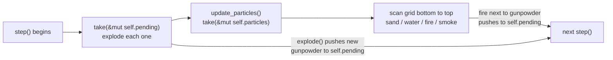

# Lesson 04: Fire, smoke, explosions and flying particles (borrowing tricks)

> Source for this lesson: `sand/src/main.rs` at commit `8da72fa`. Commit `a022b3c` leaves all of this code unchanged and adds `run_emitters`, which we use for one more borrowing trick.
>
> To read the exact file: `git show 8da72fa:sand/src/main.rs`

---

## 1. What you will build

By the end of Lesson 03 you had a grid of `Cell`s with sand and water, a `try_move` helper and a tiny xorshift RNG. In this lesson the world gets three new behaviours:

1. **Fire that spreads through wood.** A fire cell counts down its `life`. On each step it looks at its 8 neighbours and sometimes lights them. When `life` reaches 0 it turns into smoke.
2. **Gunpowder chain reactions.** An explosion goes off as a circle with strength that falls off towards the edge. Gunpowder inside the circle is queued up to explode *next* step, so the blast travels outward as a wave.
3. **Debris that flies.** Exploded cells are lifted off the grid and become `Particle`s with `f32` position and velocity. Gravity pulls them down and they land back on the grid. Sub-stepping stops fast particles from passing through thin walls.

The Rust idea at the centre of all this is the **borrow checker**. Every one of these features needs to read or change one field of `Grid` *while* calling `&mut self` methods. The naive code does not compile. Here you will see the real errors and the three standard ways around them:

- `std::mem::take`: take the field out, work on it, put it back.
- An index loop over `Copy` data: copy the item out instead of keeping a borrow open.
- Knowing what a closure captures: a closure that calls a method on `self` captures **all** of `self`.

This is where the lesson sits in one frame of the simulation:



---

## 2. Concepts

### 2.1 Some unconditional truths about borrowing

You have used `&` and `&mut` already. The borrow checker rests on a few rules with no exceptions. Everything later in this lesson follows from them.

1. **At any moment a value has either any number of shared borrows (`&T`) or exactly one mutable borrow (`&mut T`), never both.**
2. **A borrow lasts from where it is created to where it is last used.** It does not last to the end of the block. (This is "non-lexical lifetimes".)
3. **A method that takes `&mut self` borrows the *whole* struct mutably for the length of the call.** The compiler does not look inside the method to see which fields it touches. The signature is the contract.
4. **Borrowing a field (`&mut self.particles`) borrows only that field.** You may borrow `self.cells` and `self.particles` at the same time, because they are separate places in memory.

Rule 3 against rule 4 is the whole problem. Inside one function you can split `self` into fields freely. Once you call a method, though, you hand over *all* of `self`, and any field borrow still open at that moment conflicts with it.

A tiny example, separate from the project:

```rust
struct Bank {
    accounts: Vec<u32>,
    log: Vec<String>,
}

impl Bank {
    fn record(&mut self, msg: &str) {
        self.log.push(msg.to_string());
    }

    fn pay_interest(&mut self) {
        // Rule 4: field borrows are fine side by side.
        for a in self.accounts.iter_mut() {
            *a += 1;
            self.log.push("interest".into()); // OK: different field
        }

        // Rule 3: this does NOT compile.
        // for a in self.accounts.iter_mut() {
        //     *a += 1;
        //     self.record("interest"); // E0499: record() wants ALL of self
        // }
    }
}
```

`self.record(..)` does exactly what `self.log.push(..)` does. The compiler still refuses it, because `record`'s signature says "I need `&mut Bank`", and part of the `Bank` (`accounts`) is already lent out to the loop.

The simulation hits this four times. Each time below, we first look at the naive code and the **real error** (copied from `rustc 1.99`, edition 2024), then at how the project fixes it.

### 2.2 Variants that carry data: `Fire { life: u8 }`

The `Cell` enum gains materials, and two of them carry a countdown:

```rust
// sand/src/main.rs @ 8da72fa
enum Cell {
    Empty,
    Sand,
    Water,
    Stone,
    Wood,
    Gunpowder,
    // Variants can carry data. `life` counts down every step; at 0 the cell
    // turns into something else.
    Fire { life: u8 },
    Smoke { life: u8 },
}
```

`Cell` is still `Copy`, because `u8` is `Copy`. That matters a lot later. When you `match` on a cell you can pull `life` out by name (`Cell::Fire { life } => ...`). You can also ignore it with `..` (`Cell::Fire { .. } => "fire"`). The main scan passes it straight into the update function:

```rust
match self.cells[idx] {
    Cell::Sand | Cell::Gunpowder => self.update_sand(x, y),
    Cell::Water => self.update_water(x, y),
    Cell::Fire { life } => self.update_fire(x, y, life),
    Cell::Smoke { life } => self.update_smoke(x, y, life),
    Cell::Empty | Cell::Stone | Cell::Wood => {}
}
```

Why would anyone make `life` a `u8`? Each cell is stored once for each of 640 x 360 = 230,400 cells. A lifetime never needs to go above 255, and the colour code uses it directly (`40 + life.min(70) * 3` fits in a `u8` because $40 + 70 \cdot 3 = 250 \le 255$).

### 2.3 A `const` array of offsets: `NEIGHBOURS`

Fire has to look at all 8 surrounding cells. You could write 8 `if`s. Instead, write the offsets down once as data:

```rust
// sand/src/main.rs @ 8da72fa
/// Offsets to the 8 cells surrounding a cell.
const NEIGHBOURS: [(i32, i32); 8] = [
    (-1, -1), (0, -1), (1, -1),
    (-1, 0),           (1, 0),
    (-1, 1),  (0, 1),  (1, 1),
];
```

- `[(i32, i32); 8]` is a fixed-size **array** of 8 tuples. Its length is part of the type, and it lives inline with no heap allocation.
- `const` means the value is inlined wherever it is used. It is not a variable and it has no single address you could borrow.
- `for (dx, dy) in NEIGHBOURS` iterates the array **by value**. Arrays implement `IntoIterator` by value (since edition 2021), and the tuples are `Copy`.

This is the first borrowing trick, and you get it free: **looping over a `const` borrows nothing from `self`.** So the loop body may call any `&mut self` method it likes.

### 2.4 `update_fire`: life, neighbours, ignition chance

```rust
// sand/src/main.rs @ 8da72fa
fn update_fire(&mut self, x: i32, y: i32, life: u8) {
    // 1. Burned out? Become smoke (sometimes nothing, so smoke isn't endless).
    if life == 0 {
        let next = if self.coin_flip() {
            Cell::Smoke { life: self.random_range(60, 120) as u8 }
        } else {
            Cell::Empty
        };
        self.set(x, y, next);
        return;
    }

    // 2. Look at all 8 neighbours.
    for (dx, dy) in NEIGHBOURS {
        let (nx, ny) = (x + dx, y + dy);
        match self.get(nx, ny) {
            Cell::Water => {
                self.set(x, y, Cell::Smoke { life: 80 });
                self.set(nx, ny, Cell::Smoke { life: 80 });
                return;
            }
            Cell::Gunpowder => {
                self.set(nx, ny, Cell::Fire { life: 4 });
                self.pending.push((nx, ny));
            }
            Cell::Wood if self.random() % 100 < 4 => {
                let new_life = self.random_range(60, 140) as u8;
                self.set(nx, ny, Cell::Fire { life: new_life });
            }
            _ => {}
        }
    }

    // 3. Age by one step, then flicker upward like a flame.
    self.set(x, y, Cell::Fire { life: life - 1 });
    if self.random() % 3 == 0 {
        let dir = self.random_range(0, 3) as i32 - 1; // -1, 0 or 1
        self.try_move(x, y, dir, -1);
    }
}
```

Things to notice:

- **Why the `life == 0` check comes first.** `life` is a `u8`. If we skipped the check, `life - 1` at 0 would **panic** in a debug build ("attempt to subtract with overflow") and wrap to 255 in a release build. Putting the check first is what makes `life - 1` safe later in the function.
- **`match self.get(nx, ny)` borrows nothing.** `get` takes `&self` but returns a `Cell` **by value** (it is `Copy`). The shared borrow ends when `get` returns. That is why each arm can call `self.set(..)` and `self.random()`.
- **A match guard with side effects.** `Cell::Wood if self.random() % 100 < 4` rolls the RNG *only* when the neighbour is wood. With 8 neighbours, the chance per step of lighting one particular wood neighbour is 4%. A wood cell touched by $k$ fire cells catches with probability $1 - 0.96^k$ per step. Thicker fire spreads faster, and nobody had to write that rule.
- **`random_range(0, 3) as i32 - 1`** turns $\{0,1,2\}$ into $\{-1,0,1\}$. The `as i32` is needed *before* the subtraction: in `u32`, `0 - 1` would overflow.

`update_smoke` is the same shape with simpler rules: count down, then rise, like sand falling upside down.

```rust
fn update_smoke(&mut self, x: i32, y: i32, life: u8) {
    if life == 0 {
        self.set(x, y, Cell::Empty);
        return;
    }
    self.set(x, y, Cell::Smoke { life: life - 1 });
    let dir = if self.coin_flip() { 1 } else { -1 };
    if self.try_move(x, y, 0, -1) || self.try_move(x, y, dir, -1) {
        return;
    }
    self.try_move(x, y, dir, 0);
}
```

`a || b` evaluates `b` only if `a` is false. Here that gives you "try up, else try diagonal" in one line.

### 2.5 Trick #1: `std::mem::take` for the `pending` list

Gunpowder explodes *next* step, not right away. If it went off immediately, one spark would set off a whole 60x20 block inside one recursive call. You would get no visible wave, and you could overflow the stack. So `Grid` has a queue:

```rust
pending: Vec<(i32, i32)>, // explosions to set off next step
```

At the start of `step()` we must process every queued explosion, and `explode` itself pushes **new** entries onto `self.pending`. The obvious code:

```rust
for (x, y) in self.pending.drain(..) {
    self.explode(x, y, POWDER_BLAST);
}
```

The real compiler error:

```text
error[E0499]: cannot borrow `*self` as mutable more than once at a time
  --> src/main.rs:32:13
   |
31 |           for (x, y) in self.pending.drain(..) {
   |           -             ----------------------
   |           |             |
   |           |             first mutable borrow occurs here
   |  _________|             first borrow later used here
   | |
32 | |             self.explode(x, y);
   | |             ^^^^ second mutable borrow occurs here
33 | |         }
   | |_________- this for loop borrows `*self` mutably, preventing mutation within its body
```

How to read it: `drain(..)` holds `&mut self.pending` for the entire loop (the "first borrow later used here" label points at the loop, because each iteration pulls from the drain). `explode` wants `&mut self`, which includes `pending`. That makes two mutable borrows at once, against rule 1.

This is not the compiler being fussy. If it were allowed, `explode` would `push` onto the very `Vec` that `drain` is walking. A push can reallocate the buffer, and `drain` would be left reading freed memory.

The fix is to take the list out of `self` so the loop owns it:

```rust
// sand/src/main.rs @ 8da72fa, in step()
// Explosions triggered last step. Taking the list out of `self` lets
// explode() (which needs `&mut self`) push new ones for the next step.
let pending = std::mem::take(&mut self.pending);
for (x, y) in pending {
    self.explode(x, y, POWDER_BLAST);
}
```

`std::mem::take(&mut place)` swaps `T::default()` into `place` and returns the old value. For a `Vec` the default is an empty `Vec`, which does not allocate. So:

- `pending` is a local `Vec` owned by this function. Looping over it borrows nothing from `self`.
- `self.pending` is now empty, ready to collect the *next* wave.
- The mutable borrow from `take` lasts only for that one line (rule 2).

Taking the list out turns out to be what we wanted anyway. The explosions queued *this* step must not run until *next* step, and keeping the two lists apart gives exactly that.

Its relatives: `std::mem::replace(&mut place, new_value)` (you choose what goes in) and `std::mem::swap(&mut a, &mut b)`.

### 2.6 `explode`: a blast circle with falloff, in floats

```rust
// sand/src/main.rs @ 8da72fa
fn explode(&mut self, cx: i32, cy: i32, radius: i32) {
    let r = radius as f32;
    for dy in -radius..=radius {
        for dx in -radius..=radius {
            let dist = ((dx * dx + dy * dy) as f32).sqrt();
            if dist > r {
                continue; // outside the blast circle
            }
            let (x, y) = (cx + dx, cy + dy);
            let Some(i) = Self::index(x, y) else { continue };
            if y == H as i32 - 1 {
                continue; // the bottom row is an indestructible floor
            }

            // 1.0 at the centre, 0.0 at the edge.
            let strength = 1.0 - dist / r;
            let core = strength > 0.5;

            match self.cells[i] {
                Cell::Empty => {
                    if core && self.random() % 3 == 0 {
                        let life = self.random_range(10, 30) as u8;
                        self.cells[i] = Cell::Fire { life };
                    }
                }
                Cell::Stone => {
                    if core {
                        self.fling(x, y, dx, dy, strength, Cell::Sand);
                    }
                }
                Cell::Gunpowder => {
                    self.cells[i] = Cell::Fire { life: 4 };
                    self.pending.push((x, y));
                }
                Cell::Wood => {
                    let debris = if core { Cell::Fire { life: 80 } } else { Cell::Wood };
                    self.fling(x, y, dx, dy, strength, debris);
                }
                Cell::Water if core => self.cells[i] = Cell::Smoke { life: 60 },
                other => {
                    if (self.random() % 100) as f32 / 100.0 < strength + 0.3 {
                        self.fling(x, y, dx, dy, strength, other);
                    }
                }
            }
        }
    }
}
```

**The geometry.** We loop over the square $[-r, r]^2$ and skip the corners where $\sqrt{dx^2 + dy^2} > r$. What is left is a filled disc. Strength is a linear falloff:

$$\text{strength} = 1 - \frac{d}{r}, \qquad d = \sqrt{dx^2 + dy^2}$$

so it is $1$ at the centre and $0$ on the rim. "Core" is the inner half of the radius, $d < r/2$.

**Integer and float math side by side.** `dx * dx + dy * dy` is computed in `i32`. It is exact, and it is what you want for a comparison. Only then do we cast to `f32` and call `.sqrt()`, because there is no integer square root on `i32` here. (You could even skip the `sqrt` for the circle test by comparing `dx*dx + dy*dy > radius*radius` in integers. The paint brush does exactly that. We need the actual distance anyway for `strength`.) `1.0 - dist / r` must be float. In integer division `dist / r` would be 0 everywhere inside the circle.

**`let ... else`.** `let Some(i) = Self::index(x, y) else { continue };` binds `i` if the cell is on the grid, and otherwise runs the `else` block. That block must leave the scope (`continue`, `return`, `break` or panic). It saves you a level of nesting compared with `if let`.

**Why `match self.cells[i]` and `other =>` compile.** This is the second hidden borrowing trick. `self.cells[i]` is a *place* inside a `Vec`. The arm `other =>` binds the cell **by value**, and because `Cell: Copy` that is a copy, not a move. No borrow of `self.cells` stays alive into the arm, so `self.fling(..)` (which takes `&mut self`) is fine. If `Cell` were *not* `Copy`, you would get this:

```text
error[E0507]: cannot move out of index of `Vec<Cell>`
   |
11 |         match self.cells[0] {
   |               ^^^^^^^^^^^^^
...
13 |             other => { let _ = other; }
   |             ----- data moved here because `other` has type `Cell`, which does not implement the `Copy` trait
```

and the suggested fix (`match &self.cells[0]`) would hold a shared borrow during the arm, which then clashes with `self.fling`. Making small data types `Copy` saves you from a whole family of borrow fights.

**The chain reaction.** Gunpowder inside the circle is turned into short-lived fire and pushed onto `self.pending`. This is the same field that `step()` emptied with `take`, so it collects the next wave. Each gunpowder grain has a radius of `POWDER_BLAST = 7`, so the wave front moves about 7 cells per step.

### 2.7 `Particle`: leaving the grid for floating point

A grid cell can only move one cell per step, in whole cells. Debris needs to fly fast and in any direction, so `fling` lifts a cell off the grid into a free-floating particle:

```rust
// sand/src/main.rs @ 8da72fa
#[derive(Clone, Copy)]
struct Particle {
    x: f32,
    y: f32,
    vx: f32,
    vy: f32,
    cell: Cell, // what it turns back into when it lands
}
```

```rust
fn fling(&mut self, x: i32, y: i32, dx: i32, dy: i32, strength: f32, cell: Cell) {
    self.set(x, y, Cell::Empty);
    if self.particles.len() >= MAX_PARTICLES {
        return;
    }
    // Direction away from the centre (a unit vector), plus some randomness.
    let len = ((dx * dx + dy * dy) as f32).sqrt().max(1.0);
    let jitter = (self.random() % 100) as f32 / 100.0 - 0.5;
    let speed = 1.0 + strength * 4.0 + jitter;
    self.particles.push(Particle {
        x: x as f32 + 0.5,
        y: y as f32 + 0.5,
        vx: dx as f32 / len * speed + jitter,
        vy: dy as f32 / len * speed - 1.0, // slight upward kick
        cell,
    });
}
```

- `(dx, dy) / len` is a **unit vector** pointing away from the blast centre. Multiplying by `speed` gives the velocity. `.max(1.0)` guards the centre cell, where `len = 0` and dividing would give `NaN` ($0/0$).
- `x as f32 + 0.5` puts the particle at the *centre* of its cell. Cell $(x, y)$ covers the square $[x, x+1) \times [y, y+1)$. Going back from float to cell is then `floor`.
- `(self.random() % 100) as f32 / 100.0` is the standard way to get a float in $[0, 1)$ out of an integer RNG. Do the modulo in integers *first*, then cast.
- Note `self.particles.len()` and `self.particles.push(..)` inside a `&mut self` method. That is fine because nothing else is borrowed at the time.

### 2.8 Trick #1 again: `take` + `retain_mut` in `update_particles`

Each step, every particle gets gravity, moves, and either keeps flying or lands. Landing means *removing it from the list* and *writing to the grid*. `Vec::retain_mut` does the first part well: it calls your closure with `&mut T` for each element and keeps the ones where it returns `true`.

The naive attempt:

```rust
self.particles.retain_mut(|p| {
    // ... move p ...
    self.set(p.x as i32, p.y as i32, p.cell); // land it
    false
});
```

The real errors (two of them, one for each side of the conflict):

```text
error[E0501]: cannot borrow `self.particles` as mutable because previous closure requires unique access
  --> src/main.rs:25:9
   |
25 |           self.particles.retain_mut(|p| {
   |           ^              ---------- --- closure construction occurs here
   |           |              |
   |  _________|              first borrow later used by call
   | |
26 | |             self.set(p.x as i32, p.y as i32, Cell::Sand);
   | |             ---- first borrow occurs due to use of `*self` in closure

error[E0500]: closure requires unique access to `*self` but it is already borrowed
  --> src/main.rs:25:35
   |
25 |         self.particles.retain_mut(|p| {
   |         -------------- ---------- ^^^ closure construction occurs here
   |         |              |
   |         |              first borrow later used by call
   |         borrow occurs here
26 | |             self.set(p.x as i32, p.y as i32, Cell::Sand);
   |             ---- second borrow occurs due to use of `*self` in closure
```

How to read this. A **closure captures the variables it uses**. Since edition 2021 it captures the most precise *place* it can. If the body used only `self.rng`, the closure would capture just `self.rng`, and that would work. But the body calls a **method**, `self.set(..)`, which takes `&mut self`. A method call needs the *whole* `*self`, so the closure captures `&mut *self` ("unique access to `*self`"). Meanwhile `retain_mut` needs `&mut self.particles`. That gives two mutable borrows overlapping on `particles`.

You can check the precise-capture rule yourself. This compiles:

```rust
// only touches fields, never calls a method on self
self.ps.retain_mut(|p| { p.x += self.gravity; self.rng += 1; p.x < 10.0 });
```

The closure captures `&self.gravity` and `&mut self.rng`. Those are separate from `self.ps`, so rule 4 lets it through. As soon as you write `self.get(..)` or `self.set(..)` in there, it captures all of `self` and fails.

The project's fix uses `take` again:

```rust
// sand/src/main.rs @ 8da72fa
fn update_particles(&mut self) {
    // We need to read and write the grid while changing the particle list.
    // Borrowing both through `self` at once isn't allowed, so take the list out first.
    let mut particles = std::mem::take(&mut self.particles);

    particles.retain_mut(|p| {
        // ... uses self.get(..) and self.set(..) freely ...
        true
    });

    self.particles = particles;
}
```

`particles` is a local now, so `retain_mut` borrows the *local*, and the closure is free to capture all of `self`. During the loop `self.particles` is an empty `Vec`. That is harmless here, because nothing inside the closure reads it. **Don't forget the last line.** If you leave out `self.particles = particles;`, every particle disappears after one frame, and the code compiles without a warning.

The same trap with a plain `for` loop gives E0502 if you only read (`self.get`), and E0499 if you write (`self.set`):

```text
error[E0502]: cannot borrow `*self` as immutable because it is also borrowed as mutable
15 |         for p in self.particles.iter_mut() {
   |                  ------------------------- mutable borrow occurs here
16 |             if self.get(p.x as i32, p.y as i32) != Cell::Empty { p.x = 0.0; }
   |                ^^^^ immutable borrow occurs here
```

### 2.9 Sub-stepping: why `ceil`, `floor` and `as i32`

```rust
particles.retain_mut(|p| {
    p.vy += GRAVITY;
    // Move in small sub-steps so fast particles can't skip through thin walls.
    let steps = p.vx.abs().max(p.vy.abs()).ceil().max(1.0) as i32;
    let (sx, sy) = (p.vx / steps as f32, p.vy / steps as f32);
    for _ in 0..steps {
        let (nx, ny) = (p.x + sx, p.y + sy);
        let (ix, iy) = (nx.floor() as i32, ny.floor() as i32);
        if ix < 0 || ix >= W as i32 || iy >= H as i32 {
            return false; // left the screen: remove it
        }
        // Above the top edge there is nothing to hit; keep flying.
        if iy >= 0 && self.get(ix, iy) != Cell::Empty {
            // Hit something: land in the last free spot.
            let (lx, ly) = (p.x.floor() as i32, p.y.floor() as i32);
            if self.get(lx, ly) == Cell::Empty {
                self.set(lx, ly, p.cell);
            }
            return false; // remove it from the flying list
        }
        p.x = nx;
        p.y = ny;
    }
    true // keep it: still flying
});
```

**The tunnelling problem.** A particle with `vx = 25` jumps 25 cells in one frame. If you only check the cell where it *ends up*, a 1-cell stone wall in between is never seen. The fix is to split the move into `steps` pieces, each at most 1 cell long in either axis, and check after every piece. A piece of at most 1 cell can't skip over a cell entirely.

$$\text{steps} = \max\big(1, \lceil \max(|v_x|, |v_y|) \rceil\big), \qquad (s_x, s_y) = \frac{(v_x, v_y)}{\text{steps}}$$

Reading the Rust chain from left to right: `p.vx.abs().max(p.vy.abs())` is the larger speed. `.ceil()` rounds up, so `2.01` needs 3 steps, not 2. `.max(1.0)` makes sure a nearly still particle still takes 1 step. `as i32` converts. Note that `f32::max` is a method (`a.max(b)`), not an operator.

**`floor`, not `as`, to find the cell.** Cell $i$ covers $[i, i+1)$, so the cell under position $x$ is $\lfloor x \rfloor$. `as i32` **truncates toward zero**, which equals `floor` only for $x \ge 0$:

| expression | value |
|---|---|
| `-0.7_f32 as i32` | `0` (wrong cell!) |
| `(-0.7_f32).floor() as i32` | `-1` |

A particle just above the top edge at `y = -0.7` must count as row `-1` (off-grid, keep flying), not row `0`. That's why the code calls `.floor()` before every `as i32`. The checks `ix < 0`, `ix >= W`, `iy >= H` remove particles that leave the sides or bottom. There is deliberately no `iy < 0` check: debris may arc above the screen and fall back in.

**Landing in the *last free spot*.** When the next sub-step position `(nx, ny)` is blocked, we land at the *current* `p.x, p.y`, which we already know is free. If something else got there first, the particle simply vanishes.

### 2.10 `as` casting pitfalls, collected

`as` never fails and never panics. It always gives *some* number, and that number is sometimes not the one you wanted. Real outputs:

| expression | result | rule |
|---|---|---|
| `-0.7_f32 as i32` | `0` | float to int truncates toward zero |
| `1e10_f32 as i32` | `2147483647` | float to int **saturates** at the type's limits |
| `f32::NAN as i32` | `0` | NaN becomes 0 |
| `(-5_f32) as u8` | `0` | saturates at 0 |
| `300_i32 as u8` | `44` | int to smaller int **wraps** (keeps the low bits: $300 - 256$) |
| `-1_i32 as u32` | `4294967295` | same bits, read as unsigned |
| `-7 / 2` | `-3` | integer `/` truncates toward zero too |
| `(-7_i32).div_euclid(2)` | `-4` | floor-style division |

Project consequences:

- `self.random_range(60, 140) as u8` is safe only because $139 \le 255$. Write `random_range(60, 400) as u8` and you silently get wrapped lifetimes.
- `index()` checks `x < 0` *while still `i32`* and only then does `x as usize`. Cast first, and `-1` becomes `18446744073709551615`.
- `(mx / SCALE) as i32` for the mouse is fine on-screen. Off-screen negative positions truncate toward zero, so you might paint column 0 when the mouse is at $x = -2$. That is harmless here, but now you know.

### 2.11 Trick #2: the index loop over `Copy` data (`run_emitters`, commit `a022b3c`)

Commit `a022b3c` added "taps" that pour material in every step. The obvious loop:

```rust
for e in &self.emitters {
    if self.random() % e.rate == 0 { /* ... */ }
}
```

```text
error[E0502]: cannot borrow `*self` as mutable because it is also borrowed as immutable
36 |           for e in &self.emitters {
   |                    -------------- immutable borrow occurs here
37 | |             if self.random() % 2 == 0 { let _ = e.x; }
   | |                ^^^^^^^^^^^^^ mutable borrow occurs here
   |
   = help: consider using an index-based loop instead, or collecting modifications into a separate collection
```

The compiler's own `help:` line names the fix the project uses:

```rust
// sand/src/main.rs @ a022b3c
fn run_emitters(&mut self) {
    // Indexing instead of `for e in &mut self.emitters`: the loop body
    // calls self.random() and self.set(), which need all of `self`.
    for i in 0..self.emitters.len() {
        let e = self.emitters[i]; // a copy (Emitter is Copy)
        for dx in 0..e.w {
            if self.random() % e.rate == 0 && self.get(e.x + dx, e.y) == Cell::Empty {
                self.set(e.x + dx, e.y, e.cell);
            }
        }
        self.emitters[i].steps_left -= 1;
    }
    self.emitters.retain(|e| e.steps_left > 0);
}
```

Why it works, using rule 2. `0..self.emitters.len()` reads the length *once* and produces a plain `Range<usize>`, which borrows nothing. `let e = self.emitters[i];` borrows `self.emitters` just long enough to **copy** the `Emitter` out (it derives `Copy`). After that line, nothing is borrowed. The method calls are free, and `self.emitters[i].steps_left -= 1` is a fresh, short borrow.

When to choose which trick:

| Situation | Trick |
|---|---|
| Loop body may **add to** the same list | `mem::take` (an index loop would see new items, and a `Vec` iterator can't allow it at all) |
| Need to **remove** items while calling `&mut self` | `mem::take` + `retain_mut` |
| Items are small and `Copy`, list doesn't grow | index loop + copy out |
| Body touches only *fields*, not methods | nothing needed: split field borrows work |

---

## 3. Build it yourself

Start from your Lesson 03 `sand/src/main.rs` (sand, water, stone, `Grid` with `cells`, `moved`, `rng`, `frame`, `get`, `set`, `index`, `random`, `coin_flip`, `try_move`, `update_sand`, `update_water`). Each step below compiles on its own. The final result is exactly `git show 8da72fa:sand/src/main.rs`. Diff against it whenever you're stuck.

### Step 1: new constants and materials

At the top:

```rust
const GRAVITY: f32 = 0.15; // added to a flying particle's downward speed each step
const MAX_PARTICLES: usize = 30_000;
const POWDER_BLAST: i32 = 7; // explosion radius of one gunpowder grain
const BOMB_BLAST: i32 = 26;  // explosion radius of the E key bomb
```

Add `Wood`, `Gunpowder`, `Fire { life: u8 }` and `Smoke { life: u8 }` to `Cell`. The compiler will now point at every non-exhaustive `match`. Fix each one:

```rust
// in color()
Cell::Wood => [110, 70, 35],
Cell::Gunpowder => [60, 60, 60],
Cell::Fire { life } => [255, 40 + life.min(70) * 3, 20],
Cell::Smoke { life } => {
    let v = 20 + life / 2;
    [v, v, v + 4]
}
// in name()
Cell::Wood => "wood",
Cell::Gunpowder => "gunpowder",
Cell::Fire { .. } => "fire",
Cell::Smoke { .. } => "smoke",
```

Update `is_displaceable_by` so gunpowder sinks like sand and falling things push smoke aside:

```rust
fn is_displaceable_by(self, mover: Cell) -> bool {
    match (mover, self) {
        (_, Cell::Empty) => true,
        (Cell::Sand | Cell::Gunpowder, Cell::Water) => true,
        (Cell::Sand | Cell::Gunpowder | Cell::Water, Cell::Smoke { .. }) => true,
        _ => false,
    }
}
```

### Step 2: `NEIGHBOURS`, `random_range`, fire and smoke

Put `NEIGHBOURS` (section 2.3) after the `impl Grid` block. Add to `impl Grid`:

```rust
/// A random number in lo..hi (hi excluded).
fn random_range(&mut self, lo: u32, hi: u32) -> u32 {
    lo + self.random() % (hi - lo)
}
```

Then paste `update_fire` (section 2.4) and `update_smoke`. `update_fire` refers to `self.pending`, so add the field now:

```rust
struct Grid {
    cells: Vec<Cell>,
    moved: Vec<bool>,
    rng: u32,
    frame: u32,
    particles: Vec<Particle>,
    pending: Vec<(i32, i32)>, // explosions to set off next step
}
```

and initialise `particles: Vec::new(), pending: Vec::new()` in `Grid::new()`.

Dispatch them from the scan in `step()`:

```rust
match self.cells[idx] {
    Cell::Sand | Cell::Gunpowder => self.update_sand(x, y),
    Cell::Water => self.update_water(x, y),
    Cell::Fire { life } => self.update_fire(x, y, life),
    Cell::Smoke { life } => self.update_smoke(x, y, life),
    Cell::Empty | Cell::Stone | Cell::Wood => {}
}
```

### Step 3: `Particle`, `fling`, `explode`

Add the `Particle` struct (section 2.7) above `Grid`, then `fling` and `explode` (sections 2.6, 2.7) inside `impl Grid`.

### Step 4: `update_particles` and the pending queue in `step()`

Add `update_particles` (sections 2.8 and 2.9 together). Then at the top of `step()`, right after `self.moved.fill(false);`:

```rust
let pending = std::mem::take(&mut self.pending);
for (x, y) in pending {
    self.explode(x, y, POWDER_BLAST);
}
self.update_particles();
```

Try writing the `drain(..)` version first, to see E0499 with your own eyes.

### Step 5: brushes, the bomb key, drawing particles

In `pick_brush` add:

```rust
(KeyCode::Key5, Cell::Wood),
(KeyCode::Key6, Cell::Fire { life: 0 }), // life is randomised when painting
(KeyCode::Key7, Cell::Gunpowder),
```

In `paint`, sprinkle fire and gunpowder like sand, and give each fire cell its own life:

```rust
let sprinkle = matches!(cell, Cell::Sand | Cell::Water | Cell::Fire { .. } | Cell::Gunpowder);
// ... inside the loop, after the sprinkle check:
let placed = match cell {
    Cell::Fire { .. } => Cell::Fire { life: grid.random_range(40, 100) as u8 },
    other => other,
};
grid.set(cx + dx, cy + dy, placed);
```

In the main loop, before `paint(..)`:

```rust
if is_key_pressed(KeyCode::E) {
    let (mx, my) = mouse_position();
    grid.explode((mx / SCALE) as i32, (my / SCALE) as i32, BOMB_BLAST);
}
```

At the end of `draw_grid`, draw particles over the cells:

```rust
for particle in &grid.particles {
    let (x, y) = (particle.x as i32, particle.y as i32);
    if let Some(i) = Grid::index(x, y) {
        let [r, g, b] = particle.cell.color();
        image.bytes[i * 4..i * 4 + 3].copy_from_slice(&[r, g, b]);
    }
}
```

(This uses `as i32` rather than `floor`. For drawing that is fine: at $-1 < y < 0$ the particle gets drawn on row 0, which only matters for a single frame.)

### Step 6: tests

Add the two tests from the commit to the bottom of the file (`gunpowder_chain_reaction_runs_without_crashing`, `bomb_at_edges_is_safe`) and run:

```bash
cd sand && cargo test
cargo run --release
```

Draw a wooden box (5), fill it with gunpowder (7), drop a spark (6) on it, and watch.

---

## 4. Live examples

### 4.1 Run the real commit without touching your working tree

```bash
cd /Users/anujbarve/Documents/rusty
git worktree add ../sand-lesson04 8da72fa
cd ../sand-lesson04/sand
cargo run --release
```

Tweaks to try, one at a time (edit, rerun, watch):

- `GRAVITY` from `0.15` to `0.02`: debris floats like it's on the Moon. Try `0.6`.
- In `update_fire`, `% 100 < 4` becomes `% 100 < 40`: wood goes up almost at once.
- `POWDER_BLAST` from `7` to `2`: the chain reaction crawls, and you can see the wave front.
- In `update_particles`, replace the sub-step count with `let steps = 1;`. Now set off a bomb next to a thin stone wall and watch rubble pass through it.

When done: `git worktree remove ../sand-lesson04`.

### 4.2 Tunnelling vs sub-stepping, in one dimension

`cargo new tunnel`, then `src/main.rs`:

```rust
// Tunnelling vs sub-stepping, in one dimension.
const WALL: i32 = 10; // a 1-cell-thick wall at x = 10

fn naive(mut x: f32, vx: f32) -> f32 {
    let nx = x + vx;
    if nx.floor() as i32 != WALL {
        x = nx; // only checks where we END UP
    }
    x
}

fn substepped(mut x: f32, vx: f32) -> f32 {
    let steps = vx.abs().ceil().max(1.0) as i32;
    let sx = vx / steps as f32;
    for _ in 0..steps {
        let nx = x + sx;
        if nx.floor() as i32 == WALL {
            return x; // stop in the last free spot
        }
        x = nx;
    }
    x
}

fn main() {
    for vx in [0.5_f32, 3.0, 9.6, 25.0] {
        println!(
            "vx = {vx:>5}: naive ends at {:>6.2}, sub-stepped ends at {:>6.2}",
            naive(0.5, vx),
            substepped(0.5, vx)
        );
    }
}
```

Output:

```text
vx =   0.5: naive ends at   1.00, sub-stepped ends at   1.00
vx =     3: naive ends at   3.50, sub-stepped ends at   3.50
vx =   9.6: naive ends at   0.50, sub-stepped ends at   9.14
vx =    25: naive ends at  25.50, sub-stepped ends at   9.50
```

At `vx = 25` the naive particle is now on the far side of the wall. At `9.6` the naive version happens to land *inside* the wall and refuses to move at all. Sub-stepping stops at the wall's face both times. Try `const WALL` values and speeds of your own.

### 4.3 A chain reaction you can read

`cargo new chain`, then `src/main.rs`:

```rust
// A 1-D line of gunpowder. Light one end and watch the chain reaction
// travel one "wave" per step through the `pending` list.
#[derive(Clone, Copy, PartialEq, Debug)]
enum Cell { Empty, Powder, Fire }

struct World {
    cells: Vec<Cell>,
    pending: Vec<usize>,
}

impl World {
    fn explode(&mut self, at: usize, radius: usize) {
        let lo = at.saturating_sub(radius);
        let hi = (at + radius).min(self.cells.len() - 1);
        for i in lo..=hi {
            match self.cells[i] {
                Cell::Powder => {
                    self.cells[i] = Cell::Fire;
                    self.pending.push(i); // goes off NEXT step
                }
                Cell::Fire if i != at => {} // already lit, waiting its turn
                _ => self.cells[i] = Cell::Empty,
            }
        }
    }

    fn step(&mut self) {
        let pending = std::mem::take(&mut self.pending);
        for i in pending {
            self.explode(i, 2);
        }
    }

    fn show(&self) -> String {
        self.cells.iter().map(|c| match c {
            Cell::Empty => '.',
            Cell::Powder => '#',
            Cell::Fire => '*',
        }).collect()
    }
}

fn main() {
    let mut w = World { cells: vec![Cell::Powder; 30], pending: vec![] };
    w.cells[0] = Cell::Fire;
    w.pending.push(0);
    for step in 0..10 {
        println!("step {step:>2}: {}  (pending: {})", w.show(), w.pending.len());
        w.step();
    }
}
```

Output (first lines):

```text
step  0: *#############################  (pending: 1)
step  1: .**###########################  (pending: 2)
step  2: ...**#########################  (pending: 2)
step  3: .....**#######################  (pending: 2)
```

Things to try:
- Change `radius` to 5 and see the front move faster.
- Replace the `take` line with `for i in self.pending.drain(..)` and read the E0499 error.
- Replace it with an index loop `for k in 0..self.pending.len() { let i = self.pending[k]; self.explode(i, 2); }`. It compiles, but `len()` was read once, so new pushes are not exploded this step, and they are **still in the list** next step together with the old ones. Count `pending` per step and watch it grow. That is why "the list may grow" points to `take`.

---

## 5. Exercises

**E1 (easy): tune the fire.** Make wood ignite at 15% instead of 4%, and make burnt-out fire always leave smoke (never `Empty`).
*Hint:* two numbers/lines in `update_fire`.

**E2 (easy): fix the borrow error.** Add an `F` key that sets about half of all wood on fire. This first attempt does not compile:

```rust
fn ignite_all_wood(&mut self) {
    for (i, c) in self.cells.iter().enumerate() {
        if *c == Cell::Wood && self.random() % 2 == 0 {
            self.cells[i] = Cell::Fire { life: 60 };
        }
    }
}
```

Read the two E0502 errors and fix it.
*Hint:* `Cell` is `Copy`. Which trick from section 2.11 fits?

**E3 (medium): a fuse for gunpowder.** Make each gunpowder grain wait 3 extra steps before exploding, so chain reactions crackle more slowly.
*Hint:* change `pending` to `Vec<(i32, i32, u8)>`. In `step()`, after `take`, push items with a nonzero fuse back with `fuse - 1`.

**E4 (medium): `update_particles` without `mem::take`.** Rewrite it with an index loop. Move the closure body into a method `fn move_particle(&mut self, p: &mut Particle) -> bool`.
*Hint:* `Particle` is `Copy`. Copy it out, call the method with `&mut` to the *local copy*, write it back or `swap_remove`. Be careful with the index after removal.

**E5 (stretch): bouncing debris.** Particles hitting something *below them* while falling faster than `vy > 3.0` should bounce (`vy = -vy * 0.4`, `vx *= 0.6`) instead of landing.
*Hint:* "below" means the blocked cell's row `iy` is greater than the current row `p.y.floor() as i32`. Returning `true` from the closure/method keeps the particle.

**E6 (stretch, thinking): why does `pending` explode one step late, and does it matter?** Find the two places that push to `pending`. Explain what order things happen in when fire lights gunpowder during the grid scan, versus when an explosion lights gunpowder.
*Hint:* look at where in `step()` the `take` happens compared with the scan.

---

## 6. Common mistakes and how to read the errors

**E0499 "cannot borrow `*self` as mutable more than once at a time".** Look for the label "first mutable borrow occurs here". It almost always points at `self.some_vec.iter_mut()` / `.drain(..)` in a `for` head, and the second borrow is a `self.method()` in the body. Fix: `mem::take` the field, or index loop + `Copy`.

**E0502 "cannot borrow ... as immutable because it is also borrowed as mutable"** (or the other way round). Same shape, but one side is `&self` (like `self.get`). The fixes are the same.

**E0500 / E0501 "closure requires unique access to `*self`".** A closure called a `&mut self` method, so it captured *all* of `self`, while you were borrowing a field to call the closure-taking method (`retain_mut`, `sort_by`, `iter().map`). Fix: `take` the field so the closure-taking method works on a local.

**E0507 "cannot move out of index of `Vec<...>`".** You matched or bound a non-`Copy` value straight from `vec[i]`. Fix: derive `Copy, Clone` if the type is small, or match on `&vec[i]` (and then mind the borrow).

**Forgetting to put the field back after `take`.** No error, but all particles vanish after one frame. Always write `self.particles = particles;` at the end, and grep for it when particles "don't work".

**`attempt to subtract with overflow` (a runtime panic, debug only).** `life - 1` with `life == 0`, or `random_range(0, 3) - 1` done in `u32`. Fix: check for zero first, or cast to `i32` before subtracting.

**Off-by-one cells with negative floats.** `-0.3 as i32 == 0`. Use `.floor() as i32` whenever a float position may go below zero.

**`expected f32, found i32` (E0308).** Rust never converts numbers implicitly. `dx / len` with `dx: i32, len: f32` fails. Cast explicitly: `dx as f32 / len`. Note that `as` binds tighter than `/`, so `dx as f32 / len` means `(dx as f32) / len`.

**`can't call method sqrt on ambiguous numeric type {float}` (E0689).** `(2.0).sqrt()` with no type for the literal. Write `2.0_f32.sqrt()`, or let the type come from context as the project does with `(... as f32).sqrt()`.

---

## 7. Recap

- Borrow rules: many `&` or one `&mut`. Borrows end at last use. A `&mut self` method borrows **all** of `self`. Separate fields can be borrowed separately.
- `std::mem::take(&mut self.field)` moves a field out and leaves an empty default behind. It fixes "loop over my own list while calling my own methods", and it gives a clean "this step / next step" split (`pending`).
- An index loop over a `Copy` item (`let e = self.emitters[i];`) holds no borrow across method calls. Loops over a `const` array (`NEIGHBOURS`) borrow nothing.
- Closures capture precise field paths, *unless* they call a method on `self`, in which case they capture `*self`.
- Floats for continuous motion (`Particle`), integers for the grid. Move between them with `as f32` going up and `.floor() as i32` coming down. `as` truncates toward zero, saturates float to int, and wraps int to int.
- Sub-stepping with $\lceil \max(|v_x|,|v_y|) \rceil$ steps stops fast particles from tunnelling.

**Next, Lesson 05: Lava, acid, scenes and unit tests.** Commit `a022b3c` adds lava and acid as new reactions, the emitters you met in 2.11, a scene test bench for setting up repeatable situations, and `#[cfg(test)]` unit tests that run the simulation headless to check behaviour.

---

## Solutions

<details><summary>Solution E1: tune the fire</summary>

```rust
// in update_fire, step 1
if life == 0 {
    let next = Cell::Smoke { life: self.random_range(60, 120) as u8 };
    self.set(x, y, next);
    return;
}
// in the neighbour match
Cell::Wood if self.random() % 100 < 15 => { /* unchanged */ }
```

At 15% a wood cell next to $k$ flames catches with probability $1 - 0.85^k$ per step: about 48% per step with 4 flames, compared with about 15% at the old 4%.
</details>

<details><summary>Solution E2: fix the borrow error</summary>

```rust
/// Set roughly half of all wood on fire (F key).
fn ignite_all_wood(&mut self) {
    for i in 0..self.cells.len() {
        if self.cells[i] == Cell::Wood && self.random() % 2 == 0 {
            self.cells[i] = Cell::Fire { life: 60 };
        }
    }
}
```

and in `main`, before `paint(..)`:

```rust
if is_key_pressed(KeyCode::F) {
    grid.ignite_all_wood();
}
```

`self.cells[i] == Cell::Wood` makes a short shared borrow that ends at once (comparing `Copy` values). Then `self.random()` takes `&mut self` with nothing else open. The original held `self.cells.iter()` for the whole loop, which clashed with both `self.random()` and `self.cells[i] = ...`, giving the two E0502s.
</details>

<details><summary>Solution E3: gunpowder fuse</summary>

```rust
// in struct Grid
pending: Vec<(i32, i32, u8)>, // (x, y, fuse): explodes when fuse hits 0

// in step()
let pending = std::mem::take(&mut self.pending);
for (x, y, fuse) in pending {
    if fuse == 0 {
        self.explode(x, y, POWDER_BLAST);
    } else {
        self.pending.push((x, y, fuse - 1)); // not yet: wait another step
    }
}

// in update_fire
self.pending.push((nx, ny, 3));
// in explode
self.pending.push((x, y, 3));
```

This is only possible *because* of `take`: we push back onto `self.pending` while looping over the taken list. One catch: the grain sits as `Fire { life: 4 }` while it waits, and that fire is still updated by the scan. It can drift, or burn out and turn to smoke, before it "explodes" at its old coordinates. That makes no visual difference at fuse 3, but with a fuse of 10 you will see explosions where the fire used to be.
</details>

<details><summary>Solution E4: index-loop update_particles</summary>

```rust
/// Move every flying particle (index-loop version, no mem::take).
fn update_particles(&mut self) {
    let mut i = 0;
    while i < self.particles.len() {
        let mut p = self.particles[i]; // a copy: Particle is Copy
        if self.move_particle(&mut p) {
            self.particles[i] = p; // write the moved copy back
            i += 1;
        } else {
            // O(1) removal; the last particle moves into slot i,
            // so do NOT advance i: slot i now holds an unvisited particle.
            self.particles.swap_remove(i);
        }
    }
}

/// Advance one particle by one frame. Returns false when it should be removed.
fn move_particle(&mut self, p: &mut Particle) -> bool {
    p.vy += GRAVITY;
    let steps = p.vx.abs().max(p.vy.abs()).ceil().max(1.0) as i32;
    let (sx, sy) = (p.vx / steps as f32, p.vy / steps as f32);
    for _ in 0..steps {
        let (nx, ny) = (p.x + sx, p.y + sy);
        let (ix, iy) = (nx.floor() as i32, ny.floor() as i32);
        if ix < 0 || ix >= W as i32 || iy >= H as i32 {
            return false;
        }
        if iy >= 0 && self.get(ix, iy) != Cell::Empty {
            let (lx, ly) = (p.x.floor() as i32, p.y.floor() as i32);
            if self.get(lx, ly) == Cell::Empty {
                self.set(lx, ly, p.cell);
            }
            return false;
        }
        p.x = nx;
        p.y = ny;
    }
    true
}
```

`&mut self` and `&mut p` don't conflict, because `p` is a local copy and not a borrow into `self.particles`. You *could not* write `self.move_particle(&mut self.particles[i])`: that is `&mut self` plus `&mut self.particles[i]` at once, which is E0499. Copying out is what makes it work. `swap_remove` changes the order of particles, which doesn't matter here. `retain_mut` keeps the order and is a little simpler, which is why the project uses `take` + `retain_mut`.
</details>

<details><summary>Solution E5: bouncing debris</summary>

Inside the "hit something" branch, before landing (works in either the closure or the E4 method):

```rust
if iy >= 0 && self.get(ix, iy) != Cell::Empty {
    // Falling fast onto something below: bounce instead of landing.
    let hit_from_above = iy > p.y.floor() as i32;
    if hit_from_above && p.vy > 3.0 {
        p.vy = -p.vy * 0.4;
        p.vx *= 0.6;
        return true; // keep flying; remaining sub-steps are skipped this frame
    }
    let (lx, ly) = (p.x.floor() as i32, p.y.floor() as i32);
    if self.get(lx, ly) == Cell::Empty {
        self.set(lx, ly, p.cell);
    }
    return false;
}
```

Each bounce multiplies speed by 0.4, so after one or two bounces `vy` drops under 3.0 and the particle lands normally. It can't bounce forever.
</details>

<details><summary>Solution E6: why one step late</summary>

`step()` does three things in order: (1) `take` the pending list and explode each entry, (2) move particles, (3) scan the grid.

- **Fire lights gunpowder during the scan (3).** It pushes to `self.pending`. The *next* call of `step()` explodes it in phase (1). So it is one step late.
- **An explosion lights gunpowder during phase (1).** It pushes to `self.pending`, which `take` has just emptied. The loop is walking the *taken* local list, so the new entry waits for the next `step()`. Also one step late.

It matters for two reasons. It turns a single recursive avalanche into a visible wave, about `POWDER_BLAST` cells per step. And it bounds the work per step: each grain explodes at most once (it is turned into `Fire` before being queued, so later blasts no longer see it as `Gunpowder`), and no step does more than one ring of explosions. Without the delay, a large block could explode inside one huge call stack within one frame.
</details>
