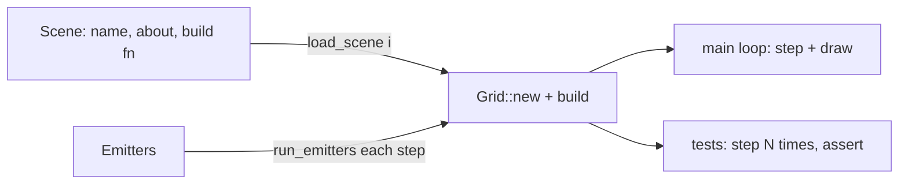

# Lesson 05 — Lava, acid, scenes & unit tests

> Source for this lesson: commit `a022b3c` ("lava, acid, smaller grains and scene test bench"), file `sand/src/main.rs`.
> See what changed since the first game with `git diff 8da72fa a022b3c -- sand/src/main.rs`, and the whole file with `git show a022b3c:sand/src/main.rs`.

---

## 1. What you will build in this lesson

At the end of Lesson 04 the game had sand, water, stone, wood, fire, smoke, gunpowder and flying particles. You tested it by hand: open the window, paint, look. That works for one or two materials. It stops working once materials *react with each other*, because each new material can break any older one.

Commit `a022b3c` adds four things. Each one fixes a problem the previous state had:

| Addition | Problem it solves |
|---|---|
| `Lava` and `Acid` materials with `update_lava` / `update_acid` | More interesting reactions (lava + water makes stone, acid dissolves solids) |
| `update_water` becomes `update_liquid(x, y, thick)` | Three liquids move almost the same way. Writing that code three times would be a bug farm |
| `Emitter` ("taps") and `Scene` presets with `const SCENES` | Setting up a demo by hand every time is slow and you can't repeat it exactly |
| `#[cfg(test)] mod tests` | Proves "acid eats stone" with `cargo test`, without opening a window |

This is still the single-file `sand/src/main.rs` game. In Lesson 06 the project grows a second engine (`lib.rs` plus binaries). The habits you build here, especially headless tests, carry through the rest of the course. Later lessons rely on them heavily to show the GPU and CPU engines agree bit for bit.



The key idea in that picture: **one `Grid` value, two consumers.** The window draws it and the tests check it. Neither needs the other.

---

## 2. Concepts

### 2.1 A new enum variant ripples through every `match` (and that is good)

Unconditional truth: **a `match` on an enum must handle every variant, or the program does not compile.** That's what "exhaustive" means.

Tiny example:

```rust
#[derive(Clone, Copy)]
enum Cell { Empty, Ice }

fn name(c: Cell) -> &'static str {
    match c {
        Cell::Empty => "erase",
    } // error[E0004]: non-exhaustive patterns: `Cell::Ice` not covered
}
```

So when `a022b3c` added `Lava` and `Acid` to `enum Cell`, the compiler pointed to every place that needed updating: `color()`, `name()` and the big `match` in `step()`. That turns into a to-do list for free. Here is the dispatch in `step()` (`sand/src/main.rs @ a022b3c`):

```rust
match self.cells[idx] {
    Cell::Sand | Cell::Gunpowder => self.update_sand(x, y),
    Cell::Water => self.update_liquid(x, y, false),
    Cell::Lava => self.update_lava(x, y),
    Cell::Acid => self.update_acid(x, y),
    Cell::Fire { life } => self.update_fire(x, y, life),
    Cell::Smoke { life } => self.update_smoke(x, y, life),
    Cell::Empty | Cell::Stone | Cell::Wood => {}
}
```

Note that this match lists the static materials explicitly (`Empty | Stone | Wood => {}`) and has no `_ =>` catch-all. That choice matters. A `_` arm would quietly swallow a new variant, and you'd get a material that never updates and no error telling you why. `is_displaceable_by` *does* end in `_ => false`, because "nothing else can be pushed" is a sensible default there. Rule of thumb: **use `_` only when "everything else" really has one right answer.**

### 2.2 Refactoring with a parameter: `update_liquid(.., thick)`

In `8da72fa` water had its own function:

```rust
fn update_water(&mut self, x: i32, y: i32) {
    if self.try_move(x, y, 0, 1) { return; }
    let dir = if self.coin_flip() { 1 } else { -1 };
    if self.try_move(x, y, dir, 1) || self.try_move(x, y, -dir, 1) { return; }
    if !self.try_move(x, y, dir, 0) { self.try_move(x, y, -dir, 0); }
}
```

Lava and acid are liquids too. Acid moves *exactly* like water. Lava moves the same way except it's gooey: it falls just as fast but spreads sideways slowly. There's one difference, so add one parameter for it (`a022b3c`):

```rust
/// Movement shared by every liquid. `thick` liquids (lava) spread slowly.
fn update_liquid(&mut self, x: i32, y: i32, thick: bool) {
    if self.try_move(x, y, 0, 1) {
        return;
    }
    let dir = if self.coin_flip() { 1 } else { -1 };
    if self.try_move(x, y, dir, 1) || self.try_move(x, y, -dir, 1) {
        return;
    }
    // Thick liquids only flow sideways 1 step in 4.
    if thick && self.random() % 4 != 0 {
        return;
    }
    if !self.try_move(x, y, dir, 0) {
        self.try_move(x, y, -dir, 0);
    }
}
```

Read `thick && self.random() % 4 != 0` carefully. `&&` *short-circuits*: when `thick` is `false`, Rust never evaluates the right side, so `self.random()` is never called and water doesn't use up a random number. Since the RNG is deterministic, that matters. If you wrote the condition as `self.random() % 4 != 0 && thick`, water would still move the same way, but it would consume extra random numbers and change every later random roll in the simulation.

The probability works out simply: a blocked thick cell tries to flow sideways with probability $\frac{1}{4}$ per step, so on average it waits $4$ steps between sideways moves.

### 2.3 Reactions: "look at neighbours, then move"

Each reactive material uses the same two-phase pattern:

1. **React**: loop over the 8 neighbours in `NEIGHBOURS` and `match` on what's there.
2. **Move**: if the cell is still what it was (you didn't `return`), call the shared movement function.

Lava (`a022b3c`):

```rust
fn update_lava(&mut self, x: i32, y: i32) {
    for (dx, dy) in NEIGHBOURS {
        let (nx, ny) = (x + dx, y + dy);
        match self.get(nx, ny) {
            // Lava + water: the lava cools into stone, the water boils off.
            Cell::Water => {
                self.set(x, y, Cell::Stone);
                self.set(nx, ny, Cell::Smoke { life: 70 });
                return; // we are stone now: stop, don't flow
            }
            Cell::Wood if self.random() % 100 < 15 => {
                self.set(nx, ny, Cell::Fire { life: 100 });
            }
            Cell::Gunpowder => {
                self.set(nx, ny, Cell::Fire { life: 4 });
                self.pending.push((nx, ny));
            }
            Cell::Empty if dy == -1 && self.random() % 400 == 0 => {
                self.set(nx, ny, Cell::Fire { life: 20 });
            }
            _ => {}
        }
    }
    self.update_liquid(x, y, true);
}
```

Three Rust points here:

- **Match guards** (`Cell::Wood if ... =>`). The arm only matches when the pattern fits *and* the condition is true. If the guard is false, matching goes on to the next arm, and here it ends at `_ => {}`. That's how you write "15% chance per step" without nesting `if`s.
- **The guard has side effects.** `self.random()` advances the RNG, and it only runs when the pattern already matched (a `Wood` neighbour). Guards run in order, only after their pattern fits.
- **The early `return`.** After `self.set(x, y, Cell::Stone)` the cell at `(x, y)` isn't lava any more. If you fell through to `update_liquid`, stone would flow like lava. `return` is how you say "I changed what I am, stop."

Acid adds two ideas: a *cost* (acid gets used up) and a *protected floor*:

```rust
fn update_acid(&mut self, x: i32, y: i32) {
    for (dx, dy) in NEIGHBOURS {
        let (nx, ny) = (x + dx, y + dy);
        if ny == H as i32 - 1 {
            continue; // the floor is acid-proof
        }
        match self.get(nx, ny) {
            Cell::Sand | Cell::Stone | Cell::Wood | Cell::Gunpowder
                if self.random() % 100 < 6 =>
            {
                self.set(nx, ny, Cell::Empty);
                if self.coin_flip() {
                    self.set(x, y, Cell::Smoke { life: 30 });
                    return;
                }
            }
            Cell::Lava => {
                self.set(x, y, Cell::Smoke { life: 40 });
                return;
            }
            _ => {}
        }
    }
    self.update_liquid(x, y, false);
}
```

Why is the floor acid-proof? Without that check, acid eats the bottom stone row, falls off the grid, and the world drains. `get` treats off-grid as `Stone` but `set` ignores off-grid writes, so "eat" would succeed on the real floor row and the sand above would then fall out. Good rules often come from asking "what's the worst thing this rule can do?"

Lava and acid also needed a line in `is_displaceable_by`, so sand sinks through them like it does through water:

```rust
(Cell::Sand | Cell::Gunpowder, Cell::Water | Cell::Acid | Cell::Lava) => true,
```

### 2.4 `Emitter` and `Vec::retain`

A scene needs material that *keeps arriving* (a pouring tap), not only a starting picture. That's the `Emitter`:

```rust
#[derive(Clone, Copy)]
struct Emitter {
    x: i32,
    y: i32,
    w: i32,
    cell: Cell,
    rate: u32,       // each spot fills with chance 1/rate per step
    steps_left: u32, // runs dry after this many steps
}
```

Every step, each emitter drops material and counts down. Finished emitters get removed with `retain`:

```rust
fn run_emitters(&mut self) {
    for i in 0..self.emitters.len() {
        let e = self.emitters[i]; // a copy (Emitter is Copy)
        for dx in 0..e.w {
            if self.random() % e.rate == 0 && self.get(e.x + dx, e.y) == Cell::Empty {
                self.set(e.x + dx, e.y, e.cell);
            }
        }
        self.emitters[i].steps_left -= 1;
    }
    self.emitters.retain(|e| e.steps_left > 0);
}
```

`Vec::retain(f)` keeps exactly the elements for which `f(&element)` returns `true`, in their original order, and drops the rest in one pass. It's the safe answer to "remove items while looping", which you can't do with `for e in &self.emitters { remove... }` because you'd be changing the `Vec` while borrowing it.

The loop uses an index plus a copy (`let e = self.emitters[i]`) instead of `for e in &mut self.emitters`. That's the borrowing trick from Lesson 04: the body calls `self.random()` and `self.set()`, which need `&mut self`, and you can't hold `&mut self.emitters` at the same time. Copying the small `Copy` struct out ends that borrow right away.

### 2.5 `&'static str`

The scene names are string literals. A string literal like `"sand + water"` is compiled into the program binary, so it exists for the whole run. Its type is `&'static str`: a borrowed string slice whose lifetime is `'static` ("lives until the program ends").

```rust
fn label() -> &'static str {
    "acid" // fine: the literal lives forever
}
```

A struct field can hold a reference only if Rust knows how long the referenced thing lives. With `'static` the answer is "forever", so the struct needs no lifetime parameter and can go in a `const`. If you used `String` instead, you'd need heap allocation, and that isn't allowed in a `const` initialiser.

### 2.6 Function pointers: `fn(&mut Grid)`

Each scene must *do* something: build a layout. You want to store "a piece of code" in a struct field. Rust's simplest way is a **function pointer**.

Unconditional truth: **`fn(A) -> B` (lowercase `fn`) is a type. Its values are functions that take an `A` and return a `B`.** A named function such as `fn sandbox(g: &mut Grid)` can be stored in a variable of type `fn(&mut Grid)`, and you call the variable like a function.

```rust
fn double(x: i32) -> i32 { x * 2 }

fn main() {
    let f: fn(i32) -> i32 = double; // no parentheses: we're naming the function, not calling it
    println!("{}", f(21));          // 42
}
```

The project's struct (`a022b3c`):

```rust
/// A named starting layout. `build` is a plain function pointer:
/// `fn(&mut Grid)` is the type of "any function that takes a &mut Grid".
struct Scene {
    name: &'static str,
    about: &'static str,
    build: fn(&mut Grid),
}
```

One syntax trap: when the function pointer sits in a **field**, you must put parentheses around the field access to call it:

```rust
fn load_scene(index: usize) -> Grid {
    let mut grid = Grid::new();
    (SCENES[index].build)(&mut grid); // call the function stored in the struct
    grid
}
```

`SCENES[index].build(&mut grid)` would make Rust look for a *method* named `build` on `Scene`. Fields and methods live in different namespaces, so a field called `build` and a method called `build` could both exist. The parentheses tell Rust "first get the field, then call what you got."

### 2.7 Function pointers vs closures

You met closures in `retain(|e| ...)`. How do they relate to `fn` pointers?

- A **closure** is an anonymous function that can *capture* variables from where it's written. Each closure has its own unique, unnameable type. All closures implement one or more of the traits `Fn`, `FnMut`, `FnOnce`.
- A **function pointer** `fn(..)` is a single concrete type: a code address, with no captured data.
- **A closure that captures nothing can be coerced to a `fn` pointer.** A closure that captures something cannot, because a code address has nowhere to store the captured value.

```rust
let n = 5;
let ok: fn(i32) -> i32 = |x| x + 1;   // captures nothing: coerces
let bad: fn(i32) -> i32 = |x| x + n;  // error: captures `n`
```

The real error is:

```
error[E0308]: mismatched types
  expected fn pointer `fn(i32) -> i32`
     found closure `{closure@...}`
note: closures can only be coerced to `fn` types if they do not capture any variables
```

Why does the project use `fn` pointers? Because scenes don't need to capture anything, and `fn` pointers are plain `Copy` data the compiler can place in a `const`. If a scene needed captured data (say a size chosen at runtime), you'd switch to `Box<dyn Fn(&mut Grid)>`. You'd lose the `const` and build the list at runtime. Exercise 6 does exactly that.

| | `fn(&mut Grid)` | `impl Fn(&mut Grid)` (generic) | `Box<dyn Fn(&mut Grid)>` |
|---|---|---|---|
| Can capture variables | no | yes | yes |
| Size | one pointer | depends on the closure | one fat pointer + heap data |
| Usable in `const` | yes | no (not a field type) | no (heap) |
| Many different ones in one array | yes | no (each closure is a different type) | yes |

### 2.8 `const` arrays of structs

```rust
const SCENES: [Scene; 6] = [
    Scene { name: "sandbox", about: "empty world with a ledge: paint anything", build: sandbox },
    Scene { name: "sand + water", about: "...", build: sand_and_water },
    // ... fire, gunpowder, lava, acid
];
```

- `[Scene; 6]` is an array type: exactly 6 `Scene`s, a length fixed at compile time. Add a seventh scene and forget to change `6` to `7`, and you get `expected an array with a size of 6, found one with a size of 7`.
- `const` means the value is evaluated at compile time and inlined wherever it's used. That works because every field is compile-time data: string literals and function pointers.
- `SCENES.len()` is known at compile time, and the main loop uses it to wrap scene numbers around:

```rust
if is_key_pressed(KeyCode::Tab) || is_key_pressed(KeyCode::Right) {
    scene = (scene + 1) % SCENES.len();
    reload = true;
}
if is_key_pressed(KeyCode::Left) {
    scene = (scene + SCENES.len() - 1) % SCENES.len();
    reload = true;
}
if reload {
    grid = load_scene(scene); // the old Grid is dropped (freed) here
}
```

Why `+ SCENES.len() - 1` and not `- 1`? `scene` is a `usize`, which can't go negative. `0 - 1` would panic in a debug build ("attempt to subtract with overflow"). Adding `len` first keeps the value non-negative, and `%` brings it back into range. For `len = 6`: $(0 + 6 - 1) \bmod 6 = 5$.

`grid = load_scene(scene);` also shows ownership in action. The old `Grid` (with its `Vec`s of hundreds of thousands of cells) gets dropped the moment it's replaced. You don't need a `free`.

### 2.9 Unit tests: `#[cfg(test)]`, `mod tests`, `use super::*`

The bottom of the file (`a022b3c`):

```rust
// Run with `cargo test`. These run the simulation without opening a window.
#[cfg(test)]
mod tests {
    use super::*;

    #[test]
    fn lava_and_water_make_stone() {
        let mut grid = Grid::new();
        grid.set(100, 50, Cell::Lava);
        grid.set(101, 50, Cell::Water);
        grid.step();
        assert_eq!(grid.get(100, 50), Cell::Stone);
    }
}
```

Piece by piece:

- **`mod tests { ... }`** declares a module inside this file. A module is a named namespace. Lesson 06 covers modules in depth; for now, know that this is a box of code with its own scope.
- **`#[cfg(test)]`** is conditional compilation. The module only exists when compiling for `cargo test`. `cargo run` and `cargo build` leave it out completely, so tests cost nothing in the real game.
- **`use super::*;`** means "bring every item from the parent module into scope." The parent is the top of `main.rs`, where `Grid`, `Cell`, `SCENES` and `load_scene` live. A child module can see its parent's private items, so tests can call private methods like `grid.step()` and read private fields like `grid.particles`.
- **`#[test]`** marks a function with no arguments as a test. `cargo test` builds a special binary that runs every `#[test]` function. Each one runs on its own thread, in parallel by default. A test **passes if it returns, and fails if it panics.**
- **`assert!(cond, "msg {x}")`** panics if `cond` is false. **`assert_eq!(a, b, "msg")`** panics if `a != b` and prints both values. That's why `Cell` derives `PartialEq` (for `==`) and `Debug` (for printing).

Why does this run with no window? The `Grid` is plain data plus plain methods, and no macroquad call touches it. Only `main`, `draw_grid`, `paint` and `draw_hud` talk to the window, and tests never call them. Keeping the simulation separate from the rendering is the design choice that makes headless testing possible.

### 2.10 Testing emergent behaviour

"Acid eats stone" isn't one line of code. It comes out of random rolls, liquid movement, and acid being used up. How do you test something like that?

Ask: **what observable fact must be true if the behaviour works, whatever the random rolls?** Don't pin exact cells, which would break the moment you tweak a probability. Pin a *direction of change* or an *invariant*.

The project's acid test:

```rust
#[test]
fn acid_eats_through_stone() {
    let mut grid = Grid::new();
    grid.fill(80, 120, 160, 121, Cell::Stone); // a ledge
    for x in 100..110 {
        grid.set(x, 119, Cell::Acid); // acid sitting on the ledge
    }
    let stone_before = (80..160).filter(|&x| grid.get(x, 120) == Cell::Stone).count();
    for _ in 0..300 {
        grid.step();
    }
    let stone_after = (80..160).filter(|&x| grid.get(x, 120) == Cell::Stone).count();
    assert!(stone_after < stone_before, "acid should dissolve part of the ledge");
}
```

The strategy, step by step:

1. **Isolate**: a fresh `Grid::new()` holding only the materials in question, placed far from walls and the floor.
2. **Measure before**: count something (stone cells on row 120).
3. **Run** enough steps that the behaviour will certainly happen. 10 acid cells, each with several stone neighbours and a $6\%$ chance per neighbour per step, so 300 steps is plenty.
4. **Measure after** and assert the *direction* (`<`), not an exact number.
5. **Explain the failure** in the message, so a red test tells you what broke.

The other tests use the same ideas:

- `every_scene_runs_without_crashing` loops over all `SCENES` and steps each 400 times. It asserts nothing, because the panic is the failure: an index out of bounds, or a `u8` life underflowing, both panic in test builds.
- `bomb_at_edges_is_safe` explodes at corners and even at `(-50, -50)`. It's an *edge-case* test for the `index()` bounds check.
- `emitters_run_dry` checks the exact `retain` contract: `emit(.., steps = 3)`, step 3 times, `assert!(grid.emitters.is_empty())`.

A detail worth knowing: `lava_and_water_make_stone` puts water to the *right* of lava on the same row. On the first step, `frame` becomes 1, so the scan runs right to left. The water updates first and falls to `(101, 51)`. The lava still sees it, because `(101, 51)` is its *diagonal* neighbour `(dx, dy) = (1, 1)` in `NEIGHBOURS`. The test passes because the reaction checks 8 neighbours, not 4. When a test passes for a reason you didn't expect, work out why. That's how you find out what your rules actually do.

The RNG is a seeded xorshift (`rng: 0x9E37_79B9` in `Grid::new`), so every test run makes the same random rolls. Tests are *deterministic*: a test that fails once fails every time, and the failure can be debugged. Lesson 11 builds on the same property to make the GPU engine match the CPU engine bit for bit.

---

## 3. Build it yourself: Ice

Goal: add an **Ice** material, an **ice scene**, and **tests that prove the reaction**. Start from the file at `a022b3c`. To get a clean copy without touching your main checkout:

```bash
cd /Users/anujbarve/Documents/rusty
git worktree add ../sand-l05 a022b3c
cd ../sand-l05/sand
cargo test    # 6 tests should pass before you change anything
```

**The rules for ice:** ice is a solid that never moves. When fire or lava touches it, each step there's a $10\%$ chance it melts into water. The fun part comes for free: that meltwater touches the lava, and the existing lava rule turns the lava into stone. Two simple rules, and you get a chain reaction.

### Step 1: the variant

Add `Ice` to the enum:

```rust
enum Cell {
    Empty,
    Sand,
    Water,
    Stone,
    Wood,
    Gunpowder,
    Lava,
    Acid,
    Ice,
    Fire { life: u8 },
    Smoke { life: u8 },
}
```

Now run `cargo build`. You'll get three `E0004 non-exhaustive patterns: Cell::Ice not covered` errors: `color()`, `name()`, and the `match` in `step()`. That's your to-do list.

### Step 2: fix `color` and `name`

```rust
            Cell::Acid => [130, 240, 50],
            Cell::Ice => [170, 220, 245],
```

```rust
            Cell::Acid => "acid",
            Cell::Ice => "ice",
```

### Step 3: dispatch and the reaction

In `step()`:

```rust
                    Cell::Acid => self.update_acid(x, y),
                    Cell::Ice => self.update_ice(x, y),
```

Then add the method inside `impl Grid`, for example just above `random_range`:

```rust
    /// Ice never moves. Heat next to it (fire or lava) melts it into water,
    /// a little at a time.
    fn update_ice(&mut self, x: i32, y: i32) {
        for (dx, dy) in NEIGHBOURS {
            match self.get(x + dx, y + dy) {
                Cell::Fire { .. } | Cell::Lava if self.random() % 100 < 10 => {
                    self.set(x, y, Cell::Water);
                    return; // we are water now
                }
                _ => {}
            }
        }
    }
```

Note the pattern `Cell::Fire { .. } | Cell::Lava if ...`. The guard applies to the *whole* or-pattern, not just to `Cell::Lava`.

You don't need to touch `is_displaceable_by`. Its final `_ => false` already means "nothing can push into ice", which is right for a solid. `explode` already handles ice too, through its `other =>` arm, which flings it as debris.

### Step 4: a brush key

In `pick_brush`, add key 0 (`KeyCode::Key0` exists in macroquad 0.4 / miniquad 0.4.11):

```rust
        (KeyCode::Key9, Cell::Acid),
        (KeyCode::Key0, Cell::Ice),
```

### Step 5: a scene

Write the build function next to the others:

```rust
fn ice(g: &mut Grid) {
    let floor = H as i32 - 1;
    g.fill(200, 240, 440, floor, Cell::Ice);
    g.emit(300, 10, 40, Cell::Lava, 3, 600);
}
```

Add it to the array, and change the length:

```rust
const SCENES: [Scene; 7] = [
    // ... the six existing scenes ...
    Scene {
        name: "ice",
        about: "lava pours onto an ice block: meltwater cools the lava into stone",
        build: ice,
    },
];
```

You don't need to change anything else. The Tab/arrow keys use `SCENES.len()`, the HUD reads `name`/`about`, and `every_scene_runs_without_crashing` automatically covers the new scene too.

### Step 6: tests that prove it

Add these inside `mod tests`:

```rust
    #[test]
    fn lava_melts_ice() {
        let mut grid = Grid::new();
        grid.fill(100, 100, 120, 110, Cell::Ice); // a 20 x 10 ice block
        grid.fill(100, 99, 120, 100, Cell::Lava); // a lava skin on top
        let count = |g: &Grid, c: Cell| g.cells.iter().filter(|&&x| x == c).count();
        let ice_before = count(&grid, Cell::Ice);
        for _ in 0..200 {
            grid.step();
        }
        let ice_after = count(&grid, Cell::Ice);
        assert!(
            ice_after < ice_before,
            "lava should melt some ice: before {ice_before}, after {ice_after}"
        );
    }

    #[test]
    fn ice_alone_stays_ice() {
        let mut grid = Grid::new();
        grid.fill(100, 100, 120, 110, Cell::Ice);
        for _ in 0..200 {
            grid.step();
        }
        let ice = grid.cells.iter().filter(|&&c| c == Cell::Ice).count();
        assert_eq!(ice, 20 * 10, "nothing hot nearby, so no ice should melt");
    }
```

The two tests split the work. `lava_melts_ice` proves the reaction *happens*, and `ice_alone_stays_ice` proves it *doesn't happen without a cause*. A buggy rule that melted all ice would pass the first test and fail the second.

`|&&x| x == c` uses a closure pattern: `iter()` yields `&Cell`, and `filter` hands its closure a reference to that, so `&&Cell`. The pattern `&&x` strips both references and gives you a `Cell` by value. That only works because `Cell` is `Copy`.

Run it:

```bash
cargo test
```

Expected (order varies, since tests run in parallel):

```
running 8 tests
test tests::lava_and_water_make_stone ... ok
test tests::emitters_run_dry ... ok
test tests::lava_melts_ice ... ok
test tests::ice_alone_stays_ice ... ok
...
test result: ok. 8 passed; 0 failed; 0 ignored; 0 measured; 0 filtered out
```

Then `cargo run`, press Tab until you reach "ice", and watch.

---

## 4. Live examples

### 4.1 Function pointers vs closures (standalone)

```bash
cargo new fnptr && cd fnptr
```

`src/main.rs`:

```rust
fn double(x: i32) -> i32 { x * 2 }
fn negate(x: i32) -> i32 { -x }

struct Op {
    name: &'static str,
    run: fn(i32) -> i32,
}

const OPS: [Op; 3] = [
    Op { name: "double", run: double },
    Op { name: "negate", run: negate },
    // A closure that captures nothing coerces to a fn pointer, even in a const.
    Op { name: "square", run: |x| x * x },
];

fn main() {
    for op in &OPS {
        println!("{:>7}(5) = {}", op.name, (op.run)(5));
    }

    // A closure that captures `offset` is NOT a fn pointer...
    let offset = 100;
    let add_offset = |x: i32| x + offset;
    // ...but it implements the Fn trait, so a generic function takes it.
    println!("add_offset(5) = {}", apply(add_offset, 5));
    println!("double(5) via apply = {}", apply(double, 5)); // fn items are Fn too
}

fn apply(f: impl Fn(i32) -> i32, x: i32) -> i32 {
    f(x)
}
```

Output:

```
 double(5) = 10
 negate(5) = -5
 square(5) = 25
add_offset(5) = 105
double(5) via apply = 10
```

Things to try:
- Change the `square` closure to `|x| x * offset` and read the error, which mentions "do not capture any variables".
- Change `[Op; 3]` to `[Op; 4]`.
- Remove the parentheses in `(op.run)(5)`. The compiler suggests putting them back.

### 4.2 `retain` as a countdown

```rust
fn main() {
    let mut taps = vec![3u32, 1, 4, 1, 5];
    for step in 1.. {
        for t in taps.iter_mut() { *t -= 1; }
        taps.retain(|&t| t > 0);
        println!("after step {step}: {taps:?}");
        if taps.is_empty() { break; }
    }
}
```

```
after step 1: [2, 3, 4]
after step 2: [1, 2, 3]
after step 3: [1, 2]
after step 4: [1]
after step 5: []
```

That's `run_emitters` with the grid taken out. Note that the order of the survivors is preserved.

### 4.3 Your first test, and what a failure looks like

```bash
cargo new --lib column && cd column
```

`src/lib.rs`:

```rust
pub fn fall(col: &mut [u8]) {
    // one step of gravity in one column: 1 = sand, 0 = empty, index 0 = top
    for y in (0..col.len() - 1).rev() {
        if col[y] == 1 && col[y + 1] == 0 {
            col.swap(y, y + 1);
        }
    }
}

#[cfg(test)]
mod tests {
    use super::*;

    #[test]
    fn grain_falls_one_cell() {
        let mut col = [1, 0, 0];
        fall(&mut col);
        assert_eq!(col, [0, 1, 0]);
    }

    #[test]
    fn grain_reaches_floor_eventually() {
        let mut col = [1, 0, 0, 0];
        for _ in 0..2 {
            fall(&mut col);
        }
        assert_eq!(col[3], 1, "after 2 steps the grain is in {col:?}");
    }
}
```

`cargo test` prints, for the second test:

```
thread 'tests::grain_reaches_floor_eventually' panicked at src/lib.rs:27:9:
assertion `left == right` failed: after 2 steps the grain is in [0, 0, 1, 0]
  left: 0
 right: 1
```

Read it like this: `left` is the first argument (`col[3]`), `right` is the second (`1`), and the message shows the whole column. The bug is in the *test*, not the code. Scanning bottom to top means a grain moves exactly **one** cell per step, the same reason `step()` scans bottom to top, so a grain at index 0 needs 3 steps to reach index 3. Change `0..2` to `0..3` and it passes. Then try scanning top to bottom (remove `.rev()`) and see the grain teleport to the floor in a single step.

### 4.4 Useful `cargo test` commands in this repo

```bash
cd ../sand-l05/sand          # your a022b3c worktree
cargo test                   # all tests
cargo test acid              # only tests whose name contains "acid"
cargo test -- --nocapture    # show println! output from tests
cargo test -- --test-threads=1   # run one at a time (easier to read output)
```

Try adding `println!("stone before {stone_before}, after {stone_after}");` to `acid_eats_through_stone`. Run with `--nocapture`, then change `0..300` to `0..10` and see how the numbers shift.

---

## 5. Exercises

1. **(Easy) Acid eats ice.** Make acid dissolve ice the same way it dissolves stone, and write a test `acid_eats_ice`.
   *Hint:* this is a one-word change in an or-pattern. Copy the shape of `acid_eats_through_stone`.

2. **(Easy) A `count` helper.** Several tests count cells of one kind. Add a helper inside `mod tests` so you can write `count(&grid, Cell::Ice)`.
   *Hint:* a plain `fn` inside the `tests` module. It sees `Grid` through `use super::*`.

3. **(Medium) Endless taps.** Change `Emitter::steps_left` to `Option<u32>`, where `None` means "pours forever". Keep `emit(..)` working as before and add `emit_forever(..)`. Test that a forever-emitter is still there after 1000 steps.
   *Hint:* `if let Some(n) = &mut self.emitters[i].steps_left { *n -= 1; }`, and retain everything that isn't `Some(0)`.

4. **(Medium) A scene sanity test.** Write a test that checks every scene except `sandbox` either has an emitter or contains at least one non-`Empty`, non-`Stone` cell right after loading. (A scene that's only floor is probably a mistake.)
   *Hint:* loop `for (i, s) in SCENES.iter().enumerate()`, skip `s.name == "sandbox"`, and use `s.name` in the assertion message.

5. **(Stretch) Freezing.** Water touching ice freezes with a $1\%$ chance per neighbour per step. Then prove the emergent claim: *"a sealed box of water with ice inside eventually freezes solid."*
   *Hint:* add a `Cell::Water if ...` arm to `update_ice` that sets the *neighbour*. For the test, build a stone box, fill the inside with water, overwrite the top inner row with ice, run 3000 steps, and `assert_eq!` that the water count is 0. Check that `ice_alone_stays_ice` still passes, and think about why.

6. **(Stretch) Scenes with captured data.** Make scenes able to capture data: `build: Box<dyn Fn(&mut Grid)>`. Generate three "pile" scenes of different widths from a loop. Explain why `SCENES` can no longer be a `const`.
   *Hint:* replace `const SCENES` with `fn scenes() -> Vec<Scene>`. You'll need `move |g: &mut Grid| ...` and `name: String` (built with `format!`).

---

## 6. Common mistakes and compiler errors

**`error[E0004]: non-exhaustive patterns: Cell::Ice not covered`.** You added a variant. The help line even suggests the missing arm. Add a real arm. Don't paper over it with `_ => {}`, or you'll hide the next new material too.

**`error[E0599]: no method named build found for struct Scene` with `field, not a method`.** You wrote `SCENES[i].build(&mut grid)`. The compiler's help says it all: "surround the field access with parentheses": `(SCENES[i].build)(&mut grid)`.

**`expected an array with a size of 6, found one with a size of 7`.** You added a scene but kept `[Scene; 6]`. Update the number. Arrays carry their length in their type.

**`expected fn pointer, found closure` and `closures can only be coerced to fn types if they do not capture any variables`.** Your closure mentions a local variable. Use a named function, a non-capturing closure, or switch to `Box<dyn Fn(..)>` (Exercise 6).

**A material that does nothing.** It compiles and you can paint it, but it just sits there. Either the `step()` match sends it to the `Empty | Stone | Wood => {}` arm, or you forgot to call `update_liquid` at the end of the reaction function.

**Stone that flows.** You changed `(x, y)` to a new material inside a reaction and didn't `return`, so the movement code ran on the new cell. Every "I became something else" branch needs a `return`.

**`attempt to subtract with overflow` panic.** Two places this can happen: `scene - 1` on a `usize` (use `(scene + len - 1) % len`), or `life - 1` on a `u8` that's already 0. Debug and test builds check arithmetic overflow, and release builds wrap silently. That's one more reason tests run in debug.

**`cannot borrow *self as mutable more than once` inside `run_emitters`.** You wrote `for e in &mut self.emitters { self.set(...) }`. Copy the emitter out by index as the project does, or take the list out with `std::mem::take` as in Lesson 04.

**A test that fails only sometimes.** In this project that should be impossible, because the RNG is seeded. If it happens, something non-deterministic has crept in (wall-clock time, `HashMap` iteration order, or threads). Find it, because Lessons 09 and 11 depend on determinism.

**A test that's too precise.** `assert_eq!(stone_after, 71)` passes today and breaks the moment you change `6` to `7` in the acid probability. Assert directions (`<`) and invariants (`== 0`, "unchanged") unless you really mean to pin an exact number.

**`use super::*` missing.** You'd get `cannot find type Grid in this scope` inside `mod tests`. A module starts with an empty scope, and you must import what it uses.

---

## 7. Recap

- Adding an enum variant makes every exhaustive `match` fail to compile until you handle it. Treat that as a checklist, and avoid `_` arms where "everything else" has no single right answer.
- Shared behaviour with one difference becomes one function with a parameter: `update_liquid(x, y, thick)`. The order of `&&` matters when one side uses the RNG.
- Reactions follow "scan 8 neighbours, `match` with guards, `return` if I changed, else move."
- `Vec::retain` removes elements by a condition, in one pass, preserving order.
- `&'static str` is a string literal that lives for the whole program. `fn(&mut Grid)` is a function-pointer type. Both are plain compile-time data, so a `const SCENES: [Scene; N]` can hold them.
- Call a stored function pointer with `(s.build)(&mut grid)`. Non-capturing closures coerce to `fn` pointers; capturing ones need `impl Fn` or `Box<dyn Fn>`.
- `#[cfg(test)] mod tests { use super::*; #[test] fn ... }` adds tests that only exist under `cargo test`, can see private items, and run without a window because the `Grid` doesn't depend on rendering.
- To test emergent behaviour: isolate, measure before, run enough steps, assert a direction or invariant, and pair it with a "nothing happens without the cause" test. The seeded RNG makes every run reproducible.

**Next: Lesson 06, "Second engine: lib + bins, modules, bit-packing."** The single `main.rs` gets split. The project gains `sand/src/lib.rs`, a `physics` module tree (`mod.rs`, `cpu.rs`, `gpu.rs`), and multiple binaries under `src/bin/`. The `mod tests` you used today becomes one instance of the general module system, and the cell itself is packed into bits, setting up the physics model of Lesson 07.

---

## Solutions

<details><summary>Solution 1: acid eats ice</summary>

In `update_acid`, add `Cell::Ice` to the eaten list:

```rust
Cell::Sand | Cell::Stone | Cell::Wood | Cell::Gunpowder | Cell::Ice
    if self.random() % 100 < 6 =>
```

Test:

```rust
#[test]
fn acid_eats_ice() {
    let mut grid = Grid::new();
    grid.fill(100, 120, 140, 121, Cell::Ice);
    grid.fill(110, 119, 120, 120, Cell::Acid);
    let ice = |g: &Grid| g.cells.iter().filter(|&&c| c == Cell::Ice).count();
    let before = ice(&grid);
    for _ in 0..300 {
        grid.step();
    }
    assert!(ice(&grid) < before, "acid should eat some ice");
}
```

</details>

<details><summary>Solution 2: count helper</summary>

```rust
#[cfg(test)]
mod tests {
    use super::*;

    fn count(grid: &Grid, cell: Cell) -> usize {
        grid.cells.iter().filter(|&&c| c == cell).count()
    }

    #[test]
    fn ice_alone_stays_ice() {
        let mut grid = Grid::new();
        grid.fill(100, 100, 120, 110, Cell::Ice);
        for _ in 0..200 {
            grid.step();
        }
        assert_eq!(count(&grid, Cell::Ice), 200);
    }
    // ...
}
```

The helper has no `#[test]`, so it's an ordinary function that only exists in test builds.

</details>

<details><summary>Solution 3: endless taps with Option</summary>

```rust
#[derive(Clone, Copy)]
struct Emitter {
    x: i32,
    y: i32,
    w: i32,
    cell: Cell,
    rate: u32,
    steps_left: Option<u32>, // None = pours forever
}

impl Grid {
    fn emit(&mut self, x: i32, y: i32, w: i32, cell: Cell, rate: u32, steps: u32) {
        self.emitters.push(Emitter { x, y, w, cell, rate, steps_left: Some(steps) });
    }

    fn emit_forever(&mut self, x: i32, y: i32, w: i32, cell: Cell, rate: u32) {
        self.emitters.push(Emitter { x, y, w, cell, rate, steps_left: None });
    }

    fn run_emitters(&mut self) {
        for i in 0..self.emitters.len() {
            let e = self.emitters[i];
            for dx in 0..e.w {
                if self.random() % e.rate == 0 && self.get(e.x + dx, e.y) == Cell::Empty {
                    self.set(e.x + dx, e.y, e.cell);
                }
            }
            if let Some(n) = &mut self.emitters[i].steps_left {
                *n -= 1;
            }
        }
        self.emitters.retain(|e| e.steps_left != Some(0));
    }
}
```

`&mut self.emitters[i].steps_left` borrows the `Option` mutably, and `if let Some(n)` binds `n: &mut u32` to the number inside it. `Option<u32>` is `PartialEq`, so `!= Some(0)` works directly.

Test:

```rust
#[test]
fn forever_emitter_never_runs_dry() {
    let mut grid = Grid::new();
    grid.emit_forever(10, 10, 5, Cell::Sand, 1);
    for _ in 0..1000 {
        grid.step();
    }
    assert_eq!(grid.emitters.len(), 1);
}
```

The existing `emitters_run_dry` test keeps passing unchanged. That's the point of keeping `emit`'s signature the same.

</details>

<details><summary>Solution 4: scene sanity test</summary>

```rust
#[test]
fn scenes_are_not_empty() {
    for (i, s) in SCENES.iter().enumerate() {
        if s.name == "sandbox" {
            continue;
        }
        let grid = load_scene(i);
        let has_content = grid
            .cells
            .iter()
            .any(|&c| c != Cell::Empty && c != Cell::Stone);
        assert!(
            has_content || !grid.emitters.is_empty(),
            "scene {i} ({}) has nothing in it",
            s.name
        );
    }
}
```

`any` stops at the first match, so it's cheaper than `filter(..).count() > 0`.

</details>

<details><summary>Solution 5: freezing, plus the emergent test</summary>

In `update_ice`:

```rust
fn update_ice(&mut self, x: i32, y: i32) {
    for (dx, dy) in NEIGHBOURS {
        match self.get(x + dx, y + dy) {
            Cell::Fire { .. } | Cell::Lava if self.random() % 100 < 10 => {
                self.set(x, y, Cell::Water);
                return;
            }
            Cell::Water if self.random() % 100 == 0 => {
                self.set(x + dx, y + dy, Cell::Ice); // freeze the neighbour, stay ice
            }
            _ => {}
        }
    }
}
```

Note there's no `return` in the freezing arm. *This* cell stays ice, so it's fine to keep checking other neighbours.

Test:

```rust
#[test]
fn sealed_water_next_to_ice_freezes_solid() {
    let mut grid = Grid::new();
    grid.fill(99, 100, 121, 112, Cell::Stone);  // a stone box...
    grid.fill(100, 101, 120, 111, Cell::Water); // ...full of water
    grid.fill(100, 101, 120, 102, Cell::Ice);   // with an ice row inside at the top
    for _ in 0..3000 {
        grid.step();
    }
    let water = grid.cells.iter().filter(|&&c| c == Cell::Water).count();
    assert_eq!(water, 0, "all the water should have frozen");
}
```

Why this is safe to assert exactly: freezing only *adds* ice, and nothing in the box can melt it, since there's no fire or lava. The amount of water can only go down. The box is full, so the water can't slosh away from the ice front. 3000 steps is far more than the 10 rows need at about $1\%$ per neighbour per step. The seeded RNG makes the result reproducible either way.

`ice_alone_stays_ice` still passes because the freezing rule needs water, and that test has none. Each test isolates one cause.

</details>

<details><summary>Solution 6: scenes with captured data (Box&lt;dyn Fn&gt;)</summary>

Shown standalone first (`cargo new scenes`), so you can see it compile on its own:

```rust
struct Scene {
    name: String,
    build: Box<dyn Fn(&mut Vec<i32>)>,
}

fn scenes() -> Vec<Scene> {
    (1..=3)
        .map(|n| Scene {
            name: format!("pile of {n}"),
            build: Box::new(move |v: &mut Vec<i32>| v.extend(std::iter::repeat_n(n, n as usize))),
        })
        .collect()
}

fn main() {
    for s in scenes() {
        let mut v = Vec::new();
        (s.build)(&mut v);
        println!("{}: {:?}", s.name, v);
    }
}
```

Output:

```
pile of 1: [1]
pile of 2: [2, 2]
pile of 3: [3, 3, 3]
```

In the game, replace `Vec<i32>` with `Grid`:

```rust
struct Scene {
    name: String,
    about: &'static str,
    build: Box<dyn Fn(&mut Grid)>,
}

fn scenes() -> Vec<Scene> {
    let mut v = vec![
        Scene { name: "sandbox".into(), about: "paint anything", build: Box::new(sandbox) },
        // ... the other named functions also go in Box::new(..) ...
    ];
    for width in [20, 60, 120] {
        v.push(Scene {
            name: format!("pile {width}"),
            about: "sand poured from a tap",
            build: Box::new(move |g: &mut Grid| g.emit(320 - width / 2, 10, width, Cell::Sand, 3, 600)),
        });
    }
    v
}
```

`main` then calls `let scenes = scenes();` once before the loop, and uses `scenes.len()` and `(scenes[i].build)(&mut grid)`.

Why it can't be `const`: `Box::new` allocates on the heap at runtime, `format!` builds a `String` at runtime, and the closures capture `width`, a value that only exists while the loop runs. A `const` must be fully computed at compile time and contain no heap pointers. `move` is needed because the closure must *own* its copy of `width`: the loop variable stops existing after each loop iteration, but the closure lives on inside the `Vec`.

The trade-off: you gain flexibility (generated scenes) and pay for one heap allocation per scene plus an indirect call. For a scene loaded once on a keypress, the cost doesn't matter. The project's `fn` pointers are the simpler choice when you don't need captures.

</details>
