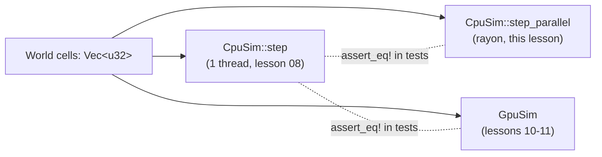
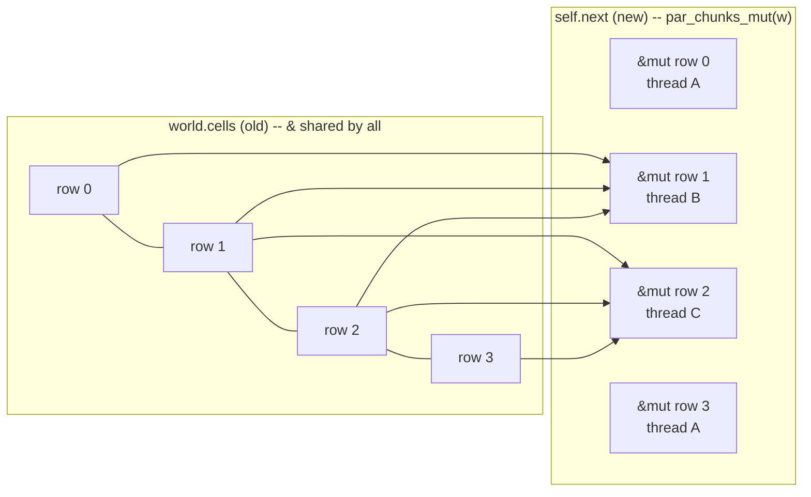

# Lesson 09 — Parallel CPU with rayon

> Course: rebuild the `sand/` falling-sand project from scratch.
> Previous: **08 Margolus blocks & double buffering (CPU)**. Next: **10 wgpu fundamentals**.

---

## 1. What you will build in this lesson

In lesson 08 you wrote `CpuSim::step`. It runs one physics step on one thread in two passes:

1. **Heat pass.** Read the old grid `world.cells` and write every cell of a new grid `self.next`. Then swap the two.
2. **Move pass.** Split the grid into 2x2 blocks (Margolus blocks, shifted by an offset `o` that is 0 or 1 depending on the frame). Update each block in place.

Your machine has many cores. `step` uses one of them. In this lesson you add `CpuSim::step_parallel`, which gives the **identical** result using all cores, through the [rayon](https://docs.rs/rayon/1.12.0) crate. You will also write a test that **proves** the two versions match bit for bit.

Where it sits in the project:



The single-thread CPU version is the reference that everything else is checked against. The rayon version is the fair "CPU at its best" baseline in the benchmark (lesson 12).

Code you will study:

- commit `31aed2d`, `sand/src/physics/cpu.rs`: the first `step_parallel` (one row per task).
- commit `1157366`, `sand/src/physics/cpu.rs`: the chunk-row version, where the single-thread and rayon paths run **the same closure**.

Read them yourself with:

```sh
git show 31aed2d:sand/src/physics/cpu.rs
git show 1157366:sand/src/physics/cpu.rs
```

---

## 2. Concepts

### 2.1 Threads, and the one thing that goes wrong: data races

A **thread** is an independent sequence of instructions. Threads in one program share the same memory. The OS runs them on different cores at the same time.

The core fact everything here rests on:

> **A data race happens when two threads access the same memory location at the same time, at least one of them writes, and nothing orders the accesses.**

All three parts are needed. If both threads only read, nothing can go wrong. If they touch different memory, nothing can go wrong either. The trouble starts only with *same location + at least one writer + no synchronisation*. When that happens, the result depends on timing. Run it twice and you may get two different grids. In C or C++ it is undefined behaviour: the compiler is allowed to assume it never happens.

For our grid this tells us exactly what we need. If every thread **writes only to its own cells** and **reads only data nobody is writing**, there can be no race. We don't need locks, and we don't need atomics.

### 2.2 Rust's rule: shared XOR mutable

You already know Rust's two kinds of reference:

| Reference | Meaning | How many at once |
|---|---|---|
| `&T` | shared: you may read | any number |
| `&mut T` | exclusive: you may read and write | exactly one, and no `&T` alongside it |

Compare this rule with the definition of a data race. A race needs *same location + one writer + concurrent access*. Rust forbids a writer (`&mut`) from existing alongside any other access to the same data. So if the borrow checker accepts your program, no two threads can race on a plain variable. **The rule you learned for single-threaded code is the same rule that prevents data races.** Rust gives you nothing new for threads here. It is the same rule, now applied across threads.

A tiny proof that the borrow checker understands slice overlap:

```rust
fn main() {
    let mut grid = vec![0u32; 8];
    let a = &mut grid[0..4];
    let b = &mut grid[2..6];   // overlaps a in [2..4]
    a[0] = 1; b[0] = 2;
}
```

```text
error[E0499]: cannot borrow `grid` as mutable more than once at a time
  = help: use `.split_at_mut(position)` to obtain two mutable non-overlapping sub-slices
```

The compiler can't tell from index arithmetic whether `0..4` and `2..6` overlap. It refuses both. But the library function `split_at_mut(mid)` returns two `&mut` slices that **cannot** overlap: one covers `[..mid]`, the other `[mid..]`. Inside, it uses a small piece of `unsafe` code that has been checked once, carefully. You get a safe API on top. `chunks_mut(n)` is the same idea applied many times: it cuts a slice into back-to-back, non-overlapping `&mut` pieces of length `n`. **rayon's `par_chunks_mut` is that same function, except the pieces go to different threads.**

### 2.3 `Send` and `Sync`, in plain words

When a value or reference moves to another thread, Rust checks two marker traits. The compiler implements them automatically.

- **`Send`**: "it is safe to *move* this value to another thread." Almost everything is `Send`. `Vec<u32>`, `&mut [u32]` and `usize` all are.
- **`Sync`**: "it is safe for several threads to hold `&` to this at the same time." By definition, `T: Sync` exactly when `&T: Send`. `u32`, `[u32]` and `Vec<bool>` are `Sync`. So are atomics and `Mutex`.

Types that break these rules are rare and have a reason. `Rc<T>` updates its reference count without synchronisation, so it is neither `Send` nor `Sync`. `Cell`/`RefCell` allow mutation through `&`, so they are not `Sync`.

rayon's methods put bounds on the closure you pass, for example `F: Fn(Self::Item) + Sync + Send`. The closure will run on many threads at once, so it must be `Sync`. A closure is `Sync` only if everything it captures is. Try capturing an `Rc`:

```rust
use rayon::prelude::*;
use std::rc::Rc;
fn main() {
    let shared = Rc::new(5u32);
    let v: Vec<u32> = (0..4u32).into_par_iter().map(|i| i + *shared).collect();
}
```

```text
error[E0277]: `Rc<u32>` cannot be shared between threads safely
    = help: within `{closure}`, the trait `Sync` is not implemented for `Rc<u32>`
    = note: required because it appears within the type `&Rc<u32>`
note: required by this bound in `ParallelIterator::map`
          F: Fn(Self::Item) -> R + Sync + Send,
```

Fix it by using `Arc` (atomic reference count), or by capturing a plain `&u32`.

### 2.4 Closures capture by reference

A closure such as `|y| row[y] = f(cells, y)` doesn't copy `cells`. By default it **borrows** each variable it uses, choosing the weakest borrow that works: `&` if it only reads, `&mut` if it writes. Only `move` closures take ownership.

That is why `step_parallel` first writes `let cells = &world.cells;`. The closure captures the variable `cells`, which is itself a `&Vec<u32>`, so each task gets a shared reference to the old grid. `w`, `h` and `frame` are `usize`/`u32`. They are `Copy` and also captured by reference, which costs nothing.

The `Fn` in rayon's bound matters. An `Fn` closure may only *read* its captures. If you try to *mutate* a captured variable, the closure becomes `FnMut`, and rayon refuses it. The next section shows the error.

### 2.5 The error you get for mutating shared state from rayon

```rust
use rayon::prelude::*;
fn main() {
    let mut total = Vec::new();
    (0..10).into_par_iter().for_each(|i| total.push(i));
}
```

```text
error[E0596]: cannot borrow `total` as mutable, as it is a captured variable in a `Fn` closure
 --> src/main.rs:4:42
  |
3 |     let mut total = Vec::new();
  |         --------- `total` declared here, outside the closure
4 |     (0..10).into_par_iter().for_each(|i| total.push(i));
  |                             -------------^^^^^---------
  |                             |        |   |
  |                             |        |   cannot borrow as mutable
  |                             |        in this closure
  |                             expects `Fn` instead of `FnMut`
```

How to read it: "`for_each` wants an `Fn` closure, so that it can call it from ten threads at once. Your closure needs `&mut total`. That would be ten `&mut` to one `Vec`, which is exactly a data race." In C++ this would compile and corrupt memory now and then. In Rust it does not compile.

There are three honest fixes, from best to worst:

1. **Give each task its own piece to write.** Use `par_chunks_mut` / `par_iter_mut`. This is what our grid does.
2. **Produce values and let rayon combine them.** Use `.map(...).collect()`, `.sum()` or `.reduce(...)`.
3. **Synchronise.** Use `AtomicU64::fetch_add` or a `Mutex<Vec<_>>`. This is correct but slow if every task fights over it.

### 2.6 rayon's toolkit

Put `rayon = "1.12.0"` in `Cargo.toml` and write `use rayon::prelude::*;`. The prelude adds `par_*` methods to slices, `Vec`s and ranges. Each one mirrors a sequential iterator you already know:

| Sequential | Parallel | Each task gets |
|---|---|---|
| `v.iter()` | `v.par_iter()` | `&T` |
| `v.iter_mut()` | `v.par_iter_mut()` | `&mut T` (one element) |
| `v.chunks(n)` | `v.par_chunks(n)` | `&[T]` of length `n` (last may be shorter) |
| `v.chunks_mut(n)` | `v.par_chunks_mut(n)` | `&mut [T]`, non-overlapping |
| `(0..n)` | `(0..n).into_par_iter()` | `usize` |
| `a.zip(b)` | `a.zip(b)` | `(item_a, item_b)` |
| `.enumerate()` | `.enumerate()` | `(index, item)` |
| `.for_each(f)` | `.for_each(f)` | runs `f` on every item, on some thread |

rayon keeps one global thread pool, by default one thread per logical core (`rayon::current_num_threads()`). It splits the work recursively and uses **work stealing**: an idle thread takes half of a busy thread's remaining range. `for_each` returns only once **every** item is done. That built-in barrier is why we can call `std::mem::swap` right after the heat pass without any extra synchronisation.

A small runnable example of all three fix styles:

```rust
use rayon::prelude::*;
use std::sync::atomic::{AtomicU64, Ordering};

fn main() {
    let grid = vec![3u32; 1_000_000];
    let sum: u64 = grid.par_iter().map(|&c| c as u64).sum();          // reduce
    let count = AtomicU64::new(0);                                       // synchronise
    grid.par_iter().for_each(|&c| if c == 3 { count.fetch_add(1, Ordering::Relaxed); });
    let rows: Vec<u32> = grid.par_chunks(1000).map(|r| r.iter().sum()).collect(); // collect
    println!("{sum} {} {}", count.load(Ordering::Relaxed), rows.len()); // 3000000 1000000 1000
}
```

### 2.7 The project's heat pass: rows as separate `&mut` slices

Here is the code from commit `31aed2d`, `sand/src/physics/cpu.rs`:

```rust
let cells = &world.cells;
self.next.par_chunks_mut(w).enumerate().for_each(|(y, row)| {
    for x in 0..w {
        row[x] = heat_cell(cells, w, h, x, y, frame);
    }
});
std::mem::swap(&mut world.cells, &mut self.next);
```

Read the types:

- `self.next.par_chunks_mut(w)` cuts the `h*w` scratch grid into `h` slices of width `w`. That is one slice per grid row, each a `&mut [u32]`.
- `.enumerate()` attaches the row number `y` to each one.
- Each task gets `(y, row)`. It may **write** only `row`, which is its own row. The type system enforces this: the closure has no other `&mut`.
- `heat_cell` needs the neighbours above and below, so it reads `cells`, the **old** grid, through `&`. Every task shares it. Nobody writes to it during this pass, because the writes go to `self.next`, a different `Vec`.

This is why double buffering (lesson 08) is the key to parallelism. With one buffer, row 5's task would read row 4 while row 4's task was overwriting it. That is a race, and the result would also depend on thread timing. With two buffers, the reads and writes never touch the same memory. Rust lets the code through because `&world.cells` and `&mut self.next` borrow two different fields. Disjoint fields can be borrowed independently.



### 2.8 The project's move pass: block rows starting at offset `o`

The move pass works **in place** on `world.cells`, one 2x2 block at a time. Blocks start at `(2*bx + o, 2*by + o)` with `o = block_offset(frame) = frame & 1`. Each block touches two grid rows, `y` and `y+1`, where `y = 2*by + o`. Blocks in the same block row share those two rows. Blocks in different block rows touch **different** rows. So a "row of blocks" is a self-contained unit of work.

The trick is to start slicing at row `o`, then cut pieces of `2*w` cells (two rows):

```rust
// commit 31aed2d, sand/src/physics/cpu.rs
let o = block_offset(frame);
world.cells[o * w..].par_chunks_mut(2 * w).enumerate().for_each(|(by, rows)| {
    if rows.len() < 2 * w {
        return; // a lone last row has no partner row
    }
    for bx in 0..w / 2 {
        let x = 2 * bx + o;
        if x + 1 >= w {
            continue;
        }
        let idx = [x, x + 1, w + x, w + x + 1];
        let mut cells = idx.map(|i| rows[i]);
        move_block(&mut cells, hash3(bx as u32, by as u32, frame));
        for k in 0..4 {
            rows[idx[k]] = cells[k];
        }
    }
});
```

Why this is correct:

- `world.cells[o * w..]` skips the first row on odd frames. Chunk number `by` then begins exactly at grid row `2*by + o`, the top row of block row `by`. So the `enumerate` index *is* the block-row index the single-thread loop uses.
- Inside a chunk, indices are **local**. The top row is `rows[0..w]` and the bottom row is `rows[w..2w]`, so the block's cells are `[x, x+1, w+x, w+x+1]`.
- If `h - o` is odd, the last chunk is a single row (`rows.len() == w`). It has no partner, and the sequential loop skips it too (`if y + 1 >= h { continue; }`). On odd frames, row 0 isn't in any block at all. Both versions agree.
- The random number is `hash3(bx, by, frame)`. It depends only on *which* block, never on *which thread* or *in what order*. That is what makes the result deterministic. A shared `rand::thread_rng()` would give different results from run to run.

Nobody had to prove that two tasks never touch the same cell. The proof is that `chunks_mut` hands out disjoint `&mut [u32]`. A bad index can only panic (out of bounds), never write into another task's rows.

### 2.9 The later version: one closure, two drivers

Chunk sleeping (lesson 13) adds a per-chunk `active` array (one `u32` per 32x32 chunk), which each task must also update. Commit `1157366` restructures the code so that the single-thread and rayon paths run **exactly the same closure**. Only the iterator that feeds it changes:

```rust
// commit 1157366, sand/src/physics/cpu.rs  (CHUNK = 32)
let awake = &self.awake;
let cells = &world.cells;
let heat = |(cy, (out, active)): (usize, (&mut [u32], &mut [u32]))| {
    heat_chunk_row(cells, out, active, &awake[cy * cw..(cy + 1) * cw], w, h, cy, frame);
};
if parallel {
    self.next.par_chunks_mut(CHUNK * w).zip(self.active.par_chunks_mut(cw)).enumerate().for_each(heat);
} else {
    self.next.chunks_mut(CHUNK * w).zip(self.active.chunks_mut(cw)).enumerate().for_each(heat);
}
```

New ideas here:

- **`zip`.** Two slices are cut in lockstep. Chunk row `cy` of the grid (32 rows = `CHUNK * w` cells) is paired with row `cy` of the chunk-activity array (`cw` entries). The task gets two disjoint `&mut` slices at once.
- **The closure is a value.** `heat` is built once and passed to either `for_each`. Its argument type is spelled out (`(usize, (&mut [u32], &mut [u32]))`) because the closure is defined before Rust sees which iterator will call it. Nested tuples come from `zip` and then `enumerate`: `(index, (a, b))`.
- **Why one closure is good.** If the two paths share the code, they can't drift apart. Only the scheduling differs.
- **Bigger tasks.** One task is now a 32-row band, not a single row. That means fewer tasks, less scheduling overhead, and better cache locality.

The move pass does the same with `grid = &mut world.cells[o * w..]` cut into `CHUNK * w` pieces. Chunk row `cy` owns the blocks whose top-left cell is in rows `cy*32 .. cy*32+32`. Its last block row reaches one row into the next band. The comment in the code explains why that is fine: the slices are cut starting from `o`, so each band runs from row `cy*32+o` to `cy*32+o+32`. Bands still never overlap.

### 2.10 Measured speedup, and why it isn't 10x

Measurements from the project's bench on an Apple M5 with 10 rayon threads:

| Grid | 1 thread | rayon | Speedup |
|---|---|---|---|
| 640x360 | 1.876 ms | 0.390 ms | 4.8x |
| 3840x2160 | 72.5 ms | 13.1 ms | 5.5x |

Ten threads, but about 5x. Ideal speedup with $p$ threads is $p$. **Amdahl's law** says that if a fraction $s$ of the work is serial,

$$ S(p) = \frac{1}{s + \frac{1-s}{p}} $$

That alone doesn't explain it: almost all of our step is parallel. Here are the real reasons:

1. **Memory bandwidth.** Each step streams the whole grid through the cores at least three times (read old, write new, then read and write again for the move pass). At 4K that is $3840 \cdot 2160 \cdot 4\,\text{B} \approx 33\,\text{MB}$ per pass, far bigger than the caches. The arithmetic per cell is small, so cores spend much of their time waiting for RAM. All cores share one memory bus. Adding cores adds compute, not bandwidth.
2. **Not all cores are equal.** The M5 mixes performance and efficiency cores. rayon counts 10 threads, but the efficiency cores do less work per second. Work stealing balances this, but the total is less than 10 "big" cores.
3. **Uneven work.** Rows full of air are cheap. Rows with falling sand, fire or heat changes are expensive. Work stealing helps, but at the end of each pass some threads sit idle waiting for the last band. There are two passes, so there are two such waits per step.
4. **Fixed overhead.** Every `for_each` costs a little to wake threads, split work and join. At 640x360 a step is only ~0.4 ms, so that overhead is a noticeable share. That is part of why the small grid scales worse (4.8x vs 5.5x).

The lesson: parallel CPU speedup is capped by the shared resource, which here is memory. This is also the reason for lessons 10-14. A GPU has roughly 10x the memory bandwidth.

---

## 3. Build it yourself

Goal: a small grid with the same two-pass shape (a read-old/write-new pass, then an in-place 2x2 block pass with an alternating offset). It has a single-thread `step`, a rayon `step_parallel`, and a test proving they match. Once this works, porting it into `sand/src/physics/cpu.rs` is a matter of swapping in `heat_cell`/`move_block`.

### Step 1: project

```sh
cargo new par --lib
cd par
cargo add rayon@1.12.0
```

Make sure `Cargo.toml` has `edition = "2024"`.

### Step 2: `src/lib.rs`, the single-thread version

The cell update rules are stand-ins: a vertical blur for "heat" and a random top/bottom swap for "move". What matters is the data access pattern.

```rust
//! A tiny grid with two passes, run on one thread or on all cores.
use rayon::prelude::*;

#[derive(Clone, PartialEq, Debug)]
pub struct Grid {
    pub w: usize,
    pub h: usize,
    pub frame: u32,
    pub cells: Vec<u32>,
}

/// Cheap deterministic hash: the "random" number depends only on (a, b, c).
pub fn hash3(a: u32, b: u32, c: u32) -> u32 {
    let mut x = a.wrapping_mul(0x9E37_79B9) ^ b.wrapping_mul(0x85EB_CA6B) ^ c.wrapping_mul(0xC2B2_AE35);
    x ^= x >> 16;
    x = x.wrapping_mul(0x7FEB_352D);
    x ^= x >> 15;
    x
}

impl Grid {
    pub fn new(w: usize, h: usize) -> Self {
        let cells = (0..w * h).map(|i| hash3(i as u32, 7, 0) % 100).collect();
        Grid { w, h, frame: 0, cells }
    }
}

/// Pass 1 for one cell: average with the cells above and below (reads only).
fn blur_cell(old: &[u32], w: usize, h: usize, x: usize, y: usize) -> u32 {
    let up = if y > 0 { old[(y - 1) * w + x] } else { old[y * w + x] };
    let down = if y + 1 < h { old[(y + 1) * w + x] } else { old[y * w + x] };
    (up + 2 * old[y * w + x] + down) / 4
}

/// Pass 2 for one 2x2 block: maybe swap top and bottom (writes in place).
/// `rows` is exactly two grid rows; `x` is the block's left column.
fn shuffle_block(rows: &mut [u32], w: usize, x: usize, r: u32) {
    if r & 1 == 1 {
        rows.swap(x, w + x);
    }
    if r & 2 == 2 {
        rows.swap(x + 1, w + x + 1);
    }
}

pub struct Sim {
    next: Vec<u32>,
}

impl Sim {
    pub fn new(g: &Grid) -> Self {
        Sim { next: vec![0; g.cells.len()] }
    }

    pub fn step(&mut self, g: &mut Grid) {
        let (w, h, frame) = (g.w, g.h, g.frame);
        for y in 0..h {
            for x in 0..w {
                self.next[y * w + x] = blur_cell(&g.cells, w, h, x, y);
            }
        }
        std::mem::swap(&mut g.cells, &mut self.next);

        let o = (frame & 1) as usize;
        for by in 0..h / 2 {
            let y = 2 * by + o;
            if y + 1 >= h {
                continue;
            }
            let rows = &mut g.cells[y * w..(y + 2) * w];
            for bx in 0..w / 2 {
                let x = 2 * bx + o;
                if x + 1 >= w {
                    continue;
                }
                shuffle_block(rows, w, x, hash3(bx as u32, by as u32, frame));
            }
        }
        g.frame = frame.wrapping_add(1);
    }
}
```

Note that `shuffle_block` already takes a two-row slice with local indices. Writing the sequential version in "per task" shape makes it easy to parallelise.

### Step 3: add `step_parallel` inside `impl Sim`

```rust
    pub fn step_parallel(&mut self, g: &mut Grid) {
        let (w, h, frame) = (g.w, g.h, g.frame);

        // Pass 1: every task reads all of `old` (&) and writes only its row (&mut).
        let old = &g.cells;
        self.next.par_chunks_mut(w).enumerate().for_each(|(y, row)| {
            for x in 0..w {
                row[x] = blur_cell(old, w, h, x, y);
            }
        });
        std::mem::swap(&mut g.cells, &mut self.next);

        // Pass 2: start at row o, hand out two rows per task.
        let o = (frame & 1) as usize;
        g.cells[o * w..].par_chunks_mut(2 * w).enumerate().for_each(|(by, rows)| {
            if rows.len() < 2 * w {
                return; // lone last row: no partner
            }
            for bx in 0..w / 2 {
                let x = 2 * bx + o;
                if x + 1 >= w {
                    continue;
                }
                shuffle_block(rows, w, x, hash3(bx as u32, by as u32, frame));
            }
        });
        g.frame = frame.wrapping_add(1);
    }
```

### Step 4: the proof test, at the bottom of `src/lib.rs`

```rust
#[cfg(test)]
mod tests {
    use super::*;

    #[test]
    fn parallel_matches_single_thread() {
        // Odd sizes and tiny sizes exercise the "lone last row" and o=1 edges.
        for (w, h) in [(64, 40), (65, 41), (3, 1), (1, 7)] {
            let mut a = Grid::new(w, h);
            let mut b = a.clone();
            let (mut sa, mut sb) = (Sim::new(&a), Sim::new(&b));
            for _ in 0..100 {
                sa.step(&mut a);
                sb.step_parallel(&mut b);
            }
            assert_eq!(a, b, "grids differ at {w}x{h}");
        }
    }
}
```

```sh
cargo test
# test tests::parallel_matches_single_thread ... ok
```

This is the same shape as the project's own test, `single_thread_and_rayon_give_identical_worlds`, in `sand/src/physics/mod.rs` (commit `31aed2d`). It clones one scene, steps one copy with `step` and the other with `step_parallel` 200 times, then runs `assert_eq!(a, b)`. `#[derive(PartialEq, Debug)]` on `Grid` is what lets `assert_eq!` compare whole worlds and print them if they differ.

### Step 5: a timing binary, `src/main.rs`

```rust
use par::{Grid, Sim};
use std::time::Instant;

fn main() {
    let (w, h) = (1920, 1080);
    println!("threads: {}", rayon::current_num_threads());
    for parallel in [false, true] {
        let mut g = Grid::new(w, h);
        let mut sim = Sim::new(&g);
        let n = 50;
        let t = Instant::now();
        for _ in 0..n {
            if parallel { sim.step_parallel(&mut g) } else { sim.step(&mut g) }
        }
        let ms = t.elapsed().as_secs_f64() * 1000.0 / n as f64;
        println!("{}: {ms:.3} ms/step", if parallel { "rayon   " } else { "1 thread" });
    }
}
```

```sh
cargo run --release
# threads: 10
# 1 thread: 12.476 ms/step
# rayon   : 3.826 ms/step
```

That's about 3.3x, which is less than the real project gets. Our toy rules do almost no arithmetic per cell, so it is even more memory-bound than the sand sim. That backs up section 2.10.

---

## 4. Live examples

**In this repo** (at commit `31aed2d` or later):

```sh
cd sand
cargo test --release single_thread_and_rayon   # the equality proof
cargo run --release --bin bench                # 1-thread vs rayon vs GPU per grid size
```

**Change the thread count** without touching code. rayon reads `RAYON_NUM_THREADS`:

```sh
for n in 1 2 4 6 8 10; do RAYON_NUM_THREADS=$n cargo run --release; done
```

Plot ms/step against threads. You should see the curve flatten well before 10. That flattening is the bandwidth wall.

**Things to tweak in your `par` crate:**

- Change `par_chunks_mut(w)` to `par_chunks_mut(32 * w)` in pass 1 (and use `y0 = idx * 32` plus a local row loop). Fewer, bigger tasks: is it faster?
- Make `blur_cell` expensive (say, loop the average 50 times). The work becomes compute-bound and the speedup should climb toward the core count.
- Replace `hash3(bx, by, frame)` with a global counter, `static N: AtomicU32` and `fetch_add`, as the random source. The test will start failing at random. That shows why randomness must depend on position, not on order.

---

## 5. Exercises

1. **(easy) Count with `par_iter`.** Write `fn count_nonzero(cells: &[u32]) -> usize` using `par_iter().filter(..).count()`, and test it against the sequential version.
   *Hint:* `filter` gets `&&u32`.

2. **(easy) `par_iter_mut`.** Write `fn cool(cells: &mut [u32])` that halves every cell in parallel.
   *Hint:* each item is `&mut u32`. Dereference it to write.

3. **(medium) Zip two outputs.** Change pass 1 of `step_parallel` so it also records, per row, whether any cell changed, in a `changed: Vec<bool>` of length `h` stored in `Sim`. Use `zip` the way commit `1157366` does.
   *Hint:* `self.next.par_chunks_mut(w).zip(self.changed.par_iter_mut()).enumerate()`.

4. **(medium) One closure, two drivers.** Refactor pass 1 into a single closure `blur_row` used by both `step` and `step_parallel`, chosen by a `parallel: bool` argument to a shared `step_impl`, like commit `1157366`.
   *Hint:* annotate the closure's argument type: `|(y, row): (usize, &mut [u32])|`. Passing the closure by value to `for_each` moves it. Either define it twice or pass `&blur_row`. `&F` implements `Fn` when `F: Fn`.

5. **(stretch) Bands of 32 rows for the move pass.** Make pass 2 hand out `32 * w` cells per task (16 block rows) instead of `2 * w`, starting from `o * w`. Keep the test passing.
   *Hint:* inside the band, loop `lb in 0..16`. The local top row is `2*lb`, and the global block row is `by = band * 16 + lb`. Stop when `2*lb + 1 >= rows.len() / w`.

6. **(stretch) Break it on purpose.** Remove the double buffer: make pass 1 write into `g.cells` directly via `par_chunks_mut`, while also reading neighbours from `g.cells`. Read the compiler error and explain in one sentence which race it prevented.
   *Hint:* you will be holding `&g.cells` and `&mut g.cells` at the same time.

---

## 6. Common mistakes and compiler errors

| You see | What it means | Fix |
|---|---|---|
| `E0596 cannot borrow X as mutable, as it is a captured variable in a Fn closure` | You mutate something captured from outside a rayon closure. That would be N threads with `&mut` to one value. | Write through the slice rayon gives you, or `map`/`collect`/`sum`, or use an atomic/`Mutex`. |
| `E0277 Rc<..> cannot be shared between threads safely` (or `Cell`, `RefCell`) | A non-`Sync` type is captured by a closure that must be `Sync`. | `Arc`, atomics, `Mutex`, or plain `&T`. |
| `E0502 cannot borrow world.cells as mutable because it is also borrowed as immutable` | You held `let cells = &world.cells;` while trying to swap or write `world.cells`. | End the shared borrow first. In the project, the `for_each` finishes and `cells` is never used again before `mem::swap`. Non-lexical lifetimes do the rest. |
| `E0499 cannot borrow as mutable more than once` | Two hand-made `&mut grid[a..b]` slices. | `split_at_mut`, `chunks_mut`, `par_chunks_mut`. |
| Panic `index out of bounds: the len is 1280 but the index is 1281` | The last chunk is shorter than you assumed (odd `h`, or `o = 1`). | Guard with `if rows.len() < 2 * w { return; }`, as the project does. |
| `type annotations needed` on a closure stored in a `let` | Rust can't infer the argument type of a closure not passed directly to an iterator. | Spell it out: `\|(cy, (out, active)): (usize, (&mut [u32], &mut [u32]))\|`. |
| Test passes on one run and fails on another | Randomness or results depend on thread order. | Derive every random number from position + frame (`hash3`), never from a shared counter or `thread_rng`. |
| Parallel version *slower* in debug | Unoptimised code plus thread overhead. | Always time with `--release`. |

A note on `E0502` and the heat pass: `let cells = &world.cells;` borrows only the field `cells`, while `self.next.par_chunks_mut` borrows a field of a **different** struct. Those are disjoint, so both can exist. If you had written a method `world.cells_ref()` returning `&Vec<u32>`, it would borrow all of `world`. That is still fine here, but it would conflict if you also needed `&mut world.frame` inside the closure. Borrowing fields directly gives the borrow checker the finest-grained information.

---

## 7. Recap

- A data race needs **same memory + a writer + concurrent access**. Rust's `&` (many readers) XOR `&mut` (one writer) rule excludes it, and `Send`/`Sync` extend that rule across threads.
- rayon's `par_*` methods mirror sequential iterators. `par_chunks_mut(n)` hands each task a **disjoint** `&mut [T]`, so the borrow checker proves tasks never write the same cell.
- Heat pass: shared `&world.cells` in, per-row `&mut` slices of `self.next` out. Double buffering is what makes this legal.
- Move pass: slice from `o * w` in chunks of `2 * w`, so each task owns one block row. Local indices are `[x, x+1, w+x, w+x+1]`.
- Determinism comes from `hash3(bx, by, frame)`, which depends on position and not on thread order. A test with `assert_eq!` proves single-thread and rayon results are identical.
- Commit `1157366` uses one closure with two drivers (`chunks_mut` vs `par_chunks_mut`), plus `zip` to hand out a second disjoint slice per task.
- About 5.5x on 10 threads, not 10x, because of memory bandwidth, mixed core types, uneven work and per-pass overhead.

**Next: Lesson 10 — wgpu fundamentals.** If memory bandwidth is the wall, go where there is more of it. You will create a GPU device, upload the grid into buffers, build a compute pipeline, and read results back.

---

## Solutions

<details><summary>Solution 1 — count_nonzero</summary>

```rust
use rayon::prelude::*;

pub fn count_nonzero(cells: &[u32]) -> usize {
    cells.par_iter().filter(|&&c| c != 0).count()
}

#[test]
fn count_matches() {
    let v: Vec<u32> = (0..10_000).map(|i| i % 3).collect();
    assert_eq!(count_nonzero(&v), v.iter().filter(|&&c| c != 0).count());
}
```
</details>

<details><summary>Solution 2 — cool</summary>

```rust
use rayon::prelude::*;

pub fn cool(cells: &mut [u32]) {
    cells.par_iter_mut().for_each(|c| *c /= 2);
}
```

Each task gets a different `&mut u32`. That is `par_chunks_mut(1)` without the slice.
</details>

<details><summary>Solution 3 — per-row changed flags with zip</summary>

```rust
pub struct Sim {
    next: Vec<u32>,
    pub changed: Vec<bool>, // one per row
}

impl Sim {
    pub fn new(g: &Grid) -> Self {
        Sim { next: vec![0; g.cells.len()], changed: vec![false; g.h] }
    }
}

// in step_parallel, pass 1:
let old = &g.cells;
self.next
    .par_chunks_mut(w)
    .zip(self.changed.par_iter_mut())
    .enumerate()
    .for_each(|(y, (row, changed))| {
        let mut any = false;
        for x in 0..w {
            let v = blur_cell(old, w, h, x, y);
            any |= v != old[y * w + x];
            row[x] = v;
        }
        *changed = any;
    });
```

`self.next` and `self.changed` are different fields, so both `&mut` borrows coexist.
</details>

<details><summary>Solution 4 — one closure, two drivers</summary>

```rust
impl Sim {
    pub fn step(&mut self, g: &mut Grid) { self.step_impl(g, false) }
    pub fn step_parallel(&mut self, g: &mut Grid) { self.step_impl(g, true) }

    fn step_impl(&mut self, g: &mut Grid, parallel: bool) {
        let (w, h, frame) = (g.w, g.h, g.frame);
        let old = &g.cells;
        let blur_row = |(y, row): (usize, &mut [u32])| {
            for x in 0..w {
                row[x] = blur_cell(old, w, h, x, y);
            }
        };
        if parallel {
            self.next.par_chunks_mut(w).enumerate().for_each(blur_row);
        } else {
            self.next.chunks_mut(w).enumerate().for_each(blur_row);
        }
        std::mem::swap(&mut g.cells, &mut self.next);

        let o = (frame & 1) as usize;
        let shuffle_rows = |(by, rows): (usize, &mut [u32])| {
            if rows.len() < 2 * w {
                return;
            }
            for bx in 0..w / 2 {
                let x = 2 * bx + o;
                if x + 1 >= w {
                    continue;
                }
                shuffle_block(rows, w, x, hash3(bx as u32, by as u32, frame));
            }
        };
        let grid = &mut g.cells[o * w..];
        if parallel {
            grid.par_chunks_mut(2 * w).enumerate().for_each(shuffle_rows);
        } else {
            grid.chunks_mut(2 * w).enumerate().for_each(shuffle_rows);
        }
        g.frame = frame.wrapping_add(1);
    }
}
```

Only one branch runs, so moving the closure into either `for_each` is fine. The compiler sees that each branch moves it at most once. The closure captures only `&` and `Copy` values, so it is `Fn + Sync + Send` and both drivers accept it. Keep `Sim::new` and the test unchanged. The test still passes.
</details>

<details><summary>Solution 5 — 32-row bands for the move pass</summary>

```rust
const BAND: usize = 32;          // grid rows per task (must be even)
let half = BAND / 2;             // block rows per task
let o = (frame & 1) as usize;
g.cells[o * w..].par_chunks_mut(BAND * w).enumerate().for_each(|(band, rows)| {
    let n_rows = rows.len() / w;
    for lb in 0..half {
        let ly = 2 * lb;
        if ly + 1 >= n_rows {
            break; // lone last row of the grid
        }
        let by = band * half + lb;
        let pair = &mut rows[ly * w..(ly + 2) * w];
        for bx in 0..w / 2 {
            let x = 2 * bx + o;
            if x + 1 >= w {
                continue;
            }
            shuffle_block(pair, w, x, hash3(bx as u32, by as u32, frame));
        }
    }
});
```

Band `band` starts at grid row `band*32 + o`, which is always the top row of block row `band*16`. So bands still contain whole blocks and never overlap. This is the same reasoning as the comment in commit `1157366`.
</details>

<details><summary>Solution 6 — break it on purpose</summary>

```rust
let old = &g.cells;
g.cells.par_chunks_mut(w).enumerate().for_each(|(y, row)| {
    for x in 0..w {
        row[x] = blur_cell(old, w, h, x, y);
    }
});
```

```text
error[E0502]: cannot borrow `g.cells` as mutable because it is also borrowed as immutable
```

The race it prevented: the task for row `y` would read row `y-1` while the task for row `y-1` was overwriting it. The result would depend on which thread got there first, so it would be wrong and non-deterministic. Even single-threaded, the result would differ from the double-buffered version, because row `y` would see the *new* row `y-1`.
</details>
