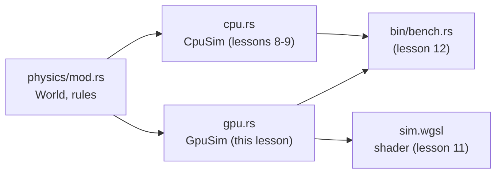
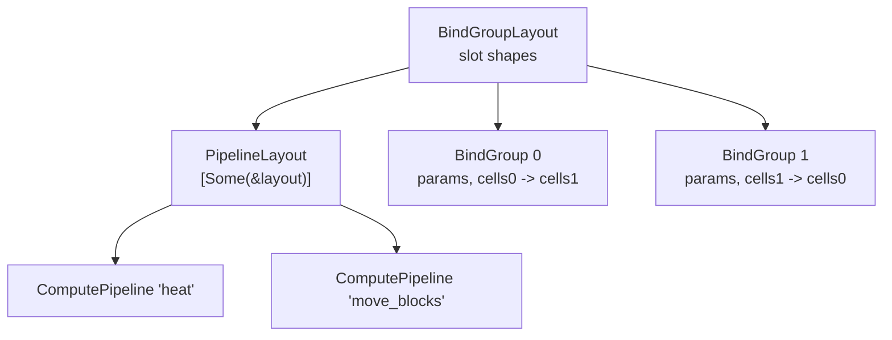
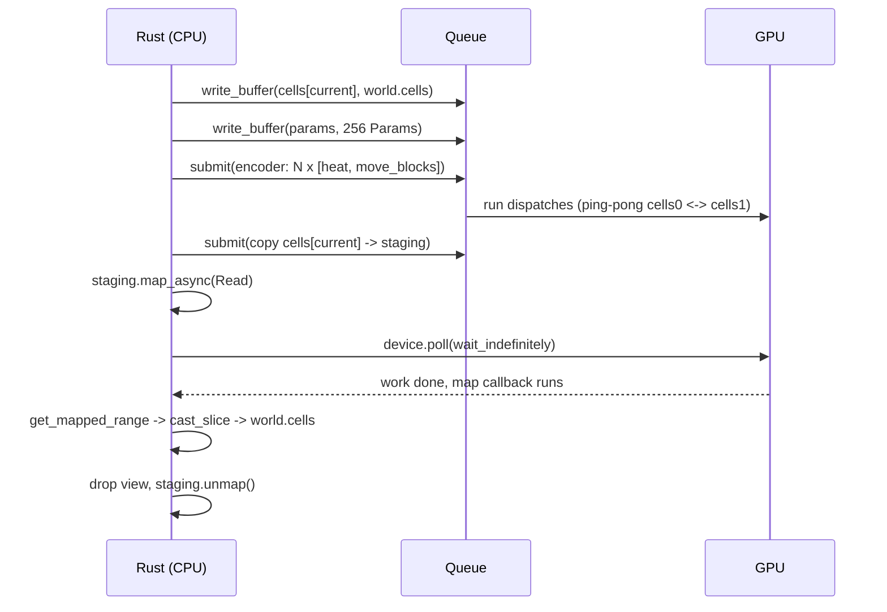

# Lesson 10 — wgpu fundamentals: device, buffers, pipelines, readback

> Source for this lesson: commit `31aed2d`, file `sand/src/physics/gpu.rs` (and `sand/src/physics/sim.wgsl`).
> Read it with `git show 31aed2d:sand/src/physics/gpu.rs`.
> Crates: `wgpu = "30.0.1"`, `pollster = "1.0.1"`, `bytemuck = { version = "1.25.2", features = ["derive"] }`.

---

## 1. What you will build in this lesson

By lesson 9 the physics engine runs on the CPU: a `World` holds `Vec<u32>` cells (one packed `u32` per cell, from lesson 6), and `CpuSim::step` / `step_parallel` advance it. A 4K grid has $3840 \times 2160 \approx 8.3$ million cells. Even with every CPU core busy, that is a lot of cells per step.

A GPU has thousands of small cores. This lesson teaches the **plumbing** that lets Rust hand the grid to the GPU, run a function on every cell at once, and get the result back. That plumbing is `GpuSim` in `sand/src/physics/gpu.rs`.

You will:

1. Write a standalone program, `gpu-double`, that doubles every number in a buffer on the GPU and reads the result back. About 150 lines. It contains every wgpu concept the sand engine uses.
2. Grow it into a ping-pong, multi-step version (the exercises), which has the same shape as `GpuSim::step`.
3. Map each piece onto the real `GpuSim`.

The shader *contents* (the physics rules ported to WGSL and kept bit-exact) are lesson 11. Here the shader is trivial on purpose, so you can focus on the Rust side.

Where it sits:



---

## 2. Concepts

### 2.1 What a compute shader is

Start from one fact you can accept without caveats:

> **A compute shader is one function. The GPU runs that function many times in parallel, and the only thing that differs between the runs is the ID each run receives.**

Each run is called an **invocation** (a thread). The function cannot return a value to you. Its only effect is writing into memory (buffers) that you gave it. So *all* communication between your Rust program and the GPU goes through buffers.

Compare with the CPU loop you already know:

```rust
// CPU: one thread walks every index
for i in 0..data.len() {
    data[i] *= 2;
}
```

```wgsl
// GPU: the loop disappears. Each invocation gets its own i.
@compute @workgroup_size(64)
fn double(@builtin(global_invocation_id) id: vec3<u32>) {
    let i = id.x;
    if (i >= params.count) { return; }
    data[i] = data[i] * 2u;
}
```

The `for` loop became "launch enough invocations". Each invocation does what one loop iteration did.

**Workgroups.** You do not launch single invocations. You launch **workgroups**, fixed-size bundles of invocations. The size is written in the shader (`@workgroup_size(64)` or `@workgroup_size(16, 16)` for 2-D). From Rust you say how many workgroups you want, in up to three dimensions:

```rust
pass.dispatch_workgroups(groups_x, groups_y, groups_z);
```

Total invocations $=$ groups $\times$ workgroup size. For $n$ items and a workgroup of 64 you need $\lceil n / 64 \rceil$ groups. Rust's integer `div_ceil` computes exactly that:

```rust
let n: u32 = 1000;
assert_eq!(n.div_ceil(64), 16); // 16 * 64 = 1024 invocations for 1000 items
```

The last group has 24 invocations with `i >= 1000`. That is why the shader starts with `if (i >= count) { return; }`. Without it, they write past the end of the buffer.

In the sand engine the grid is 2-D, so the workgroup is $16 \times 16$ and the dispatch is 2-D (`gpu.rs`, `31aed2d`):

```rust
const WORKGROUP: u32 = 16; // must match @workgroup_size in sim.wgsl
// ...
let cells = (self.width.div_ceil(WORKGROUP), self.height.div_ceil(WORKGROUP));
let blocks = ((self.width / 2).div_ceil(WORKGROUP), (self.height / 2).div_ceil(WORKGROUP));
```

`cells` launches one invocation per cell (for the heat pass). `blocks` launches one per $2\times2$ Margolus block (lesson 8), so half the width and half the height.

### 2.2 The object chain: Instance → Adapter → Device + Queue

Why so many objects? Each one answers a different question:

| Object | Question it answers |
|---|---|
| `Instance` | "Which graphics APIs exist on this machine?" (Metal, Vulkan, DX12, GL) |
| `Adapter` | "Which physical GPU do I use, and what can it do?" |
| `Device` | "Give me a logical connection I can create resources on." |
| `Queue` | "Where do I send work and data uploads?" |

The project's code (`gpu.rs`, `31aed2d`):

```rust
let instance = wgpu::Instance::new(wgpu::InstanceDescriptor::new_without_display_handle());
let adapter = instance
    .request_adapter(&wgpu::RequestAdapterOptions {
        power_preference: wgpu::PowerPreference::HighPerformance,
        ..Default::default()
    })
    .await
    .map_err(|e| e.to_string())?;
let adapter_name = format!("{} ({:?})", adapter.get_info().name, adapter.get_info().backend);
// Ask for the adapter's own limits, so big grids (4K) fit in one buffer.
let (device, queue) = adapter
    .request_device(&wgpu::DeviceDescriptor {
        label: Some("sand"),
        required_limits: adapter.limits(),
        ..Default::default()
    })
    .await
    .map_err(|e| e.to_string())?;
```

Things to notice:

- `InstanceDescriptor::new_without_display_handle()`: we never draw to a window here, so the instance needs no window handle. It enables the default backends for the platform.
- `HighPerformance` asks for the discrete GPU on laptops that have two.
- In wgpu 30, `request_adapter` returns a `Result` (older versions returned `Option`). That is why it can use `?` after `map_err`.
- `required_limits: adapter.limits()`. A device gets conservative default limits unless you ask for more. The default `max_storage_buffer_binding_size` is 128 MiB. A 4K grid is $3840 \times 2160 \times 4 = 33\,177\,600$ bytes, which fits, but asking for the adapter's real limits removes the worry for any size the hardware allows.
- `..Default::default()` is Rust's **struct update syntax**: "every field I did not name takes its value from `Default::default()`."

### 2.3 `async`, `.await` and `pollster::block_on`

`request_adapter` and `request_device` are `async fn`s. An `async fn` does not run when called. It returns a **future**: a value that represents "work that will finish later". Something has to drive the future to completion. That something is an **executor**.

Big executors (tokio) exist for servers. We only need to wait for two setup calls, so the tiny `pollster` crate is enough. `pollster::block_on(fut)` runs the future on the current thread and returns its output:

```rust
async fn answer() -> u32 { 42 }

fn main() {
    let x = pollster::block_on(answer()); // blocks until done
    println!("{x}");
}
```

The project wraps the async constructor in a normal one so callers never see `async` (`gpu.rs`, `31aed2d`):

```rust
pub fn new(world: &World) -> Result<Self, String> {
    pollster::block_on(Self::new_async(world))
}

async fn new_async(world: &World) -> Result<Self, String> { /* ... */ }
```

Inside an `async fn` you may write `.await` on other futures. Outside one, you cannot. That is the whole reason for the `new` / `new_async` split.

### 2.4 `Result`, `?` and `map_err(|e| e.to_string())`

`GpuSim::new` returns `Result<Self, String>`, not `Self`. A machine with no GPU (a CI server) should get an error the caller can print, not a panic. The bench and tests use this to skip the GPU.

`?` means: "if this is `Err(e)`, return `Err(e)` from the current function right now; otherwise unwrap the `Ok` value." It only works when the error types match. `request_adapter` fails with `wgpu::RequestAdapterError`, `request_device` with `wgpu::RequestDeviceError`. Our function promises `String`. So each error is converted first:

```rust
.map_err(|e| e.to_string())?
```

`map_err` applies a closure to the `Err` value and leaves `Ok` untouched. `to_string()` works on anything that implements `Display`, which both error types do. Tiny standalone version:

```rust
fn parse(s: &str) -> Result<u32, String> {
    let n: u32 = s.parse().map_err(|e: std::num::ParseIntError| e.to_string())?;
    Ok(n * 2)
}
```

### 2.5 Shader modules and `include_str!`

The shader is WGSL source text. The project keeps it in its own file, `sim.wgsl`, and pastes it into the binary at **compile time**:

```rust
let shader = device.create_shader_module(wgpu::ShaderModuleDescriptor {
    label: Some("sim.wgsl"),
    source: wgpu::ShaderSource::Wgsl(include_str!("sim.wgsl").into()),
});
```

`include_str!("sim.wgsl")` is a macro. The compiler reads the file (path relative to the current `.rs` file) and replaces the macro with a `&'static str` literal. No file I/O at runtime, and the binary works from any directory. `.into()` turns the `&str` into the `Cow<str>` that `ShaderSource::Wgsl` wants.

The WGSL is compiled for your GPU (by wgpu's `naga` compiler) when `create_shader_module` runs. A WGSL syntax error shows up as a panic at that line when you *run* the program, not when you `cargo build`.

### 2.6 Buffers and usages

A **buffer** is a block of GPU-visible memory with a size in bytes and a set of **usage flags**. The flags are a promise to wgpu about what you will do with the buffer. wgpu checks every operation against them, and the driver may put the buffer in faster memory based on them.

| Flag | Means |
|---|---|
| `STORAGE` | A shader may read/write it as `var<storage>` (big arrays) |
| `UNIFORM` | A shader may read it as `var<uniform>` (small, read-only constants) |
| `COPY_DST` | You may write into it (`queue.write_buffer`, or a copy target) |
| `COPY_SRC` | You may copy out of it (`copy_buffer_to_buffer` source) |
| `MAP_READ` | The CPU may map it and read its bytes |

Flags are combined with `|` (they are bitflags). One rule matters a lot: **a buffer with `MAP_READ` may only also have `COPY_DST`.** You cannot map a storage buffer directly. So reading results back always uses a separate **staging** buffer:

1. shader writes into a `STORAGE | COPY_SRC` buffer,
2. GPU copies it into a `MAP_READ | COPY_DST` staging buffer,
3. CPU maps the staging buffer and reads it.

The project creates buffers with a **closure used as a small factory** (`gpu.rs`, `31aed2d`):

```rust
let cell_count = (world.width * world.height) as u64;
let buffer = |label: &str, usage: wgpu::BufferUsages| {
    device.create_buffer(&wgpu::BufferDescriptor {
        label: Some(label),
        size: cell_count * 4,
        usage,
        mapped_at_creation: false,
    })
};
let grid_usage = wgpu::BufferUsages::STORAGE | wgpu::BufferUsages::COPY_DST | wgpu::BufferUsages::COPY_SRC;
let cells = [buffer("cells0", grid_usage), buffer("cells1", grid_usage)];
let staging = buffer("staging", wgpu::BufferUsages::MAP_READ | wgpu::BufferUsages::COPY_DST);
```

A closure (`|args| body`) is an anonymous function that can **capture** variables from the surrounding scope. This one captures `device` and `cell_count` by reference, so each call only passes what differs: the label and the usage. Three buffers, one descriptor written once. The same trick appears for `storage(binding, read_only)`, `pipeline(entry)` and `group(src)`. Whenever you see three near-identical struct literals, a local closure is the Rust way to remove the repetition without adding a top-level function.

`usage` inside the struct literal is **field init shorthand**: `usage` means `usage: usage`.

### 2.7 Getting bytes in: `#[repr(C)]`, `bytemuck`, `queue.write_buffer`

The GPU sees raw bytes. Rust values have to become `&[u8]`. Doing that by hand needs `unsafe`. `bytemuck` does it safely for types that are provably "just bytes".

```rust
#[repr(C)]
#[derive(Clone, Copy, bytemuck::Pod, bytemuck::Zeroable)]
struct Params {
    width: u32,
    height: u32,
    frame: u32,
    _pad: u32,
}
```

- `#[repr(C)]`: by default Rust may reorder struct fields. `repr(C)` fixes the layout to "fields in written order, C alignment rules". The WGSL `struct Params` has the same four `u32`s in the same order, so both sides agree byte for byte.
- `Pod` ("plain old data") means: every bit pattern is valid, no padding bytes, no pointers. `Zeroable` means all-zero bytes form a valid value. The derive macros **check** this at compile time. If you add a `bool` or leave hidden padding, it fails to compile.
- `_pad`: uniform structs in WGSL are laid out in 16-byte chunks. Four `u32`s is exactly 16 bytes, so padding to four fields keeps the sizes equal on both sides.

Two conversion functions:

```rust
bytemuck::bytes_of(&p)          // &Params    -> &[u8]   (one value)
bytemuck::cast_slice(&cells)    // &[u32]     -> &[u8]   (a slice)
bytemuck::cast_slice(&bytes)    // &[u8]      -> &[u32]  (the other way)
```

`cast_slice` reinterprets in place, no copying. Going `&[u8]` to `&[u32]` panics if the byte length is not a multiple of 4 or the pointer is not 4-byte aligned. wgpu's mapped ranges are aligned, so readback is fine.

Uploading the whole world (`gpu.rs`, `31aed2d`):

```rust
pub fn upload(&mut self, world: &World) {
    assert_eq!((world.width as u32, world.height as u32), (self.width, self.height));
    self.queue.write_buffer(&self.cells[self.current], 0, bytemuck::cast_slice(&world.cells));
    self.frame = world.frame;
}
```

`queue.write_buffer(buffer, offset, bytes)` copies `bytes` into wgpu's staging memory immediately and schedules the upload to happen before the next `queue.submit`. You can drop or change `world.cells` right after the call.

### 2.8 Bind group layouts, bind groups, pipeline layouts

A shader declares numbered slots:

```wgsl
@group(0) @binding(0) var<uniform> params: Params;
@group(0) @binding(1) var<storage, read> cells_in: array<u32>;
@group(0) @binding(2) var<storage, read_write> cells_out: array<u32>;
```

wgpu splits "connecting buffers to slots" into three objects. Each exists for a reason:

- **Bind group layout**: the *shape* of the slots. "Binding 0 is a uniform buffer, binding 1 is read-only storage, binding 2 is read-write storage." No actual buffers yet.
- **Pipeline layout**: the list of bind group layouts a pipeline uses (`@group(0)`, `@group(1)`, ...). The pipeline is compiled against this shape.
- **Bind group**: the actual buffers plugged into a layout's slots. You can make many bind groups for one layout and switch between them cheaply.

Why the split? Because compiling a pipeline is expensive and swapping buffers is cheap. Since the pipeline only knows the *shape*, you can compile it once and then point it at different buffers every dispatch. The sand engine needs exactly this for ping-pong (2.10).



The project's pipeline layout (`gpu.rs`, `31aed2d`):

```rust
let pipeline_layout = device.create_pipeline_layout(&wgpu::PipelineLayoutDescriptor {
    label: Some("sim"),
    bind_group_layouts: &[Some(&layout)],
    immediate_size: 0,
});
```

Two wgpu 30 specifics: `bind_group_layouts` is a slice of `Option<&BindGroupLayout>` (so `Some(&layout)`; a `None` leaves a group index empty), and `immediate_size: 0` says we use no immediate data (small constants pushed straight into the command stream; we use a uniform buffer instead).

### 2.9 Compute pipelines and entry points

A compute pipeline = shader module + entry point + pipeline layout. One WGSL file can hold several `@compute` functions, and `entry_point` picks one. The project builds two pipelines from one closure:

```rust
let pipeline = |entry: &str| {
    device.create_compute_pipeline(&wgpu::ComputePipelineDescriptor {
        label: Some(entry),
        layout: Some(&pipeline_layout),
        module: &shader,
        entry_point: Some(entry),
        compilation_options: Default::default(),
        cache: None,
    })
};
let heat = pipeline("heat");
let moves = pipeline("move_blocks");
```

`entry_point` is an `Option<&str>`. `None` works only if the module has exactly one compute entry point. With two (`heat` and `move_blocks`) you must name it.

### 2.10 Ping-pong buffers: two bind groups

The heat pass must read every cell's *old* temperature while writing *new* ones. If it read and wrote the same buffer, an invocation could read a neighbour that another invocation already updated, and the result would depend on thread timing. Lesson 8 solved this on the CPU with double buffering. The GPU version is the same idea: two buffers, read one, write the other, then swap roles.

You cannot swap buffers inside a bind group. So the project makes **two bind groups**, one per direction:

```rust
let group = |src: usize| {
    let dst = 1 - src;
    device.create_bind_group(&wgpu::BindGroupDescriptor {
        label: Some("sim"),
        layout: &layout,
        entries: &[
            wgpu::BindGroupEntry {
                binding: 0,
                resource: wgpu::BindingResource::Buffer(wgpu::BufferBinding {
                    buffer: &params,
                    offset: 0,
                    size: NonZeroU64::new(size_of::<Params>() as u64),
                }),
            },
            wgpu::BindGroupEntry { binding: 1, resource: cells[src].as_entire_binding() },
            wgpu::BindGroupEntry { binding: 2, resource: cells[dst].as_entire_binding() },
        ],
    })
};
let groups = [group(0), group(1)];
```

and a `current: usize` field that says which buffer holds the latest state. After each step: `self.current = 1 - self.current;`. Swapping is just flipping an integer.

### 2.11 Per-step parameters: a dynamic-offset uniform buffer

Each step needs a different `frame` number (the Margolus offset alternates with `frame & 1`, and the RNG hash uses it). If you `write_buffer` the params once per step, every dispatch in one submission sees the *last* value written, because all writes land before the submission runs. So we need 256 different `Params` alive at once.

Solution: one uniform buffer with room for `MAX_BATCH = 256` copies, and tell each dispatch *where* in it to look. That "where" is a **dynamic offset**:

- In the layout: `has_dynamic_offset: true` for binding 0.
- In the bind group: bind just `size_of::<Params>()` bytes starting at 0.
- At dispatch: `pass.set_bind_group(0, group, &[offset])`. The GPU reads params at `offset`.

The offset must be a multiple of the device limit `min_uniform_buffer_offset_alignment`, which is 256 bytes by default. Our struct is 16 bytes, but each copy sits in its own 256-byte slot:

$$\text{offset}_s = s \times 256, \qquad \text{buffer size} = 256 \times 256 = 65\,536 \text{ bytes}$$

```rust
/// Uniform buffer offsets must be multiples of this (WebGPU's default limit).
const PARAMS_STRIDE: u64 = 256;
// ...
let mut bytes = vec![0u8; (batch as u64 * PARAMS_STRIDE) as usize];
for s in 0..batch {
    let p = Params { width: self.width, height: self.height, frame: self.frame.wrapping_add(s), _pad: 0 };
    let at = (s as u64 * PARAMS_STRIDE) as usize;
    bytes[at..at + size_of::<Params>()].copy_from_slice(bytemuck::bytes_of(&p));
}
self.queue.write_buffer(&self.params, 0, &bytes);
```

`wrapping_add` makes overflow of `frame` wrap around to 0 instead of panicking in debug builds. The CPU code does the same, so both stay in sync.

**`NonZeroU64`.** `min_binding_size` and `BufferBinding::size` are `Option<NonZeroU64>`. `NonZeroU64` is a `u64` the type system guarantees is never 0. That lets `Option<NonZeroU64>` be 8 bytes, with `None` stored as 0. `NonZeroU64::new(n)` returns `Option<NonZeroU64>`: `Some` if `n != 0`, `None` if it is 0. That is exactly the type these fields want, so no unwrap is needed. `size: None` means "to the end of the buffer", which would be wrong for a dynamic-offset binding, so we give the exact struct size.

### 2.12 Recording and submitting: encoder, compute pass, `queue.submit`

The GPU does not take commands one at a time. You **record** a list of commands with a `CommandEncoder`, finish it into a `CommandBuffer`, and **submit** it to the queue. Submission returns immediately; the GPU works in the background.

```rust
let mut encoder = self.device.create_command_encoder(&Default::default());
{
    let mut pass = encoder.begin_compute_pass(&Default::default());
    // ... for each step in the batch:
    pass.set_bind_group(0, group, &offset);
    pass.set_pipeline(&self.heat);
    pass.dispatch_workgroups(cells.0, cells.1, 1);
    pass.set_pipeline(&self.moves);
    pass.dispatch_workgroups(blocks.0, blocks.1, 1);
    self.current = 1 - self.current;
}
self.queue.submit([encoder.finish()]);
```

The inner `{ ... }` block matters. `pass` borrows `encoder` mutably. `encoder.finish()` needs the encoder by value. The pass must be dropped (end of block) before you can call `finish`. This is ordinary borrow checking, applied to a GPU API.

**Batching.** Up to 256 steps (512 dispatches) go into one encoder and one submit. Submitting has a fixed CPU cost, so batching amortises it. wgpu inserts a barrier between dispatches that touch the same buffers, so each dispatch sees the previous one's writes.

### 2.13 Readback: copy → `map_async` → poll → read → unmap

```rust
pub fn download(&self, world: &mut World) {
    let mut encoder = self.device.create_command_encoder(&Default::default());
    encoder.copy_buffer_to_buffer(&self.cells[self.current], 0, &self.staging, 0, self.staging.size());
    self.queue.submit([encoder.finish()]);

    // Mapping is asynchronous: ask for it, then poll until it is done.
    self.staging.map_async(wgpu::MapMode::Read, .., |r| r.expect("map failed"));
    self.wait();
    {
        let view = self.staging.get_mapped_range(..).expect("mapped");
        world.cells.copy_from_slice(bytemuck::cast_slice(&view));
    } // the view must be dropped before unmapping
    self.staging.unmap();
    world.frame = self.frame;
}

pub fn wait(&self) {
    self.device.poll(wgpu::PollType::wait_indefinitely()).expect("GPU poll failed");
}
```

Step by step:

1. **Copy** the latest grid into the staging buffer (a GPU command, so it is recorded and submitted).
2. **`map_async`** asks for the staging buffer to become CPU-readable once the GPU is done with it. It takes a range (`..` = whole buffer) and a callback that is called with `Ok(())` or an error. It does not block.
3. **`device.poll(PollType::wait_indefinitely())`** blocks until all submitted work is done and runs pending callbacks, including the map callback. Native wgpu does not run callbacks on its own; you must poll.
4. **`get_mapped_range(..)`** gives a view that derefs to `&[u8]`. `cast_slice` turns it into `&[u32]` and `copy_from_slice` copies it into `world.cells`.
5. **Drop the view, then `unmap`**. While a view exists the buffer is still in use by the CPU. Unmapping with a live view panics. The extra `{}` block ends the view's lifetime first.

The whole round trip:



---

## 3. Build it yourself: `gpu-double`

Goal: double 1000 numbers on the GPU. Every concept above appears once. This code was compiled and run against wgpu 30.0.1 (output on an Apple M5: `using Apple M5 (Metal)`).

### Step 1: create the project

```bash
cargo new gpu-double
cd gpu-double
```

`Cargo.toml`:

```toml
[package]
name = "gpu-double"
version = "0.1.0"
edition = "2024"

[dependencies]
bytemuck = { version = "1.25.2", features = ["derive"] }
pollster = "1.0.1"
wgpu = "30.0.1"
```

The `derive` feature of bytemuck gives you `#[derive(Pod, Zeroable)]`.

### Step 2: the shader, `src/double.wgsl`

```wgsl
struct Params {
    count: u32,
    factor: u32,
    _pad0: u32,
    _pad1: u32,
}

@group(0) @binding(0) var<uniform> params: Params;
@group(0) @binding(1) var<storage, read_write> data: array<u32>;

@compute @workgroup_size(64)
fn double(@builtin(global_invocation_id) id: vec3<u32>) {
    let i = id.x;
    if (i >= params.count) {
        return; // the last workgroup may stick out past the end
    }
    data[i] = data[i] * params.factor;
}
```

### Step 3: `src/main.rs`

Write it in the order of the numbered comments. Each number is one section of the concepts above.

```rust
use std::num::NonZeroU64;

const WORKGROUP: u32 = 64; // must match @workgroup_size in double.wgsl

#[repr(C)]
#[derive(Clone, Copy, bytemuck::Pod, bytemuck::Zeroable)]
struct Params {
    count: u32,
    factor: u32,
    _pad0: u32,
    _pad1: u32,
}

fn main() {
    let input: Vec<u32> = (0..1000).collect();
    match pollster::block_on(run(&input, 2)) {
        Ok(output) => {
            println!("first 8: {:?}", &output[..8]);
            println!("last:    {}", output[output.len() - 1]);
            assert!(output.iter().zip(&input).all(|(o, i)| *o == i * 2));
            println!("all {} values doubled on the GPU", output.len());
        }
        Err(e) => eprintln!("GPU error: {e}"),
    }
}

async fn run(input: &[u32], factor: u32) -> Result<Vec<u32>, String> {
    // 1. Instance -> Adapter -> Device + Queue
    let instance = wgpu::Instance::new(wgpu::InstanceDescriptor::new_without_display_handle());
    let adapter = instance
        .request_adapter(&wgpu::RequestAdapterOptions {
            power_preference: wgpu::PowerPreference::HighPerformance,
            ..Default::default()
        })
        .await
        .map_err(|e| e.to_string())?;
    println!("using {} ({:?})", adapter.get_info().name, adapter.get_info().backend);
    let (device, queue) = adapter
        .request_device(&wgpu::DeviceDescriptor {
            label: Some("double"),
            required_limits: adapter.limits(),
            ..Default::default()
        })
        .await
        .map_err(|e| e.to_string())?;

    // 2. Shader module
    let shader = device.create_shader_module(wgpu::ShaderModuleDescriptor {
        label: Some("double.wgsl"),
        source: wgpu::ShaderSource::Wgsl(include_str!("double.wgsl").into()),
    });

    // 3. Buffers
    let size = (input.len() * 4) as u64;
    let buffer = |label: &str, size: u64, usage: wgpu::BufferUsages| {
        device.create_buffer(&wgpu::BufferDescriptor { label: Some(label), size, usage, mapped_at_creation: false })
    };
    let data = buffer(
        "data",
        size,
        wgpu::BufferUsages::STORAGE | wgpu::BufferUsages::COPY_DST | wgpu::BufferUsages::COPY_SRC,
    );
    let staging = buffer("staging", size, wgpu::BufferUsages::MAP_READ | wgpu::BufferUsages::COPY_DST);
    let params = buffer(
        "params",
        size_of::<Params>() as u64,
        wgpu::BufferUsages::UNIFORM | wgpu::BufferUsages::COPY_DST,
    );

    queue.write_buffer(&data, 0, bytemuck::cast_slice(input));
    let p = Params { count: input.len() as u32, factor, _pad0: 0, _pad1: 0 };
    queue.write_buffer(&params, 0, bytemuck::bytes_of(&p));

    // 4. Bind group layout -> pipeline layout -> pipeline
    let layout = device.create_bind_group_layout(&wgpu::BindGroupLayoutDescriptor {
        label: Some("double"),
        entries: &[
            wgpu::BindGroupLayoutEntry {
                binding: 0,
                visibility: wgpu::ShaderStages::COMPUTE,
                ty: wgpu::BindingType::Buffer {
                    ty: wgpu::BufferBindingType::Uniform,
                    has_dynamic_offset: false,
                    min_binding_size: NonZeroU64::new(size_of::<Params>() as u64),
                },
                count: None,
            },
            wgpu::BindGroupLayoutEntry {
                binding: 1,
                visibility: wgpu::ShaderStages::COMPUTE,
                ty: wgpu::BindingType::Buffer {
                    ty: wgpu::BufferBindingType::Storage { read_only: false },
                    has_dynamic_offset: false,
                    min_binding_size: None,
                },
                count: None,
            },
        ],
    });
    let pipeline_layout = device.create_pipeline_layout(&wgpu::PipelineLayoutDescriptor {
        label: Some("double"),
        bind_group_layouts: &[Some(&layout)],
        immediate_size: 0,
    });
    let pipeline = device.create_compute_pipeline(&wgpu::ComputePipelineDescriptor {
        label: Some("double"),
        layout: Some(&pipeline_layout),
        module: &shader,
        entry_point: Some("double"),
        compilation_options: Default::default(),
        cache: None,
    });

    // 5. Bind group: the actual buffers plugged into the slots
    let group = device.create_bind_group(&wgpu::BindGroupDescriptor {
        label: Some("double"),
        layout: &layout,
        entries: &[
            wgpu::BindGroupEntry { binding: 0, resource: params.as_entire_binding() },
            wgpu::BindGroupEntry { binding: 1, resource: data.as_entire_binding() },
        ],
    });

    // 6. Record commands, then submit
    let mut encoder = device.create_command_encoder(&Default::default());
    {
        let mut pass = encoder.begin_compute_pass(&Default::default());
        pass.set_pipeline(&pipeline);
        pass.set_bind_group(0, &group, &[]);
        pass.dispatch_workgroups((input.len() as u32).div_ceil(WORKGROUP), 1, 1);
    } // pass dropped here: recording of the pass ends
    encoder.copy_buffer_to_buffer(&data, 0, &staging, 0, size);
    queue.submit([encoder.finish()]);

    // 7. Readback
    staging.map_async(wgpu::MapMode::Read, .., |r| r.expect("map failed"));
    device.poll(wgpu::PollType::wait_indefinitely()).map_err(|e| e.to_string())?;
    let output: Vec<u32> = {
        let view = staging.get_mapped_range(..).map_err(|e| e.to_string())?;
        bytemuck::cast_slice(&view).to_vec()
    }; // view dropped before unmap
    staging.unmap();
    Ok(output)
}
```

Run it:

```bash
cargo run
```

```
using Apple M5 (Metal)
first 8: [0, 2, 4, 6, 8, 10, 12, 14]
last:    1998
all 1000 values doubled on the GPU
```

Note: the copy to staging went into the **same** encoder as the dispatch. One submit does both. `GpuSim` uses two submits (one in `step`, one in `download`) only because stepping and downloading are separate methods.

### Step 4: how it maps onto `GpuSim`

| `gpu-double` | `GpuSim` (`gpu.rs`, `31aed2d`) |
|---|---|
| `run` is `async`, called via `block_on` | `new` calls `block_on(Self::new_async(world))` |
| one `data` buffer | `cells: [wgpu::Buffer; 2]`, ping-pong |
| one bind group | `groups: [wgpu::BindGroup; 2]`, `groups[i]` reads `i`, writes `1 - i` |
| one 16-byte uniform | 256 slots of 256 bytes, `has_dynamic_offset: true` |
| 1 pipeline, entry `"double"` | 2 pipelines from one closure: `"heat"`, `"move_blocks"` |
| 1-D `dispatch_workgroups(n.div_ceil(64), 1, 1)` | 2-D, $16\times16$ workgroups, per cell and per block |
| upload in `run` | `upload(&mut self, world)` |
| one dispatch, then copy | `step(n)`: up to 256 steps per encoder, then `download` copies |
| local `staging` | `staging` kept in the struct and reused every download |
| returns `Vec<u32>` | `download(&self, world: &mut World)` fills an existing `Vec` |

Everything the device creates (buffers, pipelines, bind groups) is stored in the struct, because creating them is slow and they are reused every step. Only encoders and command buffers are made fresh each time; they are cheap and single-use.

---

## 4. Live examples

### 4.1 Tweak `gpu-double`

Try each change, run `cargo run`, and watch what happens:

- **Change the factor**: `run(&input, 3)` and fix the `assert!` to `i * 3`.
- **Make the count not a multiple of 64**: `(0..1000)` is already one. Now delete the `if (i >= params.count) { return; }` guard from the WGSL. Run it. On most backends wgpu clamps out-of-bounds storage accesses so it won't crash, but you are relying on luck: the extra 24 invocations do work that does nothing useful. Put the guard back.
- **Make it large**: `(0..50_000_000)`. That is 200 MB, above the 128 MiB default storage-binding limit. With `required_limits: adapter.limits()` it works on most GPUs. Replace that line with `..Default::default()` only, and you get a validation panic about the buffer binding size.
- **Print the limits**: add `println!("{:#?}", adapter.limits());` after the adapter. Find `min_uniform_buffer_offset_alignment` (256 on most hardware) and `max_compute_workgroup_size_x`.

### 4.2 Run the real engine at this commit

To see the GPU engine in this repo, check out the commit in a separate worktree (so you do not disturb your working copy):

```bash
git worktree add /tmp/sand-31aed2d 31aed2d
cd /tmp/sand-31aed2d/sand
cargo test --release gpu_gives_identical_world_to_cpu   # GPU world == CPU world, bit for bit
cargo run --release --bin bench                          # CPU vs GPU timings (lesson 12)
```

The bench prints the adapter name (from `adapter_name`), then per grid size the time per step for CPU 1 thread, CPU all cores, GPU, and GPU + readback. The gap between the last two is the cost of section 2.13 on every frame.

Experiment: in `gpu.rs` change `MAX_BATCH` to `1` and re-run the bench. Each step now gets its own `write_buffer` + encoder + submit, and you can see the per-submission overhead in the "gpu" column.

---

## 5. Exercises

**Exercise 1 (easy). Add instead of multiply.**
Change `gpu-double` so the GPU computes `data[i] + 100` for every element. Rename `factor` to `addend`.
*Hint:* only the WGSL line and the `Params` field name change, plus the `assert!`.

**Exercise 2 (easy). Return an error instead of panicking on map failure.**
The map callback does `r.expect("map failed")`. Callbacks cannot use `?`. Make `run` return `Err` if mapping failed.
*Hint:* a `std::sync::mpsc::channel()`. The callback sends `r` through the sender; after `poll`, receive it and `map_err` it.

**Exercise 3 (medium). Two entry points, one module.**
Add a second function `square` to the WGSL that does `data[i] = data[i] * data[i]`. Build two pipelines with a `pipeline(entry)` closure like the project's, and dispatch `double` then `square` in the same compute pass. For input `3` the output should be `36`.
*Hint:* both pipelines share `pipeline_layout` and the bind group. Call `set_pipeline` between the dispatches.

**Exercise 4 (medium). 2-D dispatch.**
Treat the 1000 numbers as a $40 \times 25$ grid. Use `@workgroup_size(16, 16)`, add `width` and `height` to `Params`, compute `i = y * width + x`, and dispatch `(40.div_ceil(16), 25.div_ceil(16), 1)`.
*Hint:* the guard becomes `if (x >= params.width || y >= params.height) { return; }`. `Params` now has `width, height, factor, _pad`: still 16 bytes.

**Exercise 5 (stretch). Ping-pong with per-step parameters.**
Build the core of `GpuSim::step` from scratch: two storage buffers, two bind groups, a uniform buffer with 10 `Params` at a 256-byte stride and a dynamic offset. Step $s$ (1-based) computes `dst[i] = src[i] + s`. Run 10 steps in one compute pass starting from zeros. Every output must be $1 + 2 + \dots + 10 = 55$.
*Hint:* copy the layout, `group(src)` closure and batching loop from `gpu.rs`. After the loop, `cells[current]` holds the result.

**Exercise 6 (stretch). Measure.**
Time `gpu-double` for 10 million elements with `std::time::Instant`: (a) upload, (b) dispatch + `poll`, (c) copy + map + read. Which part dominates? Compare with a plain CPU `for` loop.
*Hint:* call `device.poll(wait_indefinitely())` after each submit, or you are timing only the recording. Expect the transfer parts to dominate for something as cheap as `* 2`: that is why the sand engine keeps the world on the GPU and steps many times between downloads.

---

## 6. Common mistakes and how to read them

**"Validation Error ... Usage flags BufferUsages(...) of buffer ... do not contain required usage flags"** (wgpu panics, it does not return an error).
You forgot a flag. Typical cases: no `COPY_DST` on a buffer you `write_buffer` into, no `COPY_SRC` on the buffer you copy to staging, or no `COPY_DST` on the staging buffer. Read the buffer *label* in the message. Labels are why every descriptor has `label: Some("...")`.

**Panic creating a buffer with `MAP_READ | STORAGE`.**
`MAP_READ` may only be combined with `COPY_DST`. Use a staging buffer.

**"Dynamic binding offset ... must be aligned to 256"** or "out of bounds".
Your stride is not a multiple of `min_uniform_buffer_offset_alignment`, or `offset + binding size` runs past the end of the uniform buffer. Check `PARAMS_STRIDE` and that the buffer is `MAX_BATCH * PARAMS_STRIDE` bytes.

**Wrong number of dynamic offsets.**
If the layout says `has_dynamic_offset: true`, every `set_bind_group` for that group must pass exactly one offset per dynamic binding. `&[]` there is a validation error. Conversely, passing an offset when the layout says `false` is also an error.

**Shader errors at `create_shader_module`.**
WGSL is compiled at runtime, so `cargo build` succeeds and `cargo run` panics with a `naga` error that quotes the WGSL line, for example a missing `u` suffix (`2` vs `2u` when multiplying a `u32`) or an unknown identifier. Also: "entry point not found" means the string in `entry_point: Some("...")` does not match an `@compute fn` name.

**Bind group does not match the shader.**
The shader declares `var<storage, read_write>` but the layout says `read_only: true` (or the other way), or a binding number is missing. The panic names the binding. The layout, the WGSL `@binding(n)`, and the bind group entries must all agree.

**`cannot borrow encoder as mutable more than once` / `cannot move out of encoder because it is borrowed`.**
You called `encoder.finish()` or `encoder.copy_buffer_to_buffer(...)` while `pass` was still alive. Put the pass in its own `{ }` block, or call `drop(pass)` first.

**"Buffer is still mapped" / panic in `unmap`.**
A view from `get_mapped_range` is still alive. End its scope with `{ }` before `unmap()`.

**Reading zeros or old data.**
You read before the GPU finished. Without `device.poll(...wait_indefinitely())`, the map callback never runs and `get_mapped_range` fails. Also check you copied from `cells[current]`, not the other ping-pong buffer.

**`bytemuck` derive errors like "the trait `Pod` is not implemented" / "cannot implement Pod for a type with padding".**
Add `#[repr(C)]`, derive `Clone, Copy`, use only `Pod` field types (integers, floats, arrays of them), and pad by hand so there are no hidden gaps.

**Rust and WGSL `Params` disagree.**
Nothing checks this for you. If Rust has `width, height, frame, _pad` and WGSL has `frame, width, ...`, the shader silently reads the wrong numbers. Keep the two structs side by side and change them together.

---

## 7. Recap

- A compute shader is one function run by many invocations; the only difference between runs is the ID. All data goes in and out through buffers.
- Setup chain: `Instance` → `request_adapter` (a `Result` in wgpu 30) → `request_device` with `adapter.limits()` → `(Device, Queue)`. These are `async`; `pollster::block_on` drives them.
- Buffers carry usage flags. Readback always goes via a `MAP_READ | COPY_DST` staging buffer.
- `#[repr(C)]` + `bytemuck::Pod` give a byte layout you can share with WGSL; `cast_slice` / `bytes_of` convert without copying or `unsafe`.
- Layout (shape) → pipeline layout → pipeline (compiled once); bind groups (actual buffers) are cheap to switch. Two bind groups give ping-pong.
- A dynamic-offset uniform buffer with 256-byte slots gives each step in a batch its own parameters.
- Record many dispatches in one encoder/compute pass, `submit` once. Readback: copy → `map_async` → `poll` → `get_mapped_range` → drop view → `unmap`.
- Closures as factories (`buffer`, `storage`, `pipeline`, `group`) remove repeated descriptors; `include_str!` embeds the shader; `NonZeroU64::new` produces the `Option<NonZeroU64>` that sizes want.

**Next, lesson 11 — WGSL port & bit-exact determinism:** what goes inside `heat` and `move_blocks` in `sim.wgsl`, how the Rust rules from lesson 7 are translated line by line, and how the test `gpu_gives_identical_world_to_cpu` proves the GPU produces exactly the same world as the CPU.

---

## Solutions

<details><summary>Solution 1 — add instead of multiply</summary>

WGSL:

```wgsl
struct Params { count: u32, addend: u32, _pad0: u32, _pad1: u32, }
// ...
data[i] = data[i] + params.addend;
```

Rust: rename the field in `Params` and in the literal (`addend: 100`), call `run(&input, 100)`, and change the check to `*o == i + 100`.

</details>

<details><summary>Solution 2 — map error without panicking</summary>

```rust
let (tx, rx) = std::sync::mpsc::channel();
staging.map_async(wgpu::MapMode::Read, .., move |r| {
    let _ = tx.send(r); // ignore send error if the receiver is gone
});
device.poll(wgpu::PollType::wait_indefinitely()).map_err(|e| e.to_string())?;
rx.recv()
    .map_err(|e| e.to_string())?   // callback never ran
    .map_err(|e| e.to_string())?;  // mapping itself failed
```

`move` hands ownership of `tx` to the closure. The callback runs during `poll`, so after `poll` the result is waiting in the channel. Two `map_err`s: one for the channel's `RecvError`, one for the `BufferAsyncError`.

</details>

<details><summary>Solution 3 — two entry points</summary>

Add to `double.wgsl`:

```wgsl
@compute @workgroup_size(64)
fn square(@builtin(global_invocation_id) id: vec3<u32>) {
    let i = id.x;
    if (i >= params.count) { return; }
    data[i] = data[i] * data[i];
}
```

Replace the single pipeline with:

```rust
let pipeline = |entry: &str| {
    device.create_compute_pipeline(&wgpu::ComputePipelineDescriptor {
        label: Some(entry),
        layout: Some(&pipeline_layout),
        module: &shader,
        entry_point: Some(entry),
        compilation_options: Default::default(),
        cache: None,
    })
};
let double = pipeline("double");
let square = pipeline("square");
```

And the pass:

```rust
let groups = (input.len() as u32).div_ceil(WORKGROUP);
let mut pass = encoder.begin_compute_pass(&Default::default());
pass.set_bind_group(0, &group, &[]);
pass.set_pipeline(&double);
pass.dispatch_workgroups(groups, 1, 1);
pass.set_pipeline(&square);
pass.dispatch_workgroups(groups, 1, 1);
```

Check: `*o == (i * 2) * (i * 2)` (use small inputs so it does not overflow `u32`; `(0..1000)` is fine, max is $1998^2 \approx 4 \times 10^6$). Because now there are two entry points, `entry_point: None` would no longer work.

</details>

<details><summary>Solution 4 — 2-D dispatch</summary>

WGSL:

```wgsl
struct Params { width: u32, height: u32, factor: u32, _pad: u32, }
@group(0) @binding(0) var<uniform> params: Params;
@group(0) @binding(1) var<storage, read_write> data: array<u32>;

@compute @workgroup_size(16, 16)
fn double(@builtin(global_invocation_id) id: vec3<u32>) {
    let x = id.x;
    let y = id.y;
    if (x >= params.width || y >= params.height) { return; }
    let i = y * params.width + x;
    data[i] = data[i] * params.factor;
}
```

Rust:

```rust
const WORKGROUP: u32 = 16;

#[repr(C)]
#[derive(Clone, Copy, bytemuck::Pod, bytemuck::Zeroable)]
struct Params { width: u32, height: u32, factor: u32, _pad: u32 }

let (w, h) = (40u32, 25u32);
let p = Params { width: w, height: h, factor, _pad: 0 };
// ...
pass.dispatch_workgroups(w.div_ceil(WORKGROUP), h.div_ceil(WORKGROUP), 1); // (3, 2, 1)
```

$3 \times 2$ groups of $16 \times 16$ = $48 \times 32$ invocations cover the $40 \times 25$ grid; the guard drops the rest. This is exactly the `cells` dispatch in `GpuSim::step`.

</details>

<details><summary>Solution 5 — ping-pong with dynamic offsets (compiled and run: prints all 55s)</summary>

`src/bin/pingpong.wgsl`:

```wgsl
struct Params {
    count: u32,
    step: u32,
    _pad0: u32,
    _pad1: u32,
}

@group(0) @binding(0) var<uniform> params: Params;
@group(0) @binding(1) var<storage, read> src: array<u32>;
@group(0) @binding(2) var<storage, read_write> dst: array<u32>;

@compute @workgroup_size(64)
fn add_step(@builtin(global_invocation_id) id: vec3<u32>) {
    let i = id.x;
    if (i >= params.count) {
        return;
    }
    dst[i] = src[i] + params.step;
}
```

`src/bin/pingpong.rs` (run with `cargo run --bin pingpong`):

```rust
use std::num::NonZeroU64;

const WORKGROUP: u32 = 64;
const STRIDE: u64 = 256; // uniform dynamic offsets must be multiples of 256
const STEPS: u32 = 10;

#[repr(C)]
#[derive(Clone, Copy, bytemuck::Pod, bytemuck::Zeroable)]
struct Params {
    count: u32,
    step: u32,
    _pad0: u32,
    _pad1: u32,
}

fn main() {
    let input = vec![0u32; 8];
    let out = pollster::block_on(run(&input)).unwrap();
    // 1 + 2 + ... + 10 = 55
    println!("{out:?}");
}

async fn run(input: &[u32]) -> Result<Vec<u32>, String> {
    let instance = wgpu::Instance::new(wgpu::InstanceDescriptor::new_without_display_handle());
    let adapter = instance
        .request_adapter(&Default::default())
        .await
        .map_err(|e| e.to_string())?;
    let (device, queue) = adapter
        .request_device(&Default::default())
        .await
        .map_err(|e| e.to_string())?;
    let shader = device.create_shader_module(wgpu::ShaderModuleDescriptor {
        label: None,
        source: wgpu::ShaderSource::Wgsl(include_str!("pingpong.wgsl").into()),
    });

    let size = (input.len() * 4) as u64;
    let buffer = |size: u64, usage: wgpu::BufferUsages| {
        device.create_buffer(&wgpu::BufferDescriptor { label: None, size, usage, mapped_at_creation: false })
    };
    let usage = wgpu::BufferUsages::STORAGE | wgpu::BufferUsages::COPY_DST | wgpu::BufferUsages::COPY_SRC;
    let cells = [buffer(size, usage), buffer(size, usage)];
    let staging = buffer(size, wgpu::BufferUsages::MAP_READ | wgpu::BufferUsages::COPY_DST);
    let params = buffer(STEPS as u64 * STRIDE, wgpu::BufferUsages::UNIFORM | wgpu::BufferUsages::COPY_DST);

    queue.write_buffer(&cells[0], 0, bytemuck::cast_slice(input));
    let mut bytes = vec![0u8; (STEPS as u64 * STRIDE) as usize];
    for s in 0..STEPS {
        let p = Params { count: input.len() as u32, step: s + 1, _pad0: 0, _pad1: 0 };
        let at = (s as u64 * STRIDE) as usize;
        bytes[at..at + size_of::<Params>()].copy_from_slice(bytemuck::bytes_of(&p));
    }
    queue.write_buffer(&params, 0, &bytes);

    let storage = |binding: u32, read_only: bool| wgpu::BindGroupLayoutEntry {
        binding,
        visibility: wgpu::ShaderStages::COMPUTE,
        ty: wgpu::BindingType::Buffer {
            ty: wgpu::BufferBindingType::Storage { read_only },
            has_dynamic_offset: false,
            min_binding_size: None,
        },
        count: None,
    };
    let layout = device.create_bind_group_layout(&wgpu::BindGroupLayoutDescriptor {
        label: None,
        entries: &[
            wgpu::BindGroupLayoutEntry {
                binding: 0,
                visibility: wgpu::ShaderStages::COMPUTE,
                ty: wgpu::BindingType::Buffer {
                    ty: wgpu::BufferBindingType::Uniform,
                    has_dynamic_offset: true,
                    min_binding_size: NonZeroU64::new(size_of::<Params>() as u64),
                },
                count: None,
            },
            storage(1, true),
            storage(2, false),
        ],
    });
    let pipeline_layout = device.create_pipeline_layout(&wgpu::PipelineLayoutDescriptor {
        label: None,
        bind_group_layouts: &[Some(&layout)],
        immediate_size: 0,
    });
    let pipeline = device.create_compute_pipeline(&wgpu::ComputePipelineDescriptor {
        label: None,
        layout: Some(&pipeline_layout),
        module: &shader,
        entry_point: Some("add_step"),
        compilation_options: Default::default(),
        cache: None,
    });
    let group = |src: usize| {
        device.create_bind_group(&wgpu::BindGroupDescriptor {
            label: None,
            layout: &layout,
            entries: &[
                wgpu::BindGroupEntry {
                    binding: 0,
                    resource: wgpu::BindingResource::Buffer(wgpu::BufferBinding {
                        buffer: &params,
                        offset: 0,
                        size: NonZeroU64::new(size_of::<Params>() as u64),
                    }),
                },
                wgpu::BindGroupEntry { binding: 1, resource: cells[src].as_entire_binding() },
                wgpu::BindGroupEntry { binding: 2, resource: cells[1 - src].as_entire_binding() },
            ],
        })
    };
    let groups = [group(0), group(1)];

    let mut current = 0;
    let mut encoder = device.create_command_encoder(&Default::default());
    {
        let mut pass = encoder.begin_compute_pass(&Default::default());
        pass.set_pipeline(&pipeline);
        for s in 0..STEPS {
            pass.set_bind_group(0, &groups[current], &[(s as u64 * STRIDE) as u32]);
            pass.dispatch_workgroups((input.len() as u32).div_ceil(WORKGROUP), 1, 1);
            current = 1 - current;
        }
    }
    encoder.copy_buffer_to_buffer(&cells[current], 0, &staging, 0, size);
    queue.submit([encoder.finish()]);

    staging.map_async(wgpu::MapMode::Read, .., |r| r.expect("map failed"));
    device.poll(wgpu::PollType::wait_indefinitely()).map_err(|e| e.to_string())?;
    let out = {
        let view = staging.get_mapped_range(..).map_err(|e| e.to_string())?;
        bytemuck::cast_slice::<u8, u32>(&view).to_vec()
    };
    staging.unmap();
    Ok(out)
}
```

Output: `[55, 55, 55, 55, 55, 55, 55, 55]`.

Try writing all 10 `Params` into the *same* slot (offset 0 every time) instead: every step then sees `step = 10` (the last write), and you get `100`. That is the bug the 256-byte slots prevent. Also try forgetting `current = 1 - current`: every step reads the zeros in `cells[0]` and the result is just `10`.

</details>

<details><summary>Solution 6 — measuring</summary>

```rust
use std::time::Instant;

let t = Instant::now();
queue.write_buffer(&data, 0, bytemuck::cast_slice(input));
queue.submit([]); // flush the pending write
device.poll(wgpu::PollType::wait_indefinitely()).map_err(|e| e.to_string())?;
println!("upload:   {:?}", t.elapsed());

let t = Instant::now();
let mut encoder = device.create_command_encoder(&Default::default());
{
    let mut pass = encoder.begin_compute_pass(&Default::default());
    pass.set_pipeline(&pipeline);
    pass.set_bind_group(0, &group, &[]);
    pass.dispatch_workgroups((input.len() as u32).div_ceil(WORKGROUP), 1, 1);
}
queue.submit([encoder.finish()]);
device.poll(wgpu::PollType::wait_indefinitely()).map_err(|e| e.to_string())?;
println!("dispatch: {:?}", t.elapsed());

let t = Instant::now();
let mut encoder = device.create_command_encoder(&Default::default());
encoder.copy_buffer_to_buffer(&data, 0, &staging, 0, size);
queue.submit([encoder.finish()]);
staging.map_async(wgpu::MapMode::Read, .., |r| r.expect("map failed"));
device.poll(wgpu::PollType::wait_indefinitely()).map_err(|e| e.to_string())?;
let output: Vec<u32> = bytemuck::cast_slice(&staging.get_mapped_range(..).map_err(|e| e.to_string())?).to_vec();
staging.unmap();
println!("readback: {:?}", t.elapsed());

let t = Instant::now();
let cpu: Vec<u32> = input.iter().map(|x| x * 2).collect();
println!("cpu loop: {:?}", t.elapsed());
```

(Move the `write_buffer` of `data` out of its earlier position so it is only timed here.) Run with `cargo run --release`. For a one-multiply kernel, upload and readback dominate and the CPU loop is competitive. The lesson for the sand engine: keep the world on the GPU, do many steps per submission, and download as rarely as possible. Lesson 12 measures this properly, and lesson 15 removes the per-frame download altogether.

</details>
