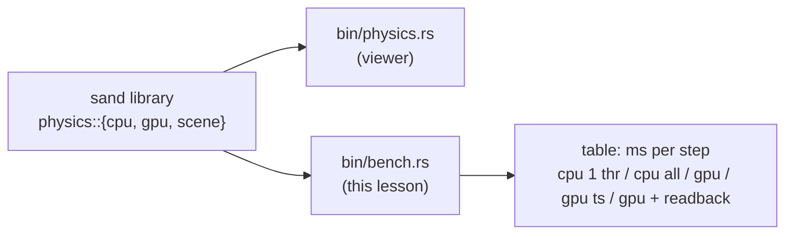
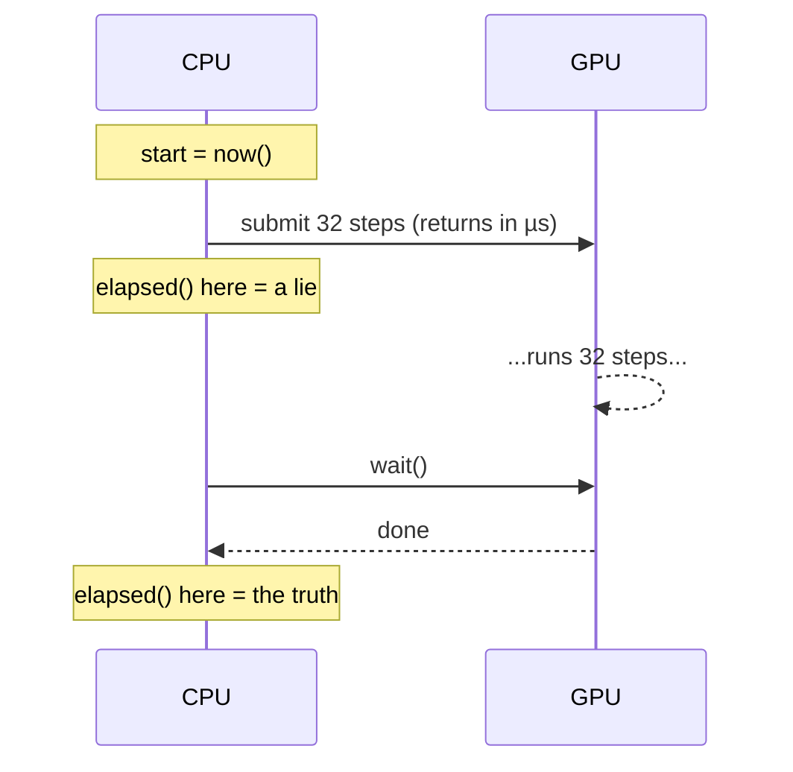
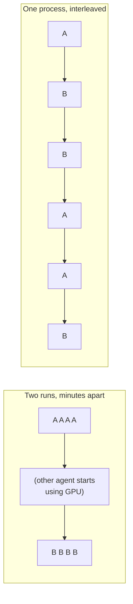

# Lesson 12 — Benchmarking honestly

> Sources: `sand/src/bin/bench.rs` at commits `2fbcad6` and `d94ade6`, the `GpuTimer` code at the bottom of `sand/src/physics/gpu.rs` at `d94ade6`, and `sand/Cargo.toml` at `d94ade6`.

## 1. What you will build

By now the project has three ways to run one simulation step: `CpuSim::step` (one thread), `CpuSim::step_parallel` (rayon, every core), and `GpuSim::step` (a wgpu compute shader). The question this lesson answers is: **which one is faster, and by how much?**

That sounds like "start a stopwatch, run it, stop the stopwatch". In practice, nearly every simple way of doing it gives a wrong number. This lesson goes through each way it goes wrong, and for each one shows the fix that `bench.rs` uses.

What you will build:

- a small **benchmark harness**: one function, `time_it`, with warm-up, a time budget and a per-unit result,
- a **formatted comparison table** that compares two implementations of the same function,
- add-ons that cope with noise: best of N, and A/B runs interleaved in one process.

Where it sits in the project:



`bench.rs` is a separate binary. It only uses the library's public API, so it measures exactly the code the viewer runs.

Here is the result it produced the first time it ran on the author's Apple M5 (commit `2fbcad6`, milliseconds per step, lower is better):

| grid | cpu 1 thread | cpu all cores | gpu | gpu + readback |
|---|---|---|---|---|
| 640x360 | 1.876 | 0.390 | 0.085 | 0.298 |
| 3840x2160 | 72.465 | 13.117 | 2.768 | 5.389 |

Keep this table in mind. By the end of the lesson you should be able to say what each column means, which column the user actually pays, and why "the GPU is 26x faster" is true and also misleading.

---

## 2. Concepts

### 2.1 Two unconditional truths

Start from two facts that hold with no exceptions:

1. **A benchmark measures exactly what happened between your two clock readings. Nothing more, nothing less.** If the work did not happen between the readings, it was not measured. If something else happened in between, it was measured too.
2. **One measurement is one sample from a noisy process.** The machine is running other things as well: the OS, other programs, thermal limits, clock-speed changes. Two runs of the same code never give exactly the same number.

Every technique in this lesson follows from these two facts. Warm-up, `wait()`, `black_box`, the readback column, best-of-N and interleaving are all ways to make "what happened between the readings" match "the thing I meant to measure", and then to deal with the noise.

### 2.2 `std::time::Instant` and `Duration`

`Instant` is a reading from a **monotonic** clock. It never goes backwards, even if the wall clock is changed (NTP, daylight saving). That makes it the right clock for timing. `SystemTime` is the wrong one.

`Duration` is a span of time (whole seconds plus nanoseconds). Subtracting two `Instant`s gives you a `Duration`.

```rust
use std::time::{Duration, Instant};

fn main() {
    let start = Instant::now();
    let mut x = 0u64;
    for i in 0..10_000_000u64 { x = x.wrapping_add(i * i); }
    let took: Duration = start.elapsed();          // same as Instant::now() - start
    println!("{x} in {took:?}");                  // Debug prints e.g. "7.1ms"
    println!("{:.3} ms", took.as_secs_f64() * 1000.0);

    let budget = Duration::from_secs_f64(0.5);   // build one from a float
    println!("{}", took < budget);              // Durations compare with < >
}
```

The methods you will use: `Instant::now()`, `instant.elapsed()`, `duration.as_secs_f64()`, `Duration::from_secs_f64(f)` and `Duration::from_millis(n)`. The project's `main` turns the first command-line argument into the budget:

```rust
// sand/src/bin/bench.rs @ 2fbcad6
let seconds: f64 = std::env::args().nth(1).and_then(|s| s.parse().ok()).unwrap_or(1.0);
let budget = Duration::from_secs_f64(seconds);
```

That one line uses three `Option` steps. `nth(1)` returns `Option<String>`. `and_then` tries to parse it, and `.ok()` turns the `Result` into an `Option`. `unwrap_or(1.0)` supplies the default. So `cargo run --release --bin bench -- 3` gives a 3-second budget, and a bad argument quietly falls back to 1 s.

### 2.3 The harness: `impl FnMut() -> u32`

The core of `bench.rs` is a single function:

```rust
// sand/src/bin/bench.rs @ 2fbcad6 (unchanged at d94ade6)
/// Run `step` repeatedly for at least `budget`; return the mean ms per call.
/// `step` returns how many steps it ran, so batched GPU calls count right.
fn time_it(budget: Duration, mut step: impl FnMut() -> u32) -> f64 {
    for _ in 0..3 {
        step(); // warm up: caches, thread pool, GPU clocks
    }
    let start = Instant::now();
    let mut steps = 0u64;
    while start.elapsed() < budget || steps < 5 {
        steps += step() as u64;
    }
    start.elapsed().as_secs_f64() * 1000.0 / steps as f64
}
```

Here is how you could have come up with each part.

**Why a closure?** We want to time four very different things (`sim.step(&mut world)`, `sim.step_parallel(..)`, GPU step+wait, GPU step+download) with the same loop. The common part is "something I can call repeatedly". In Rust that is a closure. The only question is which of the closure traits to accept:

| trait | the closure may… | can call it… |
|---|---|---|
| `Fn` | only read what it captured | many times, even through `&` |
| `FnMut` | **mutate** what it captured | many times, through `&mut` |
| `FnOnce` | consume what it captured | once |

Our bodies mutate captured state (`world`, `sim`, the GPU), so `Fn` is too strict and would not compile. `FnOnce` only allows one call. `FnMut` is the one that fits. That is also why the parameter is declared `mut step`: calling an `FnMut` needs `&mut` access to it.

`impl FnMut() -> u32` in argument position means "some concrete closure type, chosen by the caller". The compiler makes a separate copy of `time_it` for each closure (monomorphisation), so the call `step()` gets inlined and the harness itself costs almost nothing. A `&mut dyn FnMut() -> u32` would work too, but it adds an indirect call per iteration.

A tiny standalone example of an `FnMut` that captures state:

```rust
fn call_three_times(mut f: impl FnMut() -> u32) -> u32 {
    f() + f() + f()
}

fn main() {
    let mut counter = 0;
    let total = call_three_times(|| { counter += 1; counter });  // mutates `counter`
    println!("{total} {counter}"); // 6 3
}
```

**Why return `u32`?** This one comes from the GPU. Submitting GPU work and waiting for it has a fixed cost per round trip, so the bench queues **32 steps** and then waits once. If the closure returned `()` and `time_it` counted calls, the result would be "ms per 32 steps" labelled as "ms per step", which is 32 times too large. Having the closure report how much work it did keeps the unit the same across all columns:

```rust
// sand/src/bin/bench.rs @ 2fbcad6
let single = time_it(budget, || {
    sim.step(&mut world);
    1                       // one step of work
});
// ...
let gpu = time_it(budget, || {
    g.step(32);
    g.wait();
    32                      // thirty-two steps of work
});
```

Now `time_it` divides total time by total *steps*, not by total *calls*, and every column means "ms per simulation step".

**Why warm up?** The first few calls are slower for reasons that have nothing to do with steady-state speed. Caches are cold, memory pages are touched for the first time, rayon's thread pool starts its threads on the first `par_*` call, GPU pipelines finish compiling lazily, and the GPU raises its clock only once it has work. Three untimed calls get these one-off costs out of the measurement.

**Why a time budget instead of a fixed count?** A fixed count (say 100 iterations) is either far too long or far too short. 100 single-thread steps at 4K is 7 seconds. 100 GPU steps at 640x360 is 8 ms, short enough that a single OS hiccup would dominate. A budget gives every measurement the same amount of wall time, so each one averages over enough noise. The `|| steps < 5` guard makes sure even a very slow body runs a handful of times.

Note that the loop condition also checks `start.elapsed()` on every iteration. Reading the clock costs some tens of nanoseconds, which is negligible next to a step that takes 0.08 to 70 ms.

### 2.4 Why GPU timing needs `wait()`

From the GPU lesson: `GpuSim::step` **records commands and submits them, then returns straight away**. The doc comment says so:

```rust
// sand/src/physics/gpu.rs @ d94ade6
/// Queue `steps` simulation steps. Returns straight away: the GPU works
/// in the background. Call `wait` or `download` to wait for it.
pub fn step(&mut self, mut steps: u32) { ... }

/// Block until the GPU has finished all queued work.
pub fn wait(&self) {
    self.device.poll(wgpu::PollType::wait_indefinitely()).expect("GPU poll failed");
}
```

Apply truth #1. If you time `g.step(32)` alone, the clock is read again before the GPU has done the work. What you have measured is *how fast the CPU can append to a queue*. Worse, the queue fills up over the budget and the driver eventually stalls you anyway, so the number is wrong and also unstable.



Live example 4.2 below simulates this with a worker thread. You will see "0.000 ms per step" without `wait` and "2.5 ms" with it.

### 2.5 GPU timestamp queries vs wall-clock time

Even with `wait()`, the wall-clock number includes CPU-side overhead: building the command encoder, writing the params buffer, `submit`, and the OS waking our thread after `poll`. That is fair to count when the question is "how fast does my program go". It is not what you want when the question is "how fast is my shader".

Commit `d94ade6` added a second GPU column measured **by the GPU's own clock**. With `wgpu::Features::TIMESTAMP_QUERY`, a compute pass can ask the GPU to write a tick counter at the beginning and at the end of the pass:

```rust
// sand/src/physics/gpu.rs @ d94ade6
(first || last).then(|| wgpu::ComputePassTimestampWrites {
    query_set: &timer.queries,
    beginning_of_pass_write_index: first.then_some(0),
    end_of_pass_write_index: last.then_some(1),
})
```

After the passes, `timer_end` resolves the two ticks into a buffer, copies them to a mappable buffer and starts an async map. `harvest` reads them later *without blocking*, and converts ticks to ms using `queue.get_timestamp_period()` (nanoseconds per tick):

```rust
// sand/src/physics/gpu.rs @ d94ade6, GpuTimer::harvest
let ms = (ticks[1] - ticks[0]) as f64 * self.ns_per_tick / 1e6;
self.last_ms_per_step = Some(ms / slot.steps as f64);
```

The divide by `slot.steps` is the same idea as returning `u32` from the closure: always report per step.

The bench collects one timestamp reading per batch inside the timed closure, and then throws away the first three, because those came from the warm-up calls:

```rust
// sand/src/bin/bench.rs @ d94ade6
let mut stamps = Vec::new();
let gpu = time_it(budget, || {
    g.step(32);
    g.wait();
    stamps.extend(g.gpu_time_ms());   // Option<f64> is an iterator of 0 or 1 items
    32
});
let skip = stamps.len().min(3); // warm-up calls
let gpu_ts = (stamps.len() > skip)
    .then(|| stamps[skip..].iter().sum::<f64>() / (stamps.len() - skip) as f64);
```

Two small Rust idioms are worth noticing here. `Vec::extend(option)` works because `Option<T>` implements `IntoIterator`. `bool::then(|| ...)` turns a condition plus a value into an `Option`, which is how "n/a" falls out naturally when the adapter has no timestamps.

So the difference between "gpu" and "gpu (timestamps)" is the CPU-side overhead per step. The timestamp number is the one to use when tuning the shader (lesson 14). The wall-clock number is the one that matters to the program. A comment in `gpu.rs` notes one limit: timestamps *between* dispatches inside a pass would need `TIMESTAMP_QUERY_INSIDE_PASSES`, which Apple GPUs do not have, so the code only times whole `step` calls.

### 2.6 Measure what the user actually pays

Look at the 640x360 row again: gpu **0.085 ms**, gpu + readback **0.298 ms**. That is 3.5 times slower. The readback column is a different body:

```rust
// sand/src/bin/bench.rs @ 2fbcad6
let readback = time_it(budget, || {
    g.step(1);
    g.download(&mut world);   // copy grid to staging, map, wait, memcpy into World
    1
});
```

That is what a game pays each frame if it simulates on the GPU but draws from a CPU-side `World`: one step, then the full grid comes back over the bus, then the CPU waits. The file's doc comment says it directly: *"This is what a game that draws on the CPU pays per frame."*

Now compare fairly:

| 640x360 | ms | vs cpu all cores |
|---|---|---|
| cpu all cores | 0.390 | 1.0x |
| gpu (throughput) | 0.085 | 4.6x faster |
| gpu + readback | 0.298 | **1.3x faster** |

At small sizes the "GPU is 4.6x faster" headline becomes "1.3x faster" once you count the cost the user actually sees. At 4K it is 13.117 vs 5.389, a real 2.4x. This finding is why lesson 15 builds a viewer that never does a blocking readback.

### 2.7 Fair baselines

The tempting headline from the 4K row is 72.465 / 2.768 = **26x**. But that compares a GPU against *one CPU core*, and nobody ships single-threaded code when rayon is one line away. Against all cores it is 13.117 / 2.768 = **4.7x**. The bench prints both ratio columns (`gpu vs 1 thr`, `gpu vs all`) so the honest one is always there to read.

The rule is to compare against the best reasonable version of the alternative. A weak baseline makes any optimisation look good.

### 2.8 Check correctness before timing

A fast wrong answer is worthless, and a bug can easily *look* like a speed-up (for example a shader that skips half the cells). So before printing any timing, `bench.rs` runs 300 steps on all three backends and compares every cell:

```rust
// sand/src/bin/bench.rs @ d94ade6
let differ = |a: &World, b: &World| (0..a.cells.len()).filter(|&i| a.cells[i] != b.cells[i]).count();
match (differ(&single, &multi), differ(&single, &gpu_world)) {
    (0, 0) => Ok(()),
    (m, g) => Err(format!("{m} cells differ (rayon), {g} cells differ (gpu)")),
}
```

This works because lesson 11 made the GPU **bit-exact** with the CPU. Every later optimisation (packing, sleeping, fusing) had to keep this line printing `cpu 1 thread == cpu all cores == gpu, every cell`.

The same idea applies to small benchmarks: `assert_eq!(a(&input), b(&input))` before timing either one.

### 2.9 Release vs debug, and `black_box`

Never benchmark a debug build. `cargo run` builds the `dev` profile: no or little optimisation, overflow checks, and debug assertions. Live example 4.1, run both ways on the M5:

```text
cargo run --release              cargo run   (debug)
3840x2160 rows  0.733 ms         3840x2160 rows  87.545 ms
3840x2160 cols 17.605 ms         3840x2160 cols 113.463 ms
```

Debug is more than 100x slower, and it also **hides the effect being measured**. The 24x gap between rows and columns shrinks to about 1.3x, because the debug overhead per element is larger than the cache effect. Conclusions drawn from debug numbers do not carry over to release builds.

(This project sets `[profile.dev] opt-level = 1` and `opt-level = 3` for dependencies, so the viewer is playable in debug. That makes debug less slow, but it still is not what you ship.)

The opposite problem shows up in release. If the optimiser can prove a result is never used, it may delete the work entirely, and you end up timing an empty loop. `std::hint::black_box(x)` tells the compiler "assume someone looks at `x`", which stops that. The project's benches do not need it, because every body writes to a `World` or to GPU memory that is later read. A micro-benchmark that computes a number and throws it away does need it.

### 2.10 Build settings: LTO, codegen-units, panic, target-cpu

`d94ade6` added to `sand/Cargo.toml`:

```toml
[profile.release]
lto = "fat"
codegen-units = 1
panic = "abort"
```

- `lto = "fat"`: link-time optimisation across **all** crates, so the optimiser can inline across crate boundaries (for example rayon's closures into our code).
- `codegen-units = 1`: compile each crate as one unit instead of splitting it up for parallel compilation. Builds are slower, but the optimiser sees everything at once.
- `panic = "abort"`: a panic kills the process instead of unwinding. That removes unwinding tables and landing pads, which makes the binary smaller and the code sometimes a little tighter.

These cost compile time and are cheap to try. Keep them only if you measure a gain.

The next idea people reach for is `RUSTFLAGS="-C target-cpu=native" cargo run --release --bin bench`, which lets rustc use every instruction your exact CPU supports. On this project it gave **no measurable benefit**, and there are two reasons that make sense. First, on `aarch64-apple-darwin` the default target is already an Apple-silicon CPU with NEON, so "native" (`apple-m5`, as `rustc --print target-cpus` reports) adds little to the generic build. Second, the hot loops here are limited by memory traffic and by the GPU, not by which instructions are available. It also has a cost: a `native` binary may crash on an older CPU. So it was left out. The lesson is not that `target-cpu=native` is useless. The lesson is that you measure before you keep a setting.

### 2.11 Noise: the 2-3x variance story

Truth #2 was demonstrated directly during this project. While the GPU kernel was being tuned (lessons 13 and 14), several agents were working **at the same time on the same machine**, each running `cargo run --release --bin bench` against the **same GPU**. The GPU numbers began jumping by **2 to 3 times** between runs of identical code. A change could look like a 40% speed-up in one run and a regression in the next. Nothing in the code was varying. Another process was taking GPU time between our clock readings, and by truth #1 that time was counted.

Simple ways to cope, in order of effectiveness:

1. **Remove the noise source**: close other GPU or CPU-heavy programs, plug in the laptop, and don't benchmark while something else is benchmarking.
2. **Best of N**: run the measurement N times and take the **minimum**. Noise from other processes can only *add* time, never remove it, so the minimum is the closest to the true cost. (Report the median too, if you want to describe typical behaviour.)
3. **Interleave A and B in one process**: run A, B, B, A, A, B, ... and compare each one's best. Two separate runs (`bench` on build A, then later `bench` on build B) can land in different noise conditions: a background job starts, the chip heats up and slows down. Interleaving exposes both versions to the same conditions, so slow drift affects both equally and mostly cancels out.



You will build both in the exercises. Exercise 6 runs an interleaved A/B on the real `GpuSim` (sleeping on vs off).

---

## 3. Build it yourself

Goal: a standalone program that compares two implementations of the same function with a proper harness, and prints a table like `bench.rs` does.

The two implementations: sum the temperature field (the high 16 bits of each packed `u32` cell, as in lesson 6) over a `w*h` grid, once **row by row** and once **column by column**. They give the same answer and touch the same memory, but in a different order. That makes it a clean test of memory access order.

**Step 1.** Create the project.

```bash
cargo new benchlab
cd benchlab
```

**Step 2.** Write the harness. This is the same `time_it` as the project, with the parameter renamed `body` because it is no longer always a sim step.

**Step 3.** Write the two implementations.

**Step 4.** In `main`: build a deterministic grid, **assert that both agree**, time both with `black_box`, and print a table using width specifiers (`{:>11}` right-aligns in 11 columns, `{:.3}` prints 3 decimals).

The complete `src/main.rs`:

```rust
use std::hint::black_box;
use std::time::{Duration, Instant};

/// Run `body` repeatedly for at least `budget`; return mean ms per unit of work.
/// `body` returns how many units it did, so batched bodies are counted right.
fn time_it(budget: Duration, mut body: impl FnMut() -> u32) -> f64 {
    for _ in 0..3 {
        body(); // warm-up: caches, branch predictors, page faults, CPU clocks
    }
    let start = Instant::now();
    let mut units = 0u64;
    while start.elapsed() < budget || units < 5 {
        units += body() as u64;
    }
    start.elapsed().as_secs_f64() * 1000.0 / units as f64
}

/// Sum every cell's temperature (bits 16..32), walking row by row.
fn sum_rows(cells: &[u32], w: usize, h: usize) -> u64 {
    let mut total = 0u64;
    for y in 0..h {
        for x in 0..w {
            total += (cells[y * w + x] >> 16) as u64;
        }
    }
    total
}

/// Same sum, walking column by column: same answer, jumps `w` cells each read.
fn sum_cols(cells: &[u32], w: usize, h: usize) -> u64 {
    let mut total = 0u64;
    for x in 0..w {
        for y in 0..h {
            total += (cells[y * w + x] >> 16) as u64;
        }
    }
    total
}

fn main() {
    let seconds: f64 = std::env::args().nth(1).and_then(|s| s.parse().ok()).unwrap_or(0.5);
    let budget = Duration::from_secs_f64(seconds);
    let sizes = [(640, 360), (1920, 1080), (3840, 2160)];

    println!("{:>11} | {:>12} | {:>12} | {:>8}", "grid", "rows", "cols", "cols/rows");
    println!("{}", "-".repeat(52));
    for (w, h) in sizes {
        // Deterministic fake grid: temperature in the high 16 bits.
        let cells: Vec<u32> = (0..w * h).map(|i| ((i as u32).wrapping_mul(2654435761) >> 16) << 16).collect();

        // 1. Correctness before timing.
        assert_eq!(sum_rows(&cells, w, h), sum_cols(&cells, w, h), "implementations disagree");

        // 2. Time each one. black_box stops the optimiser deleting unused work.
        let rows = time_it(budget, || {
            black_box(sum_rows(black_box(&cells), w, h));
            1
        });
        let cols = time_it(budget, || {
            black_box(sum_cols(black_box(&cells), w, h));
            1
        });
        println!("{:>11} | {:>9.3} ms | {:>9.3} ms | {:>7.1}x", format!("{w}x{h}"), rows, cols, cols / rows);
    }
}
```

**Step 5.** Run it in release.

```bash
cargo run --release          # 0.5 s per measurement
cargo run --release -- 2     # 2 s per measurement, steadier
```

Output on the Apple M5 (your numbers will differ):

```text
       grid |         rows |         cols | cols/rows
----------------------------------------------------
    640x360 |     0.033 ms |     0.335 ms |    10.3x
  1920x1080 |     0.313 ms |     3.321 ms |    10.6x
  3840x2160 |     0.733 ms |    17.605 ms |    24.0x
```

Same arithmetic, same answer, up to 24x slower. Reading row by row walks memory in order, so every 64-byte cache line brought in supplies 16 cells. Reading column by column jumps `4*w` bytes on each read, so it uses one cell per cache line. The CPU lessons used row-major loops for this reason, and the GPU kernel keeps neighbouring threads on neighbouring cells for the same reason.

Two things are worth noticing in the closure body. `black_box(&cells)` hides the input, so the compiler cannot precompute the sum once, outside the loop. `black_box(sum_rows(...))` hides the output, so the call cannot be deleted as unused.

---

## 4. Live examples

### 4.1 Debug vs release, and the benchlab table

Run the program above both ways and compare:

```bash
cargo run -- 0.3             # debug
cargo run --release -- 0.3   # release
```

Things to try:

- Delete both `black_box` calls and rerun in release. The "rows" column may collapse toward zero, or it may not, depending on what the optimiser can prove. In either case you can no longer trust the number.
- Change the warm-up from `0..3` to `0..0` and use a tiny budget (`-- 0.001`). The first size gets noisier, because the first touch of the freshly allocated pages lands inside the timed region.
- Add a size `(4096, 4096)`. Column order gets especially bad when the row length is a power of two, because every read maps to the same few cache sets.

### 4.2 Why `wait()` matters: a fake asynchronous GPU

`cargo new asyncclock`, then `src/main.rs`:

```rust
use std::sync::mpsc;
use std::thread;
use std::time::{Duration, Instant};

/// A pretend GPU: a worker thread that does jobs from a queue.
struct FakeGpu {
    jobs: mpsc::Sender<u32>,
    done: mpsc::Receiver<u32>,
    queued: u32,
}

impl FakeGpu {
    fn new() -> Self {
        let (jobs, rx) = mpsc::channel::<u32>();
        let (tx, done) = mpsc::channel::<u32>();
        thread::spawn(move || {
            for job in rx {
                thread::sleep(Duration::from_millis(2)); // "2 ms of GPU work"
                tx.send(job).unwrap();
            }
        });
        FakeGpu { jobs, done, queued: 0 }
    }
    /// Like `GpuSim::step`: queue work and return at once.
    fn step(&mut self, n: u32) {
        for i in 0..n {
            self.jobs.send(i).unwrap();
        }
        self.queued += n;
    }
    /// Like `GpuSim::wait`: block until all queued work has finished.
    fn wait(&mut self) {
        while self.queued > 0 {
            self.done.recv().unwrap();
            self.queued -= 1;
        }
    }
}

fn main() {
    let mut gpu = FakeGpu::new();

    let t = Instant::now();
    gpu.step(10);
    println!("without wait: {:.3} ms per step  (a lie)", t.elapsed().as_secs_f64() * 1000.0 / 10.0);
    gpu.wait(); // drain before the next measurement

    let t = Instant::now();
    gpu.step(10);
    gpu.wait();
    println!("with wait:    {:.3} ms per step  (the truth)", t.elapsed().as_secs_f64() * 1000.0 / 10.0);
}
```

```text
without wait: 0.000 ms per step  (a lie)
with wait:    2.511 ms per step  (the truth)
```

Try removing the `gpu.wait()` that drains the queue between the two measurements. The second number then includes the first batch's leftover work too, so work leaks from one measurement into the next. On a real GPU, that is what happens if one bench column doesn't finish before the next one starts.

### 4.3 The real bench

From the repo:

```bash
cd sand
cargo run --release --bin bench          # ~1 s per cell of the table
cargo run --release --bin bench -- 3     # steadier
```

Run it twice in a row and compare the GPU columns, to see how much noise *your* machine has. Then start a second copy in another terminal while the first is running, and watch both get worse. That is the multi-agent contamination from 2.11, reproduced on purpose.

To check the `target-cpu` result yourself:

```bash
cargo run --release --bin bench > plain.txt
RUSTFLAGS="-C target-cpu=native" cargo run --release --bin bench > native.txt
```

(Changing `RUSTFLAGS` rebuilds everything.) Compare the CPU columns. Differences within your run-to-run noise mean "no effect".

---

## 5. Exercises

All exercises start from `benchlab/src/main.rs` in section 3, except number 6.

1. **(Easy) Report the count.** Make a `time_it_counted` that returns `(f64, u64)`: ms per unit *and* how many units ran. Print both for `sum_rows` at 1920x1080. *Hint:* the only change is the return expression. Is a 0.5 s budget enough units to trust the result?

2. **(Easy) Best of N.** Write `best_of(n, budget, body) -> f64` that calls `time_it` `n` times and returns the minimum. *Hint:* you need to pass the *same* closure to `time_it` repeatedly. `&mut F` implements `FnMut` whenever `F` does, so pass `&mut body`. For the minimum of `f64`s, use `fold(f64::INFINITY, f64::min)` (`f64` is not `Ord`, so `.min()` on an iterator does not compile).

3. **(Medium) Interleaved A/B.** Write `ab(rounds, budget, a, b) -> (f64, f64)` that alternates A-then-B and B-then-A over `rounds` rounds and returns the best of each. Use it to report `cols/rows`. *Hint:* two closure parameters, both `mut ... impl FnMut() -> u32`. Why alternate the order instead of always running A first?

4. **(Medium) The batch-count bug.** Time three bodies: one `sum_rows` per call returning `1`, 32 `sum_rows` in a loop returning `32`, and 32 in a loop returning `1`. Predict all three numbers before running, then explain the third. *Hint:* this is the mistake the `u32` return value in `bench.rs` prevents.

5. **(Medium) Spread.** Write `spread(n, budget, body) -> (min, median, max)` and print the spread as a percentage `(max - min) / min`. Run it once with the machine idle and once with another heavy program running. *Hint:* sort with `v.sort_by(|a, b| a.total_cmp(b))`, since `f64` has no `Ord`.

6. **(Stretch) A/B on the real GPU.** In your own copy of the repo, add `sand/src/bin/ab.rs` that builds two `GpuSim`s from `scene(4, 1920, 1080)`, one with `set_sleeping(false)`, and runs an interleaved best-of-6 using `step(32); wait(); 32` as the body. Print each round and the best ratio. *Hint:* `use sand::physics::{gpu::GpuSim, scene};`. A closure `|g: &mut GpuSim| time_it(budget, || { g.step(32); g.wait(); 32 })` saves repeating yourself (the project uses the same trick for its second table).

---

## 6. Common mistakes and compiler errors

**`expected a closure that implements the Fn trait, but this closure only implements FnMut`**: you wrote `body: impl Fn() -> u32` and the closure mutates something it captured (`sim.step(&mut world)`). Change it to `FnMut`.

**`cannot borrow body as mutable, as it is not declared as mutable`**: calling an `FnMut` needs `&mut`. Write `mut body: impl FnMut() -> u32`.

**`use of moved value: body`** when calling `time_it(budget, body)` in a loop: the first call moved the closure. Pass `&mut body` instead. `impl FnMut` accepts `&mut F` because the standard library implements `FnMut` for `&mut F`.

**`cannot borrow world as mutable because it is also borrowed as mutable`**: two closures alive at the same time both capture `&mut world`. `bench.rs` avoids this by shadowing a fresh `let mut world = start.clone();` before each `time_it`, so each closure gets its own world, and the previous closure is dropped when its `time_it` call returns. In exercise 3, give A and B separate data, or let both capture only `&cells` (a shared borrow).

**`the trait bound f64: Ord is not satisfied`** from `.min()`, `.max()` or `.sort()` on floats: floats have `NaN`, so they are not totally ordered. Use `fold(f64::INFINITY, f64::min)`, or `sort_by(|a, b| a.total_cmp(b))`.

**`attempt to multiply with overflow` (a panic, only in debug)**: this one actually happened while writing section 3. `i as u32 * 2654435761` overflows, which debug builds check and release builds silently wrap. Say what you mean with `wrapping_mul`. Note what this implies: debug and release do not even run the same arithmetic, which is one more reason not to benchmark debug builds.

**Silent mistakes the compiler can't catch** (these are the dangerous ones):

| symptom | cause |
|---|---|
| GPU step "takes 0.001 ms" | timed `step()` without `wait()` |
| a column is 32x too slow | batched body returned `1` instead of the batch size |
| release number near zero | result unused, optimiser deleted the work, so use `black_box` |
| first size always slower | no warm-up |
| "26x faster!" | baseline was one thread, not all cores |
| GPU looks great, game still slow | measured compute only, not step + readback |
| numbers change 2-3x run to run | another process sharing the CPU/GPU, so use best-of-N, interleave, remove the noise |
| "my change is 15% faster" | difference smaller than the run-to-run spread, so it is not a result |
| "huge speed-up" after a refactor | the new code is wrong, so check correctness first |

---

## 7. Recap

- Benchmarks measure exactly what happens between two `Instant` readings. Make that match what you mean: warm-up first, `wait()` for asynchronous GPU work, and `black_box` so the work is not optimised away.
- `time_it(budget, impl FnMut() -> u32)` is the whole harness. A closure lets one loop time any body, `FnMut` lets the body mutate its state, and returning the amount of work done keeps batched GPU calls on the same per-step scale.
- Use a time budget, not a fixed count, so fast and slow bodies get equally trustworthy averages.
- GPU timestamp queries measure the shader alone. Wall-clock measures the whole program. Step + readback measures what a CPU-drawing game pays per frame. Report all three and know which question each one answers.
- Compare against a fair baseline (all cores: 4.7x, not 26x) and check bit-exact correctness before printing any number.
- Only release builds count. `lto = "fat"`, `codegen-units = 1` and `panic = "abort"` were kept. `target-cpu=native` was measured and dropped.
- Noise is real. Other agents on the same GPU caused 2-3x swings. Take the minimum over N runs and interleave A/B in one process.

**The next level** is `cargo bench` with the [criterion](https://docs.rs/criterion) crate. It does the warm-up, chooses iteration counts, collects many samples, reports confidence intervals, and compares against the previous run to tell you whether a change is statistically significant. Benchmarks live in `benches/*.rs` with `harness = false` in a `[[bench]]` section of `Cargo.toml`, and look like `c.bench_function("sum_rows", |b| b.iter(|| sum_rows(black_box(&cells), w, h)))`. Everything in this lesson is still what criterion does internally, and none of it protects you from another process using your GPU.

**Next lesson (13): chunk sleeping.** The bench's second table (busy vs settled, sleeping on vs off, awake chunks) is how that optimisation was shown to be worth keeping. You now know how to read it, and how to doubt it.

---

## Solutions

<details><summary>Solution 1: count</summary>

```rust
fn time_it_counted(budget: Duration, mut body: impl FnMut() -> u32) -> (f64, u64) {
    for _ in 0..3 { body(); }
    let start = Instant::now();
    let mut units = 0u64;
    while start.elapsed() < budget || units < 5 { units += body() as u64; }
    (start.elapsed().as_secs_f64() * 1000.0 / units as f64, units)
}

// in main:
let (ms, n) = time_it_counted(budget, || { black_box(sum_rows(black_box(&cells), w, h)); 1 });
println!("{ms:.3} ms over {n} calls");
```

On the M5: `0.187 ms over 1069 calls`. A thousand samples averaged is plenty. If the count comes out at the minimum of 5, the budget is too small for that body, so raise it.
</details>

<details><summary>Solution 2: best of N</summary>

```rust
fn best_of(n: usize, budget: Duration, mut body: impl FnMut() -> u32) -> f64 {
    (0..n).map(|_| time_it(budget, &mut body)).fold(f64::INFINITY, f64::min)
}
```

`&mut body` lends the closure to each `time_it` call without moving it. Each call re-runs its own warm-up, which is fine. Minimum, not mean: other processes can only add time.
</details>

<details><summary>Solution 3: interleaved A/B</summary>

```rust
fn ab(rounds: usize, budget: Duration, mut a: impl FnMut() -> u32, mut b: impl FnMut() -> u32) -> (f64, f64) {
    let (mut best_a, mut best_b) = (f64::INFINITY, f64::INFINITY);
    for r in 0..rounds {
        if r % 2 == 0 {
            best_a = best_a.min(time_it(budget, &mut a));
            best_b = best_b.min(time_it(budget, &mut b));
        } else {
            best_b = best_b.min(time_it(budget, &mut b));
            best_a = best_a.min(time_it(budget, &mut a));
        }
    }
    (best_a, best_b)
}

// in main:
let (a, b) = ab(6, budget,
    || { black_box(sum_rows(black_box(&cells), w, h)); 1 },
    || { black_box(sum_cols(black_box(&cells), w, h)); 1 });
println!("rows {a:.3} ms, cols {b:.3} ms, cols/rows {:.1}x", b / a);
```

Alternating the order (ABBAAB...) cancels out any effect of position: whichever runs second always sees caches warmed by the first, and slow drift such as thermal throttling during the run would otherwise always penalise the same side. Both closures capture `&cells` (a shared borrow), so both can be alive at once.
</details>

<details><summary>Solution 4: the batch-count bug</summary>

```rust
let one = time_it(budget, || { black_box(sum_rows(black_box(&cells), w, h)); 1 });
let batched = time_it(budget, || { for _ in 0..32 { black_box(sum_rows(black_box(&cells), w, h)); } 32 });
let wrong = time_it(budget, || { for _ in 0..32 { black_box(sum_rows(black_box(&cells), w, h)); } 1 });
println!("one {one:.3}, batched {batched:.3}, batched-but-returns-1 {wrong:.3}");
```

M5 output: `one 0.179, batched 0.180, batched-but-returns-1 5.713`. The third is about 32x the first, because it divides 32 units of work by 1. On a CPU, batching changes nothing. On the GPU it amortises the submit+wait round trip, which is exactly why `bench.rs` batches 32 steps and returns `32`.
</details>

<details><summary>Solution 5: spread</summary>

```rust
fn spread(n: usize, budget: Duration, mut body: impl FnMut() -> u32) -> (f64, f64, f64) {
    let mut v: Vec<f64> = (0..n).map(|_| time_it(budget, &mut body)).collect();
    v.sort_by(|a, b| a.total_cmp(b));
    (v[0], v[v.len() / 2], v[v.len() - 1])
}

// in main:
let (lo, med, hi) = spread(9, budget, || { black_box(sum_rows(black_box(&cells), w, h)); 1 });
println!("min {lo:.3} median {med:.3} max {hi:.3} ({:.0}% spread)", (hi - lo) / lo * 100.0);
```

An idle M5 gave `min 0.179 median 0.180 max 0.205 (14% spread)`. Rule of thumb: an A/B difference smaller than this spread is not a finding. Under load, the max (and so the spread) grows a lot while the min barely moves, which is the case for best-of-N.
</details>

<details><summary>Solution 6: A/B on the real GPU (sleeping on vs off)</summary>

`sand/src/bin/ab.rs` (built against `d94ade6`; Cargo finds new files in `src/bin/` automatically):

```rust
//! Interleaved A/B: GPU with chunk sleeping on vs off, same process.
use sand::physics::{gpu::GpuSim, scene};
use std::time::{Duration, Instant};

fn time_it(budget: Duration, mut step: impl FnMut() -> u32) -> f64 {
    for _ in 0..3 {
        step();
    }
    let start = Instant::now();
    let mut steps = 0u64;
    while start.elapsed() < budget || steps < 5 {
        steps += step() as u64;
    }
    start.elapsed().as_secs_f64() * 1000.0 / steps as f64
}

fn main() {
    let (w, h) = (1920, 1080);
    let budget = Duration::from_millis(300);
    let mut on = GpuSim::new(&scene(4, w, h)).expect("gpu");
    let mut off = GpuSim::new(&scene(4, w, h)).expect("gpu");
    off.set_sleeping(false);

    let gpu_ms = |g: &mut GpuSim| {
        time_it(budget, || {
            g.step(32);
            g.wait();
            32
        })
    };
    let (mut best_on, mut best_off) = (f64::INFINITY, f64::INFINITY);
    for round in 0..6 {
        let (a, b) = if round % 2 == 0 {
            let a = gpu_ms(&mut on);
            (a, gpu_ms(&mut off))
        } else {
            let b = gpu_ms(&mut off);
            (gpu_ms(&mut on), b)
        };
        best_on = best_on.min(a);
        best_off = best_off.min(b);
        println!("round {round}: sleep on {a:.3} ms, off {b:.3} ms");
    }
    println!("best: on {best_on:.3} ms, off {best_off:.3} ms, off/on {:.2}x", best_off / best_on);
}
```

Run with `cargo run --release --bin ab`. One run on the M5:

```text
round 0: sleep on 1.014 ms, off 1.243 ms
round 1: sleep on 0.854 ms, off 1.253 ms
round 2: sleep on 0.803 ms, off 1.128 ms
round 3: sleep on 0.819 ms, off 1.247 ms
round 4: sleep on 0.767 ms, off 1.357 ms
round 5: sleep on 0.752 ms, off 1.220 ms
best: on 0.752 ms, off 1.128 ms, off/on 1.50x
```

Round 0 is clearly slower (the GPU clock was still ramping up), which a single measurement would have reported as the answer. Note that the two simulations drift apart over the rounds: `on` keeps going from wherever it got to and settles a little more each round, while it is also being timed. So this is an approximate A/B. The project's second table is stricter: it rebuilds each sim from the same world before each measurement. `gpu_ms` does not need `mut`, because it captures only `budget`, by reference. The `&mut GpuSim` comes in as an argument.
</details>
