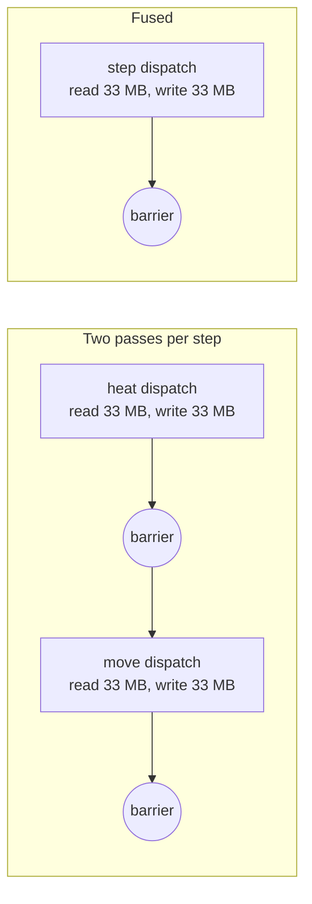

# Lesson 14 — GPU performance tuning: the fused kernel

> Source for this lesson: commit `9b8dd55` ("GPU: fuse heat and move passes into one dispatch per step") on branch `worktree-agent-a6297577531b68f08`. Its parent `0df358e` is the two-pass baseline. See the whole change with
> `git diff 0df358e 9b8dd55 -- sand/src/physics`.

> [!note] This lesson's commit is local-only, and the fused kernel now lives on `main`'s line
> This lesson teaches `9b8dd55`, an experiment on a side branch built on the two-pass engine **without chunk sleeping**. That branch is now kept locally as `fused-kernel-standalone` and is **not pushed to GitHub**. If you cloned the repo from GitHub, `git show 9b8dd55` will fail. Read the snippets in this lesson, or study the merged version in `6c1cebc`.
>
> Later history:
> - `6c1cebc` merged the fused kernel with chunk sleeping ([[13-chunk-sleeping]]) by hand. GPU steps got faster at every size, and sleeping inside the fused kernel costs about 30% on a fully awake world.
> - `07fcf0b` ([[16-real-units-velocity-clock]]) made the physics heavier (real units, speed per cell, random heat rounding). GPU steps cost more after that, and the uniform fast path got stricter conditions.
>
> Details are in "What changed later" at the end.

---

## 1. What you will build

In lesson 11 you ported the physics to WGSL as **two compute passes per step**:

1. `heat`: one thread per cell. It reads the old grid and writes the new grid.
2. `move_blocks`: one thread per Margolus 2×2 block. It works in place on the new grid.

In this lesson you merge them into **one pass**, `step`. One thread owns one 2×2 block. It reads its 4 cells and their 8 edge neighbours from the old grid, computes heat for its 4 cells, moves the block in registers, and writes the 4 cells once. Two extra speed-ups ride along: fast paths that skip work, and material tables packed into constants.

The result, from a clean in-process A/B on an Apple M5:

| grid | two passes | fused | speed-up |
|---|---|---|---|
| 3840×2160 (4K) | 4.77 ms | ~2.25 ms | ~2.1× |
| 2560×1440 | 2.10 ms | ~1.0 ms | ~2.1× |

The output stays **bit-identical to the CPU**. A new test checks that on awkward grid sizes.

Where this sits in the project: `sand/src/physics/sim.wgsl` (the shader), `sand/src/physics/gpu.rs` (the Rust driver that dispatches it), and `sand/src/physics/mod.rs` (tests). Nothing else changes. The CPU engine, the viewer and the benchmark all keep working, because `GpuSim`'s public API (`new`, `step`, `download`) stays the same.

Then you will **build it yourself**: a small standalone project with a two-pass GPU stencil, a fused version, and a CPU-equality test on odd sizes.

---

## 2. Concepts

### 2.1 Unconditional truth: a GPU step is mostly moving bytes

Start from one fact you can take as-is.

> **Every cell the shader uses must travel from GPU memory (DRAM) to a compute unit, and every result must travel back.** DRAM bandwidth is finite: a fixed number of bytes per second.

Most of our arithmetic is cheap: a few adds, shifts and compares per cell. So a useful first model is

$$
\text{time per step} \;\gtrsim\; \frac{\text{bytes moved per step}}{\text{bandwidth}}
$$

A kernel that sits close to this limit is **memory-bound**. A kernel whose arithmetic takes longer than its memory traffic is **compute-bound**. To find out which one you have, do the back-of-envelope sum and compare it with what you measure.

At 4K the grid has $3840 \times 2160 = 8{,}294{,}400$ cells. At 4 bytes per cell (one packed `u32`, lesson 6) that is about **33.2 MB**.

**Two passes.** Count each cell once per read and once per write. A neighbour read is usually a cache hit, because the thread next door just loaded it, so it does not cost DRAM traffic again.

- heat: read 33 MB, write 33 MB
- move: read 33 MB (the grid heat just wrote), write 33 MB

That is about 133 MB per step. At 4.77 ms per step, that works out to $133 / 4.77 \approx 28$ GB/s.

**Fused.** Read 33 MB, write 33 MB, about 66 MB per step. At 2.25 ms per step, that is $66 / 2.25 \approx 29$ GB/s.

The effective bandwidth is about the same in both versions. Only the bytes changed. **Halve the bytes and you halve the time.** That is the whole fusion idea in one line.

How close is that to the hardware's limit? Measure the ceiling instead of guessing it. A kernel that only does `out[i] = in[i]` moves the same 66 MB. It took **0.7 ms** at 4K, about 95 GB/s. So even the fused kernel runs at roughly a third of copy speed. The rest of the time goes to computation and branching (sections 2.5 and 2.6). The model above is a floor, not an exact prediction.

### 2.2 Kernel launches and the barrier between dispatches

The second truth:

> **Dispatches that share a buffer run one after the other. Dispatch N+1 does not start until every thread of dispatch N has finished and its writes are visible.**

wgpu inserts that barrier for you. The project's code says so in `gpu.rs`:

```rust
// wgpu puts a barrier between dispatches that touch the same
// buffers, so each dispatch sees the previous one's writes.
```

The barrier is what made the two-pass version correct: `move_blocks` needs the finished heat results. But it costs time. At the end of every dispatch the GPU drains: the last few workgroups finish while most compute units sit idle, then the next dispatch ramps up. Two dispatches per step means two drains per step. Fusing gives one.



### 2.3 When is fusing *legal*?

How could you have discovered that fusion is allowed here? Ask what each pass depends on.

- Heat for cell $(x, y)$ reads **only the old grid**: itself and its 4 neighbours.
- The move of block $B$ reads and writes **only the 4 cells of $B$**, after heat.

So the move of $B$ needs the heat results of exactly $B$'s 4 cells, and nothing else. If one thread owns block $B$, it can compute those 4 heat results itself, keep them in registers, move them, and write them. No other thread ever needs them. The barrier was only there to hand heat results from one thread to another. If no hand-off is needed, no barrier is needed.

The project wrote this argument down in the shader header (`sim.wgsl` @ `9b8dd55`):

```wgsl
// Heat reads only the old grid (cells_in) and the move only touches the
// thread's own 4 cells, so this is exactly "heat everything, then move
// everything".
```

The price is that each thread reads 12 cells (4 own + 8 edge neighbours) instead of 5. The neighbours are shared with adjacent threads, so they mostly come from cache, not DRAM.

### 2.4 Owning the right cells: `x = 2*tx - o`

The Margolus offset alternates: `o = frame & 1`. When `o = 1`, the blocks start at column 1. Column 0 belongs to no block, but it still needs its heat result written.

The old move pass placed blocks at `x = 2*bx + o`. If the fused kernel did the same, nobody would write column 0 when `o = 1`. The fix is to shift the threads **left** instead:

```wgsl
let x = 2 * i32(id.x) - i32(o); // signed: can be -1
let y = 2 * i32(id.y) - i32(o);
```

Here is a 5-wide row with `o = 1` (`·` is outside the grid):

```
column:     -1  0 | 1  2 | 3  4
thread:      [ 0 ] | [ 1 ] | [ 2 ]
             ·  ■ | ■  ■ | ■  ■
             partial  whole  whole
```

Thread 0 owns a **partial block**: one cell hangs off the edge. It writes heat for column 0 and does not move. The same happens on the right or bottom when the size's parity leaves a column or row out of the block grid. The threads tile the plane without overlap, so **every cell is written exactly once**.

Because the threads now start at −1, you need one extra cell of coverage. That is why `gpu.rs` dispatches `(w + o).div_ceil(tile)`:

```rust
let o = self.frame.wrapping_add(s) & 1;
let groups = ((self.width + o).div_ceil(self.tile.0), (self.height + o).div_ceil(self.tile.1));
pass.dispatch_workgroups(groups.0, groups.1, 1);
```

The block index used for the random hash must match the old pass bit for bit. The old pass used `bx`, where `x = 2*bx + o`. The new kernel recovers it with `(ux - o) / 2u`. For `o = 1` and thread `tx`, that gives $(2t_x - 2)/2 = t_x - 1 = b_x$. Same hash, same world.

### 2.5 Branch divergence and fast paths

The next unconditional truth:

> **GPU threads execute in lockstep groups (SIMD groups / warps, 32 threads on Apple GPUs). When threads in one group take different sides of an `if`, the group runs both sides, one after the other, with some threads masked off.**

So a branch is free only when the whole SIMD group agrees. This shapes both fast paths in the fused kernel.

**Interior vs edge.** Away from the grid edges no bounds checks are needed. Only threads that touch an edge pay for the `load()` helper. Every other SIMD group takes the cheap side as a whole:

```wgsl
let interior = x >= 1 && y >= 1 && x + 2 < i32(w) && y + 2 < i32(h);
if (interior) {
    let i = uy * w + ux;
    a0 = cells_in[i - w]; a1 = cells_in[i - w + 1u];
    // ... 10 more direct reads
} else {
    a0 = load(x, y - 1, w, h);   // bounds-checked, 0 outside
    // ...
}
```

**Uniform neighbourhood.** Large areas of a scene are solid air or stone. If all 12 values equal one value `v`, then all 4 heat results are the same, and 4 identical cells never move. So you compute heat once and write it 4 times. There is a catch: this only works when the heat result does not depend on position. Position enters `heat` in two places. One is grid edges, which the interior test already excludes. The other is the random hash, which only wood, oil and fire use. So those three materials are excluded:

```wgsl
if (same && m != WOOD && m != OIL && m != FIRE) {
    let nv = heat(v, v, v, v, v, ux, uy, w, h, frame);
    cells_out[i] = nv; cells_out[i + 1u] = nv; cells_out[j] = nv; cells_out[j + 1u] = nv;
    return;
}
```

**Blocks that cannot move.** `may_move` skips the hash and every branch of `move_block` when nothing can change. That is the case when all 4 cells are one material with fixed density, or when all 4 cells are identical.

Uniform regions are spatially coherent, so whole SIMD groups tend to take the fast path together. That is when a fast path pays off. A fast path that only scattered threads take saves almost nothing, because their neighbours in the group still run the slow path.

### 2.6 Lookup tables: `var<private>` array vs packed constants (≈10%)

The two-pass shader had tables like this:

```wgsl
// 0df358e: sim.wgsl
var<private> DENSITY: array<i32, 11> = array<i32, 11>(10, 255, 150, 100, 80, 250, 3, 255, 9, 255, 6);
```

`var<private>` means **one copy per thread**. Indexing it with a runtime value (`DENSITY[m]`) usually forces the compiler to put that array in per-thread local memory, so each lookup becomes a memory access. The fused shader packs each table into bits of constants instead. Then a lookup is a shift and a mask, which are pure ALU operations:

```wgsl
// 9b8dd55: sim.wgsl. KIND: 2 bits per material.
const KIND_BITS: u32 = (GAS << 0u) | (SOLID << 2u) | (POWDER << 4u) | /* ... */ (GAS << 20u);
fn kind(m: u32) -> u32 { return (KIND_BITS >> (2u * m)) & 3u; }

// Byte tables: 4 materials per u32. Materials 0-3 in x, 4-7 in y, 8-10 in z.
// (Eleven materials here. The current table is vec4 for 16: see "What changed later" §5.)
fn table_byte(t: vec3<u32>, m: u32) -> u32 {
    let word = select(select(t.x, t.y, m >= 4u), t.z, m >= 8u);
    return (word >> ((m & 3u) * 8u)) & 0xFFu;
}
```

`select(f, t, cond)` is WGSL's branch-free "cond ? t : f". Note the argument order: false value first.

A byte holds at most 255, but `FLOW` of air was 256 on the CPU. The shader comment proves that storing 255 gives identical results: air's flow is only ever compared inside `min(flow(l), flow(r))` of two **different** fluids, so at most one of them is air and the min is at most 230. Determinism (lesson 11) means every shortcut like this needs a written proof plus a test.

This change gave about 10% on its own.

### 2.7 Workgroup shared memory, and why it was *slower* here

Every textbook stencil tutorial says the same thing: load a tile plus a one-cell **halo** into `var<workgroup>` memory, call `workgroupBarrier()`, then read the neighbours from that fast on-chip memory. In WGSL it looks like this:

```wgsl
var<workgroup> tile: array<u32, 34 * 34>;     // 32x32 cells + 1-cell halo
// each thread copies 1-2 cells (some threads also copy halo cells) ...
workgroupBarrier();                            // wait until the whole tile is loaded
// ... then read neighbours from `tile` instead of `cells_in`
```

The project tried it and **measured** it:

- The generic tile + halo version was **20–25% slower** than reading neighbours straight from `cells_in` through the cache.
- A plain copy kernel took **0.7 ms** at 4K reading directly, and **1.7 ms** when routed through shared tiles.

Likely reasons: Apple GPUs cache global reads well, and our neighbours were already cache hits. The tile version adds a second copy (global → shared → registers), a barrier inside every workgroup, and awkward halo loads that leave threads idle. The shader keeps a note so nobody "fixes" this later without measuring:

```wgsl
// Neighbours are read straight from cells_in: they are shared
// with adjacent threads and hit the cache. (Staging a tile plus halo in
// workgroup memory was measured 20-25% slower on Apple M5.)
```

**The lesson: measure, don't assume.** Advice that is true on one GPU or one workload can be false on yours.

### 2.8 Workgroup shape

The workgroup shape now lives in exactly one place, the shader:

```wgsl
const GROUP_W: u32 = 16u;
const GROUP_H: u32 = 16u;
@compute @workgroup_size(GROUP_W, GROUP_H)
```

Experiments: most shapes (8×8, 16×16, 32×8, …) were **within noise** of each other. Two were about **5× slower**: 32×16 (512 threads per group) and 256×1 (a long thin strip). Plausible causes are fewer groups resident at once (register pressure at 512 threads) and poor 2D cache locality for a 1-row strip. The practical rule: pick a reasonable square-ish shape, then sweep a few shapes and keep what measures best.

### 2.9 The Rust side: `shader_const` and `div_ceil`

If Rust has `WORKGROUP = 16` and the shader says 8, the dispatch covers only part of the grid and nothing warns you. The old code had exactly that comment: `// must match @workgroup_size in sim.wgsl`. The new code removes the duplication: Rust **reads the number out of the shader text**.

```rust
// 9b8dd55: sand/src/physics/gpu.rs
const SHADER: &str = include_str!("sim.wgsl");

fn shader_const(name: &str) -> u32 {
    let prefix = format!("const {name}: u32 = ");
    SHADER
        .lines()
        .find_map(|l| l.strip_prefix(&prefix))
        .and_then(|rest| rest.trim_end_matches(';').trim_end_matches('u').parse().ok())
        .unwrap_or_else(|| panic!("sim.wgsl must declare {prefix}<n>u;"))
}
```

Line by line, as Rust:

- `include_str!("sim.wgsl")` embeds the file into the binary at compile time as a `&'static str`. The same string feeds both `create_shader_module` and `shader_const`, so they can never disagree.
- `format!("const {name}: u32 = ")` builds a `String`. `{name}` captures the variable directly (inline format args).
- `.lines()` is an iterator over `&str` lines.
- `.find_map(f)` calls `f` on each line and returns the first `Some(..)`. `strip_prefix` returns `Some(rest)` only if the line starts with the prefix. Together: "the text after `const GROUP_W: u32 = ` on the first matching line".
- `.and_then(..)` chains a step that can also fail. `"16u;"` → `"16u"` → `"16"` → `.parse()`. Rust infers `parse::<u32>()` from the function's return type, and `.ok()` turns `Result` into `Option`.
- `.unwrap_or_else(|| panic!(..))` panics with a clear message if any step returned `None`. The closure only runs on failure, so the message is not formatted on success.

Two integer helpers do the rest:

- `a.div_ceil(b)` is $\lceil a/b \rceil$: how many tiles cover `a` cells. Plain `a / b` rounds down and would drop the last partial tile.
- `frame.wrapping_add(s) & 1` gives the parity of a frame counter that is allowed to wrap at `u32::MAX` without panicking in debug builds.

One workgroup covers `2*GROUP_W × 2*GROUP_H` cells, because each thread owns 2×2. That is why `tile = (2 * shader_const("GROUP_W"), 2 * shader_const("GROUP_H"))`.

### 2.10 Correctness at the edges: the odd-size test

Fast code that is wrong is worthless. Tiles create new edges: tile edges, grid edges, and the parity of the block offset. The commit adds this test (`mod.rs` @ `9b8dd55`):

```rust
#[test]
fn gpu_matches_cpu_on_odd_sizes() {
    for (w, h, scene_index) in [(257, 161, 4), (100, 37, 4), (33, 18, 1), (64, 16, 2), (3, 3, 0)] {
        // ... build CPU and GPU from the same scene ...
        for steps in [1, 300] {
            // run both, download, compare every cell
            assert_eq!(diff, 0, "{w}x{h}: {diff} cells differ between CPU and GPU at frame {}", cpu_world.frame);
        }
    }
}
```

Each size is there for a reason. The tile is 32×32 cells.

| size | what it stresses |
|---|---|
| 257×161 | odd in both directions, and not a multiple of the tile |
| 100×37 | even × odd |
| 33×18 | one cell more than a tile in x; less than a tile in y |
| 64×16 | width an **exact** multiple of the tile, height smaller than one tile |
| 3×3 | every thread is an edge thread; a single whole block |

After the first `1`-step run only frame 0 (`o = 0`) has happened. The next 300 steps cover both offsets.

Then break the code on purpose to prove the test can fail. If you drop the `+ o` from the dispatch size, the last column or row is never written when `o = 1`. In the build-it-yourself project below, **only 64×16 catches that bug**. The other sizes are not tile multiples, so `div_ceil` already launches a spare group that hides it. A test you have never seen fail is a test you cannot trust.

---

## 3. Build it yourself: fuse a two-pass stencil

You will write a small standalone project with the same structure as the sand engine, but with a toy rule so the code stays short:

- **Pass 1 `blur`**: every cell becomes $(4c + l + r + u + d)/8$ plus 0–15 of hashed noise. A missing neighbour at the edge counts as the cell itself.
- **Pass 2 `sink`**: Margolus 2×2 blocks with offset `o = frame & 1`. In each column, if the top value is bigger, swap top and bottom. Partial blocks don't move.
- **`fused`**: both passes in one dispatch, one thread per block.
- A CPU reference, and a check that both GPU modes match it exactly on odd sizes.

### Step 1: create the project

```sh
cargo new fuse
cd fuse
cargo add bytemuck@1.25.2 --features derive
cargo add pollster@1.0.1 wgpu@30.0.1
```

`Cargo.toml` should now contain:

```toml
[package]
name = "fuse"
version = "0.1.0"
edition = "2024"

[dependencies]
bytemuck = { version = "1.25.2", features = ["derive"] }
pollster = "1.0.1"
wgpu = "30.0.1"
```

### Step 2: the shader, `src/stencil.wgsl`

Write the two-pass entry points first. Make them match the CPU, then add `fused`.

```wgsl
// A toy two-pass stencil and its fused version.
// Pass 1 `blur`: every cell = average of itself and its 4 neighbours, plus noise.
// Pass 2 `sink`: Margolus 2x2 blocks; in each column the bigger value sinks.
// `fused`: both passes in one dispatch, one thread per 2x2 block.

struct Params {
    width: u32,
    height: u32,
    frame: u32,
    _pad: u32,
}

@group(0) @binding(0) var<uniform> params: Params;
@group(0) @binding(1) var<storage, read> cells_in: array<u32>;
@group(0) @binding(2) var<storage, read_write> cells_out: array<u32>;

const GROUP_W: u32 = 16u;
const GROUP_H: u32 = 16u;

fn pcg(v: u32) -> u32 {
    let state = v * 747796405u + 2891336453u;
    let word = ((state >> ((state >> 28u) + 4u)) ^ state) * 277803737u;
    return (word >> 22u) ^ word;
}

// The blur rule for one cell. Neighbours outside the grid count as `me`.
fn blur_cell(me: u32, l: u32, r: u32, u: u32, d: u32, x: u32, y: u32, frame: u32) -> u32 {
    let noise = pcg(x ^ pcg(y ^ pcg(frame))) & 15u;
    return (4u * me + l + r + u + d) / 8u + noise;
}

// ---------------------------------------------------------------- two passes

@compute @workgroup_size(GROUP_W, GROUP_H)
fn blur(@builtin(global_invocation_id) id: vec3<u32>) {
    let w = params.width;
    let h = params.height;
    let x = id.x;
    let y = id.y;
    if (x >= w || y >= h) { return; }
    let i = y * w + x;
    let me = cells_in[i];
    var l = me; var r = me; var u = me; var d = me;
    if (x > 0u) { l = cells_in[i - 1u]; }
    if (x + 1u < w) { r = cells_in[i + 1u]; }
    if (y > 0u) { u = cells_in[i - w]; }
    if (y + 1u < h) { d = cells_in[i + w]; }
    cells_out[i] = blur_cell(me, l, r, u, d, x, y, params.frame);
}

@compute @workgroup_size(GROUP_W, GROUP_H)
fn sink(@builtin(global_invocation_id) id: vec3<u32>) {
    let w = params.width;
    let h = params.height;
    let o = params.frame & 1u;
    let x = 2u * id.x + o;
    let y = 2u * id.y + o;
    if (x + 1u >= w || y + 1u >= h) { return; } // partial block: not moved
    for (var dx = 0u; dx < 2u; dx += 1u) {
        let top = y * w + x + dx;
        let bottom = top + w;
        let a = cells_out[top];
        let b = cells_out[bottom];
        if (a > b) { cells_out[top] = b; cells_out[bottom] = a; }
    }
}

// ---------------------------------------------------------------- fused

fn load(gx: i32, gy: i32, w: u32, h: u32) -> u32 {
    if (gx >= 0 && gy >= 0 && gx < i32(w) && gy < i32(h)) {
        return cells_in[u32(gy) * w + u32(gx)];
    }
    return 0u; // never used: blur_cell gets `me` for missing neighbours
}

@compute @workgroup_size(GROUP_W, GROUP_H)
fn fused(@builtin(global_invocation_id) id: vec3<u32>) {
    let w = params.width;
    let h = params.height;
    let frame = params.frame;
    let o = frame & 1u;
    let x = 2 * i32(id.x) - i32(o); // may be -1 when o = 1
    let y = 2 * i32(id.y) - i32(o);

    // The 2x2 block c.. and its 8 edge neighbours (a above, l left, r right, b below).
    let a0 = load(x, y - 1, w, h);
    let a1 = load(x + 1, y - 1, w, h);
    let l0 = load(x - 1, y, w, h);
    let c00 = load(x, y, w, h);
    let c01 = load(x + 1, y, w, h);
    let r0 = load(x + 2, y, w, h);
    let l1 = load(x - 1, y + 1, w, h);
    let c10 = load(x, y + 1, w, h);
    let c11 = load(x + 1, y + 1, w, h);
    let r1 = load(x + 2, y + 1, w, h);
    let b0 = load(x, y + 2, w, h);
    let b1 = load(x + 1, y + 2, w, h);

    let in_x = array<bool, 2>(x >= 0 && x < i32(w), x + 1 < i32(w));
    let in_y = array<bool, 2>(y >= 0 && y < i32(h), y + 1 < i32(h));
    let has_l = x - 1 >= 0;
    let has_r = x + 2 < i32(w);
    let has_a = y - 1 >= 0;
    let has_b = y + 2 < i32(h);
    let ux = u32(x);
    let uy = u32(y);

    // 1. Blur the 4 cells (only those inside the grid). Inside the block every
    //    neighbour exists whenever the cell itself exists.
    var c = array<u32, 4>(0u, 0u, 0u, 0u);
    if (in_x[0] && in_y[0]) {
        c[0] = blur_cell(c00, select(c00, l0, has_l), select(c00, c01, in_x[1]),
                         select(c00, a0, has_a), select(c00, c10, in_y[1]), ux, uy, frame);
    }
    if (in_x[1] && in_y[0]) {
        c[1] = blur_cell(c01, select(c01, c00, in_x[0]), select(c01, r0, has_r),
                         select(c01, a1, has_a), select(c01, c11, in_y[1]), ux + 1u, uy, frame);
    }
    if (in_x[0] && in_y[1]) {
        c[2] = blur_cell(c10, select(c10, l1, has_l), select(c10, c11, in_x[1]),
                         select(c10, c00, in_y[0]), select(c10, b0, has_b), ux, uy + 1u, frame);
    }
    if (in_x[1] && in_y[1]) {
        c[3] = blur_cell(c11, select(c11, c10, in_x[0]), select(c11, r1, has_r),
                         select(c11, c01, in_y[0]), select(c11, b1, has_b), ux + 1u, uy + 1u, frame);
    }

    // 2. Sink, in registers, only if the whole block is inside the grid.
    if (in_x[0] && in_x[1] && in_y[0] && in_y[1]) {
        for (var col = 0u; col < 2u; col += 1u) {
            let a = c[col];
            let b = c[col + 2u];
            if (a > b) { c[col] = b; c[col + 2u] = a; }
        }
    }

    // 3. Write each in-grid cell exactly once.
    for (var k = 0u; k < 4u; k += 1u) {
        let dx = k & 1u;
        let dy = k >> 1u;
        if (in_x[dx] && in_y[dy]) {
            cells_out[(uy + dy) * w + ux + dx] = c[k];
        }
    }
}
```

Points to check against section 2:

- `u32(x)` when `x = -1` is `0xFFFFFFFF`. Then `ux + 1u` wraps to `0`, which is exactly column 0. The hash for column 0 is therefore the same as in the `blur` pass. `ux` itself is only used when `in_x[0]` is true.
- The two-pass `sink` writes `cells_out` in place. The fused version never reads `cells_out` at all.

### Step 3: the Rust driver, `src/main.rs`

The setup is lesson 10's (one params slot per step at a 256-byte dynamic offset, two bind groups that ping-pong). The new parts are `Mode`, the two dispatch shapes, and `shader_const`.

```rust
//! Two-pass vs fused GPU stencil, checked against a CPU reference.
//!
//!     cargo run --release            # correctness on odd sizes, then timing at 4K
//!     cargo test --release           # the same correctness check as a test

use std::num::NonZeroU64;
use std::time::Instant;

const SHADER: &str = include_str!("stencil.wgsl");
const MAX_BATCH: u32 = 256;
const PARAMS_STRIDE: u64 = 256; // dynamic uniform offsets must be multiples of 256

/// Read `const NAME: u32 = 16u;` out of the shader, so Rust and WGSL agree.
fn shader_const(name: &str) -> u32 {
    let prefix = format!("const {name}: u32 = ");
    SHADER
        .lines()
        .find_map(|l| l.strip_prefix(&prefix))
        .and_then(|rest| rest.trim_end_matches(';').trim_end_matches('u').parse().ok())
        .unwrap_or_else(|| panic!("stencil.wgsl must declare {prefix}<n>u;"))
}

// ------------------------------------------------------------------ CPU reference

fn pcg(v: u32) -> u32 {
    let state = v.wrapping_mul(747796405).wrapping_add(2891336453);
    let word = ((state >> ((state >> 28) + 4)) ^ state).wrapping_mul(277803737);
    (word >> 22) ^ word
}

/// One step on the CPU: blur every cell into a new grid, then sink blocks in place.
fn cpu_step(cells: &[u32], w: usize, h: usize, frame: u32) -> Vec<u32> {
    let mut out = vec![0u32; w * h];
    for y in 0..h {
        for x in 0..w {
            let i = y * w + x;
            let me = cells[i];
            let l = if x > 0 { cells[i - 1] } else { me };
            let r = if x + 1 < w { cells[i + 1] } else { me };
            let u = if y > 0 { cells[i - w] } else { me };
            let d = if y + 1 < h { cells[i + w] } else { me };
            let noise = pcg(x as u32 ^ pcg(y as u32 ^ pcg(frame))) & 15;
            out[i] = (4 * me + l + r + u + d) / 8 + noise;
        }
    }
    let o = (frame & 1) as usize;
    let mut y = o;
    while y + 1 < h {
        let mut x = o;
        while x + 1 < w {
            for dx in 0..2 {
                let top = y * w + x + dx;
                if out[top] > out[top + w] {
                    out.swap(top, top + w);
                }
            }
            x += 2;
        }
        y += 2;
    }
    out
}

fn start_grid(w: usize, h: usize) -> Vec<u32> {
    (0..w * h).map(|i| pcg(i as u32) & 0xFFFF).collect()
}

// ------------------------------------------------------------------ GPU

#[repr(C)]
#[derive(Clone, Copy, bytemuck::Pod, bytemuck::Zeroable)]
struct Params {
    width: u32,
    height: u32,
    frame: u32,
    _pad: u32,
}

#[derive(Clone, Copy, Debug, PartialEq)]
enum Mode {
    TwoPass,
    Fused,
}

struct Gpu {
    device: wgpu::Device,
    queue: wgpu::Queue,
    blur: wgpu::ComputePipeline,
    sink: wgpu::ComputePipeline,
    fused: wgpu::ComputePipeline,
    params: wgpu::Buffer,
    cells: [wgpu::Buffer; 2],
    groups: [wgpu::BindGroup; 2], // groups[i] reads cells[i], writes cells[1 - i]
    staging: wgpu::Buffer,
    current: usize,
    group: (u32, u32), // threads per workgroup
    width: u32,
    height: u32,
    frame: u32,
}

impl Gpu {
    fn new(cells: &[u32], w: usize, h: usize) -> Result<Self, String> {
        pollster::block_on(Self::new_async(cells, w, h))
    }

    async fn new_async(start: &[u32], w: usize, h: usize) -> Result<Self, String> {
        let instance = wgpu::Instance::new(wgpu::InstanceDescriptor::new_without_display_handle());
        let adapter = instance
            .request_adapter(&wgpu::RequestAdapterOptions {
                power_preference: wgpu::PowerPreference::HighPerformance,
                ..Default::default()
            })
            .await
            .map_err(|e| e.to_string())?;
        let (device, queue) = adapter
            .request_device(&wgpu::DeviceDescriptor {
                label: Some("fuse"),
                required_limits: adapter.limits(),
                ..Default::default()
            })
            .await
            .map_err(|e| e.to_string())?;

        let shader = device.create_shader_module(wgpu::ShaderModuleDescriptor {
            label: Some("stencil.wgsl"),
            source: wgpu::ShaderSource::Wgsl(SHADER.into()),
        });
        let storage = |binding: u32, read_only: bool| wgpu::BindGroupLayoutEntry {
            binding,
            visibility: wgpu::ShaderStages::COMPUTE,
            ty: wgpu::BindingType::Buffer {
                ty: wgpu::BufferBindingType::Storage { read_only },
                has_dynamic_offset: false,
                min_binding_size: None,
            },
            count: None,
        };
        let layout = device.create_bind_group_layout(&wgpu::BindGroupLayoutDescriptor {
            label: Some("stencil"),
            entries: &[
                wgpu::BindGroupLayoutEntry {
                    binding: 0,
                    visibility: wgpu::ShaderStages::COMPUTE,
                    ty: wgpu::BindingType::Buffer {
                        ty: wgpu::BufferBindingType::Uniform,
                        has_dynamic_offset: true,
                        min_binding_size: NonZeroU64::new(size_of::<Params>() as u64),
                    },
                    count: None,
                },
                storage(1, true),
                storage(2, false),
            ],
        });
        let pipeline_layout = device.create_pipeline_layout(&wgpu::PipelineLayoutDescriptor {
            label: Some("stencil"),
            bind_group_layouts: &[Some(&layout)],
            immediate_size: 0,
        });
        let pipeline = |entry: &str| {
            device.create_compute_pipeline(&wgpu::ComputePipelineDescriptor {
                label: Some(entry),
                layout: Some(&pipeline_layout),
                module: &shader,
                entry_point: Some(entry),
                compilation_options: Default::default(),
                cache: None,
            })
        };
        let (blur, sink, fused) = (pipeline("blur"), pipeline("sink"), pipeline("fused"));

        let bytes = (w * h * 4) as u64;
        let buffer = |label: &str, usage: wgpu::BufferUsages| {
            device.create_buffer(&wgpu::BufferDescriptor { label: Some(label), size: bytes, usage, mapped_at_creation: false })
        };
        let usage = wgpu::BufferUsages::STORAGE | wgpu::BufferUsages::COPY_DST | wgpu::BufferUsages::COPY_SRC;
        let cells = [buffer("cells0", usage), buffer("cells1", usage)];
        let staging = buffer("staging", wgpu::BufferUsages::MAP_READ | wgpu::BufferUsages::COPY_DST);
        let params = device.create_buffer(&wgpu::BufferDescriptor {
            label: Some("params"),
            size: MAX_BATCH as u64 * PARAMS_STRIDE,
            usage: wgpu::BufferUsages::UNIFORM | wgpu::BufferUsages::COPY_DST,
            mapped_at_creation: false,
        });
        let group = |src: usize| {
            device.create_bind_group(&wgpu::BindGroupDescriptor {
                label: Some("stencil"),
                layout: &layout,
                entries: &[
                    wgpu::BindGroupEntry {
                        binding: 0,
                        resource: wgpu::BindingResource::Buffer(wgpu::BufferBinding {
                            buffer: &params,
                            offset: 0,
                            size: NonZeroU64::new(size_of::<Params>() as u64),
                        }),
                    },
                    wgpu::BindGroupEntry { binding: 1, resource: cells[src].as_entire_binding() },
                    wgpu::BindGroupEntry { binding: 2, resource: cells[1 - src].as_entire_binding() },
                ],
            })
        };
        let groups = [group(0), group(1)];
        queue.write_buffer(&cells[0], 0, bytemuck::cast_slice(start));

        Ok(Gpu {
            device,
            queue,
            blur,
            sink,
            fused,
            params,
            cells,
            groups,
            staging,
            current: 0,
            group: (shader_const("GROUP_W"), shader_const("GROUP_H")),
            width: w as u32,
            height: h as u32,
            frame: 0,
        })
    }

    /// Queue `steps` steps in the given mode. Returns before the GPU is done.
    fn step(&mut self, mut steps: u32, mode: Mode) {
        let (gw, gh) = self.group;
        while steps > 0 {
            let batch = steps.min(MAX_BATCH);
            steps -= batch;
            let mut bytes = vec![0u8; (batch as u64 * PARAMS_STRIDE) as usize];
            for s in 0..batch {
                let p = Params { width: self.width, height: self.height, frame: self.frame.wrapping_add(s), _pad: 0 };
                let at = (s as u64 * PARAMS_STRIDE) as usize;
                bytes[at..at + size_of::<Params>()].copy_from_slice(bytemuck::bytes_of(&p));
            }
            self.queue.write_buffer(&self.params, 0, &bytes);

            let mut encoder = self.device.create_command_encoder(&Default::default());
            {
                let mut pass = encoder.begin_compute_pass(&Default::default());
                for s in 0..batch {
                    pass.set_bind_group(0, &self.groups[self.current], &[(s as u64 * PARAMS_STRIDE) as u32]);
                    match mode {
                        Mode::TwoPass => {
                            // One thread per cell, then one thread per block.
                            pass.set_pipeline(&self.blur);
                            pass.dispatch_workgroups(self.width.div_ceil(gw), self.height.div_ceil(gh), 1);
                            pass.set_pipeline(&self.sink);
                            pass.dispatch_workgroups((self.width / 2).div_ceil(gw), (self.height / 2).div_ceil(gh), 1);
                        }
                        Mode::Fused => {
                            // One thread per block; with offset 1 the threads start at -1,
                            // so they must cover one extra cell.
                            let o = self.frame.wrapping_add(s) & 1;
                            pass.set_pipeline(&self.fused);
                            pass.dispatch_workgroups(
                                (self.width + o).div_ceil(2 * gw),
                                (self.height + o).div_ceil(2 * gh),
                                1,
                            );
                        }
                    }
                    self.current = 1 - self.current;
                }
            }
            self.queue.submit([encoder.finish()]);
            self.frame = self.frame.wrapping_add(batch);
        }
    }

    fn wait(&self) {
        self.device.poll(wgpu::PollType::wait_indefinitely()).expect("GPU poll failed");
    }

    fn download(&self) -> Vec<u32> {
        let mut encoder = self.device.create_command_encoder(&Default::default());
        encoder.copy_buffer_to_buffer(&self.cells[self.current], 0, &self.staging, 0, self.staging.size());
        self.queue.submit([encoder.finish()]);
        self.staging.map_async(wgpu::MapMode::Read, .., |r| r.expect("map failed"));
        self.wait();
        let out = {
            let view = self.staging.get_mapped_range(..).expect("mapped");
            bytemuck::cast_slice(&view).to_vec()
        };
        self.staging.unmap();
        out
    }
}

// ------------------------------------------------------------------ checks

/// Run `steps` steps on CPU and GPU from the same start; return how many cells differ.
fn differences(w: usize, h: usize, steps: u32, mode: Mode) -> Result<usize, String> {
    let mut cpu = start_grid(w, h);
    let mut gpu = Gpu::new(&cpu, w, h)?;
    for frame in 0..steps {
        cpu = cpu_step(&cpu, w, h, frame);
    }
    gpu.step(steps, mode);
    let got = gpu.download();
    Ok((0..cpu.len()).filter(|&i| cpu[i] != got[i]).count())
}

const ODD_SIZES: [(usize, usize); 5] = [(257, 161), (100, 37), (33, 18), (64, 16), (3, 3)];

fn main() -> Result<(), String> {
    for (w, h) in ODD_SIZES {
        for mode in [Mode::TwoPass, Mode::Fused] {
            for steps in [1, 300] {
                let diff = differences(w, h, steps, mode)?;
                println!("{w:>4}x{h:<4} {mode:?} {steps:>3} steps: {diff} cells differ");
            }
        }
    }

    let (w, h) = (3840, 2160);
    let start = start_grid(w, h);
    for mode in [Mode::TwoPass, Mode::Fused, Mode::TwoPass, Mode::Fused] {
        let mut gpu = Gpu::new(&start, w, h)?;
        gpu.step(20, mode); // warm up
        gpu.wait();
        let steps = 500;
        let t = Instant::now();
        gpu.step(steps, mode);
        gpu.wait();
        let ms = t.elapsed().as_secs_f64() * 1000.0 / steps as f64;
        let mb = (w * h * 4) as f64 / 1e6;
        let traffic = if mode == Mode::Fused { 2.0 } else { 4.0 } * mb; // see section 2.1
        println!("{w}x{h} {mode:?}: {ms:.3} ms/step, ~{:.0} GB/s effective", traffic / ms);
    }
    Ok(())
}

#[cfg(test)]
mod tests {
    use super::*;

    #[test]
    fn gpu_matches_cpu_on_odd_sizes() {
        for (w, h) in ODD_SIZES {
            for mode in [Mode::TwoPass, Mode::Fused] {
                for steps in [1, 300] {
                    match differences(w, h, steps, mode) {
                        Ok(diff) => assert_eq!(diff, 0, "{w}x{h} {mode:?} after {steps} steps"),
                        Err(e) => {
                            eprintln!("no GPU, skipping: {e}");
                            return;
                        }
                    }
                }
            }
        }
    }
}
```

Two Rust details:

- `MB / ms` is already GB/s, because $10^6\,\text{B} / 10^{-3}\,\text{s} = 10^9$ B/s.
- `differences` returns `Result<usize, String>`, so `main` can use `?` and the test can skip cleanly on a machine without a GPU. The same pattern is used in the real `mod.rs`.

### Step 4: run it

```sh
cargo run --release
cargo test --release
```

Output on an Apple M5 (your numbers will differ):

```
 257x161  TwoPass   1 steps: 0 cells differ
 ...
   3x3    Fused 300 steps: 0 cells differ
3840x2160 TwoPass: 2.064 ms/step, ~64 GB/s effective
3840x2160 Fused: 1.618 ms/step, ~41 GB/s effective
3840x2160 TwoPass: 2.108 ms/step, ~63 GB/s effective
3840x2160 Fused: 1.589 ms/step, ~42 GB/s effective
```

Read this honestly: the toy speeds up only about **1.3×**, not 2×. The toy's two passes are so light that they already stream at about 64 GB/s. The fused kernel does 12 bounds-checked `load()` calls per thread and a lot of `select`, so it becomes partly compute-bound. Fusion cut the bytes in half, but the extra instructions ate part of the win. In the real sand kernel, compute was already the larger cost, so halving the passes halved nearly everything. The same transformation pays differently on different workloads, and that is why you measure. Exercises 3 to 5 dig into it.

---

## 4. Live examples

**A. The real thing, before vs after.** Check the commits out side by side without touching your working tree. (`0df358e` and `9b8dd55` exist only in the author's local clone, on branch `fused-kernel-standalone`. From a GitHub clone, compare `d94ade6` (two passes, with sleeping) with `6c1cebc` (fused, with sleeping) instead.)

```sh
cd /Users/anujbarve/Documents/rusty
git worktree add /tmp/sand-two-pass 0df358e
git worktree add /tmp/sand-fused 9b8dd55
(cd /tmp/sand-two-pass/sand && cargo run --release --bin bench)
(cd /tmp/sand-fused/sand && cargo run --release --bin bench)
```

Compare the `gpu` column. `cargo run --release --bin bench -- 3` gives steadier numbers (3 s per measurement). Remove the worktrees afterwards with `git worktree remove /tmp/sand-two-pass` (and the same for `/tmp/sand-fused`).

**B. Run the edge test on the fused shader.**

```sh
cd /tmp/sand-fused/sand && cargo test --release gpu_matches_cpu_on_odd_sizes
```

**C. Change the workgroup shape.** In `/tmp/sand-fused/sand/src/physics/sim.wgsl`, set `GROUP_W`/`GROUP_H` to 8/8, 32/8, 32/16 and 256/1. Rebuild and bench each one. Thanks to `shader_const`, the Rust dispatch follows automatically, and the tests still pass for every shape. Watch for the two slow shapes from section 2.8.

**D. Change the workload in the toy.** In `start_grid`, make the left half constant (`if i % w < w / 2 { 1000 } else { … }`) and rerun. Then try removing the `noise` term entirely. Watch how the two-pass/fused ratio moves.

---

## 5. Exercises

1. **(Easy) Shape sweep.** In the toy, try `GROUP_W × GROUP_H` = 8×8, 16×16, 32×8, 64×4, 256×1. Record ms/step for both modes. Do the tests still pass?
   *Hint:* only the shader needs editing. Ask yourself why.

2. **(Easy) Break it on purpose.** Remove `+ o` from both `div_ceil` calls in `Mode::Fused`. Run `cargo test --release`. Which size fails, and why only that one?
   *Hint:* `(w + o).div_ceil(32)` and `w.div_ceil(32)` differ only when `w` is a multiple of 32.

3. **(Medium) Measure the ceiling.** Add a `copy` kernel (`out[i] = in[i]`) and a `Mode::Copy`. Time it at 4K. What fraction of the copy kernel's bandwidth does each mode reach?
   *Hint:* it moves the same 2 × 33 MB as `fused`.

4. **(Medium) Interior fast path.** Give `fused` the project's `interior` branch: direct `cells_in[...]` reads when `x >= 1 && y >= 1 && x + 2 < w && y + 2 < h`, and `load()` otherwise. Is it faster? By how much?
   *Hint:* declare the 12 values as `var a0: u32;` etc. before the `if`, then assign them in both branches.

5. **(Stretch) Uniform fast path, and why the toy can't use it as-is.** The project skips work when all 12 values are equal. Explain why that shortcut is **wrong** for the toy as written. Then change the rule so noise is added only when `frame % 64 == 0` (on both CPU and GPU), and implement the shortcut for the other frames. Keep the odd-size test green.
   *Hint:* look at what `blur_cell` uses besides the values. Compare with the project's `m != WOOD && m != OIL && m != FIRE`.

---

## 6. Common mistakes and compiler errors

**`error: expected ..., found 'u32'` / type mismatch between `i32` and `u32` in WGSL.** WGSL never converts integer types implicitly. `2 * i32(id.x) - i32(o)` needs both casts, and `x + 2 < i32(w)` needs `w` cast. The error names the line and the two types it found. Add an explicit `i32(..)` or `u32(..)`.

**Index wrap-around instead of a negative index.** `u32(-1)` is `4294967295`. If you use `ux` to index while `x = -1`, you read garbage or a clamped element (wgpu bounds-checks storage accesses, so it won't crash). It will silently differ from the CPU. Guard every write with `in_x`/`in_y`.

**Forgetting one extra cell when `o = 1`.** Symptom: the CPU-equality test passes at 1 step and fails at 300, and only for sizes that are tile multiples (exercise 2). The cause is the missing `+ o` in `(w + o).div_ceil(tile)`.

**Rust and WGSL disagree on the workgroup size.** Symptom: the right or bottom part of the grid never changes. Fix: one source of truth (`shader_const`), never two constants.

**`shader_const` panics: `stencil.wgsl must declare const GROUP_W: u32 = <n>u;`.** The parser is deliberately simple: one declaration on one line, exactly `const GROUP_W: u32 = 16u;`. Writing `const GROUP_W = 16u;` or adding a trailing comment breaks it. The panic message tells you the format it expects.

**`select` arguments backwards.** `select(f, t, cond)` returns `t` when `cond` is true. `select(l0, c00, has_l)` compiles but uses the wrong neighbour. Only the CPU-equality test will tell you.

**Two-pass mental model leaking into the fused kernel.** Reading from `cells_out` inside `fused` (as `sink` does) is a race: another thread may or may not have written that cell yet. The result changes from run to run. A fused kernel reads only `cells_in`.

**Benchmarking a debug build, or with a cold GPU.** Always `--release`, warm up first, and alternate A/B/A/B in one process as `main` does. The clean A/B in this commit was "in-process" for exactly that reason (lesson 12).

---

## 7. Recap

- A GPU step is mostly bytes moving. Estimate $\text{bytes} / \text{time}$ and compare it with a measured copy-kernel ceiling. That tells you whether you are memory-bound or compute-bound.
- Each dispatch ends in a barrier and a drain. Two passes per step means two full grid round-trips and two drains.
- Fusion is legal when the second pass needs only results the same thread can compute itself. Align thread ownership with the Margolus block: `x = 2*tx - o`. Partial blocks at the edges heat but don't move. Dispatch `(w + o).div_ceil(tile)`.
- Fast paths (interior, uniform neighbourhood, can't-move) pay off when whole SIMD groups take them together. Lookup tables packed into constants beat `var<private>` arrays.
- Shared-memory tiling, the textbook trick, was **20–25% slower** here. Workgroup shape mostly didn't matter, except two shapes that were about 5× slower. Measure, don't assume.
- Correctness first: test odd sizes, exact tile multiples and tiny grids, cover both offsets, and break the code on purpose to prove the test can fail.
- Result (at `9b8dd55`, no sleeping): 4.77 → ~2.25 ms at 4K and 2.10 → ~1.0 ms at 2560×1440, about 2.1×, bit-identical to the CPU.

**Next, lesson 15, the GPU-only viewer.** The simulation is now fast enough that the expensive part is copying the grid back to the CPU every frame to draw it. Lesson 15 keeps the world on the GPU, pipelines the readback so the CPU never waits, and paints straight into GPU buffers.

---

## Solutions

<details><summary>Solution 1 — shape sweep</summary>

Edit only these two lines in `stencil.wgsl`:

```wgsl
const GROUP_W: u32 = 8u;
const GROUP_H: u32 = 8u;
```

You don't touch the Rust code because `Gpu::new` reads both values with `shader_const`. The two-pass dispatch (`div_ceil(gw)`) and the fused dispatch (`div_ceil(2 * gw)`) follow automatically, so the test passes for every shape. Expect most square-ish shapes to land within a few percent of each other. Very thin shapes like 256×1 often lose; a plausible reason is that a 1-row group shares few of its above/below neighbours with other threads in the group. In the sand project, 32×16 and 256×1 were about 5× slower. Your GPU may rank them differently, and that is the point of running the sweep.

</details>

<details><summary>Solution 2 — break it on purpose</summary>

```rust
pass.dispatch_workgroups(self.width.div_ceil(2 * gw), self.height.div_ceil(2 * gh), 1);
```

Running `cargo test --release` gives (verified):

```
assertion `left == right` failed: 64x16 Fused after 300 steps
  left: 507
 right: 0
```

Only **64×16** fails. The fused tile is 32 cells wide. For w = 257, 100 and 33, `w.div_ceil(32)` already rounds up to a group with spare threads, and those spare threads cover the extra cell that `o = 1` needs. For w = 64 the division is exact, so the last thread (owning cells 63 and 64) is missing and column 63 is never written on odd frames. Height 16 is less than one tile, so it gets a spare group too. The 1-step runs pass because frame 0 has `o = 0`. That is why the project's size list includes an exact multiple, and why every test needs both offsets.

</details>

<details><summary>Solution 3 — copy ceiling</summary>

Shader:

```wgsl
@compute @workgroup_size(GROUP_W, GROUP_H)
fn copy(@builtin(global_invocation_id) id: vec3<u32>) {
    let w = params.width;
    if (id.x >= w || id.y >= params.height) { return; }
    let i = id.y * w + id.x;
    cells_out[i] = cells_in[i];
}
```

Rust changes:

```rust
enum Mode { TwoPass, Fused, Copy }
// struct Gpu: add   copy: wgpu::ComputePipeline,
let (blur, sink, fused, copy) = (pipeline("blur"), pipeline("sink"), pipeline("fused"), pipeline("copy"));
// Ok(Gpu { ..., copy, ... })

// in step(), inside the match:
Mode::Copy => {
    pass.set_pipeline(&self.copy);
    pass.dispatch_workgroups(self.width.div_ceil(gw), self.height.div_ceil(gh), 1);
}

// in main(), time all three; Copy moves 2 x 33 MB like Fused:
for mode in [Mode::TwoPass, Mode::Fused, Mode::Copy, Mode::TwoPass, Mode::Fused, Mode::Copy] {
    // ...
    let traffic = if mode == Mode::TwoPass { 4.0 } else { 2.0 } * mb;
```

Measured on the M5:

```
3840x2160 TwoPass: 1.992 ms/step, ~67 GB/s effective
3840x2160 Fused: 1.513 ms/step, ~44 GB/s effective
3840x2160 Copy: 0.691 ms/step, ~96 GB/s effective
```

The copy at 0.69 ms matches the project's 0.7 ms. Two-pass reaches about 70% of the ceiling, so it is close to memory-bound. Fused reaches about 46%, so it is now limited by its own instructions. The next wins would come from fewer instructions, not fewer bytes.

</details>

<details><summary>Solution 4 — interior fast path</summary>

Replace the 12 `let ... = load(...)` lines in `fused` with:

```wgsl
    var a0: u32; var a1: u32; var l0: u32; var c00: u32; var c01: u32; var r0: u32;
    var l1: u32; var c10: u32; var c11: u32; var r1: u32; var b0: u32; var b1: u32;
    let interior = x >= 1 && y >= 1 && x + 2 < i32(w) && y + 2 < i32(h);
    if (interior) {
        let i = u32(y) * w + u32(x);
        let j = i + w;
        a0 = cells_in[i - w]; a1 = cells_in[i - w + 1u];
        l0 = cells_in[i - 1u]; c00 = cells_in[i]; c01 = cells_in[i + 1u]; r0 = cells_in[i + 2u];
        l1 = cells_in[j - 1u]; c10 = cells_in[j]; c11 = cells_in[j + 1u]; r1 = cells_in[j + 2u];
        b0 = cells_in[j + w]; b1 = cells_in[j + w + 1u];
    } else {
        a0 = load(x, y - 1, w, h); a1 = load(x + 1, y - 1, w, h);
        l0 = load(x - 1, y, w, h); c00 = load(x, y, w, h); c01 = load(x + 1, y, w, h); r0 = load(x + 2, y, w, h);
        l1 = load(x - 1, y + 1, w, h); c10 = load(x, y + 1, w, h); c11 = load(x + 1, y + 1, w, h); r1 = load(x + 2, y + 1, w, h);
        b0 = load(x, y + 2, w, h); b1 = load(x + 1, y + 2, w, h);
    }
```

The test stays green. Measured: fused went from about 1.60 to about 1.55 ms, roughly 3%. Small: the bounds checks were cheap next to the rest of the kernel (the many `select`s in the blur step remain). Only edge SIMD groups take the `else` branch, so divergence is limited to the border.

</details>

<details><summary>Solution 5 — uniform fast path</summary>

**Why it's wrong as written.** `blur_cell` adds `pcg(x ^ pcg(y ^ pcg(frame))) & 15`, which depends on **position**. Four equal input cells give four *different* outputs, so "compute once, write 4 times" breaks equality with the CPU. This is exactly why the project excludes wood, oil and fire: their heat result uses `hash3(x, y, salt)`.

**Change the rule.** On the CPU:

```rust
let noise = if frame % 64 == 0 { pcg(x as u32 ^ pcg(y as u32 ^ pcg(frame))) & 15 } else { 0 };
```

In WGSL `blur_cell`:

```wgsl
    var noise = 0u;
    if (frame % 64u == 0u) { noise = pcg(x ^ pcg(y ^ pcg(frame))) & 15u; }
```

**The fast path**, inside the `interior` branch from Solution 4, right after the 12 reads:

```wgsl
        // No noise this frame and all 12 values equal: every blur result is
        // (4v + 4v) / 8 = v, and equal values never sink. Write v, done.
        let v = c00;
        let same = a0 == v && a1 == v && l0 == v && c01 == v && r0 == v && l1 == v
            && c10 == v && c11 == v && r1 == v && b0 == v && b1 == v;
        if (same && frame % 64u != 0u) {
            cells_out[i] = v; cells_out[i + 1u] = v; cells_out[j] = v; cells_out[j + 1u] = v;
            return;
        }
```

This shortcut is only safe because the value is a fixed point: $(4v + 4v)/8 = v$ exactly in integer arithmetic, and the sink rule only swaps when `a > b`. The odd-size test passes (verified). Whether it is faster depends on how much of the grid is uniform: on a half-constant start grid the gain was small and noisy, because noise frames keep breaking uniformity. In the sand game, large areas of air and stone stay uniform for thousands of frames, which is why the project's version pays.

</details>

---

## What changed later

### 1. Where the fused kernel lives now

`9b8dd55` was built on `0df358e`, an import of the engine from *before* chunk sleeping. Meanwhile `main`'s line gained sleeping (`1157366`) and the pipelined viewer (`d94ade6`). So the two could not just be merged with git. In `6c1cebc` the fused kernel was ported **by hand** onto the sleeping engine. That commit is what the repo runs today.

`9b8dd55` and its parent `0df358e` are kept only as the local branch `fused-kernel-standalone`, which is not on GitHub. If you don't have it, everything this lesson quotes from `9b8dd55` is also in the snippets above, and `git diff d94ade6 6c1cebc -- sand/src/physics` shows the same fusion applied to the sleeping engine.

### 2. How sleeping was folded in (`6c1cebc`)

At `1157366` sleeping relied on "one move workgroup = one chunk", so a whole workgroup returned together. A fused thread owns a 2×2 block whose cells may lie in up to 4 chunks, so each thread now checks its cells one by one (`sim.wgsl` @ `6c1cebc`):

```wgsl
if (in_x[dx] && in_y[dy]) {
    chunk[k] = chunk_of(ux + dx, uy + dy);
    wake[k] = awake[chunk[k]] != 0u;
    any_awake = any_awake || wake[k];
}
// ...
if (!any_awake) {
    return; // everything this thread owns is asleep: cells_out already holds it
}
```

After that come the same 12 reads as in this lesson. Heat runs only for awake cells (`if (wake[k]) { cells[k] = heat(...); }`). A sleeping cell keeps its old value and is not written. The move is gated by the block's **owner chunk**, the one holding its top-left cell:

```wgsl
let whole = x >= 0 && y >= 0 && in_x[1] && in_y[1];
if (whole && wake[0] && may_move(cells) && block_can_move(cells)) {
    mark_active(chunk[0]);
    move_block(&cells, hash3((ux - o) / 2u, (uy - o) / 2u, frame));
    write = array<bool, 4>(true, true, true, true);
}
```

Activity is stamped straight into the global `array<atomic<u32>>` by `mark_active`, which loads before it stores so already-stamped chunks don't get contended writes. A separate `wake` dispatch still follows each `step` dispatch. On the Rust side, `GpuSim::step` records `step` plus (when sleeping) `wake`, and the dispatch size is still `(w + o).div_ceil(tile)`.

### 3. The uniform fast path, then and now

At `9b8dd55` the condition was `same && m != WOOD && m != OIL && m != FIRE`, and the thread wrote `nv` to all 4 cells. At `6c1cebc` it writes only the awake cells and stamps their chunks if `nv != v`. At `07fcf0b` random heat rounding and gas relaxation mean more materials depend on a per-cell random number, so the condition got stricter:

```wgsl
// sim.wgsl @ 07fcf0b
let fixed = m != WOOD && m != OIL && m != FIRE && m != SMOKE && (kind(m) != GAS || temp(v) == AMBIENT);
if (same && fixed) {
    let nv = heat(v, v, v, v, v, ux, uy, w, h, frame).cell;
    // write nv to each awake cell, mark_active if nv != v
}
```

Smoke uses its random number every step (its life ticks down at random). A gas away from 20°C relaxes with random rounding. Both can now give 4 *different* results from 4 equal inputs, so they leave the fast path. `heat` also returns a `HeatOut { cell, maybe }` struct now ([[13-chunk-sleeping]], "What changed later").

### 4. The numbers after the merge

Clean bench at `6c1cebc` (Apple M5, ms per GPU step, busy scene, sleeping on):

| grid | before all perf work | fused + sleeping (`6c1cebc`) | after real units (`07fcf0b`) |
|---|---|---|---|
| 640×360 | 0.087 | 0.059 | 0.123 |
| 1280×720 | 0.314 | 0.209 | |
| 1920×1080 | 0.703 | 0.437 | 0.794 |
| 2560×1440 | 1.268 | 0.855 | |
| 3840×2160 | 2.911 | 2.168 | 2.87 |

- A settled 4K world with sleeping costs **0.557 ms** per step (471 / 8160 chunks awake).
- On an all-awake world the sleeping bookkeeping (awake checks, atomic stamps, the `wake` pass) costs **about 30%** compared with the fused kernel alone. It is still the right default, because real scenes are mostly at rest.
- Don't compare this table with the A/B at the top of this lesson (4.77 → ~2.25 ms at 4K): they are different measurement runs. Compare ratios within one table.
- `07fcf0b` made each step do more work (speed per cell, random rounding per edge), so step costs rose. The bench now also prints a "gpu max speed" column: how many times faster than real time the GPU alone could run. At `07fcf0b` that is about 6.8× at 640×360, about 1× at 1080p and 0.3× at 4K ([[16-real-units-velocity-clock]]).

### 5. Current state: 16 materials, wider tables, two more exclusions

Working tree after `3b45133`. Lesson 19 covers the materials; these are the GPU changes.

- **Byte tables are `vec4<u32>`.** Eleven materials needed three words. Sixteen need four: `table_byte` selects among `t.x`, `t.y`, `t.z` and `t.w` (`common.wgsl`), four bytes per word.
- **`KIND_BITS` uses all 32 bits.** It holds 2 bits for each of the 16 materials, so the table has no spare room.
- **The fast path excludes `COAL` and `EXHAUST`.** `step.wgsl` now reads `let fixed = m != WOOD && m != OIL && m != COAL && m != FIRE && m != SMOKE && m != EXHAUST && ...`. Both use their random number in a way that can differ between four identical cells (coal when it ignites, exhaust for its life tick), so four equal inputs no longer give four equal outputs.
- **Directed moves are copied into `motion.wgsl`.** `block_partner` and `directed_can_act` mirror the Rust functions in `motion.rs`, so the fused kernel moves jets and exhaust exactly as the CPU does. The parity test `gpu_matches_cpu_with_jets_freezers_metal_and_coal` runs 600 steps of a scene with all the new materials and requires zero differing cells.

