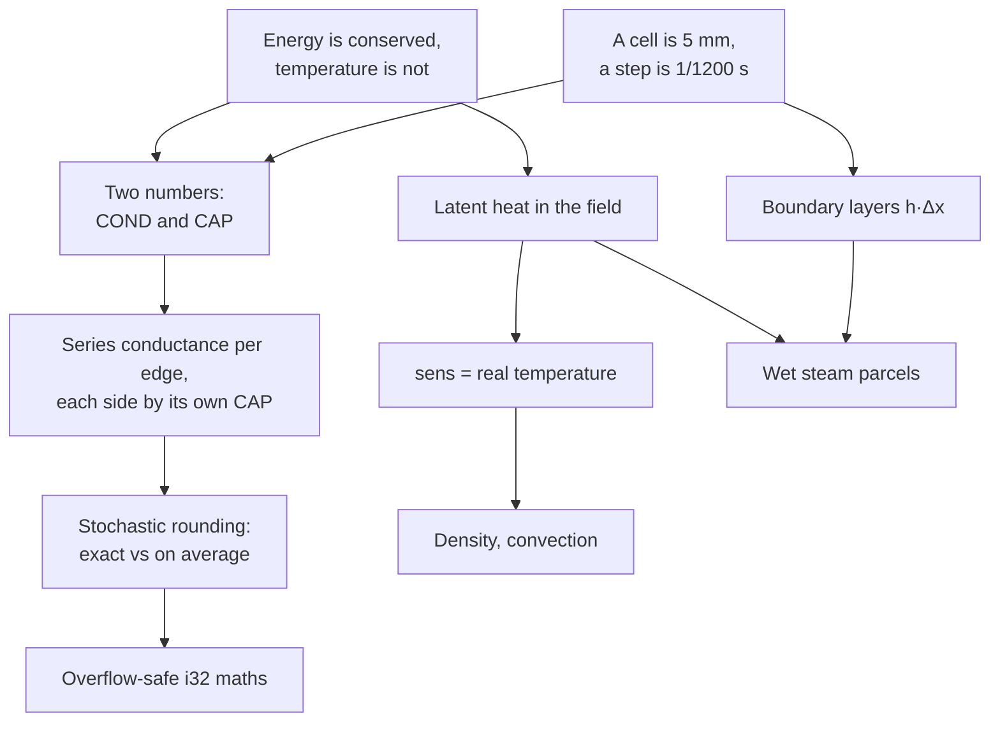
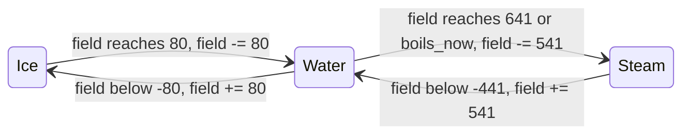

# Lesson 18: Heat that adds up (conductivity vs capacity, latent heat, boundary layers)

> Source: commits `5ddae24` (energy-based heat, liquid expansion, radiation), `20d89dd` (flame flux, anchored flames, WIP), `97d45da` (flames no longer mix sideways), `c4d6aeb` (latent heat of boiling, first boundary conductance), `302a475` (wet steam, melting ice, boundary layers). The state described is `df0f4a1`.
> Files: `sand/src/physics/materials.rs` (tables, `LATENT`, `sens`), `sand/src/physics/thermal.rs` (`flow_24`, `pair_conductance`, `heat_rate`, `heat_cell`), `sand/src/physics/motion.rs` (`spread_chance`), and the mirrors `sand/src/physics/wgsl/thermal.wgsl`, `wgsl/common.wgsl`. Tests in `sand/src/physics/tests.rs`.
> See the history with `git log --oneline 07fcf0b..df0f4a1`, and any step with `git show 302a475`.

---

## 1. What you will build

Lesson 16 gave heat real units: one number per material, the thermal **diffusivity** $\alpha$, turned into a per-step rate. It looked right for a block of granite. It went wrong the moment two *different* materials touched, and it had no idea that boiling water needs energy that a thermometer does not show.

By `df0f4a1` the heat model has these parts. This lesson derives each one:

- Two numbers per material: **conductivity** `COND` (how easily heat crosses) and **heat capacity** `CAP` (how much heat it takes to warm). Heat per edge comes from conductivities in series; each side changes by **its own** capacity.
- Overflow-safe fixed point with no 64-bit integers (`flow_24`, the `/8` split in `heat_rate`), because WGSL has no `i64`.
- **Radiation**: between touching different materials, and from hot surfaces into open air.
- **Liquid expansion**, so water heated from below turns over.
- **Latent heat** stored in the temperature field itself: water above 100°C in its field is boiling, ice above 0 is melting, steam below 100 is a wet parcel. `sens()` reads the real temperature.
- **Stochastic boiling** that keeps energy exact, so bubbles appear as soon as boiling starts.
- **Boundary layers** for boiling and melting surfaces, because a 5 mm cell is far thicker than the layer that carries heat there.
- **Anchored flames** with a real heat flux of 150 kW/m².

You will then build `heatcol`, a 1-D heat column with rock, water and steam: series conduction between two materials, a boiling boundary layer, the enthalpy plateau, and tests for exact conservation, average conservation, and the plateau.

It builds on lessons 7 (fixed point, phase changes), 11 (the WGSL mirror) and 16 (real units, stochastic rounding). The dependency map of its ideas; everything hangs off two roots:



---

## 2. Concepts

### 2.1 The unconditional truth: energy is conserved, temperature is not

> **Heat is energy. When heat moves from one cell to another, the energy one loses is the energy the other gains.**

That is the first law of thermodynamics, with no caveats inside a closed box. Temperature is *not* conserved. Put 1 litre of 80°C water next to 1 litre of 20°C air and let them settle: the result is not 50°C. It is about 79.98°C, because water holds about 3500 times more heat per degree than air.

The link between the two is the heat capacity. For one cell of volume $V$:

$$Q = \rho c\, V\, \Delta T.$$

$\rho c$ (density times specific heat) is the **volumetric heat capacity**, in J/(m³·K). It is how much energy one cubic metre needs to warm by one kelvin. Every rule in this lesson is just "move $Q$ correctly, then turn $Q$ into a $\Delta T$ for each side".

### 2.2 Three numbers that are easy to confuse

| quantity | symbol | unit | question it answers | in the code |
|---|---|---|---|---|
| conductivity | $k$ | W/(m·K) | how fast does heat cross a boundary? | `COND` (mW/(m·K)) |
| volumetric heat capacity | $\rho c$ | J/(m³·K) | how much heat to warm it 1 K? | `CAP` (10 J/(m³·K)) |
| diffusivity | $\alpha = k/(\rho c)$ | m²/s | how fast does a *temperature* spread inside it? | (was `HEAT_K`) |

The tables at `df0f4a1` (`materials.rs`), with the real values in the comments:

```rust
/// Heat, part 1: thermal conductivity in mW/(m K). How easily heat crosses
/// a boundary. Air 0.026 W/(m K), granite 2.5, dry sand 0.3, water 0.6,
/// oil 0.15, lava 1.5, steam 0.025, wood 0.15, flame gas 0.08, ice 2.2.
pub const COND: [i32; MATERIAL_COUNT] = [26, 2500, 300, 600, 150, 1500, 25, 150, 80, 2200, 26];
/// Heat, part 2: volumetric heat capacity rho*c in units of 10 J/(m^3 K).
pub const CAP: [i32; MATERIAL_COUNT] = [120, 210000, 130000, 418000, 170000, 300000, 120, 102000, 35, 190000, 120];
```

**Why one number per material was wrong.** Inside one material, diffusivity is all you need. The heat equation $\partial T/\partial t = \alpha \nabla^2 T$ has only $\alpha$ in it, because the same $\rho c$ sits on both sides of every edge and cancels. Lesson 16's `HEAT_K` was $\alpha\,\Delta t/\Delta x^2$, and between two materials it used the harmonic mean of the two rates. Both cells then changed by **the same number of degrees** in opposite directions.

Take a water cell next to an air cell. Old `HEAT_K` values: air 769, water 5, harmonic mean 9.9. Per step, the air warms by some $\delta$ and the water cools by the same $\delta$. In energy, the water loses $4180\,\delta$ kJ/m³ and the air gains $1.2\,\delta$ kJ/m³. Energy vanished, and the rate was wrong too: real air beside warm water reaches the water's temperature in a fraction of a second, while the water hardly notices.

The fix needs both numbers. How much heat crosses depends on the conductivities. How far each side's temperature moves depends on each side's own capacity.

### 2.3 Heat across one edge, derived

Each cell is a cube of side $\Delta x = 5$ mm. The heat that flows between cell centres $a$ and $b$ passes through half of $a$ (thickness $\Delta x/2$) and then half of $b$. Two slabs in series add their thermal resistances, like resistors:

$$R = \frac{\Delta x/2}{k_a\,\Delta x^2} + \frac{\Delta x/2}{k_b\,\Delta x^2}
\quad\Rightarrow\quad
G = \frac1R = \Delta x \cdot \underbrace{\frac{2 k_a k_b}{k_a + k_b}}_{k_{\text{series}}}.$$

So the edge has conductance $G = k_{\text{series}}\,\Delta x$ in W/K. In one step $\Delta t$ the heat crossing is $Q = G\,(T_b - T_a)\,\Delta t$, and each side changes by $Q$ over its own capacity $\rho c_a\,\Delta x^3$:

$$\Delta T_a = \frac{k_{\text{series}}\,\Delta t}{\rho c_a\,\Delta x^2}\,(T_b - T_a),
\qquad
\Delta T_b = -\frac{k_{\text{series}}\,\Delta t}{\rho c_b\,\Delta x^2}\,(T_b - T_a).$$

Check: $\rho c_a \Delta T_a + \rho c_b \Delta T_b = 0$. Energy is conserved, and each side moves at its own pace. If $a = b$, the factor is $k/(\rho c)\cdot \Delta t/\Delta x^2 = \alpha\,\Delta t/\Delta x^2$: lesson 16's formula falls out as the one-material special case.

In fixed point the per-step rate is stored times $2^{24}$. With `COND` in mW/(m·K) and `CAP` in 10 J/(m³·K), all the constants fold into one number:

$$\texttt{RATE\_SCALE} = \frac{2^{24}\cdot \Delta t}{\Delta x^2 \cdot 1000 \cdot 10} = \frac{16\,777\,216 / 1200}{2.5\times 10^{-5}\cdot 10^4} = 55\,924.$$

```rust
pub fn heat_rate(cap: i32, conductance: i32) -> i32 {
    let rate = if conductance <= 37_000 {
        conductance * RATE_SCALE / cap
    } else {
        (conductance / 8) * RATE_SCALE / (cap / 8).max(1)
    };
    rate.min(RATE_MAX)
}
```

(The `/8` branch is section 2.5.) In `heat_cell`, the edge closure asks `pair_conductance` for the edge, then `heat_rate(my_cap, ...)` with **this cell's** capacity:

```rust
let rate = heat_rate(my_cap, pair_conductance(m, mn, t0s, tn));
let roll = edge_roll(edge_cell, down, key);
t += if ours { flow_24(tn - t0s, rate, roll) } else { -flow_24(t0s - tn, rate, roll) };
```

Some numbers. Water against air: $k_{\text{series}} = 2\cdot600\cdot26/626 = 49$ mW/(m·K). The air cell's rate is $49\cdot55924/120 = 22835$, about $0.0014$ of the gap per step, so air catches up in under a second. The water cell's rate is $49\cdot55924/418000 = 6$, about $3.6\times10^{-7}$ per step. Same edge, same heat, rates 3800 times apart.

### 2.4 Stochastic rounding: what is exact and what is only on average

Rates like $6/2^{24}$ round to zero with plain integer division (lesson 16, section 2.10). The project adds a random `roll` in $[0, 2^{24})$ before the shift, so the expected result is the exact real value. Lesson 16 also made both cells of an edge use **the same roll**, so a same-material edge computes the same integer on both sides and one negates it.

With two capacities, that trick no longer cancels exactly. Cell $a$ computes $\lfloor (d\cdot r_a + u)/2^{24} \rfloor$ and cell $b$ computes $\lfloor (d\cdot r_b + u)/2^{24} \rfloor$ with different rates $r_a \neq r_b$. Each is right **on average**. Their rounding errors, weighted by $\rho c_a$ and $\rho c_b$, do not cancel step by step. Here is the full ledger:

| situation | conservation |
|---|---|
| edge between two cells with the same capacity behind the field | **exact**, to the unit |
| edge between different materials | **on average**: the total does a random walk of size about $\rho c\sqrt{\text{steps}\times\text{edges}}$ |
| same material, but one cell on a phase plateau (wet steam next to dry steam, melting ice next to cold ice) | on average (the two `my_cap` differ) |
| a phase change landing exactly on its threshold, or a wet parcel boiling or condensing | **exact** (section 2.8) |
| a phase change that overshoots its threshold within a step | small loss: the overshoot changes capacity |
| `heat_rate` truncation (`conductance * RATE_SCALE / cap` is integer division) | small bias: stone–water is off by 0.09%, water–air by 9% on the water side |
| gases relaxing to 20°C, radiation to the sky, flames held at 900°C | **not conserved on purpose**: the room is a reservoir, burning is a source |

The project's test checks the middle case honestly, by name:

```rust
#[test]
fn heat_between_different_materials_is_conserved_on_average() {
    // Hot stone in cold water, no gas anywhere (gases lose heat to the
    // room on purpose). Energy = sum of heat capacity * temperature.
    ...
    let energy = |w: &World| {
        w.cells.iter().map(|&c| CAP[material(c) as usize] as f64 * (temp(c) - AMBIENT) as f64).sum::<f64>()
    };
    ...
    assert!(drift < 0.01, "energy drifted by {:.2}%", drift * 100.0);
```

Note the energy is `CAP * temp`, not the sum of temperatures. Summing temperatures was the old, wrong invariant.

### 2.5 Overflow-safe fixed point, because WGSL has no `i64`

The exact flow is $\lfloor (d \cdot r + u)/2^{24} \rfloor$. The gap $d$ can be up to $2^{20}$ (the full 20-bit temperature range), the rate up to `RATE_MAX` $= 2^{18}-1$. Their product needs 38 bits. On the CPU you would write `(d as i64 * rate as i64 + roll as i64) >> 24`. WGSL has no 64-bit integers, and the CPU must produce **bit-identical** results to the GPU (lesson 11), so both sides do it in `i32`.

The trick: split $d = 4096\,h + \ell$ with $0 \le \ell < 4096$ (`d >> 12` and `d & 4095`, which also works for negative $d$ in two's complement). Then

$$d\,r + u = 4096\,(h r) + (\ell r + u),$$

and for any integer $A$ and $B \ge 0$,

$$\left\lfloor \frac{4096 A + B}{2^{24}} \right\rfloor = \left\lfloor \frac{A + \lfloor B/4096 \rfloor}{4096} \right\rfloor .$$

(Dividing by $2^{24}$ is dividing by 4096 twice, and since $A$ is an integer, flooring $B/4096$ first changes nothing.) Every intermediate now fits: $|h r| \le 2^8\cdot 2^{18} = 2^{26}$ and $\ell r + u < 2^{12}\cdot2^{18} + 2^{24}$, below $2^{31}$.

```rust
pub fn flow_24(d: i32, rate: i32, roll: i32) -> i32 {
    let (hi, lo) = (d >> 12, d & 4095);
    (hi * rate + ((lo * rate + roll) >> 12)) >> 12
}
```

The WGSL copy in `wgsl/thermal.wgsl` is the same three lines, with a comment that `&` on a negative `i32` works on its two's complement bits, as in Rust.

`heat_rate` has the second overflow. `conductance * RATE_SCALE` fits in an `i32` only while conductance is at most $2^{31}/55924 \approx 38\,400$. The boundary-layer conductances of section 2.10 are larger (250 000). So above 37 000 both factors are divided by 8 first. That is **exact** here, because every `CAP` the boundary layers touch is a multiple of 8 (water 418 000 = 8 · 52 250, lava, stone, sand and wood too), and $250\,000/8 = 31\,250$ is an integer. Water against a boiling surface: $31250\cdot55924/52250 = 33447$, about 0.2% of the gap per step.

### 2.6 Radiation, linearised into a conductance

Two surfaces at absolute temperatures $T_a$ and $T_b$ exchange radiation $q = \varepsilon\sigma(T_a^4 - T_b^4)$ W/m². For a small gap, factor it around the mean $T$:

$$T_a^4 - T_b^4 \approx 4T^3\,(T_a - T_b).$$

So radiation behaves like an extra heat-transfer coefficient $h_r = 4\varepsilon\sigma T^3$, and as a conductivity across one cell, $h_r\,\Delta x$. That is `radiation_k`:

```rust
/// 4 * emissivity * sigma * T^3 * CELL, with emissivity 0.9 and T the mean
/// absolute temperature. Computed with T/10 so it fits an i32.
pub fn radiation_k(ta: i32, tb: i32) -> i32 {
    let kelvin = (ta + tb) / 2 / T_SCALE + 273;
    let t10 = (kelvin / 10).max(0);
    (((t10 * t10 * t10) >> 6) * 1045) >> 14
}
```

At 20°C it is 24 mW/(m·K), negligible next to rock. At 1150°C ($T = 1423$ K) it is about 2850, more than granite's 2500. That is why glowing things heat their surroundings so much better than warm ones.

`pair_conductance` adds it only **between different condensed materials** (inside one continuous body there is no surface to radiate across), and at a third for a flame against a surface (emissivity about 0.3).

A surface facing open air radiates to the room at $T_0 = 293$ K. Here the gap is not small (1423 K vs 293 K), so `sky_rate` uses the **exact** factorisation instead of the $4T^3$ approximation:

$$T^4 - T_0^4 = (T^2 + T_0^2)(T + T_0)\,(T - T_0).$$

The loss is "rate times $(T - T_0)$", which fits the same `flow_24` machinery. For lava at 1150°C this gives about 14 K/s of cooling per exposed face. That matches $\varepsilon\sigma(T^4 - T_0^4)/(\rho c\,\Delta x) = 2.09\times10^5 / (3\times10^6 \cdot 0.005) = 13.9$ K/s, and it is how `lava_in_open_air_crusts_over` forms a crust in 30 s. Air itself carries almost no heat away.

### 2.7 Liquid expansion and convection

Conduction alone can only even out a temperature difference. To turn over a pot, hot water must be lighter than cold. `EXPANSION` is in ppm per K (water 300, oil 700, lava 100), and `density` applies it:

```rust
} else if k == LIQUID {
    // Liquids expand a little: d * (1 - expansion * (t - 20°C)).
    let warmer = (t - AMBIENT) / T_SCALE;
    (d - d * (EXPANSION[m as usize] * warmer / 1000) / 1000).max(1)
}
```

Water at 80°C comes out 1.8% lighter than at 20°C, so it rises through the Margolus gravity pass like any lighter fluid. `water_heated_from_below_turns_over` puts 80°C water under 20°C water and, after 10 s, requires the top half to be more than 10 K warmer than the bottom.

Gases use the ideal gas law instead, $\rho \propto 1/T$. And note the first line of `density`: `let (m, t) = (material(cell), sens(cell));`. It reads the **real** temperature. Section 2.8 explains why that matters: a boiling cell's field can hold 641, and 300 ppm/K × 621 K would make it 18.6% lighter than cold water, which is nonsense.

### 2.8 Latent heat: why a threshold is not enough

The old rule was "water at 100°C becomes steam". It looks fine and is badly wrong. To boil 1 kg of water you must add 2.26 MJ **after** it reaches 100°C, five times what it took to heat it from 20 to 100. With a threshold, the first joule past 100°C turns a whole cell into steam for free. Energy appears from nowhere, and a pot boils dry the instant it reaches 100°C.

So the cell must be able to hold "100°C and some energy on the way to steam". Where can that energy live? The cell is one `u32` with 20 bits of temperature. The project's answer: **store it in the temperature field itself, in units of water-kelvins.**

$$\frac{L_v}{c_w} = \frac{2.26\ \text{MJ/kg}}{4.18\ \text{kJ/(kg·K)}} = 541\ \text{K},
\qquad
\frac{L_f}{c_w} = \frac{333\ \text{kJ/kg}}{4.18\ \text{kJ/(kg·K)}} = 80\ \text{K}.$$

Boiling one water cell takes the same energy as heating it by 541 K. So a water cell whose field reads 300°C is really at 100°C, with 200 K of its 541 K of vaporisation heat already absorbed. The field becomes an **enthalpy**: temperature plus stored latent heat. The rules:

| material | field range | what it means | real temperature |
|---|---|---|---|
| water | below $-80$ | turns to ice, field $+80$ | (becomes ice) |
| water | $-80$ to 0 | freezing: has given up part of its fusion heat | 0°C |
| water | 0 to 100 | ordinary liquid | the field |
| water | 100 to 641 | boiling: has absorbed part of $L_v$ | 100°C |
| water | 641 and up | all boiled: steam, field $-541$ | (becomes steam) |
| steam | 100 and up | dry, superheated | the field |
| steam | $-441$ to 100 | **wet parcel**: partly condensed | 100°C |
| steam | below $-441$ | all condensed: water, field $+541$ | (becomes water) |
| ice | up to 0 | ordinary ice | the field |
| ice | 0 to 80 | **melting**: has absorbed part of $L_f$ | 0°C |
| ice | 80 and up | all melted: water, field $-80$ | (becomes water) |

The steam field can go to $-441$°C. It fits: 20 signed bits at 256 units per degree reach $\pm 2047$°C.



`sens()` turns the field back into a real temperature. It is used for every edge gap, for density, for the heat view and for the probe under the mouse:

```rust
pub fn sens(cell: u32) -> i32 {
    let t = temp(cell);
    match material(cell) {
        WATER => t.clamp(0, celsius(100)),
        STEAM => t.max(celsius(100)),
        ICE => t.min(0),
        _ => t,
    }
}
```

This is the *plateau*. Heat a boiling cell and `sens` stays at 100 while the field climbs. The gap to the hot neighbour stays wide, so heat keeps pouring in at full rate, exactly as in a real pot, whose thermometer sticks at 100°C.

**The bookkeeping.** Write $C_w$ for water's `CAP`. Measure energy from liquid water at 0°C. Then each cell's enthalpy is

$$H = \begin{cases}
C_w\, f & \text{water, any field } f\\
C_w\,(f + 541) & \text{wet steam, } f < 100\\
C_w\cdot 641 + C_s\,(f - 100) & \text{dry steam}\\
C_w\,(f - 80) & \text{melting ice, } f > 0\\
C_i\, f - 80\,C_w & \text{cold ice, } f \le 0
\end{cases}$$

Check a transition: water at $f = 641$ has $H = 641\,C_w$; it becomes steam at $f = 100$, $H = 641\,C_w$. Equal. Ice at $f = 80$ has $H = 0$; it becomes water at $f = 0$, $H = 0$. Equal.

Look at the wet-steam and melting-ice lines: their field moves at **water's** capacity, not steam's or ice's. The 541 K and 80 K are water-kelvins. If a wet parcel's field moved at steam's `CAP` of 120, giving back 541 K would release 3500 times too little energy. So `heat_cell` picks the capacity behind the field:

```rust
// Heat capacity behind the field: a wet steam parcel is a water cell's worth
// of mass changing phase, so its field moves at water's rate.
// Melting ice likewise: its fusion heat is counted in water's units.
let phase_plateau = (m == STEAM && t0 < celsius(100)) || (m == ICE && t0 > 0);
let my_cap = if phase_plateau { CAP[WATER as usize] } else { CAP[m as usize] };
```

(Boiling water and freezing water are already water, so their `CAP` is already right.) WGSL has the same line with `select`.

One honest gap remains. A cell can overshoot a threshold within a step: water reaches field $641 + \varepsilon$ and becomes steam at $100 + \varepsilon$. That $\varepsilon$ was counted at $C_w$ and is now counted at $C_s$, so $(C_w - C_s)\,\varepsilon$ is lost. $\varepsilon$ is at most one step's flow, so this is tiny, and the wet-parcel path below avoids it entirely. You will see the exact number in `heatcol`'s tests.

### 2.9 Stochastic boiling: wet parcels with exact energy

`c4d6aeb` added the 541 K plateau with only one way out: the field reaches 641, and the whole cell becomes steam. The physics was right. The picture was empty: the hot-crust test (lava under a pool, covered by its own crust) showed no steam after the first burst.

Work out what a cell needs. One 5 mm water cell is $1.25\times10^{-7}$ m³, 0.125 g. Boiling it takes

$$4.18\times10^{6} \cdot 1.25\times10^{-7} \cdot 541 \approx 282\ \text{J}.$$

Through a 5 mm rock crust, the heat into the water is about 12 W per crust cell (the test's comment). So one water cell has to sit still against the crust for $282/12 \approx 23$ s before anything visible happens. It never does. A charged cell reads 100°C, so it conducts its stored heat into cooler water around it, and it moves, because water flows and spreads. The pool warms correctly and no single cell ever reaches 641.

Real boiling does not vaporise 5 mm blocks either. It makes many tiny bubbles out of a thin layer. A cell that has absorbed some of its latent heat is best seen as **partly vapour**. So `302a475` lets a boiling cell release a parcel at random, more likely the more it holds:

```rust
let stored = t - celsius(100);
let boils_now = m == WATER
    && stored > 0
    && pcg(r ^ 0xB011_B011) % (LATENT as u32 * BOIL_SLOWDOWN) < stored as u32;
...
WATER if t >= celsius(100) + LATENT || boils_now => {
    next = STEAM;
    life = VT_GAS[STEAM as usize];
    t -= LATENT;
}
```

The parcel keeps **exactly** the energy absorbed: water at $100 + s$ becomes steam at $100 + s - 541$, below 100, a wet parcel. Same $H$, same capacity ($C_w$ via `my_cap`). No overshoot, no loss. The chance per step is $s/(541\cdot 64)$: a half-charged cell bubbles with chance $1/128$ per step, about every 0.1 s. Bubbles appear as soon as boiling starts, at a rate set by the heat flowing in.

A wet parcel rises and mixes into the room. Steam's relaxation to 20°C uses `STEAM_RELAX_K = 2950` on its **real** temperature (100°C, an 80 K gap): $80\cdot256\cdot2950/2^{20} \approx 58$ units, 0.23 K of field per step, so a fully charged parcel condenses in about 2 s, a half-charged one in about 1 s. Then it is water again and rains back.

Now the numbers for the hot crust. 282 J per parcel at 12 W is 0.043 parcels per second per crust cell. The commit's figure of ~1.7 parcels/s matches about 40 crust cells, which is the upward face of the test's lava (24 + 8 + 8 cells). Each parcel lives one to two seconds, so a handful exists at any moment. That number decides the test (section 2.13).

### 2.10 Boundary layers: $h\,\Delta x$ as a conductance

Even with latent heat, the lava–water edge was too slow. The cell model assumes temperature changes linearly from cell centre to cell centre, over 5 mm. Real heat transfer at a boiling surface happens in a layer far thinner than that, stirred by bubbles. Engineers describe it by a **heat-transfer coefficient** $h$ in W/(m²·K): $q = h\,\Delta T$.

To put it into the grid, ask which conductivity gives the same heat through one face: $h\,\Delta x^2\,\Delta T = k_{\text{eff}}\,\Delta x\,\Delta T$, so

$$k_{\text{eff}} = h\,\Delta x.$$

| interface | $h$ | $k_{\text{eff}} = h\,\Delta x$ | what plain conduction gives |
|---|---|---|---|
| water on a surface at 110°C or hotter (nucleate boiling) | 50 000 W/(m²·K) | 250 W/(m·K): `BOIL_CONDUCTANCE = 250_000` | lava–water: 0.86 W/(m·K) series, a few hundred times less |
| water against ice (melting) | 1500 W/(m²·K) | 7.5 W/(m·K): `MELT_CONDUCTANCE = 7_500` | ice–water: 0.94 W/(m·K), 8 times less |

```rust
let hot_surface = |s: u32, ts: i32| matches!(s, LAVA | STONE | SAND | WOOD) && ts >= celsius(110);
if (a == WATER && hot_surface(b, tb)) || (b == WATER && hot_surface(a, ta)) {
    return BOIL_CONDUCTANCE;
}
if (a == WATER && b == ICE) || (a == ICE && b == WATER) {
    return MELT_CONDUCTANCE;
}
```

The value depends only on the pair and their temperatures, so both cells of the edge compute the same number. Conservation is unchanged. 110°C is "a little superheat starts nucleate boiling".

A real number to check the melting value against: ice in 22°C water. $q = 1500\cdot22 = 33$ kW/m², and melting ice takes $\rho_{\text{ice}} L_f = 917\cdot333\,000 = 3.05\times10^8$ J/m³, so the surface retreats at $33\,000/3.05\times10^8 \approx 0.1$ mm/s. A 5 mm cell open on four faces melts in roughly 10 to 15 s. `ice_melts_in_hot_water` puts one ice cell in 80°C water and asks that it melts within 40 s, but not within 1 s.

What the model leaves out: real boiling has a ceiling, the critical heat flux (roughly 1 MW/m² for water at 1 atm). Above it a vapour film forms (the Leidenfrost effect) and $h$ drops. At 50 000 W/(m²·K), lava at 1150°C would push 50 MW/m². In the sim the lava face cools and crusts within moments, so this lasts a fraction of a second, but it is a known simplification, not physics.

**The freezer uses the same value (added later).** `pair_conductance` also returns `MELT_CONDUCTANCE` between water and `FREEZER`, a cold plate at -30°C, with the same $h = 1500$ W/(m²·K). Lesson 19 (section 2.6) explains why plain conduction is too slow for it and what the freezing time is.

### 2.11 Flames: anchored, with a real flux

Two changes made fire behave (`20d89dd`, `97d45da`). First, a flame touching a solid or liquid heats it with a surface flux $q = 150$ kW/m², a typical figure for flames on a surface. The temperature rise per step is $q\,\Delta t/(\rho c\,\Delta x)$. In 1/256 K units:

$$\frac{256\cdot 150\,000}{10\cdot 0.005 \cdot 1200} = 640\,000 = \texttt{FLAME\_UNITS},\qquad \Delta t\text{-rise} = \texttt{FLAME\_UNITS}/\texttt{CAP}.$$

For wood that is $640000/102000 = 6$ units per step, 28 K/s. Burning is a source, so this is not conserved (the flame is held at 900°C or more anyway).

Second, flames are **anchored** to their fuel. `sinks` returns false for any pair with fire, and `spread_chance` now excludes it:

```rust
// A flame is anchored: it does not mix sideways into air and die out.
if ml != mr && ml != FIRE && mr != FIRE && fluid(ml) && fluid(mr) && speed(left) == 0 && speed(right) == 0 {
```

Before `97d45da` a flame next to oil drifted sideways into the air, died there, and the oil never reached 250°C.

### 2.12 Lava: crust that conducts, gravel only when unheld

Lava below 1000°C sets. Which rock it becomes decides how heat gets out afterwards: stone conducts at 2.5 W/(m·K), gravel (sand) at 0.3.

```rust
LAVA if t < celsius(1000) => {
    let held = below.is_some_and(|b| matches!(material(b), LAVA | STONE) || KIND[material(b) as usize] >= POWDER);
    next = if touches_water && !held { SAND } else { STONE };
}
```

Real lava shatters into gravel when it is quenched while falling through water. Lava resting on lava, rock or powder forms a solid crust. The old rule called lava on lava "unsupported" (lava is a liquid), so the crust on top of a pool became gravel, an insulating blanket eight times worse than rock.

### 2.13 The debugging story

This took four commits. Each fixed something real and exposed the next thing.

| commit | change | what was still wrong |
|---|---|---|
| `5ddae24` | `COND` + `CAP` replace `HEAT_K`; radiation; expansion | boiling a bare threshold at 100°C with no energy cost; steam condensed at 50°C |
| `20d89dd` | flame flux, anchored flames, unsupported solids fall; token phase costs (boiling −40 K, freeze/melt ±10 K); hot-crust test added | the hot-crust test fails; a ×6 multiplier on the lava–water edge was a hack |
| `97d45da` | flames do not spread sideways | (fire fixed) |
| `c4d6aeb` | 541 K plateau, `sens()` for gaps; boundary conductance at 300°C+ | **water read 500°C**; **ice never melted**; **under a crust, boiling stopped after ~2 s** |
| `302a475` | wet parcels, ice plateau, `sens()` everywhere, 110°C, melt layer, gravel only when unheld | the test is rewritten to check the intent |

**"500°C water".** `c4d6aeb` stored latent heat in the field and used `sens()` for conduction, but the heat view and the probe still printed `temp()`. A boiling cell holding 400 K of latent heat showed as 500°C. Nothing in the physics was wrong. The display read the enthalpy as a temperature. `302a475` made the shader's `temp_of` and the HUD probe go through the same clamp as `sens()`.

**Ice that never melted.** The rules (from `20d89dd` until `302a475`) were "ice at 1°C or more becomes water at $-10$ K", and "water at $-2$°C or less becomes ice at $+10$ K". Follow one cell: ice at +1 becomes water at $-9$; water at $-9$ is below $-2$, so next step it is ice at +1; which melts to water at $-9$... It flickered between the two every step, forever. And even a correct rule would have been slow: plain ice–water conduction is 8 times weaker than a melting interface. The fix was the 0..80 plateau (no thresholds to ping-pong between, the cell stays ice at a real 0°C until it has absorbed 80 K) plus `MELT_CONDUCTANCE`.

**Lava under a crust that stopped boiling.** Three things together: the crust turned to gravel (section 2.12), the boundary layer switched off once the crust surface fell below 300°C, and whole-cell boiling could not show the trickle of heat that still came through (section 2.9). `302a475` fixed all three.

**The test that asked for the wrong thing.** The hot-crust test, written first, said

```rust
for _ in 0..3 * STEPS_PER_SECOND { sim.step(&mut world); }
assert!(world.count(STEAM) >= 10, "hot crust around bottom lava should keep making steam");
```

Do the arithmetic from section 2.9: about 1.7 parcels per second, each living up to 2 s. At any moment there are three or four. Demanding ten is demanding *wrong* physics, and a model tuned to pass it would be wrong. The intent was "boiling never stops while lava is still molten underneath". So the test was rewritten to check exactly that:

```rust
// After the first burst, heat comes through the rock crust (~12 W per
// crust cell), enough for ~1.7 steam parcels per second, each of which
// condenses in ~2 s. So a few parcels exist at any time: check that
// boiling never stops, rather than a fixed count.
...
assert!(steps_with_steam * 10 >= STEPS_PER_SECOND * 8, ...);
assert!(world.count(LAVA) > 0, "the lava under the crust is still molten");
```

`phase_transition_latent_heat` was rewritten for the same reason. Its old version expected steam below 50°C to become water at "49°C + 541", a water cell with a 590°C field, which only made sense under the old rule. The new version checks the plateaus: water at field $-2$ is still water, ice at field 1 is still ice with `sens` 0, steam at field 49 is still steam with `sens` 100, and each turns over exactly at its threshold.

The lesson for your own projects: when a test fails, first compute what the real system would do. Sometimes the test is the bug.

---

## 3. Build it yourself: `heatcol`

A 1-D column, index 0 at the bottom. Rock, water and steam, the same units and constants as the project. No motion, so you can watch heat alone.

### Step 1: create the crate

`cargo new --lib heatcol && cd heatcol`. No dependencies. Everything goes in `src/lib.rs`, plus a small `src/main.rs`.

### Step 2: constants and materials

```rust
//! A 1-D heat column: rock and water, conduction with per-cell heat
//! capacities, a boiling boundary layer, and latent heat stored in the field.

pub const T_SCALE: i32 = 256;
pub const fn celsius(c: i32) -> i32 {
    c * T_SCALE
}

/// Latent heat of vaporisation as a temperature rise of water.
pub const LATENT: i32 = 541 * T_SCALE;
pub const RATE_SCALE: i32 = 55_924;
pub const RATE_MAX: i32 = (1 << 18) - 1;
/// h * dx for nucleate boiling: 50000 W/(m^2 K) * 5 mm, in mW/(m K).
pub const BOIL_CONDUCTANCE: i32 = 250_000;

#[derive(Clone, Copy, Debug, PartialEq, Eq)]
pub enum Mat {
    Rock,
    Water,
    Steam,
}

impl Mat {
    /// Thermal conductivity, mW/(m K).
    pub const fn cond(self) -> i32 {
        match self {
            Mat::Rock => 2500,
            Mat::Water => 600,
            Mat::Steam => 25,
        }
    }
    /// Volumetric heat capacity, 10 J/(m^3 K).
    pub const fn cap(self) -> i32 {
        match self {
            Mat::Rock => 210_000,
            Mat::Water => 418_000,
            Mat::Steam => 120,
        }
    }
}
```

**Rust note.** An `enum` with methods is the idiomatic replacement for the project's `[i32; MATERIAL_COUNT]` tables. A `match` on an enum must cover every variant, so adding `Mat::Ice` later makes the compiler list every function you forgot to update. `const fn` lets you use these in constants.

### Step 3: a cell, its real temperature, and its enthalpy

```rust
#[derive(Clone, Copy, Debug, PartialEq, Eq)]
pub struct Cell {
    pub mat: Mat,
    /// The stored field: a temperature, or a temperature plus latent heat.
    pub field: i32,
}

impl Cell {
    pub fn new(mat: Mat, c: i32) -> Cell {
        Cell { mat, field: celsius(c) }
    }

    /// The real temperature: boiling water is at 100°C, wet steam too.
    pub fn sens(self) -> i32 {
        match self.mat {
            Mat::Water => self.field.min(celsius(100)),
            Mat::Steam => self.field.max(celsius(100)),
            Mat::Rock => self.field,
        }
    }

    /// The heat capacity that moves the field. A wet steam parcel's field
    /// counts latent heat in water's units, so it moves at water's rate.
    pub fn heat_cap(self) -> i32 {
        if self.mat == Mat::Steam && self.field < celsius(100) {
            Mat::Water.cap()
        } else {
            self.mat.cap()
        }
    }

    /// Energy relative to liquid water at 0°C, in 10 J/m^3 * (1/256 K).
    pub fn enthalpy(self) -> i64 {
        let f = self.field as i64;
        let (cw, cs) = (Mat::Water.cap() as i64, Mat::Steam.cap() as i64);
        let (boil, l) = (celsius(100) as i64, LATENT as i64);
        match self.mat {
            Mat::Rock => Mat::Rock.cap() as i64 * f,
            Mat::Water => cw * f,
            Mat::Steam if self.field < celsius(100) => cw * (f + l),
            Mat::Steam => cw * (boil + l) + cs * (f - boil),
        }
    }
}
```

`enthalpy` is the formula from section 2.8, in `i64` because it is only used by tests (on the CPU you may use 64 bits; the step itself must not, to match a GPU). `Mat::Steam if ...` is a **match guard**: the arm only matches when the condition holds, and the next arm catches the rest.

### Step 4: the edge maths

```rust
/// floor((d * rate + roll) / 2^24) in i32 only, for |d| <= 2^20,
/// 0 <= rate <= RATE_MAX, 0 <= roll < 2^24.
pub fn flow_24(d: i32, rate: i32, roll: i32) -> i32 {
    let (hi, lo) = (d >> 12, d & 4095);
    (hi * rate + ((lo * rate + roll) >> 12)) >> 12
}

/// Heat crossing the edge between `a` and `b`, as a conductivity (mW/(m K)).
/// Symmetric: conductance(a, b) == conductance(b, a).
pub fn conductance(a: Cell, b: Cell) -> i32 {
    let hot_rock = |c: Cell| c.mat == Mat::Rock && c.sens() >= celsius(110);
    if (a.mat == Mat::Water && hot_rock(b)) || (b.mat == Mat::Water && hot_rock(a)) {
        return BOIL_CONDUCTANCE;
    }
    let (ka, kb) = (a.mat.cond(), b.mat.cond());
    2 * ka * kb / (ka + kb)
}

/// Per-step rate (times 2^24) at which a cell of capacity `cap` follows a gap.
pub fn heat_rate(cap: i32, conductance: i32) -> i32 {
    let rate = if conductance <= 37_000 {
        conductance * RATE_SCALE / cap
    } else {
        (conductance / 8) * RATE_SCALE / (cap / 8).max(1)
    };
    rate.min(RATE_MAX)
}

pub fn pcg(v: u32) -> u32 {
    let state = v.wrapping_mul(747_796_405).wrapping_add(2_891_336_453);
    let word = ((state >> ((state >> 28) + 4)) ^ state).wrapping_mul(277_803_737);
    (word >> 22) ^ word
}

/// The random rounding for edge `i` (between cells i and i+1) in this step.
fn edge_roll(i: usize, key: u32) -> i32 {
    (pcg(i as u32 ^ key) & 0xFF_FFFF) as i32
}
```

**Rust note.** `wrapping_mul` and `wrapping_add` say "overflow is intended here". A plain `*` that overflows panics in debug builds and wraps silently in release. `flow_24` never overflows by construction, so it uses plain `*`, and debug-mode tests would catch you if you broke that.

### Step 5: phase rules and the step

```rust
/// Phase rules. They only move energy between "sensible" and "latent".
pub fn phase(c: Cell) -> Cell {
    match c.mat {
        Mat::Water if c.field >= celsius(100) + LATENT => Cell { mat: Mat::Steam, field: c.field - LATENT },
        Mat::Steam if c.field < celsius(100) - LATENT => Cell { mat: Mat::Water, field: c.field + LATENT },
        _ => c,
    }
}

/// One step. Index 0 is the bottom. Each cell gathers from its two edges;
/// the edge below belongs to the neighbour, so we compute its view and negate.
pub fn step(cells: &[Cell], frame: u32) -> Vec<Cell> {
    let key = pcg(frame ^ 0x5EED_1234);
    (0..cells.len())
        .map(|i| {
            let me = cells[i];
            let (ts, cap) = (me.sens(), me.heat_cap());
            let mut t = me.field;
            if i + 1 < cells.len() {
                let up = cells[i + 1];
                if up.sens() != ts {
                    let rate = heat_rate(cap, conductance(me, up));
                    t += flow_24(up.sens() - ts, rate, edge_roll(i, key));
                }
            }
            if i > 0 {
                let down = cells[i - 1];
                if down.sens() != ts {
                    let rate = heat_rate(cap, conductance(down, me));
                    t -= flow_24(ts - down.sens(), rate, edge_roll(i - 1, key));
                }
            }
            phase(Cell { mat: me.mat, field: t })
        })
        .collect()
}

pub fn total_enthalpy(cells: &[Cell]) -> i64 {
    cells.iter().map(|c| c.enthalpy()).sum()
}
```

This is `heat_cell` in one dimension. Gaps use `sens()`, the field moves by `heat_cap()`. The edge below is named by the lower cell (`i - 1`), so both cells find the same roll, and the upper cell computes the lower cell's view (`ts - down.sens()`) and negates it. `step` reads only the old slice and builds a new `Vec`: the double buffer of lesson 8, in one line of iterator code.

### Step 6: tests

```rust
#[cfg(test)]
mod tests {
    use super::*;

    #[test]
    fn flow_24_matches_64_bit_maths() {
        let mut s = 1u32;
        for _ in 0..200_000 {
            s = pcg(s);
            let d = (s % (1 << 21)) as i32 - (1 << 20);
            s = pcg(s);
            let rate = (s % (RATE_MAX as u32 + 1)) as i32;
            s = pcg(s);
            let roll = (s & 0xFF_FFFF) as i32;
            let exact = ((d as i64 * rate as i64 + roll as i64) >> 24) as i32;
            assert_eq!(flow_24(d, rate, roll), exact, "d={d} rate={rate} roll={roll}");
        }
        // The naive product really does overflow i32 in this range.
        assert!((1i32 << 20).checked_mul(RATE_MAX).is_none());
    }

    #[test]
    fn same_material_conserves_exactly() {
        let mut cells: Vec<Cell> = (0..20).map(|i| Cell::new(Mat::Rock, 20 + 40 * (i % 7))).collect();
        let before: i64 = cells.iter().map(|c| c.field as i64).sum();
        for frame in 0..20_000 {
            cells = step(&cells, frame);
        }
        let after: i64 = cells.iter().map(|c| c.field as i64).sum();
        assert_eq!(before, after);
    }

    #[test]
    fn rock_and_water_conserve_on_average() {
        // Hot rock under cold water, below boiling: no boundary layer, no phase.
        let mut cells: Vec<Cell> = (0..20).map(|i| if i < 10 { Cell::new(Mat::Rock, 90) } else { Cell::new(Mat::Water, 20) }).collect();
        let start = total_enthalpy(&cells);
        let excess = start - cells.iter().map(|c| Cell { field: celsius(20), ..*c }.enthalpy()).sum::<i64>();
        let water_before: i64 = cells[10..].iter().map(|c| c.enthalpy()).sum();
        for frame in 0..120_000 {
            cells = step(&cells, frame);
        }
        let moved = cells[10..].iter().map(|c| c.enthalpy()).sum::<i64>() - water_before;
        let drift = (total_enthalpy(&cells) - start).abs();
        assert!(moved > 0, "heat should reach the water");
        // The rounding errors of the two sides do not cancel step by step, so
        // the total does a random walk: small next to the heat in play.
        assert!((drift as f64) < 0.01 * excess as f64, "drift {drift} vs excess {excess}");
    }

    #[test]
    fn phase_rules_keep_enthalpy_exactly() {
        // Exactly at the threshold, and condensing a wet parcel: exact.
        let c = Cell { mat: Mat::Water, field: celsius(100) + LATENT };
        assert_eq!(phase(c).mat, Mat::Steam);
        assert_eq!(phase(c).enthalpy(), c.enthalpy());
        let wet = Cell { mat: Mat::Steam, field: celsius(100) - LATENT - 1 };
        assert_eq!(phase(wet).mat, Mat::Water);
        assert_eq!(phase(wet).enthalpy(), wet.enthalpy());
        // Overshoot: the part above the threshold was counted at water's
        // capacity and is now steam's. That much energy is lost.
        let over = 777;
        let c = Cell { mat: Mat::Water, field: celsius(100) + LATENT + over };
        let lost = c.enthalpy() - phase(c).enthalpy();
        assert_eq!(lost, (Mat::Water.cap() - Mat::Steam.cap()) as i64 * over as i64);
    }

    #[test]
    fn boiling_water_sits_at_100_while_it_absorbs_latent_heat() {
        // A heater (rock held at 600°C) under one water cell.
        let mut cells = vec![Cell::new(Mat::Rock, 600), Cell::new(Mat::Water, 20)];
        let (mut reached_100, mut boiled) = (None, None);
        for frame in 0..100_000u32 {
            cells[0] = Cell::new(Mat::Rock, 600);
            cells = step(&cells, frame);
            let w = cells[1];
            if w.mat == Mat::Water {
                assert!(w.sens() <= celsius(100), "water never reads above 100°C");
            }
            if reached_100.is_none() && w.sens() == celsius(100) {
                reached_100 = Some(frame);
            }
            if w.mat == Mat::Steam {
                boiled = Some(frame);
                break;
            }
        }
        let (a, b) = (reached_100.expect("reaches 100°C") as f64, boiled.expect("boils") as f64);
        // Heating 20 -> 100 against a 580..500 K gap vs 541 K at a 500 K gap.
        let ratio = (b - a) / a;
        assert!((6.0..9.0).contains(&ratio), "plateau / warm-up = {ratio:.2}");
    }
}
```

What each test pins down:

- `flow_24_matches_64_bit_maths`: the split identity of section 2.5, against `i64` on 200 000 random inputs. `checked_mul` returns `None` on overflow instead of panicking, which proves the naive product does not fit.
- `same_material_conserves_exactly`: `assert_eq!`, not a tolerance. Same capacity, same roll, negated.
- `rock_and_water_conserve_on_average`: a tolerance, because different capacities only cancel on average. `Cell { field: celsius(20), ..*c }` is **struct update syntax**: a copy of `*c` with one field replaced.
- `phase_rules_keep_enthalpy_exactly`: exact at the threshold and for a wet parcel, and the overshoot loss is exactly $(C_w - C_s)\varepsilon$.
- `boiling_water_sits_at_100_while_it_absorbs_latent_heat`: the plateau. The expected ratio comes from the physics. Warm-up is $\ln(580/500)/r = 0.148/r$, the plateau $541/(500 r) = 1.08/r$, ratio 7.3.

### Step 7: a demo (`src/main.rs`)

```rust
use heatcol::*;

fn main() {
    // A rock heater at 600°C under a single 5 mm water cell.
    let mut cells = vec![Cell::new(Mat::Rock, 600), Cell::new(Mat::Water, 20)];
    println!("  time   material  real °C  field °C");
    for frame in 0..1200u32 {
        cells[0] = Cell::new(Mat::Rock, 600);
        if frame % 60 == 0 || cells[1].mat == Mat::Steam {
            let w = cells[1];
            println!("{:5.2} s  {:8}  {:7.1}  {:8.1}", frame as f64 / 1200.0, format!("{:?}", w.mat), w.sens() as f64 / 256.0, w.field as f64 / 256.0);
            if w.mat == Mat::Steam {
                break;
            }
        }
        cells = step(&cells, frame);
    }
}
```

### Step 8: run it

```bash
cargo test --release
cargo run --release
```

All five tests pass, and the demo prints:

```
  time   material  real °C  field °C
 0.00 s  Water        20.0      20.0
 0.05 s  Water        85.4      85.4
 0.10 s  Water       100.0     145.5
 0.15 s  Water       100.0     205.3
 ...
 0.45 s  Water       100.0     564.1
 0.50 s  Water       100.0     623.9
 0.52 s  Steam       100.8     100.8
```

The real temperature reaches 100°C in about 0.06 s, then stays there for 0.45 s while the field climbs by 541. The field rises at a constant 1.2 K per millisecond on the plateau, because the gap to the heater is fixed at 500 K. The last line shows the overshoot: the cell became steam 0.8 K past the threshold.

---

## 4. Live examples in the real project

From `/Users/anujbarve/Documents/rusty/sand`:

```bash
cargo run --release --bin physics
```

- Press `Tab` (or `→`) once to get the **"lava + water"** scene. You can also start there with `SAND_SCENE=1 cargo run --release --bin physics`.
- Press **`H`** for the heat view. Boiling water near the lava shows 100°C, not 500°C. Wet steam parcels show 100°C as they rise and fade. The lava's crust shows a sharp drop from orange to cooler rock.
- Hover the mouse: the HUD probe prints the material and its `sens()` temperature.
- Slow time with `,` to watch single parcels leave the crust; speed up with `.` to watch the crust thicken and the boiling slow down; `/` returns to real time.
- Press `Tab` twice more for the **"ice"** scene: ice in hot surroundings reads 0°C in the heat view while it melts.

The tests that pin this lesson down:

```bash
cargo test --release ice_melts
cargo test --release phase_transition_latent_heat
cargo test --release boiling_water_reads_at_most_100c
cargo test --release lava_at_bottom_keeps_water_boiling_through_hot_crust
cargo test --release heat_between_different_materials_is_conserved_on_average
cargo test --release water_heated_from_below_turns_over
cargo test --release lava_in_open_air_crusts_over
```

`cargo test` takes a substring filter, so `ice_melts` runs `ice_melts_in_hot_water`. Use `--release`: these tests run tens of thousands of steps.

---

## 5. Exercises

### Exercise 1: rates and overflow by hand

Compute `heat_rate` for both sides of a water–lava edge when the lava is above 110°C. Which branch runs, and why would the other branch give a wrong answer? How many seconds does the water side need to close 63% of a fixed gap?

<details><summary>Solution 1</summary>

The edge is `BOIL_CONDUCTANCE = 250_000`, above 37 000, so the `/8` branch runs. Water: $31250\cdot55924/52250 = 33447$. Lava: $31250\cdot55924/37500 = 46602$. Both are below `RATE_MAX` (262 143).

The first branch would compute $250000\cdot55924 = 1.4\times10^{10}$, far past $2^{31} \approx 2.1\times10^{9}$. In release builds that wraps silently to garbage. In WGSL it always wraps.

Water's rate is $33447/2^{24} = 0.00199$ of the gap per step, $2.39$ per second. A fixed gap closes as $1 - e^{-2.39 t}$, so 63% takes $1/2.39 = 0.42$ s. That matches the `heatcol` demo (warm-up rate $r = 2.39$/s).
</details>

### Exercise 2: why density reads `sens`

In `density`, replace `sens(cell)` with `temp(cell)` (in your head). How much lighter than 20°C water would a boiling cell with field 641°C be? What would you see?

<details><summary>Solution 2</summary>

`warmer` would be 621 K. $300\cdot621/1000 = 186$ per mille, so the cell would be 18.6% lighter than cold water, lighter than oil (density 9000 vs 10 000). Boiling cells would shoot to the top of the pool and float on oil as "water" before turning to steam. With `sens` the cell counts as 100°C, 2.4% lighter, and rises as real hot water does.
</details>

### Exercise 3: add freezing to `heatcol`

Add `Mat::Ice` (`cond` 2200, `cap` 190 000) and `LATENT_F = 80 * T_SCALE`. Water below field $-80$ freezes (field $+80$), ice at field 80 or more melts (field $-80$). Update `sens`, `heat_cap` and `enthalpy`. Then test that melting is exact, that freezing loses exactly one unit's worth of capacity difference, and that both plateaus read 0°C.

<details><summary>Solution 3</summary>

```rust
pub const LATENT_F: i32 = 80 * T_SCALE;
// In Mat: Ice; cond 2200; cap 190_000.

// sens:
Mat::Water => self.field.clamp(0, celsius(100)),
Mat::Ice => self.field.min(0),

// heat_cap:
if (self.mat == Mat::Steam && self.field < celsius(100)) || (self.mat == Mat::Ice && self.field > 0) {
    Mat::Water.cap()
} else { self.mat.cap() }

// enthalpy, two new arms:
Mat::Ice if self.field > 0 => cw * (f - LATENT_F as i64),
Mat::Ice => Mat::Ice.cap() as i64 * f - cw * LATENT_F as i64,

// phase, two new arms before `_ => c`:
Mat::Water if c.field < -LATENT_F => Cell { mat: Mat::Ice, field: c.field + LATENT_F },
Mat::Ice if c.field >= LATENT_F => Cell { mat: Mat::Water, field: c.field - LATENT_F },
```

```rust
#[test]
fn freezing_and_melting_keep_energy() {
    let melting = Cell { mat: Mat::Ice, field: LATENT_F };
    assert_eq!(phase(melting).mat, Mat::Water);
    assert_eq!(phase(melting).enthalpy(), melting.enthalpy());
    // Freezing triggers one unit past -LATENT_F; that unit changes capacity.
    let freezing = Cell { mat: Mat::Water, field: -LATENT_F - 1 };
    assert_eq!(phase(freezing).mat, Mat::Ice);
    let lost = freezing.enthalpy() - phase(freezing).enthalpy();
    assert_eq!(lost, -((Mat::Water.cap() - Mat::Ice.cap()) as i64));
    assert_eq!(Cell { mat: Mat::Water, field: -LATENT_F / 2 }.sens(), 0, "freezing water is at 0°C");
    assert_eq!(Cell { mat: Mat::Ice, field: LATENT_F / 2 }.sens(), 0, "melting ice is at 0°C");
}
```

The freezing rule triggers at `< -LATENT_F`, so the smallest trigger is one unit past it, and that unit moves from water's capacity to ice's. The compiler helps: after adding `Mat::Ice`, every `match` that lacks an `Ice` arm is an error, so you cannot forget `cond` or `cap`.
</details>

### Exercise 4: wet parcels in `heatcol`

Give `phase` a random number `r` and add `boils_now` exactly as in `thermal.rs` (`BOIL_SLOWDOWN = 64`). Write a test that any boiling water cell, boiled early, keeps its enthalpy exactly and reads 100°C. Then run the old plateau test. It fails. Why, and what should it check instead?

<details><summary>Solution 4</summary>

```rust
pub const BOIL_SLOWDOWN: u32 = 64;

pub fn phase(c: Cell, r: u32) -> Cell {
    let stored = c.field - celsius(100);
    let boils_now = c.mat == Mat::Water && stored > 0 && r % (LATENT as u32 * BOIL_SLOWDOWN) < stored as u32;
    match c.mat {
        Mat::Water if boils_now => Cell { mat: Mat::Steam, field: c.field - LATENT },
        Mat::Water if c.field >= celsius(100) + LATENT => Cell { mat: Mat::Steam, field: c.field - LATENT },
        Mat::Steam if c.field < celsius(100) - LATENT => Cell { mat: Mat::Water, field: c.field + LATENT },
        _ => c,
    }
}
// In step: phase(Cell { mat: me.mat, field: t }, pcg(i as u32 ^ pcg(frame ^ 0xA511_E9B3)))
// In the old tests: phase(c, u32::MAX) never boils early (u32::MAX % 8_863_744 is large).

#[test]
fn wet_parcels_keep_energy_exactly() {
    let mut s = 7u32;
    for _ in 0..10_000 {
        s = pcg(s);
        let c = Cell { mat: Mat::Water, field: celsius(100) + (s % LATENT as u32) as i32 };
        let out = phase(c, pcg(s));
        assert_eq!(out.enthalpy(), c.enthalpy());
        if out.mat == Mat::Steam {
            assert_eq!(out.sens(), celsius(100), "a wet parcel is at 100°C");
        }
    }
}
```

The plateau test fails because the cell now becomes a wet parcel long before its field reaches 641, so the plateau/warm-up ratio is far below 6. The physics did not break: the test encoded "a cell boils all at once", which is the old model. This is the hot-crust story in miniature. Check the intent instead: water never reads above 100°C, the parcel reads 100°C, and the total enthalpy is unchanged.
</details>

### Exercise 5: what the melting boundary layer buys

In your Exercise 3 crate, put one ice cell at $-10$°C in the middle of nine cells of 60°C water and count the seconds until it melts. Then add `MELT_CONDUCTANCE = 7_500` for water–ice edges in `conductance` and measure again. Explain the ratio.

<details><summary>Solution 5</summary>

```rust
if matches!((a.mat, b.mat), (Mat::Water, Mat::Ice) | (Mat::Ice, Mat::Water)) {
    return 7_500;
}
```

Measured in this 1-D column: about 117 s with plain conduction, about 16 s with the boundary layer. The series conductivity is $2\cdot2200\cdot600/2800 = 943$ mW/(m·K), so the boundary layer is 8 times stronger. The time drops by about 7 rather than 8, because the neighbouring water also cools and has to be re-warmed by conduction through more water, which the boundary layer does not speed up. A pattern also used in `matches!`: `(A, B) | (B, A)` matches either order of a tuple.
</details>

### Exercise 6: find the two places that do not use `sens`

Read the radiation-to-sky and flame-flux lines of `heat_cell`:

```rust
if touches_fire && condensed(m) && m != FIRE {
    t += FLAME_UNITS / CAP[m as usize];
}
if condensed(m) && open_faces > 0 && t0 != AMBIENT {
    t += flow_24(AMBIENT - t0, sky_rate(m, t0) * open_faces, (r2 >> 8) as i32);
}
```

(a) What does a melting ice cell with field 50 (real 0°C) do in a 20°C room, by these lines? (b) What heating rate does the flame give water, and what should it be? Propose fixes (do not edit the project; try them in `heatcol` or on paper).

<details><summary>Solution 6</summary>

(a) The sky term uses `t0`, the raw field, not `sens`. A melting ice cell at field 50 counts as 50°C, so `AMBIENT - t0` is negative: the ice **loses** heat to a warmer room through radiation, slowing its melting. A boiling water cell at field 400 likewise radiates as if at 400°C. The fix is to use `t0s` for the gap and in `sky_rate` (and in the WGSL mirror, which has the same line).

(b) `FLAME_UNITS / CAP` is plain integer division. For water, $640000/418000 = 1.53$ truncates to 1, so water heats at 1.17 K/s instead of 1.8 K/s, 35% too slow. For wood it is 6 instead of 6.27 (4% low). The fix is the same idea as everywhere else: stochastic rounding, for example `(FLAME_UNITS * 256 / CAP + (roll & 255)) >> 8` with a fresh random byte, so the mean is exact. (Watch the overflow: $640000\cdot256 = 1.6\times10^8$ still fits in an `i32`.)
</details>

---

## 6. Common mistakes

- **Conserving the sum of temperatures.** That is only an invariant inside one material. Between materials, conserve $\sum \rho c\,T$ (or the enthalpy $H$ once phases exist). A test that sums `temp(c)` will pass for a wrong model and fail for a right one.
- **One number per material.** Diffusivity is enough for one material, never for a boundary. Keep `COND` and `CAP` separate; combine conductivities on the edge, divide by each side's capacity.
- **Arithmetic mean of conductivities.** Two slabs in series add resistances, so the edge uses the harmonic mean. The arithmetic mean lets a thin insulator conduct like the metal next to it.
- **A boiling threshold with no energy.** "At 100°C it becomes steam" creates energy. Phase changes need a plateau where energy goes in and temperature stays.
- **Reading the field as a temperature.** Once latent heat lives in the field, every consumer must ask `sens()`: gaps, density, display, probes, sky radiation. The "500°C water" bug was a display that forgot.
- **Moving a plateau field at the wrong capacity.** Latent heat counted in water-kelvins must move at water's capacity (`my_cap`), even when the cell is labelled steam or ice.
- **Phase rules that ping-pong.** "Melt at +1 into −9" and "freeze at −2 into +1" form a loop. With an enthalpy field there are no gaps between thresholds to jump across.
- **Whole-cell events for gradual processes.** A 5 mm cell needs 282 J to boil. If the only visible event needs the whole cell, slow processes are invisible. Release partial parcels that carry exactly their energy.
- **Cell-centre conduction at an interface that is really a thin layer.** At 5 mm, boiling and melting surfaces are hundreds and eight times too slow. Use $h\,\Delta x$ as the edge conductance, the same value from both sides.
- **`conductance * RATE_SCALE` overflowing.** Fine below 37 000, garbage above. Divide both factors first, and only where that division is exact.
- **Assuming `i64` on the GPU.** WGSL has none. Split the multiplication (`flow_24`) and test the split against `i64` on the CPU.
- **Tests that demand unphysical numbers.** "At least 10 steam cells" assumed a steam rate the physics cannot give. Compute what the real thing would do before trusting a failing test.

---

## 7. Recap

- Energy is conserved, temperature is not: $Q = \rho c\,V\,\Delta T$. So heat needs two numbers per material, `COND` ($k$) and `CAP` ($\rho c$). Diffusivity $\alpha = k/\rho c$ only works inside one material, which is why `HEAT_K` failed at boundaries.
- An edge's conductance is $k_{\text{series}}\,\Delta x$ with $k_{\text{series}} = 2k_ak_b/(k_a+k_b)$. Each side changes by the same heat over its own capacity, as a per-step rate `conductance * RATE_SCALE / cap` with `RATE_SCALE = 55924`.
- With a shared roll, same-capacity edges conserve **exactly**. Different capacities conserve **on average** (a random walk). Gas relaxation, sky radiation and flames are deliberate sources and sinks.
- No `i64` in WGSL: `flow_24` splits $d = 4096h + \ell$ so every product fits in 31 bits, and `heat_rate` divides by 8 (exactly) above 37 000.
- Radiation is linearised into conductances: $4\varepsilon\sigma T^3\Delta x$ between touching different materials, and the exact factor $(T^2+T_0^2)(T+T_0)$ to open air, about 14 K/s per face for fresh lava.
- Liquids expand (water 300 ppm/K), so heated water rises and turns over. Density reads `sens()`.
- Latent heat lives in the field in water-kelvins: 541 K to boil, 80 K to melt. Water 100..641 is boiling, steam below 100 is a wet parcel, ice 0..80 is melting, water below 0 is freezing. `sens()` is the real temperature, and plateau cells move at water's capacity.
- Boiling releases wet parcels at random with chance $s/(541\cdot64)$, each carrying exactly the energy absorbed. Through a crust at ~12 W per cell that is ~1.7 parcels/s, each condensing in 1 to 2 s.
- Boundary layers become conductances $h\,\Delta x$: 250 W/(m·K) for boiling (50 000 W/m²K), 7.5 for melting (1500 W/m²K, ice retreats ~0.1 mm/s in 22°C water).
- Flames are anchored and deliver 150 kW/m² (`FLAME_UNITS = 640000`). Quenched lava becomes gravel only when nothing holds it up; resting lava crusts into conductive rock.
- The bugs (500°C water, flickering ice, a crust that stopped boiling) were each one missing idea from this list, and one test had to be rewritten because it asked for physics that does not happen.

Next, lesson 17's capstone roadmap: when you rebuild the heat system, build it in this order, `COND`/`CAP` first, the plateau second, boundary layers last, with a conservation test at each step.
