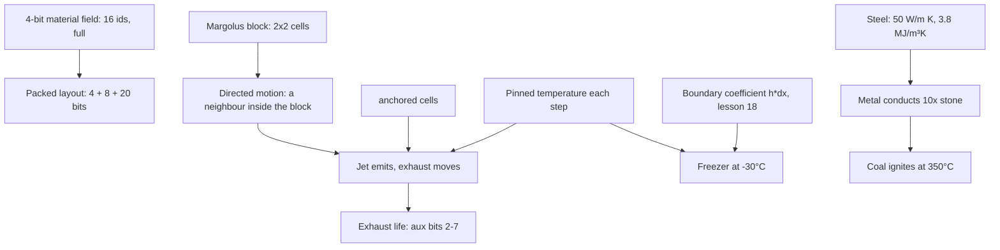

# Lesson 19: Jets, freezers, and a material field that is full

> Source: the working tree on branch `gpu-perf`, after `3b45133`. These changes are not committed as this lesson is written, so compare with `git log` once they are. The state described is the current `sand/` code.
> Files: `sand/src/physics/materials.rs` (ids, `anchored`, `dir_step`, `JET_T`, `FREEZER_T`, `EXHAUST_LIFE_MAX`, packing), `sand/src/physics/motion.rs` (`block_partner`, `directed_can_act`, step 0 of `move_block`), `sand/src/physics/thermal.rs` (`sinks`, `flame`, `pair_conductance`, the `EXHAUST` and `COAL` arms, the pinned reservoirs), `sand/src/physics/wgsl/motion.wgsl`, `wgsl/common.wgsl`, `wgsl/step.wgsl`. Tests in `sand/src/physics/tests.rs`, module `new_materials`.
> Lesson 18 explains the heat model that the freezer and the metal use. Read it first.

---

## 1. What you will build

Until now every material was passive. A cell moved because of gravity or density, and it changed temperature because of its neighbours. This lesson adds the first things that **act on their own**:

- a **jet**, a fixed nozzle that keeps making hot gas and pushes it in one direction,
- **exhaust**, the hot gas itself, which moves a cell at a time and then cools to smoke,
- a **freezer**, a fixed cold plate that keeps water below zero,
- **metal** (steel-like) and **coal**, which need the heat model of lesson 18 to behave right.

Each of these needs one new idea:

1. **Directed motion.** A move has a direction. A cell can only move into a neighbour, and only where the Margolus block of lesson 8 allows it.
2. **Anchored cells.** Some cells never fall or spread.
3. **Pinned reservoirs.** Some temperatures are held fixed, so the cell is an endless source of heat or cold.
4. **A boundary coefficient for a cold plate.** Water against a freezer uses the same contact value as water against ice (lesson 18, section 2.10).

The lesson also records a limit. The material id is 4 bits, and there are now 16 ids (0 to 15). The field is full. Section 2.1 shows what it would cost to add a 17th material.

It builds on lessons 8 (Margolus blocks), 16 (real units, speed levels), 18 (heat, boundary layers) and 11 (the WGSL mirror). The dependencies of this lesson's ideas:



---

## 2. Concepts

### 2.1 A field of 4 bits holds 16 ids, and there are 16 now

Each cell is one packed `u32` (lesson 6, and the header of `materials.rs`):

```text
bit 31                                12 11          4 3      0
┌───────────────────────────────────────┬─────────────┬────────┐
│ temperature: signed, 20 bits          │ aux: 8 bits │ mat: 4 │
└───────────────────────────────────────┴─────────────┴────────┘
```

```rust
pub const fn material(cell: u32) -> u32 { cell & 0xF }
pub const fn aux(cell: u32) -> u32 { (cell >> 4) & 0xFF }
pub const fn temp(cell: u32) -> i32 { (cell as i32) >> 12 }
```

The ids run from `AIR = 0` to `EXHAUST = 15`:

| id | name | kind | what it does |
|---|---|---|---|
| 0 | `AIR` | gas | |
| 1 | `STONE` | solid | |
| 2 | `SAND` | powder | |
| 3 | `WATER` | liquid | boils, freezes |
| 4 | `OIL` | liquid | burns |
| 5 | `LAVA` | liquid | cools to stone or gravel |
| 6 | `STEAM` | gas | wet parcels below 100°C |
| 7 | `WOOD` | solid | burns |
| 8 | `FIRE` | gas | anchored |
| 9 | `ICE` | solid | melts |
| 10 | `SMOKE` | gas | fades to air |
| 11 | `METAL` | solid | steel-like, falls, conducts well |
| 12 | `COAL` | solid | falls, ignites at 350°C, burns long |
| 13 | `JET` | solid | fixed nozzle at 700°C |
| 14 | `FREEZER` | solid | fixed cold source at -30°C |
| 15 | `EXHAUST` | gas | hot combustion gas from a jet |

`MATERIAL_COUNT` is 16, and the arrays that are indexed by material (`KIND`, `DENSITY`, `FLOW`, `COND`, `CAP`, ...) each have 16 entries. Every one of them is written out in full, which makes a new material a visible change in every table.

**What a 17th material would cost.** Suppose you want 32 ids, which needs 5 bits. The 4 bits are taken, and the other fields are used too:

- **Aux is full.** The aux byte holds a speed level from 0 to 255 for falling and flowing cells (level 256 would be `MAX_SPEED`, lesson 16). It also holds the life of fire, smoke and exhaust. Taking a bit from it halves the speed resolution.
- **Temperature is needed.** The temperature range is set by the 20 bits. `T_MIN = -(1 << 19)` and `T_MAX = (1 << 19) - 1` are $\pm 2048$°C. Taking one bit leaves 19 bits, which is $\pm 1024$°C. That is too small: lava starts at 1150°C (`default_temp(LAVA)`), and `pack` would clamp it to about 1024°C.
- **A second word per cell** costs no bits in the layout, but it doubles the memory the step must read and write. Lesson 14 (section 2.1) showed that the GPU step is mostly moving bytes, so this is the expensive choice.
- **The tables grow too.** `KIND_BITS` holds 2 bits for each of 16 materials in one `u32`, so 32 materials need a second word. The byte tables hold 4 materials per `u32` (section 2.9), so they need a second `vec4` as well.

So the field is full in a real sense. The next material needs a design decision, not a new constant.

### 2.2 Directed motion: a jet's exhaust goes one way

A jet has a direction. It is stored in the aux byte, bits 0 and 1 (`dir_step` in `materials.rs`):

```rust
/// Direction codes (aux bits 0-1): 0 up, 1 right, 2 down, 3 left.
pub const fn dir_step(d: u32) -> (i32, i32) {
    match d & 3 {
        0 => (0, -1),
        1 => (1, 0),
        2 => (0, 1),
        _ => (-1, 0),
    }
}
```

Every other move in this engine happens inside a Margolus block (lesson 8): a 2x2 group of cells, and each cell belongs to exactly one block per step. Directed motion uses the same rule. A jet can only put exhaust into a neighbour **that is inside its own 2x2 block**. `block_partner` finds that neighbour, or returns `None`:

```rust
/// The cell in the same block as `c` (0 top-left, 1 top-right, 2 bottom-left,
/// 3 bottom-right) that lies in direction `d`, if there is one.
pub(crate) fn block_partner(c: usize, d: u32) -> Option<usize> {
    let (dx, dy) = dir_step(d);
    let (nx, ny) = ((c % 2) as i32 + dx, (c / 2) as i32 + dy);
    ((0..2).contains(&nx) && (0..2).contains(&ny)).then(|| (ny * 2 + nx) as usize)
}
```

The block grid starts at offset $o \in \{0, 1\}$, and $o$ changes every step (`block_offset(frame) = frame & 1`). So a jet at column $x$ has a right-hand partner only when $x - o$ is even. That is every other step. The move pass runs this first, before gravity (step 0 of `move_block`):

```rust
// 0. Nozzles and exhaust. A jet puts exhaust into air in its direction;
//    exhaust moves one cell along its own direction into air. Only pairs
//    inside this block can act, so a jet works on every other step (its
//    block only covers its neighbour then), which is deterministic.
let mut done = [false; 4];
for c in 0..4 {
    let m = material(cells[c]);
    if (m != JET && m != EXHAUST) || done[c] {
        continue;
    }
    let d = aux(cells[c]) & 3;
    let Some(p) = block_partner(c, d) else { continue };
    if material(cells[p]) != AIR {
        continue;
    }
    if m == JET {
        cells[p] = pack(EXHAUST, d | (EXHAUST_LIFE_MAX << 2), EXHAUST_T);
    } else {
        cells.swap(c, p);
    }
    done[p] = true;
}
```

Read it as two rules:

- A **jet** writes a new exhaust cell into an air neighbour in its direction. The exhaust starts at 1100°C with direction $d$ and life 63.
- An **exhaust** swaps itself with an air neighbour in its direction, so it moves one cell along that direction.

`done[p]` stops a cell from acting twice in one step. A cell that has just been written or moved must not be moved again.

The effect is measured by the test `jet_exhaust_only_goes_where_the_nozzle_points`: for each of the four directions, every exhaust cell after 150 steps lies ahead of the nozzle. Running a jet on its own shows the timing (the scratch experiment in section 3, step A):

```text
step  1: exhaust cells  1, front x = 61
step  2: exhaust cells  1, front x = 62
step  3: exhaust cells  2, front x = 63
step  4: exhaust cells  2, front x = 64
...
```

Two facts follow from the code and the output. Exhaust may move on every step it is aligned, but it only does so with chance 192/256 (`EXHAUST_MOVE`), so the front advances about 0.75 cell per step (about 4.5 m/s, lesson 16). A new exhaust cell appears every second step, because the jet can only fire on the steps when its neighbour is in its block. Together those give a dense plume: about one particle per cell at steady state.

A jet is a source of motion that the pass must treat as an actor, not as a passive cell. The GPU needs the same rule, so `motion.wgsl` has copies of `block_partner` and `directed_can_act`. The Rust function `directed_can_act` says whether a block holds a jet or exhaust that can act:

```rust
/// Could a nozzle or exhaust in this block act (for some random number, in
/// fact always)? Such a block is never asleep.
pub(crate) fn directed_can_act(cells: &[u32; 4]) -> bool {
    (0..4).any(|c| {
        let m = material(cells[c]);
        (m == JET || m == EXHAUST)
            && block_partner(c, aux(cells[c]) & 3).is_some_and(|p| material(cells[p]) == AIR && p != c)
    })
}
```

"Never asleep" is the link to lesson 13. A jet acts on every step, with no random number involved, so a block with a jet can never be skipped. The heat pass says the same thing: `heat_cell` sets `maybe = true` for `JET` and `EXHAUST`.

### 2.3 Anchored cells: some things never move

Fire, exhaust, jets and freezers are attached to their place. `anchored` lists them:

```rust
/// Anchored cells never move by gravity or spread: flames, nozzles, exhaust
/// and freezers stay where they are.
pub const fn anchored(m: u32) -> bool {
    matches!(m, FIRE | EXHAUST | JET | FREEZER)
}
```

Two functions use it:

- `sinks(top, bottom)` returns `false` if either cell is anchored. An anchored cell never falls, and nothing falls into it.
- `spread_chance(left, right)` returns 0 if either cell is anchored. A flame does not mix sideways into air and die out (lesson 18, section 2.11).

A **jet** is anchored, but exhaust is anchored too, and it still moves. This is not a contradiction. Anchored means "gravity and spreading do not move it". Exhaust moves only by its own directed rule (section 2.2), which runs in step 0 before gravity. Gravity never sees it.

### 2.4 Exhaust life: 6 bits, a random tick, then smoke

The life of exhaust is in aux bits 2 to 7. Bits 0 and 1 keep the direction, so the aux byte of an exhaust cell is `d | (life << 2)`. `EXHAUST_LIFE_MAX` is 63. Its life drops by one with chance $1/16$ per step, in the `EXHAUST` arm of `heat_cell`:

```rust
EXHAUST => {
    maybe = true;
    let (dir, left) = (life & 3, life >> 2);
    if left == 0 {
        next = SMOKE;
        life = 30 + (r & 31);
    } else if r2 % 16 == 0 {
        life = dir | ((left - 1) << 2);
    }
}
```

The random number `r2` is the same hash that fire and smoke ticks use, so each cell's choice is a hash of its position and the step. It is not a global random generator. When life reaches 0 the cell becomes smoke with a life of 30 to 61 ticks (1.6 to 3.3 s), and smoke fades to air as before.

The expected life of one exhaust cell is $63 \times 16 = 1008$ steps, about 0.84 s. A jet keeps making exhaust, so a jet's output is a stream: as long as the jet runs, new exhaust keeps arriving, and each cell travels until it is stopped by a non-air cell or until its life runs out.

Exhaust counts as a flame. `flame(m)` in `thermal.rs` is `m == FIRE || m == EXHAUST`. So exhaust:

- ignites coal and wood next to it, and heats what touches it (the flame flux of lesson 18, 150 kW/m²),
- does not count as open air for radiation to the sky (`open_faces` skips flames),
- counts toward the fire bed in the sound analysis (lesson 20).

### 2.5 Pinned reservoirs: a source that never runs out

A jet and a freezer keep their temperature fixed. At the end of `heat_cell`, after all the rules have run, the field is set back:

```rust
// Nozzles and freezers are fixed-temperature reservoirs: their field is
// pinned, so they are an endless source of heat or cold.
if m == JET {
    t = JET_T;
} else if m == FREEZER {
    t = FREEZER_T;
}
```

`JET_T` is 700°C and `FREEZER_T` is -30°C (both in fixed point, $256$ units per degree). A jet does not warm up as it heats its neighbours, and a freezer does not warm up as the water on it warms. The reservoir is a boundary condition, not a cell that obeys the energy budget of lesson 18.

That is a deliberate choice, and it breaks conservation on purpose. Energy goes out of a freezer and into the water next to it, and the freezer's own temperature does not change. The same is true of the room gas (lesson 18, section 2.4), and it is written in the test table there. The test `freezer_and_jet_hold_their_temperature` runs 2000 steps with lava right beside the freezer, and checks that both cells read exactly their pinned values.

Pinned does not mean "passive". A freezer's neighbours still conduct into it, and the freezer still conducts to them through `pair_conductance` (section 2.6). The pinning only fixes the freezer's own temperature.

### 2.6 A freezer plate: why a boundary coefficient

Water freezes when its field falls below $-80$ K (lesson 18, section 2.8). To freeze water on a freezer plate, heat must flow out of the water through the contact. Lesson 18 explained why a 5 mm cell cannot do this with plain conduction. Here is the number.

The freezer's conductivity is 2 W/(m·K) (`COND[FREEZER] = 2000`, "a cold insulated box wall, about ice"). Water's is 0.6 W/(m·K). Plain conduction across the edge between them is the series value from lesson 18, section 2.3:

$$k_{\text{series}} = \frac{2 \cdot 600 \cdot 2000}{600 + 2000} = 923\ \text{mW/(m·K)}.$$

Run the freezer pool with only that value and no boundary term. The scratch experiment in section 3, step B, does that by turning off the contact clause in `pair_conductance`. Nothing freezes in 300 s of simulated time.

The cause is the cell itself. Water's half-cell is 2.5 mm, so its conduction to the face is $k / (\Delta x / 2) = 0.6 / 0.0025 = 240$ W/(m²·K). A real cold plate in water is limited by a thin water layer at the surface, and it passes heat at about 1500 W/(m²·K) (the same value lesson 18 uses for melting ice). The cell model underestimates the contact by about 6 times.

The fix is the boundary conductance from lesson 18, section 2.10: conductance $= h\,\Delta x$, with the same value from both sides:

```rust
/// Boundary conductance for water against ice: h = 1500 W/m²K times 5 mm.
pub const MELT_CONDUCTANCE: i32 = 7_500;
```

and in `pair_conductance`:

```rust
// Water against ice (a melting interface), or against a freezer plate
// (a cold plate with the same contact coefficient, h ~ 1500 W/m²K): the
// freezer's wall is 5 mm of insulation, far less than the water layer.
if (a == WATER && (b == ICE || b == FREEZER)) || ((a == ICE || a == FREEZER) && b == WATER) {
    return MELT_CONDUCTANCE;
}
```

$7500 = 1500 \cdot 0.005 \cdot 1000$ mW/(m·K) for ice. The freezer plate later got ten times that contact (`FREEZER_CONDUCTANCE` = 75000, h = 15000 W/(m²·K)), so the plate cools the water about ten times faster than ice melts in it. The plain series value is 923, and that is the whole difference.

Be honest about where the number comes from. $h = 1500$ W/(m²·K) is a modelling value, taken from the melting interface, not a measurement of this freezer. The test `freezer_freezes_a_sealed_water_pool` checks that the result is physically plausible: the water on the plate freezes within 40 s. The 45.9 s figure in section 3 was measured with the older ice-level contact (7500), so the freezer now freezes much sooner than that.

The pool in that test is sealed: two stone walls and a stone floor hold it, so it cannot slide away from the plate. That keeps the timing about heat and not about flow.

### 2.7 Metal: the same rule, a bigger conductivity

Metal (id 11) is a solid. It falls like stone (it is in `KIND` as `SOLID`, and `has_speed` includes `METAL`, so it can fall with a speed). Its heat numbers are the largest in the table:

| material | `COND` (W/(m·K)) | `CAP` (MJ/(m³·K)) | diffusivity $k/\rho c$ (m²/s) |
|---|---|---|---|
| stone | 2.5 | 2.1 | $1.2\times10^{-6}$ |
| metal | 50 | 3.8 | $1.3\times10^{-5}$ |

(The table in `materials.rs` stores `COND` in mW/(m·K) and `CAP` in units of 10 J/(m³·K). The table above converts them.) Steel conducts about 11 times faster than stone. The test `metal_carries_heat_much_faster_than_stone` heats one face of a 16 by 16 block of each material to 900°C, with no air, and reads the temperature 3 cells in after 24 000 steps (20 s):

```rust
let (metal, stone) = (at(METAL), at(STONE));
assert!(metal > stone + 10.0, "metal 1.5 cm along: {metal:.1}°C, stone: {stone:.1}°C");
```

Nothing in the step had to change for this. The edge rule of lesson 18 takes the conductivities in series, and metal's large $k$ makes the rate large. This is the reason the nozzle body in scene 5 is metal: a jet is a hot source, and a metal body spreads that heat across itself quickly.

### 2.8 Coal: a slow fuel that needs a spark

Coal (id 12) is a solid that falls. It does not burn at once. It ignites when it is at least 350°C and touches air, lava or fire (`thermal.rs`):

```rust
// Coal: hard to light, then burns for a long time (up to ~13 s).
COAL if t >= celsius(350) && (touches_air || touches_lava || touches_fire) => {
    next = FIRE;
    life = 200 + (r & 55);
}
```

The life is 200 to 255 ticks. A tick is 64 steps (53 ms), so coal burns for $200 \times 53 = 10.7$ s to $255 \times 53 = 13.6$ s. That is much longer than wood's 6 to 13 s, which is what makes coal a fuel and not a log.

Coal also counts as fuel for fire spread: `touches_fuel` includes `COAL` (with wood and oil). A burning pile keeps itself alight by touching its own fuel.

The test `coal_lights_next_to_fire_and_burns` places coal at 360°C next to a fire and checks that the coal becomes fire in 200 steps.

### 2.9 The GPU mirror: wider tables and one exclusion

The GPU shader repeats the tables, so the numbers must be the same in both places (lesson 11). Two things changed.

**The byte tables are 16 wide.** Each table holds one byte per material, so four materials share one `u32`, and 16 materials need four words. The table type is `vec4<u32>`, one word per group of four (`common.wgsl`):

```wgsl
// Byte tables: 4 materials per u32 (lowest byte first): materials 0-3 in
// x, 4-7 in y, 8-11 in z, 12-15 in w.
fn table_byte(t: vec4<u32>, m: u32) -> u32 {
    let word = select(select(select(t.x, t.y, m >= 4u), t.z, m >= 8u), t.w, m >= 12u);
    return (word >> ((m & 3u) * 8u)) & 0xFFu;
}
```

**`KIND_BITS` is a full `u32`.** It holds 2 bits per material, for 16 materials, so all 32 bits are used. `kind(m)` reads one 2-bit field:

```wgsl
fn kind(m: u32) -> u32 { return (KIND_BITS >> (2u * m)) & 3u; }
```

**The fast path leaves out `EXHAUST` and `COAL`.** The uniform-block shortcut of lesson 14 (section 2.5) is valid only when the rule gives the same answer for every cell with the same inputs. `step.wgsl` now says:

```wgsl
let fixed = m != WOOD && m != OIL && m != COAL && m != FIRE && m != SMOKE && m != EXHAUST && (kind(m) != GAS || temp(v) == AMBIENT)
    && !(m == WATER && temp(v) > celsius(100));
```

`COAL` and `EXHAUST` use their random number in a way that can differ between four identical cells. Coal sets its burn life from `r` when it ignites, so four identical coal cells that ignite in one step get four different lives. Exhaust counts down its life with `r2 % 16`, so four identical exhaust cells can come out with four different lives. Such a block must take the slow path.

The GPU test `gpu_matches_cpu_with_jets_freezers_metal_and_coal` checks all of this together. It builds a 96 by 64 scene with four jets (one per direction), a freezer plate, a metal bar, a coal pile with fire, and water and lava. It runs 600 steps on the CPU and on the GPU, and requires that not one cell differs.

---

## 3. Build it yourself: three small experiments

The project's tests already pin each behaviour. These experiments show the behaviour changing when you change the rule, so that the tests mean something to you. Do them in a **copy** of the project, not in your working tree:

```bash
cp -R ~/Documents/rusty/sand ~/sand-lab      # a scratch copy, with its own target/
cd ~/sand-lab
```

Each step is a `#[test]` you add to a new file `src/physics/exp.rs`, plus one line at the end of `src/physics/mod.rs`:

```rust
#[cfg(test)]
mod exp;
```

Then run it with `cargo test --release --lib exp_ -- --nocapture`.

### Step A: how far does exhaust travel, and how often does a jet fire?

`src/physics/exp.rs`:

```rust
use super::*;
use cpu::CpuSim;

#[test]
fn exp_jet_front() {
    let mut w = World::new(121, 121);
    w.cells[60 * 121 + 60] = pack(JET, 1, JET_T); // a jet at the centre, facing right
    let mut sim = CpuSim::new(&w);
    for step in 1..=12 {
        sim.step(&mut w);
        let (mut n, mut front) = (0, 0);
        for x in 0..121 {
            for y in 0..121 {
                if material(w.cells[y * 121 + x]) == EXHAUST {
                    n += 1;
                    front = front.max(x);
                }
            }
        }
        println!("step {step:2}: exhaust cells {n:2}, front x = {front}");
    }
}
```

Measured in the project (the output in section 2.2): the front advances about three quarters of a cell per step, and the cell count rises by one every two steps. Now change the jet to face down (`pack(JET, 2, JET_T)`) and predict the front's y coordinate before you run it. Then put a `WATER` cell in the jet's neighbour instead of air. Predict what happens, and check `block_partner` and step 0 to see why.

### Step B: why the freezer needs the boundary term

Copy the freezer test (`freezer_freezes_a_sealed_water_pool`) into `exp.rs` and make it print the step of the first ice instead of asserting:

```rust
use super::*;
use cpu::CpuSim;

#[test]
fn exp_freezer_first_ice() {
    let mut w = World::new(30, 30);
    w.fill(0, 0, 1, 30, STONE);
    w.fill(29, 0, 30, 30, STONE);
    w.fill(0, 29, 30, 30, STONE);
    w.fill(1, 24, 29, 29, FREEZER);
    w.fill(1, 16, 29, 24, WATER);
    let mut sim = CpuSim::new(&w);
    for step in 1..=(300 * STEPS_PER_SECOND as usize) {
        sim.step(&mut w);
        if w.count(ICE) > 0 {
            println!("first ice at step {step} = {:.1} s", step as f64 / STEPS_PER_SECOND as f64);
            return;
        }
    }
    println!("no ice within 300 s");
}
```

Run it. With the older 7500 contact the project printed `first ice at step 55083 = 45.9 s`; with the freezer's 75000 contact the first ice comes much earlier. Now switch off the contact clause in your copy of `pair_conductance` (`thermal.rs`), so that water and freezer use plain series conduction:

```rust
if false && ((a == WATER && (b == ICE || b == FREEZER)) || ((a == ICE || a == FREEZER) && b == WATER)) {
    return MELT_CONDUCTANCE;
}
```

Run it again. It prints `no ice within 300 s`. The only change is the contact value. Put the clause back, and note that the test in the project asks for ice within 40 s.

### Step C: the metal bar, and the parity test

```bash
cargo test --release metal_carries_heat      # steel 1.5 cm in vs stone, 20 s
cargo test --release gpu_matches_cpu_with_jets   # 600 steps, 0 differing cells
```

The first passes, because metal must read more than 10 degrees above stone at that point. The second needs a GPU adapter. On a machine without one it prints "no GPU adapter, skipping" and passes, so look for that line before you trust a pass.

---

## 4. Live examples in the real project

From `/Users/anujbarve/Documents/rusty/sand`:

```bash
cargo run --release --bin physics
```

- The **jet engine** scene is scene index 5. Press `Tab` five times from the start, or run `SAND_SCENE=5 cargo run --release --bin physics`. It has a metal body with four nozzles, a freezer under falling water, and a jet that lights a coal pile.
- The toolbar has two rows. The top row holds the controls. The bottom row holds the brushes: sand to fire, then oil, lava, ice, steam, and the new ones `-` metal, `=` coal, `J` jet and `F` freezer.
- Press `T` to turn the **next** jet you paint. Each press turns it 90 degrees, and the default is right. A jet already on the grid keeps the direction it was painted with.
- Paint a jet in an open area and watch the stream. Press `,` to slow the world clock (lesson 16) and count the exhaust cells as they leave.
- Press `H` for the heat view. The jet and the freezer always read their pinned temperatures.

The tests that pin this lesson down:

```bash
cargo test --release new_materials           # all seven tests in the module
cargo test --release jet_exhaust_only_goes_where_the_nozzle_points
cargo test --release freezer_freezes_a_sealed_water_pool
cargo test --release block_can_move_is_never_wrong
```

`block_can_move_is_never_wrong` (lesson 13) draws every material from `MATERIAL_COUNT`, so it covers all 16 ids. The whole library test suite has 40 tests, and all of them pass on the current code.

---

## 5. Exercises

### Exercise 1: which way does exhaust go?

A jet at $(x, y)$ faces down ($d = 2$). Its neighbour below is air. Work out the block that contains the jet when the offset $o = 0$, and again when $o = 1$. On which steps does the jet fire? Then say what happens to the exhaust it produced, step by step, over the next two steps.

<details><summary>Solution 1</summary>

`dir_step(2) = (0, 1)`, so the partner is one row down. Blocks start on rows of the same parity as $o$: with $o = 0$ a block covers rows 60 and 61, and with $o = 1$ it covers rows 59 and 60. Take $x = 60$, $y = 60$. With $o = 0$, the block covers rows 60 and 61, so the partner at row 61 is inside the block and the jet fires. With $o = 1$, the block covers rows 59 and 60 (the row above is in the block) so the partner is at row 61, which is outside, and the jet does not fire. The jet fires on the even steps when $o = 0$.

The exhaust is written at $(60, 61)$ with direction 2 and life 63. On the next step the offset flips to $o = 1$. The exhaust's block covers rows 61 and 62, so its partner at row 62 is inside, and the air there lets it swap down. It is now at row 62. Its partner in the next step is at row 63 inside the block, so it moves again. Exhaust moves every step, and the jet fires every other step.
</details>

### Exercise 2: how long does a jet's exhaust live?

Using the code in section 2.4, compute the expected number of steps a single exhaust cell lives before it becomes smoke, and the expected time in seconds. Then say why the answer is not a fixed 63 steps.

<details><summary>Solution 2</summary>

Each of the 63 decrements happens when `r2 % 16 == 0`. That is a chance of $1/16$ per step, so the time to each decrement has mean 16 steps, and the 63 decrements take $63 \times 16 = 1008$ steps on average. At 1200 steps per second that is $1008 / 1200 = 0.84$ s.

It is not a fixed 63 steps, because each decrement is a separate random event. The number is the life in ticks, and the time per tick is random. A cell's life is the sum of 63 geometric waits, with mean 1008 and a standard deviation of about $\sqrt{63 \cdot 240} \approx 123$ steps (each wait has variance $(15/16)/(1/16)^2 = 240$). The randomness comes from the position and step hash `r2`, so it is the same every run, but it varies from cell to cell.
</details>

### Exercise 3: a 5-bit material field

You want 32 materials. Propose a new layout with 5 bits of material. Keep aux at 8 bits and the temperature at 19 bits. Compute the new $T_{\text{MIN}}$ and $T_{\text{MAX}}$ in degrees Celsius. Which default temperature breaks, and what does `pack` do to it?

<details><summary>Solution 3</summary>

The layout becomes: material bits 0 to 4 (32 ids), aux bits 5 to 12 (8 bits), temperature bits 13 to 31 (19 bits). The temperature range is $\pm 2^{18}$ units. At 256 units per degree that is $\pm 1024$°C: $T_{\text{MIN}} = -1024$°C, $T_{\text{MAX}} = 1023.996$°C.

`default_temp(LAVA) = celsius(1150)`. `pack` clamps the temperature to `T_MAX`, so new lava starts at about 1024°C, not 1150°C. The lava would also lose the 1200°C threshold at which stone turns to lava (`STONE if t >= celsius(1200)`), which can no longer be reached. The cost is real, and it is why the field is "full" in practice, not only in count. The alternatives are a second word per cell (section 2.1), or a different number format for temperature, and each has its own cost.
</details>

### Exercise 4: remove the boundary term and measure

Using the scratch copy from section 3, step B, turn the freezer contact clause off and run the test for 300 s. Then put it back, but change `MELT_CONDUCTANCE` to half its value (3750). Does the first ice come earlier or later? Explain the result in terms of the conductance.

<details><summary>Solution 4</summary>

With half the coefficient the edge conducts half as much heat, so the first ice should come later than 45.9 s. Measure it rather than trust this sentence. The reason is the per-step rate `conductance * RATE_SCALE / cap`: while the edge is the bottleneck, the time to freeze grows as the conductance falls. Plain conduction (923) is about 8 times smaller than 7500, and in section 3 it did not freeze within 300 s.
</details>

### Exercise 5: the fast path and the random number

Explain why `EXHAUST` is in the `fixed` exclusion list in `step.wgsl`, and give a concrete set of four identical exhaust cells that would give four different results in one step. Hint: look at which random number the `EXHAUST` arm reads.

<details><summary>Solution 5</summary>

The `EXHAUST` arm decrements life when `r2 % 16 == 0`, and `r2 = pcg(r)` where `r = pcg(i ^ pcg(frame ^ CELL_SALT))` depends on the cell's index `i`. Four identical exhaust cells at different indices use different values of `r2`. Take four cells with life 63 and direction 1. For some of them `r2 % 16 == 0` and their life becomes 62, and for the others it stays 63. So one step gives four different cells. The fast path assumes four equal inputs give four equal outputs, so it must not run here. The exclusion is what keeps the GPU and the CPU equal.
</details>

### Exercise 6: a jet pointed at a wall

A jet faces right, and the cell it would fill is stone. What does step 0 do? Does the jet block stay asleep? Explain using `directed_can_act`.

<details><summary>Solution 6</summary>

`block_partner` gives the right-hand cell, and step 0 checks `material(cells[p]) != AIR`. The stone is not air, so it continues and writes nothing. Nothing moves, and the jet's temperature stays pinned at 700°C.

`directed_can_act` returns false in this case: it asks whether the partner is `AIR`, and it is not. The move check alone would let this block sleep. The heat pass still sets `maybe = true` for `JET` on every step (section 2.5), so the chunk stays awake anyway. That is worth noticing: a sleep rule must rule out every kind of change, heat as well as motion, before a chunk may sleep.
</details>

---

## 6. Common mistakes

- **Treating a fixed temperature as a fact of the physics.** A jet at 700°C and a freezer at -30°C are boundary conditions. They are not outputs of the heat model. Their neighbours change; they do not. Write the pin in one place, after all rules run.
- **Letting a directed cell act twice.** Step 0 uses `done[p]` for that. Without it, exhaust moved by its own rule could be moved again by its new neighbour's rule in the same step.
- **Forgetting the block.** `block_partner` returns `None` for a neighbour outside the 2x2 block. Code that moves a cell to `c + 1` without checking the block works on every step on the CPU and on some steps on the GPU, and the two then disagree.
- **Using plain conduction across a thin layer.** Water on a cold plate needs the boundary coefficient, as ice does. Plain conduction through 5 mm of water froze nothing in 300 s.
- **Adding a material without the tables.** `KIND`, `DENSITY`, `FLOW`, `VT_*`, `COND`, `CAP`, `EXPANSION`, `NAMES`, the WGSL `table_byte` words and `KIND_BITS` all have one entry per material. The compiler checks array lengths against `MATERIAL_COUNT`, but not the WGSL words, so the GPU parity test is the check that catches a missing entry.
- **Putting a random-number rule in the fast path.** Any cell whose rule reads a per-cell random number must be excluded from the uniform-block shortcut (lesson 14), or the GPU and CPU drift apart.
- **Assuming the field has room.** It has 16 ids and all are used. Plan the layout change before you need it.

---

## 7. Recap

- Material is 4 bits, so there are 16 ids (0 to 15). They are all in use: metal (11), coal (12), jet (13), freezer (14) and exhaust (15) were the last five. Adding another material means changing the layout, which costs temperature range, aux resolution or memory traffic.
- A **jet** writes exhaust into an air neighbour in its direction. **Exhaust** swaps itself one cell along its direction into air. Both happen in step 0 of `move_block`, and only for a pair that lies in one 2x2 block. So a horizontal or vertical jet fires on every other step, and its exhaust moves on about three steps in four (`EXHAUST_MOVE` = 192).
- **Anchored** cells (`FIRE`, `EXHAUST`, `JET`, `FREEZER`) never fall and never spread sideways. Exhaust still moves, by its directed rule, which gravity never sees.
- Exhaust life is 6 bits in aux, counted down with chance 1/16 per step, for an expected 0.84 s before it becomes smoke.
- **Jets and freezers are pinned.** Their temperatures are reset after all rules run (700°C and -30°C). They are reservoirs, and they break energy conservation on purpose.
- A **freezer plate** has a contact coefficient ten times the ice one: $h = 15000$ W/(m²·K) times 5 mm, which is 75000 mW/(m·K). Ice uses 7500. Plain conduction through the water gives 923 and froze nothing in 300 s. The coefficient is a modelling choice, and the pool test checks that the result is plausible.
- An **exhaust** heats the cells it touches ten times harder than a flame does (`EXHAUST_FLUX` = 10 times `FLAME_UNITS`).
- **Metal** conducts about 11 times faster than stone, so the same rule gives a fast metal body and a slow stone one.
- **Coal** ignites at 350°C next to air, lava or fire, and then burns for 10.7 to 13.6 s.
- On the GPU, the byte tables are `vec4` (16 materials), `KIND_BITS` uses all 32 bits, and the uniform fast path leaves out `EXHAUST` and `COAL` because their rules use a random number. A 600-step scene with all the new materials must match the CPU cell for cell.

Lesson 20 covers the last new subsystem: the sound. The viewer's sound is driven by the same grid, and it has a recorded side as well as a synthesised one.
