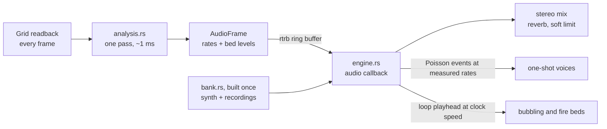

# Lesson 20: Sound from the grid: synthesis, recordings, and loops that do not click

> Source: the working tree on branch `gpu-perf`, after `3b45133`. The audio work is not committed as this lesson is written, so compare with `git log` once it is. The state described is the current `sand/` code.
> Files: `sand/src/audio/analysis.rs` (cells to sound parameters), `sand/src/audio/engine.rs` (the mixer, events, loops), `sand/src/audio/bank.rs` (the one-shot bank, the recorded clips, `seamless_loop`), `sand/src/audio/output.rs` (the device and the callback), `sand/src/audio/mod.rs` (the data flow), `sand/assets/audio/clips/README.md` (sources and licences). The viewer side is `sand/src/bin/physics/main.rs`.
> Lesson 16 explains the world clock, which sets the sound's speed. Lesson 15 explains the readback that feeds the analysis.

---

## 1. What you will build

The simulation already knows what is happening: sand is pouring, water is boiling, something is burning. This lesson explains how that knowledge becomes sound, and how the sound is made. There are two kinds of source:

- **Synthesised** sounds. The code writes the waveform: a bubble is a damped sine at its Minnaert frequency, a whoosh is filtered noise. There is no file.
- **Recorded** sounds. A CC0 recording is embedded in the binary with `include_bytes!`. Short pieces are cut from it, and two of them are played in a loop.

The design is a split. Use **synthesis** for things with no good sample, and for short events where a model is clear. Use **recordings** for continuous textures, like a bubbling pot or a fire, where a model would sound thin.

Two things make a recording usable as a loop, and they are the core of this lesson. The loop must not click where it wraps, and the playback must follow the world clock.

It builds on lesson 16 (the clock), lesson 15 (the readback the analysis reads), and lesson 18 (boiling bubbles and the fire that the sound follows).



---

## 2. Concepts

### 2.1 Measuring a grid, then sending a small frame

Each frame the viewer already has a copy of the cells (the readback of lesson 15). `analysis.rs` makes one pass over them and counts what is happening, in 8 bands from left to right. The result is a small `AudioFrame` of fixed size: how often each one-shot kind should fire, and how loud each continuous bed should be.

The module header is specific about the cost: "one linear pass with a few neighbour reads: about 1 ms for 640x360 cells. Its buffers are allocated once." The analysis runs on the main thread, so it adds no GPU work.

The frame then goes to the audio thread through a lock-free ring buffer, `rtrb::RingBuffer::<AudioFrame>::new(8)` in `output.rs`. The game writes frames, and the audio thread reads the newest. Neither side waits for the other. A mutex here would be a bug: if the game held the lock while the audio thread wanted it, the callback would stall, and a stalled callback is an audible click.

### 2.2 Events from rates: Poisson, not a fixed beat

Most one-shots are not a beat. A sand stream makes many grain clicks per second, at random times. `engine.rs` turns the measured rate into events with a Poisson-style draw, once per control block of 64 samples:

```rust
// One-shots: Poisson events at the measured rates (world rates times
// clock speed = real rates).
if audible {
    for kind in 0..KINDS {
        for band in 0..BANDS {
            let mut expected = f.rates[kind][band] * f.speed * block_s;
            let mut fired = 0;
            while fired < 6 && self.rng.f() < expected {
                self.trigger(kind, band, pitch);
                expected -= 1.0;
                fired += 1;
            }
        }
    }
}
```

The expected number of events in a block is the world rate times the clock speed times the block's length in seconds. The `while` loop fires at most six per block (`fired < 6`), so a sudden spike cannot flood the mixer. If `expected` is 2.3, the loop fires twice for sure and a third time with chance 0.3.

Notice `f.speed`: the clock speed. At 0.1x world time, the rates are a tenth, so events are sparser. The world's sound is slower, not only quieter. That is the ASMR promise in the module header: "Event rates and pitch follow the world clock: slow motion plays sparser, deeper sound."

### 2.3 Synthesise or record: the decision

Here is every one-shot kind and where its waveform comes from (`bank.rs`):

| kind | what it is | source | why |
|---|---|---|---|
| `Grain` | one sand grain hitting others | synthesised | no CC0 recording of pouring sand was found |
| `Drip` | the start of a bubble in water | recorded (`bubbles-single1/2/3`, first 0.12 s) | a real bubble has a shape a model misses |
| `Bubble` | a boiling bubble | recorded (`bubbles-single1/2/3`, whole clip) | same |
| `Crackle` | burning wood or oil popping | recorded (`fire-1`, short pieces) | a fire recording has real pops |
| `Plop` | a thick lava bubble | synthesised | no CC0 recording found |
| `Ignite` | a fuel catching fire | recorded (`fire-1`, 0.6 s pieces) | a real whoosh of ignition |
| `Tink` | lava setting into rock | synthesised | no CC0 recording found |
| `Fry` | one pop of a frying sizzle | synthesised | no CC0 recording found |

And the continuous beds (`engine.rs`):

| bed | source |
|---|---|
| bubbling water | recorded loop (`bubbles-loop2-amp`) |
| fire | recorded loop (`fire-1`) |
| sand, steam, lava, sizzle | low-passed pink noise, shaped by the measured levels |

The rule that falls out of this table:

- **Synthesise** when the sound has a clear physical model you can write in a few lines (a bubble at its Minnaert frequency $f_0 = 3.26/r$ Hz, a tink as a falling sine), or when no good recording exists under a licence you can use.
- **Record** when the sound is a continuous texture. A model of a bubbling pot is a sum of many bubbles, and a recording already is one. A real recording of a fire has the crackle structure that a noise model lacks.

The licence matters, and `assets/audio/clips/README.md` lists every clip with its source. All of them are CC0 (public domain dedication), so the game needs no attribution. The README also says which sounds were searched for and not found: "sand pouring, frying/sizzle. Those sounds are still synthesised."

Each one-shot kind has eight variants (`VARIANTS = 8`), so a stream of grains is not eight identical copies. The engine picks one at random per event (`trigger`).

### 2.4 Pieces of one recording: the variants

A recording is one sound, but a stream needs many different ones. The bank cuts a different piece of the same clip for each variant (`Bank::new`):

```rust
// Drips: the short start of a bubble, higher up in pitch.
1 => Some(piece(&bubbles[v % 3], sr, 0.0, 0.12)),
// Boiling bubbles: the whole recorded bubble.
2 => Some(bubbles[v % 3].clone()),
// Crackles: short pops from the fire recording.
3 => Some(piece(&fire, sr, 0.15 + 0.25 * v as f32 % 2.2, 0.09)),
// Ignitions: a soft burst from the fire recording.
5 => Some(piece(&fire, sr, 0.05 + 0.3 * v as f32 % 2.0, 0.6)),
```

Read the crackle line as `0.15 + ((0.25 * v) % 2.2)` seconds: variant 0 starts at 0.15 s, variant 1 at 0.40 s, and so on, wrapping after 2.2 s. The `% 2.2` keeps the start inside the 2.87 s of the clip. Each piece then gets a 4 ms fade-out, the same 7 kHz low-pass as the synthesised sounds, and a peak normalisation to 0.9. The fade-out is the lesson 7 rule again: a sound never ends with a step.

Three bubble clips feed the bubble kinds, through `v % 3`. So variants 0, 3 and 6 use the same clip, and so on. With eight variants and three clips the repetition is visible in principle, but each clip is started at a different moment, so it is not heard as a loop.

### 2.5 A loop that does not click

A continuous bed plays a loop. A recording's last sample and first sample are not the same. If you play it straight through and then start again, the sound jumps at the join. That jump is a click, and it repeats every few seconds.

Measure the join in the project's clips. This experiment runs in a scratch copy (section 3, step B). The numbers are the absolute sample-to-sample jump, from the decoded WAV at its file rate (44.1 kHz):

| clip | length | mean step per sample | raw jump at the wrap | loop jump at the wrap |
|---|---|---|---|---|
| bubbling water | 6.76 s | 0.00147 | 0.00192 | 0.00085 |
| fire | 2.87 s | 0.00094 | 0.00540 | 0.00046 |

The raw wrap of the fire clip is about 5.7 times a typical sample step: a clear click. The crossfaded loop wraps in less than one typical step. The water clip's raw jump is small, but the bed is played for minutes, so a small click every 6.5 s is still heard as a pulse.

The fix is `seamless_loop` (`bank.rs`):

```rust
/// A seamless loop from a recording: the last `xf` seconds are blended into
/// the first ones, so the wrap-around has no click.
fn seamless_loop(x: &[f32], sr: f32, xf: f32) -> Vec<f32> {
    let n = (xf * sr) as usize;
    if x.len() <= 2 * n {
        return x.to_vec();
    }
    let l = x.len();
    let mut body = x[..l - n].to_vec();
    for i in 0..n {
        let g = i as f32 / n as f32;
        body[i] = x[i] * g + x[l - n + i] * (1.0 - g);
    }
    body
}
```

Here is the idea. The loop is the recording **minus its last $n$ samples**. Its first $n$ samples are a blend that starts as pure tail and ends as pure head: at $i = 0$ the sample is `x[l - n]` (the tail), and by $i = n - 1$ it is almost `x[i]` (the head). The tail is folded into the head, and then cut off.

Why is that seamless? Look at the two ends of the loop:

- The **last** sample of the loop is `x[l - n - 1]`.
- The **first** sample of the loop is `body[0] = x[l - n]`.

Those two samples are **neighbours in the original recording**. Playing the loop from its end back to its start is the same as playing the original straight through at that point. The wrap is not a jump, because the recording itself is continuous there.

The cost is the length. The loop is shorter than the recording by $n$ samples, and its first $n$ samples are a blend, not the recording's original start. The crossfade length is a trade-off: longer hides the join better, but keeps less of the recording. The constants are 0.3 s for water and 0.25 s for fire, set by hand. The code does not record a measurement behind them, so treat them as choices you may tune.

A special case worth knowing: `seamless_loop(&x, sr, 0.0)` gives `x` unchanged, with the raw join. Section 3 uses that to show the click again.

### 2.6 Playing a loop at the clock speed

A loop is played with a playhead, a float position in samples. The engine advances it by the **pitch**, which is the clock speed (`engine.rs`, the `block` function):

```rust
// A recorded loop (bubbling water, fire), played at the clock speed.
let which = if i == BED_WATER { 0 } else { 1 };
let x = self.bank.loop_sample(which, bv.loop_pos);
bv.loop_pos += pitch;
let len = self.bank.loops[which].len() as f32;
if bv.loop_pos >= len {
    bv.loop_pos -= len;
}
```

Two rules follow from the code, and both are choices:

- **The pitch is the clock speed, clamped and smoothed.** `pitch = self.pitch.step(f.speed.clamp(0.25, 2.0), ...)`. At 0.5x world time the loop plays at half speed, so the water sounds deeper and slower, as the world does. At 16x it would play at 2x (the clamp stops it at 2.0).
- **Below 0.05x the sound fades out.** `let audible = f.speed >= 0.05;` The volume target is zero when the world is nearly paused. Between 0.05x and 0.25x the loop stays at pitch 0.25, because the clamp is 0.25. So very slow world time sounds like a 0.25 loop, not like silence. That is a design choice written in the code, and you can change it.

The wrap of `loop_pos` uses `-= len`, not `= 0`. A float playhead that moves past the end keeps the fractional part, so there is no lost time at each wrap.

The fire bed also counts the jet's exhaust. In `analysis.rs`, `EXHAUST => c[b].fire += 1`, with the comment "A jet's exhaust burns: it roars with the fire bed." That is the link to lesson 19: the exhaust is a flame, so it gets the same loop.

### 2.7 Built once, and nothing allocated on the audio thread

The one-shot bank is built once, on the main thread, before the audio stream starts (`output.rs`):

```rust
let mut engine = Engine::new(sr);
```

and `Engine::new` calls `Bank::new(sample_rate)`. Decoding the WAVs, resampling them to the device rate, synthesising the eight variants of eight kinds, and cutting the pieces all happen there. The callback never does them.

The callback is `engine.process(data, channels)`, called by the device with a buffer of samples. Everything it touches was sized in `new`: the voices are a fixed array, `[Voice; MAX_VOICES]` with `MAX_VOICES = 192`, and when all are busy `trigger` replaces the one "furthest through its sound" (an existing index, no new memory). The module header states the rule: "No allocation, no locks: everything is created in `Engine::new` and reused."

Why does it matter? The device calls the callback on a deadline, a few milliseconds of audio at a time. If the callback allocates, the allocator may take a lock or ask the operating system for memory, and the callback can run late. A late callback is an underrun, which is a click or a dropout. Building everything up front moves that cost to startup, where nobody is listening.

The test `banks_are_deterministic` checks the other half: the bank is the same every time it is built. Every synthesised sound uses a fixed seed (`Rng::new(0x5EED_0000 ^ ...)`), and the recordings are fixed files, so two banks are identical.

### 2.8 The viewer's side

The viewer starts the audio with `AudioOut::start()` and keeps the game silent if there is no device or if `SAND_SCREENSHOT` is set (`main.rs`). Pressing `M` toggles `settings.audio`. Each frame the viewer sends the audio thread an `AudioFrame` whose `volume` is zero when muted (`main.rs`: `let volume = if settings.audio { settings.volume } else { 0.0 };`). The engine smooths toward that target (`volume: Smooth` in `engine.rs`), so muting fades rather than clicks. The analysis keeps running while muted.

---

## 3. Build it yourself: two experiments

Do these in a scratch copy, as in lesson 19:

```bash
cp -R ~/Documents/rusty/sand ~/sand-audio-lab
cd ~/sand-audio-lab
```

### Step A: the tests that pin the audio

From the project, unchanged:

```bash
cargo test --release --lib audio             # the audio module's tests
cargo test --release banks_are_deterministic
cargo test --release quiet_world_is_silent_and_pouring_sand_is_heard
cargo test --release pause_fades_out
```

`quiet_world_is_silent_and_pouring_sand_is_heard` checks that an empty world is silent and a pouring stream is not. `pause_fades_out` sets the clock speed to zero and checks that the output falls to silence. Read each one before you run it. The names are the specification.

### Step B: measure the seam, with and without the crossfade

Append this test module to `src/audio/bank.rs` in your scratch copy. It uses the private `seamless_loop` and the embedded constants, so it must live inside that file:

```rust
#[cfg(test)]
mod seam_exp {
    use super::*;
    #[test]
    fn exp_loop_seams() {
        for (name, bytes, xf) in [("water", WATER_LOOP, 0.3f32), ("fire", FIRE, 0.25f32)] {
            let (rate, x) = decode_wav(bytes);
            let sr = rate;
            let raw_step: f32 = x.windows(2).map(|w| (w[1] - w[0]).abs()).sum::<f32>() / x.len() as f32;
            let raw_wrap = (x[0] - x[x.len() - 1]).abs();
            let lp = seamless_loop(&x, sr, xf);
            let seam_wrap = (lp[0] - lp[lp.len() - 1]).abs();
            let seam_step: f32 = lp.windows(2).map(|w| (w[1] - w[0]).abs()).sum::<f32>() / lp.len() as f32;
            println!("{name}: rate {rate} Hz, {:.2} s, mean |step| {raw_step:.5}, raw wrap jump {raw_wrap:.5}, loop len {:.2} s, loop wrap jump {seam_wrap:.5}, loop mean step {seam_step:.5}",
                x.len() as f32 / sr, lp.len() as f32 / sr);
        }
    }
}
```

Run it with `cargo test --release --lib exp_loop -- --nocapture`. The output in the project (section 2.5):

```text
water: rate 44100 Hz, 6.76 s, mean |step| 0.00147, raw wrap jump 0.00192, loop len 6.46 s, loop wrap jump 0.00085, loop mean step 0.00150
fire: rate 44100 Hz, 2.87 s, mean |step| 0.00094, raw wrap jump 0.00540, loop len 2.62 s, loop wrap jump 0.00046, loop mean step 0.00098
```

Now the crossfade-off case. In your copy, change the fire line to `("fire", FIRE, 0.0f32)` and run it again. With $n = 0$ the loop is the whole recording with its raw join, so the wrap jump should be the raw value, 0.00540. Predict that before you run it.

### Step C: hear it

```bash
cargo run --release --bin physics
```

Press `Tab` to reach scene 2 ("fire") or scene 3 ("ice", with steam and lava). Listen to the fire bed. Press `,` a few times, down to 0.05x. The loop slows to pitch 0.25 and stays there, as section 2.6 says. Press `M` to mute and `M` again to bring the sound back. The beds are quiet on purpose, so turn the system volume up for this.

---

## 4. Live examples in the real project

The tests above are the fastest check. For sound, listen:

- Scene 1 ("lava + water") has lava boiling water. The bubbling water bed and the boiling bubbles are both there. Pour water onto lava with the mouse and listen for the boiling plops and the steam hiss.
- Scene 5 ("jet engine") has the fire bed from exhaust. Paint a jet with `J`, aim it with `T`, and listen to the roar build as exhaust comes out. The roar is the fire loop at the rate of the exhaust cells.
- Press `.` to speed the world to 16x. The bubbling loop plays at its clamped top speed of 2x, which is a higher, faster sound. Then press `/` to return to real time.
- The source of every clip is in `sand/assets/audio/clips/README.md`. Open a clip in an audio editor and look at its join: you will see the same mismatch the measurement shows.

---

## 5. Exercises

### Exercise 1: predict the click

A recording of 1.0 s at 44.1 kHz has its first sample at 0.2 and its last sample at -0.4. Compute the raw wrap jump. Then compute the crossfaded wrap jump for $n = 0.25$ s, using `seamless_loop`. Which one is larger?

<details><summary>Solution 1</summary>

The raw jump is $|x_0 - x_{l-1}| = |0.2 - (-0.4)| = 0.6$. That is a big click, several times the typical step of a recording at this level.

With $n = 0.25 \cdot 44100 = 11025$ samples, the loop's first sample is `body[0] = x[l - n]`, and its last sample is `x[l - n - 1]`. These are neighbours in the original, so their difference is one sample step of the recording, not the difference between its two ends. Unless the recording has a jump there itself, the crossfaded jump is about the size of a normal step, which is far smaller than 0.6. The principle: the crossfade does not change the sound, it moves the wrap to a place where the sound is already continuous.
</details>

### Exercise 2: why is the loop shorter?

`seamless_loop` returns `body` of length $l - n$, not $l$. Explain why it cannot return length $l$ and still be seamless.

<details><summary>Solution 2</summary>

To be seamless, the first samples must match the samples just before the wrap, and the wrap point must be two neighbours in the recording. The code achieves that by blending the tail into the head, which overwrites the head's first $n$ samples with a mix. The original tail, `x[l - n..l]`, is then no longer needed as the sound at the end: its content is already in the head. Keeping all $l$ samples would mean either keeping the tail as well (so the wrap would again be a raw join) or repeating part of the sound (an audible repeat). So the length is $l - n$: the loop trades $n$ samples of content for a join that is continuous.
</details>

### Exercise 3: add a recorded one-shot

The README lists `water/splash1.wav` and `water/drowning.wav` as "not used yet". Describe the steps to add `splash1.wav` as a one-shot kind for the water-landing sound, following the drips pattern. Which constants change, and which function reads the file?

<details><summary>Solution 3</summary>

1. Embed it: `const SPLASH: &[u8] = include_bytes!("../../assets/audio/clips/water/splash1.wav");` in `bank.rs`, next to the others.
2. Add a `Kind` variant and a name. The kinds are indexed by their order, so add a variant and bump `KINDS` (and append a name to `KIND_NAMES`). `KINDS` is the only constant that sizes the sounds array.
3. Build the variants: in `Bank::new`, decode it once with `clip(SPLASH, sr)`, then for each variant cut a piece with `piece(&splash, sr, start, len)`, and apply `fade_out`, `lowpass` and `normalise` as the other recorded kinds do.
4. Give it a rate: the analysis (`analysis.rs`) must set `frame.rates[Kind::X as usize][band]` from the grid, or the event never fires.
5. Run `cargo test --release` and `banks_are_deterministic`. The variants are built from fixed pieces, so the test still passes.

The sounds are read only in `Bank::new` (the file is decoded there) and `engine.rs` (the events use `Bank::get`). Nothing reads the file on the audio thread.
</details>

### Exercise 4: what very slow motion sounds like

At 0.02x world time, is the bubbling-water bed audible? What pitch does it play at? Use `engine.rs` to answer both.

<details><summary>Solution 4</summary>

`audible = f.speed >= 0.05`. At 0.02 it is false, so the volume target is zero and the bed fades out. Below 0.05x the world is effectively paused for the ear.

Between 0.05 and 0.25, the bed is audible and its pitch is clamped to 0.25 (`f.speed.clamp(0.25, 2.0)`). So at 0.02x there is no sound, and at 0.05x the loop plays at 0.25. The clamp means the loop does not slow below 0.25, even though the world does. Changing the 0.25 changes this trade-off.
</details>

### Exercise 5: why a mutex would be a bug

Explain why `rtrb` (a lock-free ring buffer) is used between the game and the audio thread, instead of `Mutex<AudioFrame>`. Describe the failure in one sentence.

<details><summary>Solution 5</summary>

The audio callback runs on a deadline and cannot wait. A `Mutex` makes the callback wait for the game whenever the game holds the lock, for example while it writes a frame. If that wait exceeds the buffer length, the callback misses its deadline and the device plays a gap, which is heard as a click or a dropout. A lock-free ring buffer lets the game write frames and the callback read them without either side ever waiting for the other.
</details>

---

## 6. Common mistakes

- **Playing a recording straight through as a loop.** Its end and start are different. Crossfade the wrap, or cut at a point where the recording is continuous, and measure the join (section 2.5).
- **Making the crossfade much longer than the sound it hides.** It costs recording time and changes the loop's character. Measure the join and listen.
- **Allocating or locking in the callback.** Build everything in the constructor. A callback that allocates can miss its deadline and click (section 2.7).
- **Forgetting the clock in a loop.** A loop that plays at a fixed rate does not follow slow motion. Here the playhead advances by the pitch, so it slows with the world (section 2.6).
- **Synthesising a sound you could record, or recording one you could model.** A fire recording beats a noise model for texture. A bubble's pitch is a formula. Choose by the sound, and write down where the sound came from.
- **Using a sound file without its licence.** `assets/audio/clips/README.md` lists each source and its licence. Add a clip there when you add the clip.
- **Trusting a comment that is out of date.** Comments drift. The `bank.rs` header now says which sounds are recorded and which are synthesised, but it is still the code that decides, so read the code, not only the header.

---

## 7. Recap

- The analysis reads the cells once per frame (about 1 ms at 640x360, on the main thread) and sends a small fixed-size `AudioFrame` through a lock-free ring buffer.
- One-shot events are Poisson draws at the measured rate times the clock speed, at most six per control block. Sparse grains, dense streams, and slow motion all come from the same rule.
- Synthesise a sound that has a clear model, or that no CC0 recording covers. Record a continuous texture. The eight one-shot kinds are split this way: grain, plop, tink and fry are synthesised; drip, bubble, crackle and ignite come from recordings.
- Each one-shot has eight variants, cut as different pieces of the same clip, then faded, low-passed and normalised.
- A loop must not click at its wrap. `seamless_loop` folds the last $n$ samples into the first and cuts them off, so the wrap joins two neighbouring samples of the recording. Measured in the project: the fire clip's raw wrap jump is 0.0054 (5.7 typical steps), and its loop jump is 0.00046.
- The loop's playhead advances by the clock speed (clamped to 0.25 to 2.0), and the bed is silent below 0.05x.
- The one-shot bank is built once in `Engine::new`, before the stream starts. The callback reads pre-sized arrays and does not allocate, so it cannot miss its deadline on the allocator.
- Fire includes the jet's exhaust (lesson 19), so a running jet roars with the fire loop.

Lesson 17 (the capstone) asks you to build the whole project yourself. The audio is the one part of the course that is not a rule on the grid: it is a function of the grid, measured once per frame. Build it last, and after the physics is right.
