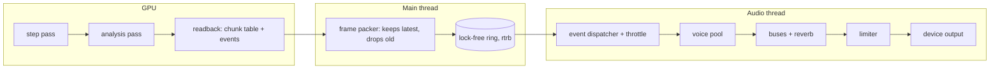

# Audio plan: detailed, physically driven sound

Status: plan, not implemented. Target: the `physics` viewer on branch `gpu-perf`.

## 1. Goals

- Sound comes from what the simulation is doing, not from a loop that plays when something is on screen.
- Each material sounds different: sand hisses and clicks, water pours and splashes, stone clacks, wood knocks and crackles, lava rumbles and sizzles, steam hisses, boiling water bubbles.
- Loudness and timbre follow physical quantities: impact energy, flow rate, temperature, burning area.
- Works at every world speed: 0.01x slow motion to 16x fast forward, and paused.
- Stays out of the way of the simulation: GPU analysis is cheap, audio CPU is bounded, nothing allocates on the audio thread.
- Clean mix: limiter, per-bus gain, voice budget, ducking. No clicks, no clipping, no pile-up of identical sounds.
- Testable: offline rendering of recorded simulation frames to WAV, with automatic checks.

Non-goals (first release): HRTF or 3D positional audio, sample libraries with recorded real sounds (procedural first; samples can slot into the same voice interface later), music.

## 2. What the simulation tells the audio

Everything the audio needs is derived from the cell grid on the GPU in one extra compute pass after each step. The pass reads the previous and current states (the ping-pong buffers already hold both), so it can detect transitions without extra storage.

### 2.1 Per-chunk aggregates (ambient beds)

The grid is already split into 32x32 chunks (`CHUNK` in `physics/mod.rs`). One analysis thread per chunk writes a fixed record:

| field | meaning | used for |
|---|---|---|
| `count[11]` | cells per material | bed levels (water, sand, fire, steam, lava, room) |
| `moving` | cells with speed > 0, by kind (powder, liquid, gas) | flow rate, pour and hiss |
| `mean_speed[3]` | mean speed level per kind | pitch and brightness of flow sounds |
| `slides` | sand/liquid cells that slid diagonally this step | avalanche rumble |
| `falls` | cells that landed this step, binned by speed | impact rate |
| `hot_area` | cells above 500°C | incandescent and fire bed |

Record size: about 24 u32 (96 bytes). 640x360 has 20x12 = 240 chunks, so the whole table is about 23 KB. Read back through the existing staging path, the same way the grid is read back now.

Sleeping chunks run no analysis work and report zero, which is exactly right: a settled pile is silent.

### 2.2 Event ring buffer (one-shot sounds)

Transitions that should make a sound are appended to a GPU ring buffer with `atomicAdd` on a head counter:

| event | detection (prev -> cur cell) | sound |
|---|---|---|
| impact | speed > threshold last step, speed 0 now, blocked from below by solid or liquid | thud, splash, clack, depending on the materials |
| ignition | WOOD or OIL -> FIRE | whoosh + crackle burst |
| boil | WATER -> STEAM | bubble cluster |
| freeze | WATER -> ICE | soft tick |
| solidify | LAVA -> STONE or SAND | cooling chirp, falling pitch |
| quench | LAVA cell with WATER neighbour, transition this step | sizzle + steam puff |
| extinguish | FIRE -> SMOKE with WATER neighbour | hiss |

Each record: kind (u32), material pair (u32), position in cells (two u16 packed in u32), energy (f32: 0.5 * v^2 for impacts, otherwise a fixed scale), chunk index. 16 bytes.

Cap: 512 events per step. Beyond that the buffer counts dropped events in a separate counter, and the CPU shows the number in the stats overlay. A tenfold fire should not flood the audio thread; it should saturate gracefully.

Impact speed comes from the physics: a cell with speed level s moves at `s * MAX_SPEED / 256` (6 m/s at s = 256). So impact energy is physical, not guessed: a grain that fell 1 m lands much harder than one that fell 1 cm.

### 2.3 Costs

- Analysis pass: reads 2 x grid, writes chunk table and event ring. At 640x360 about 1 MB of reads. Expect 0.02 to 0.05 ms, well under the simulation step.
- Readback: 23 KB chunk table + event ring (up to 8 KB). Smaller than the grid readback already done each frame.
- The analysis pass runs only on awake chunks (same indirect-dispatch idea as chunk sleeping; uses the `awake` flags).

### 2.4 CPU reference

`physics/audio_analysis.rs` implements the same reduction on the CPU. Tests check the GPU output equals the CPU output on the same worlds (counts and event lists, bit-exact, since everything is integer or exact float). This also gives a path to offline rendering without a GPU.

## 3. Time: how sound follows the world clock

The world clock (`physics/clock.rs`) decides how much world time passes per real second. Audio has to respect it:

- **Event sounds** are triggered by world events. At 0.1x, the same events happen ten times slower in real time, so you hear them spaced out. This is physically honest: a slow-motion splash is a slow splash.
- **Continuous beds** (flow, fire roar, room tone) are synthesised with a rate parameter taken from the clock's speed. Their playback pitch follows the speed like a tape slowed down: `pitch_ratio = clamp(speed, 0.05, 16)`. Below 0.05x the beds fade out, since a 0.01x tape is inaudible rumble.
- **Paused**: beds and voices fade to silence over 100 ms. Events raised while paused are discarded, not queued.
- **Fast forward** (up to 16x): event rate is 16x. The voice budget and per-region throttling (section 6) keep this bounded. Beds track the new energy but pitch stays at 16x speed-equivalent only up to a cap of +24 semitones, beyond which beds get quieter instead.

Decision (section 12, resolved): beds pitch with the clock, tape-style.

## 4. Sound design per material

All sounds are procedural first. Each has a parameter set driven by the analysis numbers, plus a fixed timbre. Frequencies below are targets; tune by ear.

### 4.1 Sand

- **Pour bed**: filtered noise. Level proportional to `sqrt(moving_sand)`. Bandpass centre about 1.5 to 3 kHz, rising with `mean_speed` (faster grains sound brighter). Q about 1.2. Stereo spread from the chunk x-distribution.
- **Grain clicks**: each landing grain triggers a 2 to 5 ms noise burst through a resonant bandpass (about 4 to 7 kHz, random per grain within a narrow range). Rate = landings per second in the chunk. Amplitude scales with impact energy. Clicks are granular: each click is a voice from a pool of 8, so a dense pile of grains becomes a continuous crackle, not 300 separate sounds.
- **Avalanche**: when `slides` is high in a chunk, a low (60 to 180 Hz) filtered noise swell plays and decays over 0.3 to 1.2 s. This is the rumble of a pile shifting.
- **Settle**: a short quiet tick when a region goes from active to sleeping (chunk transitions from awake to asleep). Very soft, ties the sleeping system to sound.

### 4.2 Water

- **Pour / flow bed**: broadband noise through a lowpass whose cutoff follows flow speed (800 Hz to 6 kHz). Level from falling water cells. Add a faint sub layer (40 to 90 Hz sine with slow random pitch wobble) when the volume of moving water is large: this is the body of a waterfall.
- **Impact splash**: noise burst (6 to 12 ms, highpass 2 kHz) plus a bubble cluster (see 4.2 bubbles) with count proportional to energy.
- **Bubble (Minnaert resonance)**: a bubble of radius r oscillates at about `f0 = 3.26 / r` Hz with r in metres. A 2 mm bubble rings near 1.6 kHz, a 5 mm bubble near 650 Hz. Each bubble is a sine with a fast pitch rise over the first 5 to 15 ms (the Minnaert chirp) and an exponential decay of 20 to 80 ms. Radii are random in 0.5 to 4 mm, so clusters sound like water, not a tone.
- **Drip**: low-energy impacts on still water produce single small bubbles with long decay.
- **Surface level changes**: no direct sound; covered by pour and splash.

### 4.3 Stone

- **Impact clack**: 3 to 5 modal partials (sines at about 900, 1900, 2950, 4200 Hz with random ±3% detune), decays 40 to 180 ms, amplitude by energy, plus a 1 ms click transient. Modal set picked per stone cell position (deterministic hash), so a flat floor rings with one character and a jagged pile with another.
- **Skid**: during sliding stone (not present in the current material set, but the same code path as sand with a higher-Q bandpass).

### 4.4 Wood

- **Knock**: lower modal set (about 220, 480, 790, 1200 Hz), decays 60 to 250 ms. Triggered by impacts with energy above a threshold.
- **Burning crackle**: a sparse Poisson process of noise impulses (1 to 4 ms, highpass 3 kHz) with rate proportional to ignition events in the chunk. Each crackle gets a random pitch offset. This gives the characteristic "popping" of burning wood.

### 4.5 Fire

- **Roar**: lowpass noise (300 to 900 Hz cutoff), level sqrt(fire cells), slow amplitude modulation 0.3 to 1.5 Hz (the breathing of a flame).
- **Flicker**: a 8 to 15 Hz amplitude LFO with random walk, depth 0.1 to 0.25. Keeps the roar alive.
- **Crackle**: same sparse impulses as burning wood, rate from ignition events plus fire cells near water (extinguishing pops).
- **Ignition whoosh**: on ignition events, a 150 to 400 ms bandpass sweep from 400 to 1500 Hz.

### 4.6 Steam

- **Hiss**: highpass noise (4 to 8 kHz) with level from steam cell count and boil rate. Stereo width from chunk spread.
- **Puff**: on quench and boil events, a 200 to 500 ms lowpass noise envelope (sharp attack, long decay) at 300 to 700 Hz.

### 4.7 Boiling water and quench

- **Boiling**: boil events in a chunk schedule bubble voices (see 4.2) at a Poisson rate of about 3 to 15 per second per chunk, pitch by radius distribution.
- **Quench (lava into water)**: sizzle (highpass noise, 3 to 9 kHz, 200 to 400 ms) plus a puff of steam sound plus a small splash. Strongest sound in the sim: this is a high-value event, so it gets priority in the voice allocator.

### 4.8 Lava

- **Rumble**: lowpass noise (30 to 120 Hz), level from lava cell count and mean speed (convection). Slow LFO 0.05 to 0.2 Hz for the flow surge.
- **Solidify chirp**: on lava -> stone, a short sine sweep from 2.4 kHz down to 1.2 kHz over 80 to 150 ms, with a faint noise tail. Cooling sound of basalt.
- **Hiss while cooling**: lowpass noise decaying with lava temperature.

### 4.9 Ice

- **Freeze tick**: 1 to 2 ms click with 2.5 to 4 kHz resonance, very quiet.
- **Melt drip**: occasional small bubble voices, rate from ice to water conversion events.

### 4.10 Room

- **Room tone**: pink noise at -48 dBFS, lowpass 6 kHz, constant. Keeps silence from sounding digital. Off in the Off quality tier.

## 5. Synthesis architecture

### 5.0 Baked one-shots (decided)

One-shot events are synthesised once, offline, by a bake tool, then saved as WAV files and played back at runtime. Beds stay procedural at runtime because they need continuous parameters from the simulation.

- **Bake tool**: `sand/src/bin/bake.rs`. Runs the procedural synth in section 4 for each event variant and writes 48 kHz, 24-bit mono WAV files to `sand/assets/audio/`. Deterministic: same tool version, same files.
- **Variants**: each one-shot has 4 to 8 variants (for example 8 grain clicks, 6 bubble radii, 4 stone clacks per modal set). The runtime picks one by the event's hash, so a given world always sounds the same.
- **Runtime**: a `Sampler` voice plays a baked file with gain, pitch ratio (±1 semitone random per event, plus world-clock pitch in section 3), and pan. Cost is a buffer read and a multiply: much cheaper than synthesis.
- **What is baked**: grain clicks, impact clacks and knocks per material, bubbles (Minnaert radius table), ignition whoosh, crackle pops, quench sizzle, steam puff, solidify chirp, ice tick, avalanche swell.
- **What stays procedural**: flow beds (water, sand), fire roar, lava rumble, steam hiss, room tone.
- **Size**: about 60 short files, a few MB in total. Checked into the repo, so the game needs no build step to find them.
- **Licence**: samples come from our own synth, so there is no third-party licence to track.
- **Changing a sound**: edit the bake parameters, re-run the bake, commit the new WAVs. Golden tests (section 11.3) catch unintended changes.

### 5.1 Voices

A voice is a sound instance with a start time, a source, parameters, an envelope, a pan, and a bus. Voices are preallocated in a fixed pool (no allocation on the audio thread).

Voice types:

| type | source |
|---|---|
| `Sampler` | baked WAV (section 5.0): all one-shot events |
| `Noise` | runtime white or pink generator with state-variable filter (lowpass, bandpass, highpass): beds |
| `Bed` | long-running procedural noise or sine with parameter smoothing (flow, fire, lava, steam, room) |
| `Loop` | baked seamless loop with level and filter from the analysis (optional, for fire roar if procedural sounds poor) |

Runtime DSP blocks used by beds: state-variable filter (Chamberlin or TPT), one-pole smoothers, LFOs, pink noise generator.

Parameter smoothing: every parameter changed by the analysis is smoothed with a one-pole filter (time constant 20 to 80 ms for beds, 2 ms for event amplitude). No zipper noise, no jumps.

Filter stability: all filters are state-variable (Chamberlin or TPT) with the cutoff clamped below 0.45 times the sample rate, and the Q clamped. Tested: no NaN or infinity for any parameter combination within range.

### 5.2 Random sources

Each voice has its own xorshift state seeded from the event's hash (cell index + frame), so the same world always produces the same sound. The audio is not bit-exact across machines (float maths), but it is repeatable for a given recording, which matters for tests.

### 5.3 Pools and granularity

- Click pool: 16 voices for sand and gravel grains. Grains past that are dropped quietly (they would be inaudible in the sum anyway).
- Bubble pool: 24 voices.
- Event voices (impact, ignition, quench, solidify): 24 voices, highest priority.
- Beds: one voice per (material, chunk-row). 20x12 chunks would be 240 beds, so beds are per material and per x-band of 4 chunks: about 5 x 6 x 11 materials at most, and most are silent. In practice a few dozen are active.

### 5.4 Voice allocation and priority

Priority, highest first: quench, ignition, impact over 0.5 J-equivalent, solidify, boil, normal impacts, clicks, bubbles, beds.

When the pool is full, a new voice steals the lowest-priority voice that is quietest. A voice that is about to be stolen fades out over 5 ms to avoid clicks.

## 6. Keeping it uncluttered

These are the rules that stop a busy scene from turning into noise:

1. **Per-region throttle.** Each 32x32 chunk allows at most N events per 100 ms by kind (impacts 8, boils 4, ignition 2, quench 2). Excess events are merged into the bed level instead of getting their own voice.
2. **Merge, don't multiply.** Many identical small events in one chunk become one voice with a louder amplitude (`+3 dB per doubling`, not linear sum). A pile of 300 grain landings is one crackle voice.
3. **Loudness hierarchy.** Beds sit at about -30 dBFS; event transients at -12 to -6 dBFS; high-priority events (quench, ignition) may reach -3 dBFS. Limiter at -1 dBTP so the sum never clips.
4. **Ducking.** When the fire roar or the quench layer is loud, the flow and room beds duck by up to 4 dB over 50 ms. Attack fast, release slow.
5. **Spatial spread.** Pan from the chunk centroid of each event (equal-power pan law). Beds spread across their x-band. Two sounds at the same place sum at one pan position, which avoids a phasey wide mush.
6. **Frequency separation.** Beds live low to mid (room below 6 kHz, lava below 200 Hz, fire roar below 1 kHz). Transients live high (clicks, bubbles, chirps above 1 kHz). This keeps beds and events from masking each other.
7. **Reverb only for events.** A single shared reverb (feedback delay network, 4 lines, RT60 about 0.8 s) takes a send from events. Beds stay dry. Reverb is off in the Low tier.

## 7. Mixing and output

- Bus layout: `beds` (flow, fire, lava, steam, room), `events` (impacts, bubbles, ignition, quench, solidify), `ui` (settings clicks, optional). Each bus has gain, mute and a send to reverb.
- Per-bus soft compressor (threshold -18 dBFS, ratio 3:1, attack 10 ms, release 150 ms) on `events` only, to keep the crowd even.
- Master: sum, then a look-ahead limiter (5 ms look-ahead, ceiling -1 dBTP).
- Sample rate 48 kHz. Buffer 256 frames (about 5 ms latency), configurable to 512 for weaker machines.
- Loudness target: about -18 LUFS integrated for a typical busy scene, measured offline during tests. Normalisation is a fixed gain, not a live meter.

## 8. Threading and data flow

- The audio callback never blocks, locks or allocates. Messages from the main thread are fixed-size structs in a single-producer single-consumer ring (crate `rtrb`).
- If the main thread stalls, the audio thread keeps playing the last beds and lets events expire. No glitches, just silence after the tail.
- If the audio thread falls behind (device hiccup), the ring drops the oldest frame packets. The audio thread never waits for them.
- Frame packets are coalesced: at most one per rendered frame, carrying the newest chunk table and up to 512 events.

## 9. Crates and where they fit

- `cpal`: device output, low level. Full control over buffer size and callback.
- `kira`: higher-level mixer with tracks, effects, tweening and spatial tracks. Alternative to writing the mixer and reverb ourselves. Check the current version and API before committing; the plan works with either.
- `rtrb`: lock-free ring buffer.
- `macroquad::audio`: not used. It only loops and plays files, with no per-voice control.
- Optional: `fundsp` for ready-made DSP blocks. Adds a dependency; keep it optional.

Decided: `cpal` + our own voice pool and mixer. The voice model above (priority, merging, per-voice parameter smoothing, world-time pitch) is specific enough that a generic mixer would be fought, not used. Revisit if the mixer grows beyond a few hundred lines.

## 10. Settings

- Master volume, and per-bus volume: beds, events, UI.
- Audio quality tier: Off, Low (16 voices, no reverb, no room tone), Medium (24 voices, reverb), High (32 voices, reverb, room tone, per-grain panning).
- Output device (list from cpal), buffer size (256 or 512).
- Per-material enable: sand, water, stone, wood, fire, steam, lava, ice (for debugging and for taste).
- Mute when unfocused (on by default).
- Show the audio stats line in the overlay: voices in use, events per second, dropped events, audio CPU percent.

These live in `Settings` (`bin/physics/settings.rs`) next to the graphics options. The Audio section in the settings window follows the same pattern: `Action`s for things that need the audio thread, plain values otherwise.

## 11. Testing

### 11.1 Unit tests (no device)

- Filter stability: random parameters inside range, 10 s of output, no NaN or infinity, output bounded by 4.0.
- Envelope: attack, decay and release times within 5% of spec.
- Voice pool: never exceeds capacity; stealing picks the lowest priority; stolen voices fade without a step.
- Throttle: N+1 events in 100 ms produce N voices plus one merged level increase.
- Pan law: equal power (total power constant over the pan range within 0.1 dB).

### 11.2 Analysis tests (GPU + CPU)

- GPU analysis equals CPU analysis on the same world (exact).
- Known scenes produce expected events: a dropped stone produces one impact with energy about 0.5 m g h within 10%; lava into water produces one quench; a wood cell next to fire produces one ignition.
- Sleeping chunks report zero (checked against the chunk awake flags).

### 11.3 Offline render tests

- A recorder writes the per-frame packets (chunk table, events, speed, paused flag) to a `.sandrec` file during play.
- A headless renderer replays a recording through the same audio code and writes a WAV.
- Checks on the WAV: no clipping (peak below -1 dBTP), loudness within 3 LU of target, no DC offset, expected band energy: fire scene has most energy below 1 kHz; sand scene has transients above 2 kHz.
- Golden tests: a short recording plus its rendered RMS per second, checked with a tolerance. Catches regressions in the mapping from physics to sound.

### 11.4 Performance tests

- Audio thread: 32 voices of each type at once must take under 1.0 ms per 5 ms buffer on the M5 (20% of the budget).
- Analysis pass: under 0.05 ms at 640x360 with an active scene.
- Stress: 10x fire scene (every cell burning) runs with no underruns over 60 s and no growth in memory.

### 11.5 Manual listening checklist

- Pour a stream of sand: a continuous hiss with a clicking texture, not a machine gun.
- Drop one stone: one clear clack with a ring, then silence.
- Drop water on a hot stone: a sizzle, a puff, a burst of bubbles.
- Set a wood wall on fire: the roar builds in seconds, crackles come and go.
- Slow to 0.1x: events are spaced out, beds sound lower.
- Pause: everything stops within 100 ms.

## 12. Decisions (resolved)

1. **Beds and slow motion:** beds pitch with the world clock, tape-style (section 3).
2. **Engine:** our own mixer on `cpal` with `rtrb` for the message ring (recommended; section 9).
3. **Sound source:** procedural synthesis, run once offline and baked to WAV for one-shot events (section 5.0). Beds stay procedural at runtime.
4. **Default:** audio on for everyone, quality tier Medium.

## 13. Phases and acceptance

| phase | content | done when |
|---|---|---|
| P0 | device output, voice pool, master limiter, test tone | 1 kHz tone at -12 dBFS, no underruns for 10 min |
| P1 | GPU analysis pass, readback, CPU reference, parity tests | GPU == CPU on 5 scenes; analysis under 0.05 ms |
| P2 | beds: flow (water, sand), fire, lava, steam, room | each bed follows its physical quantity in the listening checklist |
| P3 | bake tool + WAV variants (section 5.0); events: impacts (all materials), boil, ignition, quench, solidify, bubbles on the Sampler voice | each event triggers once per physical event, throttle verified, baked files reproduce bit-exact from the bake tool |
| P4 | spatial pan, reverb send, ducking, merge rules | busy scene stays under the voice budget and sounds uncluttered |
| P5 | world clock mapping: pitch, fades, pause | 0.1x and pause behave as in section 3 |
| P6 | settings: buses, quality tiers, device, stats line | every setting takes effect without restart |
| P7 | recorder, offline renderer, golden tests, performance tuning | all tests in section 11 pass |

Each phase is a separate commit with its tests. P0 and P1 are the foundation; P2 to P4 can be worked on in parallel once P1 is in.

## 14. Risks

- **Audio device changes** (headphones plugged in, sample rate switch): handle by reopening the stream; test by unplugging.
- **Analysis cost creeping up** as materials are added: keep the chunk record fixed and small; review when adding a material.
- **Too many events at fast forward**: throttle is per real second, so 16x produces more real events than 1x. Check the dropped-event counter in stats; tune throttle, not the physics.
- **Listener fatigue**: the uncluttered rules are the main defence. Keep the listening checklist as a gate for each phase.
- **Cross-platform**: cpal backends differ (CoreAudio here; ALSA or WASAPI elsewhere). Test on macOS first; note platform-specific buffer sizes.
