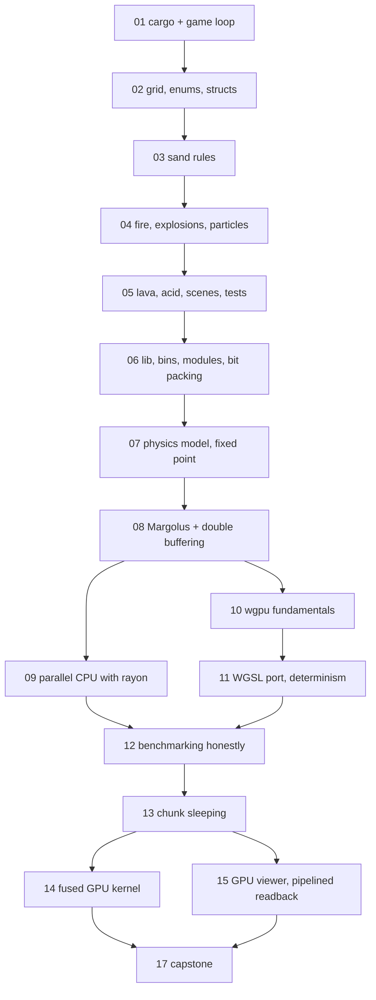
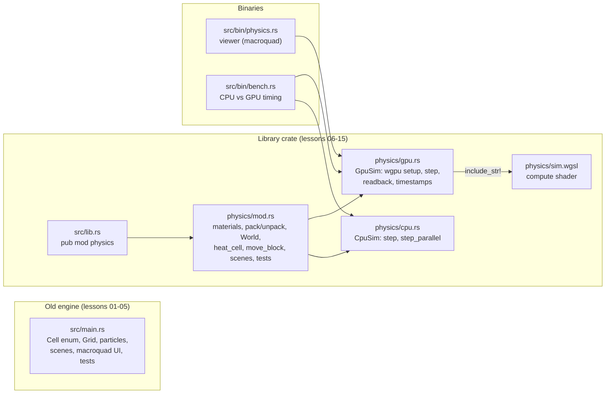

# Rust by Falling Sand: Course Index

This course teaches Rust by rebuilding one real project: the falling-sand simulation in `sand/`. It starts with an empty `cargo new` and ends with a GPU physics engine that gives exactly the same result as the CPU version, bit for bit. Each lesson matches a real commit in this repo, so you can always compare your code with the code that actually shipped.

## Who it's for

- You can already program in some language: variables, loops, functions, arrays. That is all you need.
- You are new to Rust. Ownership, traits, closures, modules, testing and async are taught when the project first needs them, not up front.
- You want to *build*, not just read. The test of this course is whether you can write the whole project yourself (see [[17-capstone-roadmap]]).

No graphics, physics or GPU background is needed. Every formula is built up from things you already know.

## How to use the lessons

One rule holds for every lesson: **you learn by typing, not by reading.** The loop:

1. **Read** the lesson once all the way through. Its job is to show you why each piece of code *had* to look the way it does.
2. **Type the code yourself** in your own crate (for example `~/sand-mine`). Don't copy and paste. The compiler errors you hit while typing are a big part of the lesson.
3. **Run the live examples.** `cargo run`, `cargo test`, `cargo run --release --bin bench`. See the behaviour with your own eyes.
4. **Do the exercises** at the end of the lesson. They are small changes that show whether the idea actually landed.
5. **Compare with the real commit.** Each lesson names a commit. Read the version that shipped without touching your working tree:

```bash
git show <sha> --stat                    # which files changed
git show <sha>:sand/src/main.rs          # one file as it was at that commit
git diff <older-sha> <sha> -- sand/      # exactly what this stage added
```

Where your code differs, ask which version is clearer and why. Both can be right.

## The lessons

### Part 1: the first engine (one file, `main.rs`)

**[[01-setup-cargo-game-loop]]**: Installing Rust, `cargo new`, `Cargo.toml` and dependencies, `cargo run` vs `--release`. A macroquad window and the game loop: `#[macroquad::main]`, `async fn main`, `next_frame().await`. Why a game is just "read input, update, draw, repeat."
*Concepts:* cargo, crates, `fn`, `let`/`mut`, attribute macros, a first look at `async`/`.await`.

**[[02-grid-enums-structs]]**: The world as a flat `Vec` of cells indexed by `y * W + x`. A `Cell` enum, a `Grid` struct, `impl` blocks and methods. Drawing the grid into an `Image`.
*Concepts:* `enum`, `struct`, `impl`, `&self` vs `&mut self`, ownership and borrowing basics, `#[derive(Clone, Copy, PartialEq)]`, `match`, `usize` vs `i32` and casting.

**[[03-falling-sand-rules]]**: The rules that make sand pile and water spread. Scanning bottom-up, randomising left and right, the "updated this frame" problem.
*Concepts:* `match` with guards, `if let`, `Option`, bounds checks, macroquad's `rand` module, slices and `swap`.

**[[04-fire-explosions-particles]]**: Fire, smoke, wood, gunpowder, bombs. Cells with state (life counters inside enum variants). Flying particles as a separate `Vec<Particle>` with gravity.
*Concepts:* enum variants that hold data, `Vec` push/retain, closures, borrowing two things at once (and why the borrow checker refuses it), `const` arrays.

**[[05-lava-acid-scenes-tests]]**: Lava and acid, a scene test bench (`Scene` structs holding function pointers), and the first unit tests.
*Concepts:* function pointers (`fn(&mut Grid)`), arrays of structs, `#[cfg(test)]`, `#[test]`, `assert!`/`assert_eq!`, `cargo test`.

### Part 2: the physics engine (library + binaries)

**[[06-lib-bins-modules-bitpacking]]**: Splitting the crate into `lib.rs`, `physics/` modules and `src/bin/*` binaries. Packing material, aux and temperature into one `u32`.
*Concepts:* `mod`, `pub`, `use`, `crate::` paths, lib vs bin targets, `default-run`, bit shifts and masks, `const fn`, sign extension with `as i32 >> 12`.

**[[07-physics-model-fixed-point]]**: Density, buoyancy, friction, viscosity, heat conduction and phase changes, all in integer maths. Fixed-point temperature (`T_SCALE = 256`). Randomness as a hash of position and step (`pcg`, `hash3`).
*Concepts:* lookup tables as `const` arrays, `clamp`, wrapping arithmetic, pure functions, closures as small helpers.

**[[08-margolus-double-buffering]]**: Why the old engine can't run in parallel. Two passes: a heat pass that reads the old grid and writes a new one (double buffering), and a move pass over 2x2 Margolus blocks that shifts by one cell every other step.
*Concepts:* `std::mem::swap`, `&[u32]` vs `&mut [u32; 4]`, array patterns, why "no two writers to one cell" is the whole trick.

**[[09-parallel-cpu-rayon]]**: `step_parallel` with rayon: `par_chunks_mut`, splitting rows so each thread owns its slice.
*Concepts:* `Send`/`Sync`, why the borrow checker makes data races a compile error, closures captured by threads, iterators and adapters.

**[[10-wgpu-fundamentals]]**: Device, queue, buffers, bind groups, compute pipelines, dispatch, and reading results back. `bytemuck` to turn `&[u32]` into `&[u8]` with no `unsafe`.
*Concepts:* traits (`Pod`, `Zeroable`) and derive, `Result` and `?`, `pollster::block_on` for async APIs, lifetimes in practice, RAII (resources freed on `Drop`).

**[[11-wgsl-port-determinism]]**: Porting the rules to `sim.wgsl` line by line, keeping CPU and GPU bit-identical, and the tests that prove it (`gpu_gives_identical_world_to_cpu`).
*Concepts:* `include_str!`, keeping two implementations in sync, integration-style tests, test helpers.

**[[12-benchmarking-honestly]]**: `bin/bench.rs`: warm-up, timing budgets, batching GPU steps, separating "gpu" from "gpu + readback", checking correctness before timing.
*Concepts:* `std::time::Instant`/`Duration`, `impl FnMut() -> u32` parameters, `String` formatting, `Result<(), String>`.

### Part 3: making it fast

**[[13-chunk-sleeping]]**: 32x32 chunks that go to sleep when nothing changes, why skipping them is provably exact, and the same rule on CPU and GPU.
*Concepts:* designing for invariants, more tests as proofs (sleeping == no sleeping), bit flags.

**[[14-gpu-perf-fused-kernel]]**: Fusing the heat and move passes into one dispatch: one thread per 2x2 block, interior fast paths, uniform-block shortcuts, and measuring what helped (and what didn't: workgroup tiles were slower).
*Concepts:* profiling-driven changes, testing odd grid sizes, edge cases at boundaries.

**[[15-gpu-viewer-pipelined-readback]]**: A GPU-only viewer, three staging buffers in rotation so the CPU never waits, epoch-based discarding of stale readbacks, GPU timestamp queries, release LTO.
*Concepts:* `Option` state machines, `Arc<AtomicU8>` to share a buffer's state with a `map_async` callback, Cargo profiles (`lto`, `codegen-units`, `panic = "abort"`).

**[[17-capstone-roadmap]]**: Build the whole thing yourself, milestone by milestone, with acceptance criteria and stretch goals.

## Rust concepts, and where they are taught

| Concept | Lessons |
|---|---|
| Cargo, crates, dependencies, profiles | 01, 06, 15 |
| Variables, mutability, integer types, casting | 01, 02, 06 |
| `struct`, `enum`, `impl`, methods | 02, 04 |
| `match`, `if let`, patterns | 02, 03, 08 |
| `Option` and `Result`, `?` | 03, 10, 12 |
| Ownership and borrowing | 02, 04, 09 |
| Slices and arrays (`&[T]`, `&mut [T; N]`) | 03, 08, 09 |
| Traits and `#[derive]` | 02, 10 |
| Closures and `impl Fn*` | 04, 07, 09, 12 |
| Iterators | 04, 09 |
| Modules, `pub`, `use`, lib + bins | 06 |
| `const`, `const fn`, lookup tables | 04, 06, 07 |
| Bit manipulation | 06, 13 |
| Testing (`#[test]`, `cargo test`, equivalence tests) | 05, 11, 13, 14, 15 |
| Async (`async fn`, `.await`, `block_on`) | 01, 10 |
| Threads, `Send`/`Sync`, rayon | 09 |
| Safe GPU interop with `bytemuck` (no `unsafe`) | 10 |
| `Drop` and RAII | 10 |
| Shared state across callbacks | 15 |
| Measuring performance | 12, 13, 14, 15 |

## Lesson dependencies

Each arrow means "read this one first."



Lessons 09 and 10 are independent of each other: both rely only on lesson 08's "every cell has exactly one writer" rule.

## Project architecture

The repo holds two engines. The old one is a single file. The new one is a library with two front ends.



`cargo run` starts the old engine (`default-run = "sand"`). `cargo run --release --bin physics` starts the viewer and `cargo run --release --bin bench` runs the benchmark.

## Commits and lessons

| Commit | What it added | Lessons |
|---|---|---|
| `8da72fa` | Initial sand game: `main.rs`, sand, water, stone, wood, fire, smoke, gunpowder, bombs | 01-04 |
| `a022b3c` | Lava, acid, smaller grains, scene test bench, first tests | 05 |
| `2fbcad6` | New physics engine: `lib.rs`, `physics/{mod,cpu,gpu}.rs`, `sim.wgsl`, `bin/physics.rs`, `bin/bench.rs` | 06-12 |
| `31aed2d` | Pack material, aux and temperature into one `u32` per cell | 06, 07 |
| `1157366` | Chunk sleeping on GPU and CPU, bit-exact with no sleeping | 13 |
| `d94ade6` | GPU-only viewer, pipelined readback, GPU timestamps, release LTO | 15 |
| `9b8dd55` | Fused single-dispatch GPU kernel (side branch; its parent `0df358e` imports the engine *without* chunk sleeping, so read it as an experiment on the two-pass engine) | 14 |

Lesson 06 teaches bit packing together with the module split, though in history it came one commit later (`31aed2d`). If you want to see the unpacked first version, read `2fbcad6`.

To look at or run a stage without disturbing your own work, use a worktree (a second checkout in its own folder):

```bash
git worktree add ../rusty-stage05 a022b3c     # checkout of that commit in ../rusty-stage05
cd ../rusty-stage05/sand && cargo run && cargo test
git worktree remove ../rusty-stage05          # when you're done
```

`git checkout <sha>` also works, but it moves your main working tree to that commit ("detached HEAD"). Return with `git checkout main`.

## External resources

Use these next to the lessons, not instead of them.

**The Rust Programming Language** ("the Book", free at doc.rust-lang.org/book):

| Book chapter | Lessons |
|---|---|
| 1 Getting Started, 3 Common Programming Concepts | 01 |
| 4 Understanding Ownership, 5 Structs, 6 Enums and Pattern Matching | 02, 03 |
| 8 Common Collections, 13 Iterators and Closures | 04, 09 |
| 11 Writing Automated Tests | 05, 11, 13 |
| 7 Packages, Crates, and Modules | 06 |
| 9 Error Handling | 10, 12 |
| 10 Generic Types, Traits, and Lifetimes | 10 |
| 16 Fearless Concurrency | 09, 15 |
| 14 More about Cargo | 15 |

The Book's chapter on async/await is newer and its number has changed between editions. Look it up by name when you reach lesson 10.

**Practice and reference:**

- **Rust by Example** (doc.rust-lang.org/rust-by-example): short runnable examples for each feature. Good when a lesson's syntax feels new.
- **rustlings** (github.com/rust-lang/rustlings): small exercises you fix until they compile. Do the matching section after each Part 1 lesson.
- **The Cargo Book** (doc.rust-lang.org/cargo): profiles, targets, `[[bin]]`.
- **std docs** (doc.rust-lang.org/std): `Vec`, slices, `Option`, `Instant`.

**Graphics and GPU:**

- **macroquad** docs on docs.rs and its examples in the macroquad GitHub repo (lessons 01-05).
- **Learn Wgpu** (sotrh.github.io/learn-wgpu): the standard wgpu tutorial. Its API calls may lag the wgpu version in `Cargo.toml`, so trust the compiler and docs.rs when they disagree.
- **WebGPU Fundamentals** (webgpufundamentals.org): the best plain explanation of buffers, bind groups, workgroups and compute shaders. Its examples use JavaScript, but the concepts map one to one onto wgpu (lessons 10, 11, 14).
- **wgpu** and **bytemuck** API docs on docs.rs.
- **rayon** docs on docs.rs, especially `ParallelIterator` and `par_chunks_mut` (lesson 09).
