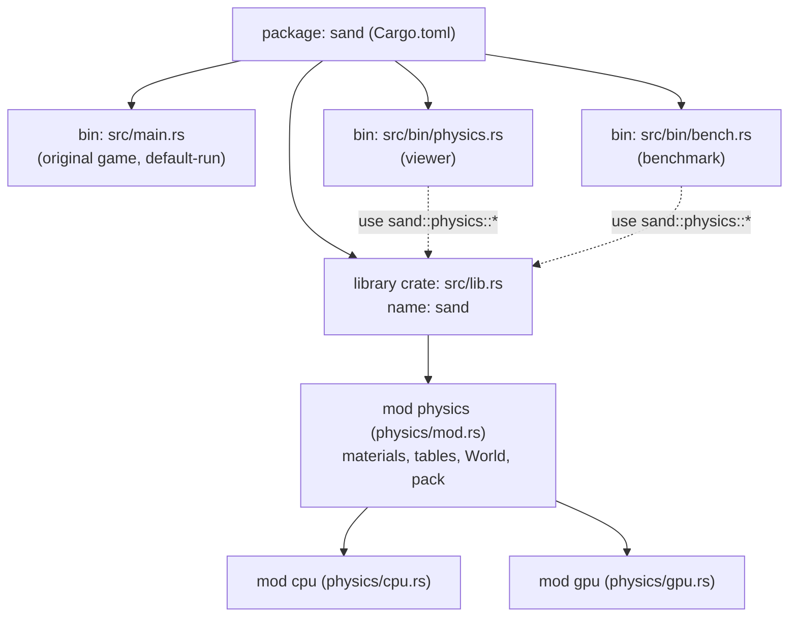

# Lesson 06: Second engine. Library + binaries, modules, bit-packing

## 1. What you will build in this lesson

Lessons 01–05 built the original game. All of it lives in one file, `sand/src/main.rs`, and a cell is a Rust `enum Cell { Empty, Sand, ..., Fire { life: u8 } }`.

At commit `2fbcad6` the project gets a **second physics engine**. This one has to run the same rules on the CPU and on the GPU. To make that possible, two things change:

1. **The code layout.** One package now holds a *library* (`src/lib.rs` plus a `physics` module tree) and several *programs* that use it: the old game (`src/main.rs`), a viewer (`src/bin/physics.rs`) and a benchmark (`src/bin/bench.rs`).
2. **What a cell is.** A cell is no longer an enum. It is a plain `u32` with fields packed into its bits. At `31aed2d` that `u32` takes on the temperature as well. Material, aux and temperature now share **one** 32-bit word, and the GPU gets faster because each step moves half as many bytes.



By the end you will have rebuilt this structure in a small package of your own. It will have a library, two binaries, a `pack`/`unpack` API, and tests showing that negative temperatures survive the round trip.

---

## 2. Concepts

### 2.1 Package vs crate: the unconditional truths

Everything else in this section follows from three facts:

- **A crate is one unit the compiler builds.** It produces either a library (code for other crates to use) or a binary (an executable with a `fn main`).
- **A package is a folder with a `Cargo.toml`.** It holds **at most one library crate** and **any number of binary crates**.
- **Cargo finds crates by file location:**

| File | Becomes |
|---|---|
| `src/lib.rs` | the library crate, named after the package (`sand`) |
| `src/main.rs` | a binary named after the package (`sand`) |
| `src/bin/foo.rs` | a binary named `foo` |

You never list these in `Cargo.toml`. Creating the file is enough.

**Why would you want this?** In the original game, all the logic sat next to `main`, so nothing else could reuse it. The new engine needs at least two front-ends: a window you can watch, and a headless benchmark. You could copy the code into both, but then the copies drift apart. The fix is to put the logic in a library crate and have each program depend on it. A binary in the same package can use the library automatically, under the package name:

```rust
// sand/src/bin/physics.rs @ 2fbcad6
use macroquad::prelude::*;
use sand::physics::{cpu::CpuSim, gpu::GpuSim, *};
```

From inside `src/bin/physics.rs`, the library is an outside crate called `sand`. That is why the path starts with `sand::` and not `crate::`. The binary can only see things the library marks `pub`.

The library root at `2fbcad6` is a single line:

```rust
// sand/src/lib.rs @ 2fbcad6
pub mod physics;
```

### 2.2 `default-run`

Once a package has more than one binary, a bare `cargo run` no longer knows which one to start, and it stops with an error asking you to pick one with `--bin`. `Cargo.toml` settles this:

```toml
# sand/Cargo.toml @ 2fbcad6
[package]
name = "sand"
version = "0.1.0"
edition = "2024"
default-run = "sand"
```

The result:

- `cargo run` starts the original game (`src/main.rs`, binary `sand`).
- `cargo run --release --bin physics` starts the viewer.
- `cargo run --release --bin bench -- 3` starts the benchmark. Everything after `--` goes to the program as its arguments.

`cargo test` builds and tests **all** the crates in the package, library and binaries alike.

### 2.3 Modules: `mod`, `pub mod`, `pub`

A crate is a tree of modules. `mod name;` means "this module's body is in another file". Cargo looks for it in one of two places:

- `name.rs`, next to the current file, or
- `name/mod.rs`.

So `pub mod physics;` in `lib.rs` loads `src/physics/mod.rs`. In turn, `physics/mod.rs` declares its children:

```rust
// sand/src/physics/mod.rs @ 2fbcad6
pub mod cpu;
pub mod gpu;
```

That loads `src/physics/cpu.rs` and `src/physics/gpu.rs`.

A short standalone example of visibility:

```rust
mod shapes {
    pub struct Square { pub side: f32, secret: u8 }
    impl Square {
        pub fn new(side: f32) -> Self { Square { side, secret: 0 } }
    }
    fn helper() {}            // private: only `shapes` and its children can call it
    pub mod deep {
        pub fn call() { super::helper(); }   // a child can see its parent's private items
    }
}

fn main() {
    let s = shapes::Square::new(2.0);
    println!("{}", s.side);   // ok, `side` is pub
    // s.secret              // error[E0616]: field `secret` is private
    shapes::deep::call();
}
```

Here is the rule underneath: **everything is private to its module unless it is marked `pub`, and a private item is visible to its own module and that module's descendants.** Struct fields are private one by one, too. That is why `World` writes `pub width`, `pub cells` and so on:

```rust
// sand/src/physics/mod.rs @ 31aed2d
#[derive(Clone, Debug, PartialEq, Eq)]
pub struct World {
    pub width: usize,
    pub height: usize,
    pub cells: Vec<u32>, // packed cells (material, aux, temperature), row by row, row 0 at the top
    pub frame: u32,      // steps run so far; picks the block offset and the randomness
}
```

### 2.4 Paths: `crate::`, `super::`, `self::`, and the crate name

| Path start | Means |
|---|---|
| `crate::` | the root of **this** crate (`lib.rs` when you are inside the library) |
| `super::` | the parent module |
| `self::` | the current module |
| `sand::` | the external crate called `sand` (how a binary refers to the library) |

`cpu.rs` is a child of `physics`, so it reaches its parent's items with `super::`:

```rust
// sand/src/physics/cpu.rs @ 2fbcad6
use super::{block_offset, hash3, heat_cell, move_block, World};
use rayon::prelude::*;
```

`use super::World` and `use crate::physics::World` point at the same item. `super::` is shorter, and it keeps working if you later move the whole `physics` folder somewhere else.

`use sand::physics::*` is a *glob import*. It brings in every `pub` item of `physics`: `AIR`, `SAND`, `World`, `pack` and the rest. The viewer and the bench use dozens of material constants, so a glob is reasonable there.

### 2.5 Why plain `u32` constants and not an enum?

The original game used:

```rust
// sand/src/main.rs @ 2fbcad6
enum Cell {
    Empty, Sand, Water, Stone, Wood, Gunpowder, Lava, Acid,
    Fire { life: u8 },
    Smoke { life: u8 },
}
```

In Rust that is excellent. You get one type, exhaustive `match`, and data attached to a variant. But the second engine has to send the grid to the GPU and run the same rules in a WGSL shader. Three facts settle the choice:

1. **WGSL has no Rust enums.** A shader sees buffers of plain numbers: `u32`, `i32`, `f32`, and vectors of them.
2. **Rust does not promise how it lays out a data-carrying enum in memory.** The size, where the tag goes, and the padding are all up to the compiler. You cannot hand those bytes to another program and expect it to read them.
3. **A `Vec<u32>` is a plain block of 4-byte numbers.** The `bytemuck` crate can view it as `&[u8]` and copy it straight into a GPU buffer, with no conversion step:

```rust
// sand/src/physics/gpu.rs @ 2fbcad6
self.queue.write_buffer(&self.mat[self.current], 0, bytemuck::cast_slice(&world.mat));
```

So the engine gives up the enum and uses named integer constants:

```rust
// sand/src/physics/mod.rs @ 2fbcad6
pub const AIR: u32 = 0;
pub const STONE: u32 = 1;
pub const SAND: u32 = 2;
pub const WATER: u32 = 3;
// ... LAVA = 5, STEAM = 6, WOOD = 7, FIRE = 8, ICE = 9, SMOKE = 10
pub const MATERIAL_COUNT: usize = 11;
```

What you lose: `match m { AIR => .., SAND => .. }` is no longer exhaustive, so a missing case does not cause a compile error. You must write `_ => ...`. What you gain: the exact same numbers mean the same thing in Rust and in `sim.wgsl`.

#### Per-material tables

Integer ids give you something else for free: a material id **is an array index**. Each material property becomes a lookup table indexed by id:

```rust
// sand/src/physics/mod.rs @ 2fbcad6
// Indexed by material id.         air stone sand water oil lava steam wood fire ice smoke
pub const KIND: [u32; MATERIAL_COUNT] = [GAS, SOLID, POWDER, LIQUID, LIQUID, LIQUID, GAS, SOLID, GAS, SOLID, GAS];
pub const DENSITY: [i32; MATERIAL_COUNT] = [10, 255, 150, 100, 80, 250, 3, 255, 9, 255, 6];
pub const FLOW: [u32; MATERIAL_COUNT] = [256, 0, 200, 230, 150, 40, 200, 0, 120, 0, 150];
pub const COND: [i32; MATERIAL_COUNT] = [15, 100, 40, 120, 40, 80, 20, 40, 80, 150, 15];
```

`DENSITY[SAND as usize]` is `150`. Array indexing needs a `usize`, which is why you will see `as usize` all over the engine. The shader has the same tables with the same numbers. Lesson 07 explains what the values mean physically.

### 2.6 `const` and `const fn`

A `const` is a value the compiler works out while compiling. Every use of it is replaced by the value itself. A `const fn` is a function the compiler is *allowed* to run at compile time, so you can use it to define other constants:

```rust
// sand/src/physics/mod.rs @ 2fbcad6
pub const T_SCALE: i32 = 256;
pub const fn celsius(c: i32) -> i32 {
    c * T_SCALE
}
pub const AMBIENT: i32 = celsius(20);   // computed by the compiler: 5120
```

A `const fn` is still an ordinary function at run time. `celsius(x)` with a run-time `x` works fine.

The catch is that a `const fn` may only call other `const`-callable functions. At `31aed2d`, `pack` started using `i32::clamp`. `clamp` comes from the `Ord` trait, and trait methods can't yet be called in `const fn` on stable Rust. So `pack` lost its `const`:

```rust
// 2fbcad6
pub const fn pack(material: u32, aux: u32) -> u32 { material | (aux << 8) }
// 31aed2d
pub fn pack(material: u32, aux: u32, temp: i32) -> u32 { ... temp.clamp(T_MIN, T_MAX) ... }
```

If you try to keep the `const`, the compiler says:

```
error[E0658]: cannot call conditionally-const method `<i32 as Ord>::clamp` in constant functions
```

`material`, `aux` and `temp` use only bit operators, so they can stay `const fn`.

### 2.7 Bits, masks and shifts

A `u32` is 32 on/off switches. Bit $k$ is worth $2^k$. Four operators let you pick fields out and put them in:

| Operator | What it does | Example (8 bits shown) |
|---|---|---|
| `a & b` | keeps the bits that are set in both | `1011_0110 & 0000_1111 = 0000_0110` |
| `a \| b` | keeps the bits set in either | `0000_0110 \| 0101_0000 = 0101_0110` |
| `a << n` | moves bits up by $n$ (multiplies by $2^n$) | `0000_0011 << 4 = 0011_0000` |
| `a >> n` | moves bits down by $n$ (divides by $2^n$) | `0011_0000 >> 4 = 0000_0011` |

A **mask** is a constant whose set bits mark the field you care about. `0xF` is `1111` in binary, so it marks 4 bits. `0xFF` marks 8. The recipe for reading a field that is `w` bits wide starting at bit `s`:

$$\text{field} = (\text{cell} \gg s)\ \&\ (2^w - 1)$$

And for writing it into an empty slot:

$$\text{cell} = \text{cell}\ |\ (\text{value} \ll s)$$

In the engine at `2fbcad6` the cell held two fields, material in bits 0–7 and aux in bits 8–15. Temperature was a separate `Vec<i32>`:

```rust
// sand/src/physics/mod.rs @ 2fbcad6
pub const fn material(cell: u32) -> u32 { cell & 0xFF }
pub const fn aux(cell: u32) -> u32 { (cell >> 8) & 0xFF }
pub const fn pack(material: u32, aux: u32) -> u32 { material | (aux << 8) }
```

### 2.8 The 31aed2d layout: everything in one word

Eleven materials fit in 4 bits ($2^4 = 16$). Aux (the remaining life of fire and smoke) needs 8 bits. That leaves $32 - 4 - 8 = 20$ bits, which is enough to hold the temperature too:

```text
 bit 31                                12 11          4 3      0
 ┌───────────────────────────────────────┬─────────────┬────────┐
 │ temperature: signed, 20 bits          │ aux: 8 bits │ mat: 4 │
 │ (1/256 °C units, bit 31 = sign)       │  0…255      │  0…15  │
 └───────────────────────────────────────┴─────────────┴────────┘
   read: (cell as i32) >> 12             (cell>>4)&0xFF  cell&0xF
```

| Field | Bits | Width | Range |
|---|---|---|---|
| material | 0–3 | 4 | 0…15 |
| aux | 4–11 | 8 | 0…255 |
| temperature | 12–31 | 20, signed | $-2^{19}$ … $2^{19}-1$ units $= -2048$ … $+2047.996$ °C |

Temperatures are fixed point: 256 units per degree (`T_SCALE`). So 20 signed bits cover $\pm 2^{19}/256 = \pm 2048$ °C. Lava starts at 1600 °C, so it fits.

```rust
// sand/src/physics/mod.rs @ 31aed2d
/// Temperature range that fits in 20 signed bits.
pub const T_MIN: i32 = -(1 << 19);
pub const T_MAX: i32 = (1 << 19) - 1;

pub const fn material(cell: u32) -> u32 {
    cell & 0xF
}
pub const fn aux(cell: u32) -> u32 {
    (cell >> 4) & 0xFF
}
/// `as i32` reinterprets the bits; `>>` on an i32 copies the sign bit
/// down, so negative temperatures come back out negative.
pub const fn temp(cell: u32) -> i32 {
    (cell as i32) >> 12
}
pub fn pack(material: u32, aux: u32, temp: i32) -> u32 {
    material | (aux << 4) | ((temp.clamp(T_MIN, T_MAX) as u32) << 12)
}
```

`material` and `aux` follow the mask-and-shift recipe from 2.7. `temp` has no mask, and it casts to `i32` before shifting. The next section explains why.

### 2.9 Two's complement and the arithmetic right shift

**How negatives are stored.** An `i32` uses *two's complement*. The top bit is worth $-2^{31}$ rather than $+2^{31}$, and every other bit keeps its usual positive value. So $-1$ is all ones, and in general a negative number has 1s filling its high bits.

**`as` between same-size integers changes no bits.** `-10240i32 as u32` keeps exactly the same 32 bits and just reads them as the unsigned number 4294957056. `as i32` reverses it. That makes `as` a free way to switch between signed and unsigned, which is exactly what packing needs.

**What `pack` does with a negative temperature**, for example ice at $-40$ °C $= -10240$ units:

1. `clamp` keeps it within $[-2^{19}, 2^{19}-1]$, which means its true value fits in the low 20 bits plus a sign.
2. `as u32` reinterprets the bits. The high 12 bits are all copies of the sign bit (1s).
3. `<< 12` pushes those 12 copies off the top and moves the 20 meaningful bits into bits 12–31. Bit 31 is now the temperature's sign bit.

**Unpacking.** Rust's `>>` behaves differently on the two kinds of integer:

- On **unsigned** values it is a *logical* shift, which fills the vacated high bits with 0.
- On **signed** values it is an *arithmetic* shift, which fills them with copies of the sign bit.

```rust
fn main() {
    let t: i32 = -10240;
    let cell = (t as u32) << 12;
    println!("{}", (cell as i32) >> 12); // -10240   arithmetic: sign copied down
    println!("{}", (cell >> 12) as i32); // 1038336  logical: zeros came in, sign lost
    println!("{}", -8i32 >> 1);          // -4
    println!("{}", (-8i32 as u32) >> 1); // 2147483644
}
```

(Every output above comes from actually running the program.) So `(cell as i32) >> 12` shifts the temperature down and *sign-extends* it in the same step. Temperature sits in the top bits, so there is nothing above it to mask away. That is the reason it was put at the top.

WGSL works the same way: `>>` on an `i32` is arithmetic. The shader can therefore use the same trick, and the CPU and GPU results stay bit-identical.

### 2.10 `clamp`: making `pack` safe

If you pack a temperature that does not fit in 20 bits, its high bits fall off the top of the `u32`. It would come back as a completely different number, possibly with the opposite sign. `x.clamp(lo, hi)` returns `lo` if `x < lo`, `hi` if `x > hi`, and `x` otherwise. With it, an impossible temperature saturates at the edge of the range and never wraps around. Note that `pack` does **not** mask `material` or `aux`. Callers must pass `material < 16` and `aux < 256`. Exercise 3 adds a guard for that.

### 2.11 `#[derive(Clone, Debug, PartialEq, Eq)]` on `World`

`derive` asks the compiler to write a trait implementation for you, field by field:

- `Clone`: `world.clone()` makes a deep copy, `Vec` included.
- `Debug`: `{:?}` printing. `assert_eq!` needs it to show the two values when they differ.
- `PartialEq`: `==` compares every field. Two `Vec`s are equal when they have the same length and the same elements.
- `Eq`: a promise that `==` is a full equivalence (every value equals itself). This holds because there are no floats in `World`. A struct with an `f32` field cannot derive `Eq`, since `NaN != NaN`.

The tests depend on this. Run the same scene on two backends and you can compare the whole world with one `assert_eq!(cpu_world, gpu_world)`. After 31aed2d the bit-exact CPU/GPU test also became simpler, because only one array needs checking:

```rust
// sand/src/physics/mod.rs @ 31aed2d (tests)
let diff = (0..cpu_world.cells.len()).filter(|&i| cpu_world.cells[i] != gpu_world.cells[i]).count();
assert_eq!(diff, 0, "{diff} cells differ between CPU and GPU");
```

### 2.12 Why packing makes things faster: memory traffic

Before `31aed2d`, every cell was a `u32` (material + aux) plus an `i32` (temperature): **8 bytes**. After, it is one `u32`: **4 bytes**. A 4K grid is $3840 \times 2160 = 8\,294\,400$ cells:

$$8\,294\,400 \times 8\text{ B} \approx 66.4\text{ MB} \quad\longrightarrow\quad 8\,294\,400 \times 4\text{ B} \approx 33.2\text{ MB}$$

Each step reads the grid and writes it. Each readback copies it from the GPU to the CPU. The per-cell maths is a handful of integer operations, so the GPU spends most of its time *waiting on memory*, not computing. If you halve the bytes, you speed up whatever was waiting on memory. The commit message records the 4K numbers:

| 4K grid | before (`2fbcad6`) | after (`31aed2d`) |
|---|---|---|
| GPU step | 2.911 ms | 2.614 ms |
| GPU step + readback | 5.334 ms | 3.896 ms |

The step only gets about 10% faster, because the step does more than move memory. Readback is nothing *but* moving memory, so the step + readback time falls by about 27%.

The code also got simpler. A cell's temperature now travels with it automatically when it moves:

```rust
// 2fbcad6: two arrays had to be swapped in lockstep
let swap = |a: usize, b: usize, cells: &mut [u32; 4], temps: &mut [i32; 4]| {
    cells.swap(a, b);
    temps.swap(a, b);
};
// 31aed2d: one array
cells.swap(top, bottom);
```

---

## 3. Build it yourself

Goal: a package `cellpack` with a library (the `physics` module, plus a `report` submodule), a default binary, and a second binary `inspect`. Plus tests that round-trip every field, negative temperatures included. It has no dependencies, so it builds in seconds.

**Step 1: create the package.**

```bash
cargo new cellpack
cd cellpack
mkdir -p src/physics src/bin
```

**Step 2: `Cargo.toml`.** Add `default-run`:

```toml
[package]
name = "cellpack"
version = "0.1.0"
edition = "2024"
default-run = "cellpack"

[dependencies]
```

**Step 3: the library root, `src/lib.rs`.**

```rust
pub mod physics;
```

**Step 4: `src/physics/mod.rs`.** Constants, pack/unpack, `World`, tests:

```rust
//! Cell layout and the World grid.

pub mod report;

pub const AIR: u32 = 0;
pub const STONE: u32 = 1;
pub const SAND: u32 = 2;
pub const WATER: u32 = 3;
pub const ICE: u32 = 9;
pub const FIRE: u32 = 8;

pub const T_SCALE: i32 = 256;
pub const fn celsius(c: i32) -> i32 {
    c * T_SCALE
}
pub const AMBIENT: i32 = celsius(20);

pub const T_MIN: i32 = -(1 << 19);
pub const T_MAX: i32 = (1 << 19) - 1;

pub const fn material(cell: u32) -> u32 {
    cell & 0xF
}
pub const fn aux(cell: u32) -> u32 {
    (cell >> 4) & 0xFF
}
pub const fn temp(cell: u32) -> i32 {
    (cell as i32) >> 12
}
pub fn pack(material: u32, aux: u32, temp: i32) -> u32 {
    material | (aux << 4) | ((temp.clamp(T_MIN, T_MAX) as u32) << 12)
}

#[derive(Clone, Debug, PartialEq, Eq)]
pub struct World {
    pub width: usize,
    pub height: usize,
    pub cells: Vec<u32>,
}

impl World {
    pub fn new(width: usize, height: usize) -> Self {
        World { width, height, cells: vec![pack(AIR, 0, AMBIENT); width * height] }
    }

    pub fn index(&self, x: i32, y: i32) -> Option<usize> {
        if x < 0 || y < 0 || x >= self.width as i32 || y >= self.height as i32 {
            None
        } else {
            Some(y as usize * self.width + x as usize)
        }
    }

    pub fn set(&mut self, x: i32, y: i32, m: u32, t: i32) {
        if let Some(i) = self.index(x, y) {
            self.cells[i] = pack(m, 0, t);
        }
    }
}

#[cfg(test)]
mod tests {
    use super::*;

    #[test]
    fn round_trips_every_field() {
        for m in 0..16 {
            for a in [0, 1, 80, 255] {
                for t in [T_MIN, celsius(-40), -1, 0, 1, AMBIENT, celsius(1600), T_MAX] {
                    let c = pack(m, a, t);
                    assert_eq!((material(c), aux(c), temp(c)), (m, a, t), "m={m} a={a} t={t}");
                }
            }
        }
    }

    #[test]
    fn negative_temperature_stays_negative() {
        let ice = pack(ICE, 0, celsius(-40));
        assert_eq!(temp(ice), -10240);
        assert!(ice >> 31 == 1, "sign bit should be set");
    }

    #[test]
    fn out_of_range_temperature_is_clamped() {
        assert_eq!(temp(pack(FIRE, 0, celsius(5000))), T_MAX);
        assert_eq!(temp(pack(FIRE, 0, celsius(-5000))), T_MIN);
    }

    #[test]
    fn worlds_compare_with_eq() {
        let mut a = World::new(4, 4);
        let b = a.clone();
        assert_eq!(a, b);
        a.set(1, 1, SAND, AMBIENT);
        assert_ne!(a, b);
    }
}
```

A few things to note here:

- `#[cfg(test)] mod tests` is compiled only by `cargo test`.
- `use super::*` pulls in the parent's items, private ones included, because `tests` is a child module.
- The test value `-1` matters. Its packed bits are all 1s above bit 11, so it checks the sign extension at its most extreme.

**Step 5: a submodule, `src/physics/report.rs`.** It shows `super::` at work:

```rust
//! Human-readable descriptions of packed cells.

use super::{aux, material, temp, T_SCALE};

pub fn describe(cell: u32) -> String {
    format!(
        "cell {cell:#010x} = material {}, aux {}, temp {:.2} C",
        material(cell),
        aux(cell),
        temp(cell) as f32 / T_SCALE as f32
    )
}
```

`{cell:#010x}` prints hex with a `0x` prefix, zero-padded to 10 characters in total.

**Step 6: the default binary, `src/main.rs`.** It refers to the library by the package name:

```rust
use cellpack::physics::{celsius, pack, World, SAND, WATER};

fn main() {
    let mut world = World::new(8, 4);
    world.set(2, 0, SAND, celsius(20));
    world.set(3, 0, WATER, celsius(5));
    let filled = world.cells.iter().filter(|&&c| c != world.cells[0]).count();
    println!("{} cells, {} not plain air", world.cells.len(), filled);
    println!("{:#010x}", pack(SAND, 0, celsius(20)));
}
```

**Step 7: the second binary, `src/bin/inspect.rs`.**

```rust
//! cargo run --bin inspect -- -40
use cellpack::physics::{celsius, pack, report::describe, ICE};

fn main() {
    let c: i32 = std::env::args().nth(1).and_then(|s| s.parse().ok()).unwrap_or(-40);
    let cell = pack(ICE, 7, celsius(c));
    println!("{}", describe(cell));
    println!("bits: {cell:032b}");
}
```

**Step 8: run it.**

```bash
cargo test                          # 4 passed
cargo run                           # runs src/main.rs thanks to default-run
cargo run --bin inspect -- -40
cargo run --bin inspect -- 3000     # clamped
```

Expected output:

```
32 cells, 2 not plain air
0x01400002
cell 0xfd800079 = material 9, aux 7, temp -40.00 C
bits: 11111101100000000000000001111001
cell 0x7ffff079 = material 9, aux 7, temp 2048.00 C
bits: 01111111111111111111000001111001
```

How to read the `-40` bit pattern, right to left:

- `1001` is material 9 (ice).
- `00000111` is aux 7.
- The top 20 bits, which begin with `1`, are a negative number: $-10240$.

For `3000`, the temperature has saturated at `T_MAX`: bit 31 is 0 and the 19 bits below it are all 1s. It prints as `2048.00` because $524287/256 = 2047.996$, which rounds to `2048.00` at two decimals.

---

## 4. Live examples

**A. The real project's binaries** (from `sand/`, at `31aed2d` or later):

```bash
cargo run                            # the original game (default-run = "sand")
cargo run --release --bin physics    # the new engine viewer, G switches CPU/GPU
cargo run --release --bin bench      # timing table, checks backends agree first
cargo test --release                 # includes the CPU-vs-GPU bit-exact test
```

Tweak to try: in your `cellpack`, delete `default-run` and run `cargo run`. Cargo refuses and asks you to choose between `cellpack` and `inspect`.

**B. Signed vs unsigned shift playground.** Save as `shift.rs` and run with `rustc shift.rs && ./shift`:

```rust
fn main() {
    for t in [-1i32, -10240, 0, 5120, (1 << 19) - 1, -(1 << 19)] {
        let cell = (t as u32) << 12;
        println!("{t:>8}  bits {cell:032b}  arith {:>8}  logical {:>8}",
                 (cell as i32) >> 12, (cell >> 12) as i32);
    }
}
```

Watch the "logical" column. It is right for every value $\ge 0$ and wrong for every negative one.

**C. Overflow past 20 bits.** In `inspect.rs`, replace `pack` with a version that has no `clamp` (`... | ((temp as u32) << 12)`) and run `cargo run --bin inspect -- 2100`. Since $2100 \times 256 = 537600 > 2^{19}$, the top bit gets lost and the temperature comes back as about $-1996$ °C. Put `clamp` back afterwards.

---

## 5. Exercises

1. **(easy) `with_temp`.** Write `pub fn with_temp(cell: u32, t: i32) -> u32`. It returns the same cell with only the temperature replaced. Add a test.
   *Hint:* unpack the other two fields and repack.

2. **(easy) A third binary.** Add `src/bin/table.rs`. It prints, for $-50, 0, 50, 100, 150$ °C, the packed hex value of `WATER` at that temperature. Run it with `cargo run --bin table`.
   *Hint:* `for c in (-50..=150).step_by(50)`.

3. **(medium) Guard the narrow fields.** `pack(16, 0, 0)` silently gives you material 0 with aux 1. Show that in a test, then add `debug_assert!`s to `pack` so that the call panics in debug builds. Mark that test `#[should_panic]`.
   *Hint:* `debug_assert!` is removed in `--release`, so the shipped code pays nothing for it.

4. **(medium) Set a field in place with a mask.** Write `pub const fn set_aux(cell: u32, a: u32) -> u32`. It must clear bits 4–11 and write `a` there, without unpacking temperature. It can be `const fn`. Why?
   *Hint:* `!` on a `u32` flips every bit. `!(0xFF << 4)` keeps everything *except* the aux bits.

5. **(medium) Redesign the layout.** Suppose you need 32 materials. Material becomes 5 bits (0–4), aux moves to 5–12, and temperature to 13–31. What are the new `T_MIN`/`T_MAX`, and what is the range in °C? Does lava at 1600 °C still fit? Write the code.
   *Hint:* count the temperature bits. The range is $\pm 2^{\text{bits}-1}$ units.

6. **(stretch) Bytes per step.** Write a binary that, for each grid size in the bench (`640x360` up to `3840x2160`), prints the bytes in the old layout (8 B/cell) and the new one (4 B/cell). Assume each step reads and writes the grid once. Then print the memory bandwidth (GB/s) needed for 60 steps per second.
   *Hint:* bytes per step $= 2 \times$ cells $\times$ bytes per cell.

---

## 6. Common mistakes and compiler errors

**"error[E0433]: failed to resolve: use of unresolved module or unlinked crate `physics`"** in a binary.
A binary is a *separate crate*. It has to name the library: `use cellpack::physics::...`, not `use physics::...` or `use crate::physics::...`. Inside a binary, `crate::` means that binary itself.

**"error[E0603]: function `helper` is private"** or **"error[E0616]: field `cells` of struct `World` is private"**
You forgot `pub`. Also check that every module along the path is `pub mod`. A `pub fn` inside a private `mod` still can't be reached from outside.

**"error[E0583]: file not found for module `report`"**
`pub mod report;` in `physics/mod.rs` looks for `src/physics/report.rs` or `src/physics/report/mod.rs`. Check the spelling and the folder.

**"error: `cargo run` could not determine which binary to run"**
You have several binaries and no `default-run`. Add one, or pass `--bin name`.

**"error[E0658]: cannot call conditionally-const method `<i32 as Ord>::clamp` in constant functions"**
`pack` is marked `const fn` but calls `clamp`. Drop the `const`, or clamp by hand with `if`s.

**"error: this arithmetic operation will overflow ... attempt to shift left by `32_i32`"**
Shifting a 32-bit value by 32 or more is an error at compile time (and a panic at run time in debug builds). Check your shift amounts against the layout.

**Mismatched types: `expected usize, found u32`** when indexing `DENSITY[m]`.
Write `DENSITY[m as usize]`.

**Logic bugs the compiler can't catch:**
- Unpacking temperature with `(cell >> 12) as i32`. Every negative temperature comes back as a large positive one. The cast must come *before* the shift.
- Masking the temperature after the shift (`((cell as i32) >> 12) & 0xFFFFF`). That clears the sign bits you just copied down.
- Changing a shift amount in Rust but not in `sim.wgsl`. The CPU-vs-GPU bit-exact test exists to catch exactly this.
- A `match` on material ids with no `_` arm. Integer matches must be exhaustive, so the compiler forces a `_ =>`, and a new material quietly falls into it.

---

## 7. Recap and what is next

- A **package** has at most one library (`src/lib.rs`) and any number of binaries (`src/main.rs`, `src/bin/*.rs`). Binaries use the library through the package name (`use sand::physics::*`). `default-run` decides what a bare `cargo run` starts.
- **Modules** are a tree. `mod x;` loads `x.rs` or `x/mod.rs`. Everything is private unless marked `pub`. You navigate with `crate::`, `super::` and `self::`.
- The GPU needs **plain data**, so cells became `u32`s with named constants, and material ids double as indices into property tables.
- **Bit-packing**: you read a field with $(\text{cell} \gg s)\ \&\ \text{mask}$ and write one with $|\ (v \ll s)$. A signed field goes at the **top** and is read with `(cell as i32) >> 12`. The arithmetic shift sign-extends it, and `clamp` keeps out-of-range values from wrapping.
- `#[derive(Clone, Debug, PartialEq, Eq)]` lets tests compare whole worlds with `assert_eq!`.
- Packing temperature into the cell cut each cell from 8 bytes to 4. The 4K GPU step went from 2.911 to 2.614 ms, and step + readback from 5.334 to 3.896 ms.

**Next, Lesson 07: The physics model.** You will look at what the `KIND`, `DENSITY`, `FLOW` and `COND` tables mean: density and buoyancy, friction and viscosity, heat conduction, and temperature-driven phase changes. It is all done in integer fixed point (`T_SCALE = 256`), so the CPU and the GPU agree bit for bit.

---

## Solutions

<details><summary>Solution 1: with_temp</summary>

```rust
pub fn with_temp(cell: u32, t: i32) -> u32 {
    pack(material(cell), aux(cell), t)
}

#[test]
fn with_temp_changes_only_temperature() {
    let c = pack(FIRE, 80, celsius(900));
    let d = with_temp(c, celsius(-3));
    assert_eq!((material(d), aux(d), temp(d)), (FIRE, 80, celsius(-3)));
}
```
</details>

<details><summary>Solution 2: third binary</summary>

`src/bin/table.rs`:

```rust
use cellpack::physics::{celsius, pack, WATER};

fn main() {
    for c in (-50..=150).step_by(50) {
        println!("{c:>5} C  ->  {:#010x}", pack(WATER, 0, celsius(c)));
    }
}
```

`cargo run --bin table`. The negative rows start with `0xf...` because the sign bit is set.
</details>

<details><summary>Solution 3: guards</summary>

```rust
pub fn pack(material: u32, aux: u32, temp: i32) -> u32 {
    debug_assert!(material < 16, "material {material} does not fit in 4 bits");
    debug_assert!(aux < 256, "aux {aux} does not fit in 8 bits");
    material | (aux << 4) | ((temp.clamp(T_MIN, T_MAX) as u32) << 12)
}

#[test]
#[should_panic(expected = "does not fit in 4 bits")]
fn material_too_big_panics() {
    pack(16, 0, 0);
}
```

Before the guard: $16 = 10000_2$, so its bit 4 lands in aux. `material` comes back 0 and `aux` comes back 1.
</details>

<details><summary>Solution 4: set_aux</summary>

```rust
pub const fn set_aux(cell: u32, a: u32) -> u32 {
    (cell & !(0xFF << 4)) | ((a & 0xFF) << 4)
}

#[test]
fn set_aux_keeps_others() {
    let c = pack(ICE, 3, celsius(-40));
    let d = set_aux(c, 200);
    assert_eq!((material(d), aux(d), temp(d)), (ICE, 200, celsius(-40)));
}
```

It can be `const fn` because it uses only `&`, `|`, `!` and `<<`, which are built-in operators. It calls no trait method like `clamp`. The temperature bits are never interpreted, only kept, so the sign takes care of itself.
</details>

<details><summary>Solution 5: 5-bit materials</summary>

Temperature now has $32 - 5 - 8 = 19$ bits, so it ranges over $\pm 2^{18}$ units $= \pm 262144 / 256 = \pm 1024$ °C. **Lava at 1600 °C no longer fits**. It would be clamped to about 1024 °C, which breaks the physics. That is why the real engine chose 4 material bits.

```rust
pub const T_MIN: i32 = -(1 << 18);
pub const T_MAX: i32 = (1 << 18) - 1;
pub const fn material(cell: u32) -> u32 { cell & 0x1F }
pub const fn aux(cell: u32) -> u32 { (cell >> 5) & 0xFF }
pub const fn temp(cell: u32) -> i32 { (cell as i32) >> 13 }
pub fn pack(material: u32, aux: u32, temp: i32) -> u32 {
    material | (aux << 5) | ((temp.clamp(T_MIN, T_MAX) as u32) << 13)
}
```

The alternatives are to shrink `T_SCALE` (coarser temperatures) or go back to a separate temperature array (twice the memory traffic). That is a real trade-off.
</details>

<details><summary>Solution 6: bytes per step</summary>

`src/bin/traffic.rs`:

```rust
const SIZES: [(usize, usize); 5] = [(640, 360), (1280, 720), (1920, 1080), (2560, 1440), (3840, 2160)];

fn main() {
    println!("{:>11} {:>12} {:>12} {:>14} {:>14}", "grid", "old MB/step", "new MB/step", "old GB/s @60", "new GB/s @60");
    for (w, h) in SIZES {
        let cells = (w * h) as f64;
        let old = 2.0 * cells * 8.0; // read + write, 8 bytes per cell
        let new = 2.0 * cells * 4.0; // read + write, 4 bytes per cell
        println!(
            "{:>11} {:>12.1} {:>12.1} {:>14.2} {:>14.2}",
            format!("{w}x{h}"),
            old / 1e6,
            new / 1e6,
            old * 60.0 / 1e9,
            new * 60.0 / 1e9
        );
    }
}
```

At 4K: 132.7 MB per step before and 66.4 MB after. At 60 steps per second that is 7.96 GB/s versus 3.98 GB/s. The real engine does two passes per step (heat and move), so the true traffic is higher. The 2:1 ratio between the layouts stays the same.
</details>
