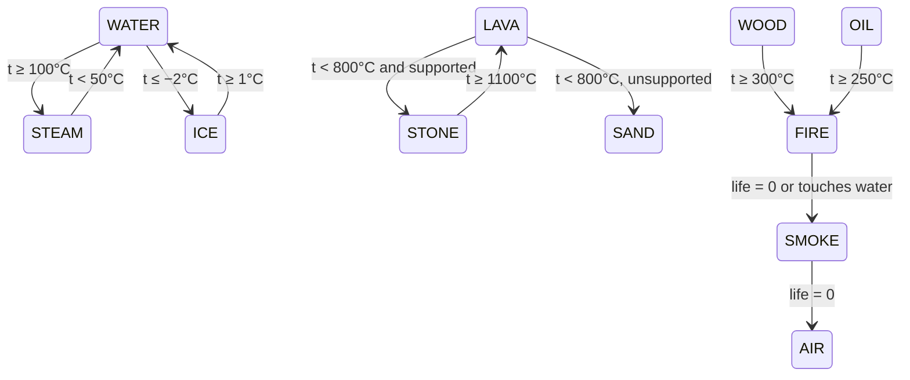

# Lesson 07: The physics model (density, heat and phase changes in fixed point)

> Source for this lesson: commit `31aed2d`, file `sand/src/physics/mod.rs`.
> To read it without touching your working tree: `git show 31aed2d:sand/src/physics/mod.rs`

## 1. What you will build in this lesson

In lesson 06 you split the project into a library (`sand/src/lib.rs`) with a `physics` module, and packed each cell into one `u32`:

```
bits 0-3    material (16 possible)
bits 4-11   aux: remaining life for fire and smoke
bits 12-31  temperature, signed 20 bits
```

This lesson covers what those bits *mean*: the rules that make the second engine feel physical. It has three parts.

1. **Heat**: every cell has a temperature, and heat flows between neighbours by conduction.
2. **Phase changes**: temperature turns water into steam, lava into stone, wood into fire, and so on.
3. **Density**: heavy things sink through light things, faster when the density gap is bigger (buoyancy). Hot gas is lighter than cold gas, which gives you convection.

All of it uses **integers only**. That is the most important design decision in this lesson, and section 2.1 explains why.

Here is where it sits in one simulation step:


The heat pass (`heat_cell`) is this lesson. The move pass (`move_block`, Margolus blocks) is lesson 08, but `move_block` asks two questions that belong here: `sinks(top, bottom)` and `spreads(left, right)`. We cover those two functions in this lesson as well.

By the end you will have written **`heatgrid`**, a small standalone program. It has a heat-diffusion grid with phase changes, it prints an ASCII picture of lava boiling water, and it includes a unit test that proves heat is conserved *exactly*.

---

## 2. Concepts

### 2.1 Fixed-point numbers, and why not `f32`

A **fixed-point** number is an integer that you agree to read as a fraction. The project stores temperature as an `i32` in units of $\frac{1}{256}$ °C:

```rust
// sand/src/physics/mod.rs @ 31aed2d
pub const T_SCALE: i32 = 256;
pub const fn celsius(c: i32) -> i32 {
    c * T_SCALE
}
pub const AMBIENT: i32 = celsius(20);
```

So the stored value $T$ means $T / 256$ °C. For example, `5120` means 20 °C and `-10240` means −40 °C.

Why not just use `f32`? Two reasons.

**1. Determinism across CPU and GPU.** The project runs the same rules on the CPU (Rust) and on the GPU (WGSL, lesson 11). A test checks that the two grids are *bit-identical* after 200 steps. Floating point can't promise that. The GPU may fuse `a*b + c` into one FMA instruction that rounds once instead of twice, and it may flush tiny numbers to zero. Each of those changes the last bit, and in a chaotic simulation a one-bit difference grows until whole cells end up in different places. Integer `+ - * /` is exact and defined the same way everywhere, so the same inputs always give the same bits.

**2. Exact conservation.** With integers you can *prove* that conduction neither creates nor destroys heat, and a test can check it with `assert_eq!` rather than "close enough" (section 2.3).

The price is **truncation**. Integer division throws away the fraction. Rust's `/` on integers rounds **toward zero**:

```rust
fn main() {
    println!("{} {}", 7 / 2, -7 / 2);   // 3 -3   (not 3 and -4)
}
```

Keep that fact in mind, because two of this lesson's results depend on it.

#### The T_SCALE = 16 story: heat that stopped flowing

An earlier version used `T_SCALE = 16`, so one unit was $\frac{1}{16}$ °C. That looks like plenty of precision. In practice heat stopped spreading and left frozen, blotchy gradients. Here is why.

The heat that one neighbour sends per step is

$$\Delta = \operatorname{trunc}\!\left(\frac{(T_j - T_i)\,k}{1024}\right)$$

Truncation makes $\Delta = 0$ whenever $|T_j - T_i|\,k < 1024$. So there is a **dead zone**: any gap smaller than $1024/k$ units never flows at all. Air has $k = 15$, so its dead zone is $1024/15 \approx 68$ units.

| T_SCALE | 68 units in °C | effect |
|---|---|---|
| 16 | 4.3 °C | neighbouring air cells up to about 4 °C apart never equalise. Gradients freeze. |
| 256 | 0.27 °C | the leftover gaps are too small to see |

The temperature range is still fine at 256: 20 signed bits give $\pm 2^{19}/256 \approx \pm 2047$ °C, and lava starts at 1600 °C. That is why the doc comment in the source reads:

```rust
/// Temperatures are fixed point: 256 units per degree Celsius. Fine steps
/// matter: conduction rounds toward zero, so a gap smaller than one unit
/// times 1024 / COND would never flow.
```

### 2.2 `const fn`

A `const fn` can run at **compile time**, which means you can use it to define other constants:

```rust
const fn square(x: i32) -> i32 { x * x }
const AREA: i32 = square(12);          // computed by the compiler
fn main() { println!("{AREA}"); }
```

`celsius` is a `const fn`, so `AMBIENT` and every threshold such as `celsius(100)` cost nothing at run time, and you can still call it normally at run time. The bit accessors are `const fn` too:

```rust
pub const fn material(cell: u32) -> u32 { cell & 0xF }
pub const fn aux(cell: u32) -> u32 { (cell >> 4) & 0xFF }
pub const fn temp(cell: u32) -> i32 { (cell as i32) >> 12 }
```

`pack` is *not* `const`. It calls `i32::clamp`, and `clamp` is a trait method (`Ord::clamp`). You can't call trait methods inside a `const fn` on stable Rust.

### 2.3 Conduction: the discrete heat equation

The heat equation says temperature changes in proportion to how different you are from your surroundings:

$$\frac{\partial T}{\partial t} = \alpha \nabla^2 T$$

On a grid, $\nabla^2 T$ at cell $i$ becomes "sum of (neighbour − me)". If we take one step of size 1 forward in time (**explicit Euler**), we get

$$T_i^{\text{new}} = T_i + \sum_{j \in N(i)} \alpha_{ij}\,(T_j - T_i), \qquad \alpha_{ij} = \frac{\min(k_i, k_j)}{1024}$$

where $N(i)$ is the 4 neighbours (left, right, up, down) and $k$ is the material's conductivity from the `COND` table. Here is the real code:

```rust
// sand/src/physics/mod.rs @ 31aed2d, inside heat_cell
let mut flux = 0;
let mut touches_water = false;
let mut neighbour = |j: usize| {
    let mn = material(cells[j]);
    let k = k_self.min(COND[mn as usize]);
    flux += (temp(cells[j]) - t0) * k / 1024;
    touches_water |= mn == WATER;
};
if x > 0 { neighbour(i - 1); }
if x + 1 < w { neighbour(i + 1); }
if y > 0 { neighbour(i - w); }
if y + 1 < h { neighbour(i + w); }
let mut t = t0 + flux;
```

**Why `min(k_a, k_b)`?** A pair of cells is only as conductive as its worse conductor. Stone touching air conducts like air, which is why air insulates. Just as important, $\min$ is **symmetric**: $\min(k_a,k_b) = \min(k_b,k_a)$. Cell $i$ and cell $j$ compute the same $k$ for their shared edge, and conservation depends on that.

**Why heat is conserved exactly.** Look at one edge between cells $a$ and $b$, with gap $g = T_b - T_a$:

- $a$ receives $\operatorname{trunc}(g k / 1024)$
- $b$ receives $\operatorname{trunc}(-g k / 1024)$

Truncation toward zero is an **odd function**: $\operatorname{trunc}(-x) = -\operatorname{trunc}(x)$. So whatever $a$ gains, $b$ loses, down to the last unit, and summed over all edges the total heat cannot change. If Rust rounded toward $-\infty$ (floor), then $\lfloor -2.5 \rfloor = -3$ but $-\lfloor 2.5 \rfloor = -2$. Each such edge would create one unit of heat out of nothing every step.

The order matters as well. The code multiplies first and divides last: `(diff) * k / 1024`. Writing `diff * (k / 1024)` would give `k / 1024 == 0` for every material and kill all conduction.

**Stability: why `COND` must be ≤ 256.** Rewrite the update as

$$T_i^{\text{new}} = \Big(1 - \sum_j \alpha_{ij}\Big) T_i + \sum_j \alpha_{ij} T_j$$

If $\sum_j \alpha_{ij} \le 1$, every weight is non-negative and they add up to 1. The new temperature is then a weighted *average* of old temperatures, so it can never be hotter than the hottest neighbour or colder than the coldest. That is a **maximum principle**, and it is what makes the scheme stable. With 4 neighbours, the condition is

$$4 \cdot \frac{k}{1024} \le 1 \iff k \le 256$$

If you break the bound, the scheme overshoots. Take a checkerboard of $+A$ and $-A$. Every cell sees 4 neighbours at the opposite value, so

$$T^{\text{new}} = A\,(1 - 8\alpha)$$

At $\alpha = 1/4$ ($k = 256$) you get exactly $-A$: the pattern flips sign forever without decaying, which is the borderline case. Above that, $|1 - 8\alpha| > 1$ and the amplitude **grows every step** until it overflows. The largest value in the table is ice at 150, which keeps the scheme comfortably inside the bound:

```rust
/// Thermal conductivity, out of 1024 per neighbour per step. Must stay
/// at most 256 so that 4 neighbours can never move more than 100% of
/// the temperature gap in one step (which would make the maths unstable).
pub const COND: [i32; MATERIAL_COUNT] = [15, 100, 40, 120, 40, 80, 20, 40, 80, 150, 15];
//                                        air stone sand water oil lava steam wood fire ice smoke
```

**Overflow reasoning.** An `i32` holds about $\pm 2.1 \times 10^9$. Temperatures fit in 20 signed bits, so a gap is at most $2^{20} \approx 10^6$, and times $k \le 150$ that is about $1.6 \times 10^8$. That fits with more than 10× headroom. The test that sums *all* cells uses `i64`, because $64 \times 64 = 4096$ cells at 1000 °C is $4096 \times 256000 \approx 10^9$, which is too close to the `i32` limit. Overflow behaves differently by build: in a debug build an `i32` overflow **panics**, and in a release build it silently wraps.

### 2.4 Closures that mutate captured variables

A **closure** is an anonymous function that can use variables from the scope around it:

```rust
fn main() {
    let mut total = 0;
    let mut add = |x: i32| total += x;   // captures `total` by &mut
    add(3);
    add(4);
    println!("{total}");                  // 7. The closure's borrow ended after its last use.
}
```

The closure changes `total`, so it implements the `FnMut` trait, and *calling* it requires `mut` on the binding (`let mut add`). Rust picks the lightest capture that works. `neighbour` in `heat_cell` captures:

- `flux` and `touches_water` by **mutable** reference (it writes them)
- `cells`, `t0` and `k_self` by **shared** reference (it only reads them)

Because the closure holds `&mut flux`, you can't read `flux` while the closure is still going to be used. After the last `neighbour(...)` call the borrow ends (non-lexical lifetimes), so `let mut t = t0 + flux;` compiles. The closure exists to avoid writing the same four lines four times, once per neighbour.

### 2.5 `||` short-circuits, which keeps an index in bounds

```rust
let supported = y + 1 >= h || KIND[material(cells[i + w]) as usize] >= POWDER;
```

On the bottom row, `cells[i + w]` would be out of bounds and would panic. `||` evaluates its right side **only if the left side is false**, so the index is only computed when a row below exists. `KIND[...] >= POWDER` works because the kinds are ordered `GAS=0, LIQUID=1, POWDER=2, SOLID=3`, so "powder or solid" is a single comparison.

### 2.6 Match guards

A **match guard** adds an `if` condition to a match arm:

```rust
fn describe(n: i32) -> &'static str {
    match n {
        0 => "zero",
        x if x < 0 => "negative",
        _ => "positive",
    }
}
```

Arms are tried **top to bottom**. If an arm's pattern matches but its guard is false, Rust moves on to the next arm. You can therefore list the same pattern several times with different guards. The phase-change table in the project uses this:

```rust
// sand/src/physics/mod.rs @ 31aed2d, inside heat_cell
match m {
    WATER if t >= celsius(100) => next = STEAM,
    WATER if t <= celsius(-2) => next = ICE,
    ICE if t >= celsius(1) => next = WATER,
    // Condenses well below boiling, so steam rises a while before raining.
    STEAM if t < celsius(50) => next = WATER,
    LAVA if t < celsius(800) => next = if supported { STONE } else { SAND },
    STONE if t >= celsius(1100) => next = LAVA,
    WOOD if t >= celsius(300) => { next = FIRE; life = 40 + (r & 63); }
    OIL if t >= celsius(250) => { next = FIRE; life = 20 + (r & 31); }
    FIRE => { /* see below */ }
    SMOKE => { /* see below */ }
    _ => {}
}
```

Two Rust details apply here:

- `WATER`, `STEAM` and the rest are `const`s, and **a constant used in a pattern compares by value**. A lowercase name in that position would instead create a new variable that matches anything. The project uses uppercase constants, so this works as intended.
- Matching on a `u32` must cover every value, so the final `_ => {}` is required. Without it you get `E0004 non-exhaustive patterns` (section 6).

### 2.7 Phase changes and hysteresis

Water boils at 100 °C, but steam only condenses below **50 °C**. The gap between the two thresholds is **hysteresis**. With a single threshold, a cell near 100 °C would flicker between water and steam every frame. With the gap, a fresh steam cell (which starts at 120 °C) has to lose 50 °C before it turns back into water. During that time it rises, which is how the simulation gets clouds and then rain. Ice works the same way on a smaller scale: it freezes at −2 °C and melts at 1 °C.



Lava has the same kind of gap: it solidifies below 800 °C and stone melts above 1100 °C.

**Fire and smoke use `aux` as a life counter.** On ignition, `life` gets a random value from the position hash, for example `40 + (r & 63)` for wood. `r & 63` keeps the low 6 bits, so it is a number from 0 to 63. Each frame:

```rust
FIRE => {
    if touches_water || life == 0 {
        next = SMOKE;
        life = 30 + (r & 31);
    } else {
        // Burning releases heat: the flame stays at least this hot.
        life -= 1;
        t = t.max(celsius(900));
    }
}
SMOKE => {
    if life == 0 { next = AIR; } else { life -= 1; }
}
```

`t.max(celsius(900))` is how **burning releases heat**: a flame never drops below 900 °C, so it keeps pumping heat into its neighbours by conduction until nearby wood passes 300 °C and ignites. That is how fire spreads, and there is no special "spread" rule. Note that this *breaks* conservation on purpose, since burning is chemical energy entering the system. The same goes for:

```rust
// Gases mix with the wider atmosphere and drift back to room temperature.
if KIND[m as usize] == GAS && m != FIRE {
    t += (AMBIENT - t) / 64;
}
```

Each step, a gas cell closes $\frac{1}{64}$ of its gap to 20 °C, which is exponential decay toward ambient. This is why the conservation test uses only stone.

### 2.8 The debugging story: stone hanging in mid-air

The first version of the lava rule was simply `LAVA if t < celsius(800) => next = STONE`. In the "lava + water" scene, a blob of lava falls into a pool. The **leading edge** of the falling lava touched water, cooled fastest, and turned into stone *while still falling*. Stone is `SOLID`, and solids never move, so it stopped where it was. The result was a crust of stone hanging in mid-air with nothing under it.

The fix was to ask whether anything is holding the cell up:

```rust
// Lava resting on something sets into stone. Lava that cools while
// falling or sinking through water shatters into gravel instead
// (real lava does this in water), so no stone is left hanging in mid-air.
LAVA if t < celsius(800) => next = if supported { STONE } else { SAND },
```

Unsupported lava becomes `SAND`, a powder that keeps falling. The lesson is general: **a rule that is local in temperature can still create a non-local inconsistency** (a floating solid). The fix was to give the rule one more piece of local information, the cell below.

### 2.9 Density, buoyancy and viscosity

```rust
/// Relative density. Only differences matter. Solids never move.
pub const DENSITY: [i32; MATERIAL_COUNT] = [10, 255, 150, 100, 80, 250, 3, 255, 9, 255, 6];
//                                           air stone sand water oil lava steam wood fire ice smoke
```

**Hot gas is lighter**, which gives convection:

```rust
fn density(cell: u32) -> i32 {
    let (m, t) = (material(cell), temp(cell));
    let d = DENSITY[m as usize];
    if KIND[m as usize] == GAS && m != FIRE {
        (d - (t - AMBIENT) / celsius(40)).max(1)
    } else {
        d
    }
}
```

A gas loses 1 density point per 40 °C above ambient, but never drops below 1. Air at 100 °C has density $10 - 80/40 = 8$, so it rises through 20 °C air at density 10. Fire is excluded: if flames got lighter as they got hotter, they would shoot away from the wood they are burning.

**Sinking is a probability proportional to the density gap:**

```rust
fn sinks(top: u32, bottom: u32, roll: u32) -> bool {
    let (mt, mb) = (material(top) as usize, material(bottom) as usize);
    if KIND[mt] == SOLID || KIND[mb] == SOLID || KIND[mb] == POWDER {
        return false;
    }
    let (dt, db) = (density(top), density(bottom));
    if dt <= db {
        return false;
    }
    roll < ((dt - db) * 256 / dt) as u32
}
```

`roll` is a random number from 0 to 255, so

$$P(\text{swap}) = \frac{1}{256}\left\lfloor \frac{256\,(d_\text{top} - d_\text{bottom})}{d_\text{top}} \right\rfloor \approx \frac{d_\text{top} - d_\text{bottom}}{d_\text{top}}$$

This is a rough version of Archimedes. The net downward force on a sinking body is its weight minus the buoyant force, $(\rho_\text{top} - \rho_\text{bottom})\,g\,V$. Divide by its weight $\rho_\text{top}\,g\,V$ and you get the fraction of free-fall acceleration it keeps: $\frac{\rho_t - \rho_b}{\rho_t}$.

| top over bottom | $256(d_t - d_b)/d_t$ | chance per step |
|---|---|---|
| sand over air | $256 \cdot 140/150 = 238$ | 93%, falls fast |
| sand over water | $256 \cdot 50/150 = 85$ | 33%, sinks slowly |
| water over oil | $256 \cdot 20/100 = 51$ | 20%, oil rises slowly |
| air over steam | $256 \cdot 7/10 = 179$ | 70%, steam shoots up |
| 20 °C air over 100 °C air | $256 \cdot 2/10 = 51$ | 20%, convection |

**Viscosity** is a per-material chance to trade places sideways, and the pair uses the *less* runny of the two:

```rust
fn spreads(left: u32, right: u32, roll: u32) -> bool {
    let (ml, mr) = (material(left) as usize, material(right) as usize);
    let fluid = |k: u32| k == GAS || k == LIQUID;
    ml != mr && fluid(KIND[ml]) && fluid(KIND[mr]) && roll < FLOW[ml].min(FLOW[mr])
}
```

`FLOW` is water 230, oil 150 and lava 40 (out of 256), so water levels out fast and lava creeps. Note `ml != mr`: swapping two identical cells would do nothing, so the function doesn't report it as a move.

### 2.10 The three tests

```rust
#[test]
fn conduction_conserves_heat() {
    // Only stone (no phase change below 1100°C, no gas cooling).
    let mut world = World::new(64, 64);
    world.fill(0, 0, 64, 64, STONE);
    for y in 20..30 {
        for x in 20..30 {
            world.cells[y * 64 + x] = pack(STONE, 0, celsius(1000));
        }
    }
    let total = |w: &World| w.cells.iter().map(|&c| temp(c) as i64).sum::<i64>();
    let before = total(&world);
    run(&mut world, 300);
    let after = total(&world);
    assert_eq!(before, after);
    assert!(temp(world.cells[64 * 25 + 15]) > AMBIENT, "heat should have spread outward");
}
```

The test sets up a world where only conduction can happen: everything is stone, 1000 °C is below stone's melting point, and there are no gases. It then demands **exact** equality. The second assert guards against a cheat: an engine where no heat flows at all would also "conserve" heat.

`oil_floats_on_water` starts the world upside down, with water on top of oil, and runs 3000 steps. It then checks that oil's mean row is above water's mean row. It checks a statistic rather than every cell, because the motion is random.

`lava_boils_water_and_turns_to_stone` runs scene 1 for 600 steps. It records the *peak* steam count (more than 20), because steam later condenses and rains away. It also checks that there is more stone at the end than an empty world has. Together these exercise boiling, cooling and the supported-lava rule end to end.

---

## 3. Build it yourself: `heatgrid`

You will build a standalone binary with a fixed-point heat grid, double buffering, phase changes and a conservation test. It doesn't depend on the `sand` crate.

### Step 1: create the project

```bash
cargo new heatgrid
cd heatgrid
```

In `Cargo.toml`, make sure `edition = "2024"`.

### Step 2: materials and fixed point

The code is simplified compared with the project. A cell is a small struct rather than a packed `u32`, so you can focus on the physics.

```rust
// src/main.rs
const AIR: u8 = 0;
const STONE: u8 = 1;
const WATER: u8 = 2;
const STEAM: u8 = 3;
const ICE: u8 = 4;
const LAVA: u8 = 5;
const NAMES: [&str; 6] = ["air", "stone", "water", "steam", "ice", "lava"];
const SYMBOL: [char; 6] = ['.', '#', '~', '^', '*', '@'];

/// Thermal conductivity out of 1024, per neighbour per step. Must be <= 256.
const COND: [i32; 6] = [15, 100, 120, 20, 150, 80];

const T_SCALE: i32 = 256;
const fn celsius(c: i32) -> i32 {
    c * T_SCALE
}
const AMBIENT: i32 = celsius(20);

#[derive(Clone, Copy, Debug, PartialEq, Eq)]
struct Cell {
    mat: u8,
    temp: i32, // 1/256 °C
}
```

### Step 3: the grid with two buffers

Every cell must read the **old** temperatures. If you updated in place, cell 5 would see cell 4's *new* value, and both conservation and symmetry would break. So the grid keeps a second buffer, `next`, and swaps it with `cells` at the end of each step.

```rust
struct Grid {
    w: usize,
    h: usize,
    cells: Vec<Cell>,
    next: Vec<Cell>,
}

impl Grid {
    fn new(w: usize, h: usize) -> Self {
        let air = Cell { mat: AIR, temp: AMBIENT };
        Grid { w, h, cells: vec![air; w * h], next: vec![air; w * h] }
    }

    fn put(&mut self, x: usize, y: usize, mat: u8, c: i32) {
        self.cells[y * self.w + x] = Cell { mat, temp: celsius(c) };
    }

    fn total_heat(&self) -> i64 {
        self.cells.iter().map(|c| c.temp as i64).sum()
    }
```

### Step 4: conduction with a mutating closure

```rust
    /// Conduction only: what flows into cell (x, y) from its 4 neighbours.
    fn conduct(&self, x: usize, y: usize) -> i32 {
        let i = y * self.w + x;
        let t0 = self.cells[i].temp;
        let k_self = COND[self.cells[i].mat as usize];
        let mut flux = 0;
        let mut neighbour = |j: usize| {
            let k = k_self.min(COND[self.cells[j].mat as usize]);
            flux += (self.cells[j].temp - t0) * k / 1024;
        };
        if x > 0 { neighbour(i - 1); }
        if x + 1 < self.w { neighbour(i + 1); }
        if y > 0 { neighbour(i - self.w); }
        if y + 1 < self.h { neighbour(i + self.w); }
        flux
    }
```

### Step 5: the step, and phase changes with match guards

```rust
    fn step(&mut self, phase_changes: bool) {
        for y in 0..self.h {
            for x in 0..self.w {
                let i = y * self.w + x;
                let m = self.cells[i].mat;
                let t = self.cells[i].temp + self.conduct(x, y);
                let next = if phase_changes { phase(m, t) } else { m };
                self.next[i] = Cell { mat: next, temp: t };
            }
        }
        std::mem::swap(&mut self.cells, &mut self.next);
    }

    fn print(&self) {
        for row in self.cells.chunks(self.w) {
            let line: String = row.iter().map(|c| SYMBOL[c.mat as usize]).collect();
            println!("{line}");
        }
    }
}

/// Phase changes with hysteresis: boil at 100, condense at 50.
fn phase(m: u8, t: i32) -> u8 {
    match m {
        WATER if t >= celsius(100) => STEAM,
        WATER if t <= celsius(-2) => ICE,
        ICE if t >= celsius(1) => WATER,
        STEAM if t < celsius(50) => WATER,
        LAVA if t < celsius(800) => STONE,
        STONE if t >= celsius(1100) => LAVA,
        other => other,
    }
}
```

`other => other` is a catch-all that *binds* the value, so "no change" returns the material untouched.

`self.conduct(x, y)` borrows `self` immutably while `self.next[i] = ...` borrows it mutably. These don't conflict, because `conduct` returns an `i32` and its borrow ends before the assignment.

### Step 6: `main`, a lava block in a pool

```rust
fn main() {
    let mut g = Grid::new(24, 10);
    for y in 0..10 {
        for x in 0..24 {
            g.put(x, y, WATER, 20);
        }
    }
    for y in 3..7 {
        for x in 10..14 {
            g.put(x, y, LAVA, 1600);
        }
    }
    let before = g.total_heat();
    for frame in 0..=400 {
        if frame % 100 == 0 {
            println!("frame {frame}  total heat {}", g.total_heat());
            g.print();
            let lava = g.cells.iter().filter(|c| c.mat == LAVA).count();
            let steam = g.cells.iter().filter(|c| c.mat == STEAM).count();
            println!("{} cells: {lava}, {} cells: {steam}\n", NAMES[LAVA as usize], NAMES[STEAM as usize]);
        }
        g.step(true);
    }
    println!("heat drift: {}", g.total_heat() - before);
}
```

Run `cargo run`. You'll see the lava `@` turn to stone `#`, and a growing ring of steam `^`. The last frame looks like:

```
~~~~~~~^^^^^^^^^^~~~~~~~
~~~~~~~^^^^^^^^^^~~~~~~~
~~~~~~~^^^####^^^~~~~~~~
...
heat drift: 0
```

`heat drift: 0` holds even *with* phase changes. In this model a phase change only relabels the material and never touches `t`. There is no latent heat, and nothing moves.

### Step 7: the conservation test

```rust
#[cfg(test)]
mod tests {
    use super::*;

    #[test]
    fn conduction_conserves_heat() {
        let mut g = Grid::new(32, 32);
        for y in 0..32 {
            for x in 0..32 {
                g.put(x, y, STONE, 20);
            }
        }
        for y in 10..16 {
            for x in 10..16 {
                g.put(x, y, STONE, 1000);
            }
        }
        let before = g.total_heat();
        for _ in 0..300 {
            g.step(false);
        }
        assert_eq!(before, g.total_heat());
        assert!(g.cells[13 * 32 + 5].temp > AMBIENT, "heat should spread");
    }

    #[test]
    fn hysteresis() {
        assert_eq!(phase(WATER, celsius(100)), STEAM);
        assert_eq!(phase(STEAM, celsius(70)), STEAM); // still steam between 50 and 100
        assert_eq!(phase(STEAM, celsius(49)), WATER);
        assert_eq!(phase(WATER, celsius(70)), WATER);
    }
}
```

Run `cargo test`. Both tests should pass. (This exact code was compiled and run while writing this lesson.)

---

## 4. Live examples

**A. Break conservation on purpose.** In `conduct`, change `* k / 1024` to `.div_euclid(1024)` applied after the multiply:

```rust
flux += ((self.cells[j].temp - t0) * k).div_euclid(1024);
```

`div_euclid` rounds toward $-\infty$ for a positive divisor, so it is no longer an odd function. Run `cargo test`. `conduction_conserves_heat` fails with a non-zero difference. That is the antisymmetry argument from section 2.3, observed directly.

**B. See the dead zone.** Set `T_SCALE` to `16` and change `main` so that every cell is air, with one column at 30 °C. Print the temperature of a cell a few columns away every 100 frames, as `t as f32 / T_SCALE as f32`. It stops changing while still several degrees off. Set it back to 256 and the same cell keeps creeping toward equilibrium.

**C. Make it explode.** Change `COND[STONE]` to `400` and run `cargo test conduction`. Each step flows more than 100% of the gap, so the edges of the hot block overshoot, then overshoot back harder. Within 300 steps the temperatures reach about $\pm 10^9$, and the debug build panics:

```
thread 'tests::conduction_conserves_heat' panicked at src/main.rs:56:21:
attempt to multiply with overflow
```

Up to that point every edge's flow was still exactly antisymmetric. Conservation and stability are **different** properties, and you need both. To watch it grow before the crash, print `g.cells.iter().map(|c| c.temp).max()` every 10 steps with `COND[STONE]` at `300`.

**D. The real project's tests.** From a checkout of commit `31aed2d`, or a worktree, so you don't disturb the working tree:

```bash
git worktree add /tmp/sand-31aed2d 31aed2d
cd /tmp/sand-31aed2d/sand
cargo test --lib conduction_conserves_heat
cargo test --lib oil_floats_on_water
cargo test --lib lava_boils_water_and_turns_to_stone
cargo run --bin physics   # scene 1 is "lava + water"
```

Try editing `STEAM if t < celsius(50)` to `celsius(99)` in that worktree and watch the viewer. Steam now rains almost the instant it forms, so no clouds build up.

---

## 5. Exercises

**Exercise 1 (easy): measure the dead zone.** Write a test that computes, for air (`k = 15`), the flux across a 1 °C gap with `T_SCALE = 16` and with `T_SCALE = 256`. It should also compute the smallest gap in units that flows at all.
*Hint:* the flux is `gap * k / 1024`, and 1 °C is `T_SCALE` units.

**Exercise 2 (easy): prove hysteresis with a sweep.** Write a test that heats a single water value from 20 °C to 110 °C in steps of 1 °C, calling `phase` at each step. It then cools it back to 20 °C. Record the temperature at which it became steam and the temperature at which it became water again. Assert 100 and 49.
*Hint:* keep `let mut m = WATER;` and update `m = phase(m, celsius(c));` inside two loops (`(20..=110)` and `(20..=110).rev()`).

**Exercise 3 (medium): supported lava.** Add a `GRAVEL` material. Change `phase` to take `supported: bool`, so that cooling lava becomes stone only when the cell below is stone, gravel or ice, or when the lava is on the bottom row. Otherwise it becomes gravel.
*Hint:* compute `supported` in `step` with `y + 1 >= self.h || holds_up(self.cells[i + self.w].mat)`, and rely on `||` short-circuiting. `matches!` is handy for `holds_up`.

**Exercise 4 (medium): buoyancy table.** Implement `density(m, t)` with the project's hot-gas rule, and `sink_chance(d_top, d_bottom) -> u32` returning the threshold out of 256. Assert the values from the table in section 2.9, including that 100 °C air has density 8.
*Hint:* the gas rule is `(d - (t - AMBIENT) / celsius(40)).max(1)`, and a gap of zero or less gives chance 0.

**Exercise 5 (stretch): find the stability limit.** Model one checkerboard pair as a two-element array `[A, -A]`, where each cell sees 4 neighbours at the opposite value. Iterate 10 steps for `k = 200`, `256` and `300`. Assert that the amplitude decays, stays constant, and grows, in that order. Then derive $k \le 256$ on paper from $|1 - 8\alpha| \le 1$.
*Hint:* one step is `d = (a[1] - a[0]) * k / 1024 * 4; a = [a[0] + d, a[1] - d];`.

**Exercise 6 (stretch): gas relaxation, and why the test excludes it.** Add the project's rule `if m == AIR || m == STEAM { t += (AMBIENT - t) / 64; }` to `step`. Write a test showing that a grid of hot air *loses* total heat, while the stone-only conservation test still passes. Explain why in one sentence.

<details><summary>Solution 1</summary>

```rust
#[test]
fn dead_zone() {
    let k = COND[AIR as usize];          // 15
    assert_eq!(16 * k / 1024, 0);        // T_SCALE 16: a 1°C gap never flows
    assert_eq!(256 * k / 1024, 3);       // T_SCALE 256: it flows 3 units per step
    assert_eq!(1024 / k, 68);            // gaps under 68 units are dead (≈4.3°C at 16, ≈0.27°C at 256)
}
```
Strictly, the smallest gap that flows is the smallest $g$ with $15g \ge 1024$, which is $g = 69$ ($15 \times 68 = 1020 < 1024$). Every gap of 68 units or less is dead.
</details>

<details><summary>Solution 2</summary>

```rust
#[test]
fn hysteresis_sweep() {
    let mut m = WATER;
    let mut boiled_at = None;
    for c in 20..=110 {
        m = phase(m, celsius(c));
        if m == STEAM && boiled_at.is_none() { boiled_at = Some(c); }
    }
    let mut condensed_at = None;
    for c in (20..=110).rev() {
        m = phase(m, celsius(c));
        if m == WATER && condensed_at.is_none() { condensed_at = Some(c); }
    }
    assert_eq!(boiled_at, Some(100));
    assert_eq!(condensed_at, Some(49));   // `t < celsius(50)` first true at 49
}
```
</details>

<details><summary>Solution 3</summary>

```rust
const GRAVEL: u8 = 6;
// extend the tables to 7 entries:
const SYMBOL: [char; 7] = ['.', '#', '~', '^', '*', '@', ':'];
const NAMES: [&str; 7] = ["air", "stone", "water", "steam", "ice", "lava", "gravel"];
const COND: [i32; 7] = [15, 100, 120, 20, 150, 80, 40];

/// Does this material hold up what sits on it?
fn holds_up(m: u8) -> bool {
    matches!(m, STONE | GRAVEL | ICE)
}

fn phase(m: u8, t: i32, supported: bool) -> u8 {
    match m {
        WATER if t >= celsius(100) => STEAM,
        WATER if t <= celsius(-2) => ICE,
        ICE if t >= celsius(1) => WATER,
        STEAM if t < celsius(50) => WATER,
        LAVA if t < celsius(800) => if supported { STONE } else { GRAVEL },
        STONE if t >= celsius(1100) => LAVA,
        other => other,
    }
}

// in Grid::step, replace the `let next = ...` line with:
let supported = y + 1 >= self.h || holds_up(self.cells[i + self.w].mat);
let next = if phase_changes { phase(m, t, supported) } else { m };
```
Update the `hysteresis` test calls to pass `true` as the third argument. In this static grid nothing falls, but in the real engine gravel is a `POWDER` and keeps moving, which fixes the floating crust. A 3×3 check with lava over water gives gravel, and lava on the bottom row gives stone.
</details>

<details><summary>Solution 4</summary>

```rust
const IS_GAS: [bool; 6] = [true, false, false, true, false, false];

fn density(m: u8, t: i32) -> i32 {
    const D: [i32; 6] = [10, 255, 100, 3, 255, 250];
    let d = D[m as usize];
    if IS_GAS[m as usize] { (d - (t - AMBIENT) / celsius(40)).max(1) } else { d }
}

fn sink_chance(dt: i32, db: i32) -> u32 {
    if dt <= db { 0 } else { ((dt - db) * 256 / dt) as u32 }
}

#[test]
fn buoyancy_table() {
    assert_eq!(sink_chance(150, 10), 238);   // sand over air
    assert_eq!(sink_chance(150, 100), 85);   // sand over water
    assert_eq!(sink_chance(100, 80), 51);    // water over oil
    assert_eq!(sink_chance(10, 3), 179);     // air over steam
    assert_eq!(density(AIR, celsius(100)), 8);
    assert_eq!(density(AIR, celsius(1000)), 1);   // clamped by .max(1)
    assert_eq!(sink_chance(density(AIR, AMBIENT), density(AIR, celsius(100))), 51);
}
```
The `.max(1)` also protects the division `/ dt` in the project's `sinks` from ever dividing by zero.
</details>

<details><summary>Solution 5</summary>

```rust
#[test]
fn checkerboard_blows_up_above_256() {
    let run = |k: i32| {
        let mut a = [1000i32, -1000];
        for _ in 0..10 {
            let d = (a[1] - a[0]) * k / 1024 * 4;
            a = [a[0] + d, a[1] - d];
        }
        a[0].abs()
    };
    assert!(run(200) < 1000);    // decays
    assert_eq!(run(256), 1000);  // flips sign forever
    assert!(run(300) > 1000);    // grows
}
```
On paper: $T^{\text{new}} = A + 4\alpha(-A - A) = A(1 - 8\alpha)$. Stability needs $|1-8\alpha| \le 1$, so $0 \le \alpha \le \tfrac14$, which means $k \le 256$.
</details>

<details><summary>Solution 6</summary>

```rust
// in Grid::step, after `let t = ...`, change it to `let mut t = ...` and add:
if m == AIR || m == STEAM {
    t += (AMBIENT - t) / 64;
}

#[test]
fn gas_cooling_is_not_conservative() {
    let mut g = Grid::new(16, 16);
    for y in 0..16 { for x in 0..16 { g.put(x, y, AIR, 200); } }
    let before = g.total_heat();
    for _ in 0..100 { g.step(false); }
    assert!(g.total_heat() < before);
}
```
Explanation: the relaxation term moves heat between a cell and an outside "atmosphere" that isn't part of the grid, so there is no paired cell that gains what this one loses. That is why the project's conservation test fills the world with stone only.
</details>

---

## 6. Common mistakes and compiler errors

**Missing catch-all arm in a `match` on `u32`:**

```
error[E0004]: non-exhaustive patterns: `0_u32..=2_u32` and `4_u32..=u32::MAX` not covered
```

Guards don't count toward exhaustiveness. The compiler can't know that `t >= 100` and `t < 100` together cover everything, so even `WATER if a => .., WATER if !a => ..` still needs a plain `WATER` arm or `_`. Add `_ => {}` (or `other => other`).

**Reading a variable that a closure still holds mutably:**

```rust
let mut neighbour = |j: i32| flux += j;
println!("{flux}");   // read while the closure is still to be used
neighbour(1);
```
```
error[E0502]: cannot borrow `flux` as immutable because it is also borrowed as mutable
```

Finish all calls to the closure first, then read `flux`, as `heat_cell` does.

**Forgetting `mut` on a closure that mutates:**

```
error[E0596]: cannot borrow `add` as mutable, as it is not declared as mutable
```

Calling an `FnMut` closure needs `&mut` access to it, so write `let mut add = ...`.

**Dividing before multiplying.** `diff * (k / 1024)` compiles fine and silently gives 0 for every material, because `k / 1024 == 0`. With integer maths, multiply first and divide last, and then check that the product can't overflow (section 2.3).

**Updating in place.** If you write the new temperature straight into `cells` instead of `next`, the code compiles and looks almost right. But conservation fails and heat drifts in the scan direction (left to right, top to bottom). The fix is a second buffer plus `std::mem::swap`.

**Overflow in sums.** Summing 4096 cells of 1000 °C in fixed point as `i32` comes close to $2^{31}$. In debug builds this panics with `attempt to add with overflow`, and in release it wraps to garbage. Sum as `i64`, as the project's test does. A constant expression that overflows, such as `let x: i32 = 2_000_000 * 2_000;`, is caught at compile time by the `arithmetic_overflow` lint, which is an error by default.

**Lowercase "constants" in patterns.** `match m { water if ... }` with a lowercase `water` binds a *new* variable that matches everything, and you will get an "unreachable pattern" warning on the following arms. Use uppercase `const`s.

**Indexing the row below on the bottom row.** `self.cells[i + self.w]` panics with `index out of bounds` on the last row. Put the bounds check on the **left** of `||`.

---

## 7. Recap and what comes next

- Temperatures are **fixed point** (`T_SCALE = 256` units per °C) so that CPU and GPU give bit-identical results and conservation can be tested with `assert_eq!`. At 16 units per °C, truncation left a dead zone of about 4 °C in which heat stopped flowing.
- Conduction is **explicit Euler** on the discrete heat equation with pair conductivity $\min(k_a,k_b)/1024$. Truncation toward zero is odd, so each edge's flow is exactly antisymmetric and total heat is conserved. $4k/1024 \le 1$, that is $k \le 256$, keeps every update a weighted average, which makes it stable.
- **Phase changes** are a `match` with guards. Hysteresis (boil at 100 °C, condense at 50 °C) prevents flicker and makes clouds. Fire holds itself at ≥ 900 °C to release heat, and `aux` counts down the life of fire and smoke.
- Only **supported** lava sets into stone. Otherwise it becomes sand, which fixed the stone that hung in mid-air.
- **Buoyancy**: swap chance $\approx (d_t - d_b)/d_t$. Hot gases are lighter, which drives convection. **Viscosity**: sideways swap chance $\min(\text{FLOW}_l, \text{FLOW}_r)/256$.
- Rust tools used: `const fn`, match guards, `FnMut` closures that capture by `&mut`, `||` short-circuiting for bounds, and reasoning about `i32` overflow.

**Next, lesson 08: Margolus blocks and double buffering (CPU).** That lesson covers how `move_block` uses `sinks` and `spreads` on 2×2 blocks, why the block grid shifts by one cell every other frame, and how the heat pass's old and new buffers are swapped without copying, all of which lets every cell update in parallel.
