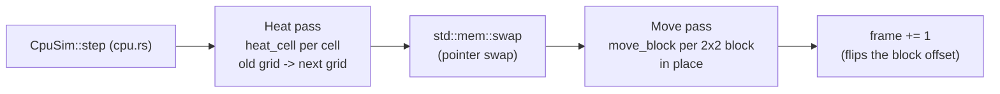
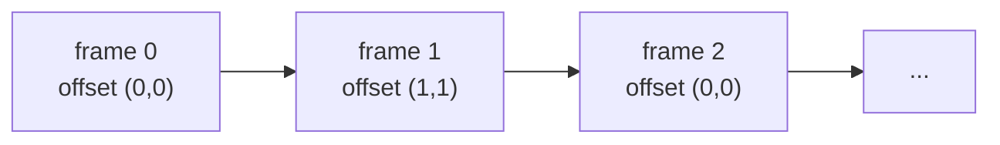
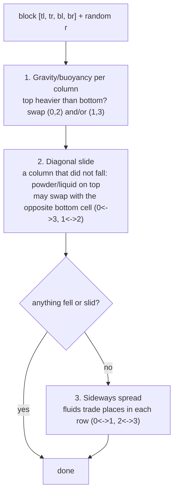

# Lesson 08: Margolus blocks and double buffering (CPU)

> [!note] This lesson teaches the `31aed2d` version of `move_block`
> The Margolus blocks, the alternating offset, the pure hash and the double buffering are unchanged, and the code you build here keeps working. What commit `07fcf0b` changed inside the block rules:
> - Moving cells (sand, water, oil, lava, steam) store a **speed level** in their `aux` byte, and gravity accelerates it in the per-cell heat pass, not in `move_block`.
> - A column swaps with chance $p = 2s/(1+s)$ for speed $s$ (`move_chance`), instead of "density gap / top density".
> - A cell pushed out of the way loses its speed (`displace`), and only resting cells slide or spread.
>
> See "What changed later (07fcf0b)" at the end of this lesson, and [[16-real-units-velocity-clock]].

> Sources: commit `31aed2d`, files `sand/src/physics/mod.rs` (`pcg`, `hash3`, `move_block`, `block_offset`) and `sand/src/physics/cpu.rs` (`CpuSim::step`). The original engine is in `sand/src/main.rs` at `8da72fa`.

---

## 1. What you will build

So far the game has run on one engine, the one from lesson 03. It scans the grid cell by cell and lets each cell move to a nearby spot. It works, but that design cannot run in parallel: not on 8 CPU cores, and not on thousands of GPU threads.

This lesson builds the core of the **second engine**, the one that later runs on rayon (lesson 09) and on the GPU (lessons 10-14). By the end you will have:

- a `move_block` function that rearranges one **2x2 block** of cells: gravity, diagonal sliding and sideways spreading,
- a `step` that cuts the grid into blocks, **shifts the block grid by one cell every other step**, and runs `move_block` on every block,
- randomness that is a **pure hash of (block x, block y, frame)**, so the same start always gives the same world,
- a **double-buffered** pass (read the old grid, write a new grid, then swap them), which the real engine uses for heat,
- a test showing that the same seed gives the same world, bit for bit.

Where it sits in the project:



Lesson 07 covered what happens *inside* `heat_cell` (fixed-point temperature, phase changes). Here we care about *how the passes are organised*, and why that organisation is what lets them run in parallel.

---

## 2. Concepts

### 2.1 The core fact: parallel work needs separate writes and a fixed order of reads

Two facts hold every time, with no exceptions:

1. **If two pieces of work write to the same memory, their result depends on which one runs first.** Run them at the same time and you get a data race. Rust refuses to compile that in safe code.
2. **If a piece of work reads memory that another piece of work writes in the same pass, its result depends on the order they run in.** In that case you cannot reorder the work, so you cannot run it in parallel.

So a pass can run in any order, and therefore in parallel, exactly when **every task writes only memory no other task touches, and reads only memory nobody writes during the pass**. The rest of this lesson is two ways to arrange that:

| Pass | Trick | Why the writes don't clash |
|---|---|---|
| Move pass | Margolus 2x2 blocks | each block reads and writes only its own 4 cells |
| Heat pass | double buffering | every cell reads the old grid and writes only its own slot in the new grid |

### 2.2 Why the original engine is inherently sequential

This is the heart of the original `step` (`sand/src/main.rs`, `8da72fa`):

```rust
// Bottom to top, so a falling grain is not processed twice.
let left_to_right = self.frame % 2 == 0;
for y in (0..H as i32).rev() {
    for i in 0..W as i32 {
        let x = if left_to_right { i } else { W as i32 - 1 - i };
        let idx = y as usize * W + x as usize;
        if self.moved[idx] {
            continue;
        }
        match self.cells[idx] {
            Cell::Sand | Cell::Gunpowder => self.update_sand(x, y),
            ...
```

and `try_move` does `self.cells.swap(a, b); self.moved[b] = true;`.

It breaks both rules from 2.1:

- **Writes clash.** The grain at `(x, y)` may write to `(x-1, y+1)`, `(x, y+1)` or `(x+1, y+1)`. Its neighbour at `(x+2, y)` may write to `(x+1, y+1)` too. Two grains, one empty cell.
- **Reads depend on order.** Whether a grain can fall depends on whether the cell below was *already emptied this frame* by the cell processed before it. The `moved` flags exist because the scan order matters: without them a grain that falls one row would be found again on the next row and fall again in the same frame.
- **The random generator is shared state.** `random(&mut self)` updates `self.rng` (xorshift). The 1000th random number depends on how many calls came before it. Process cells in a different order and every cell gets different dice.

You cannot fix this by adding locks. The *answer itself* is defined by the scan order. Change the order and you have a different simulation.

### 2.3 The Margolus neighbourhood

The fix, from cellular-automaton research (Norman Margolus, 1980s): **don't let a cell move anywhere. Cut the grid into 2x2 blocks and let each block shuffle only its own 4 cells.**

```
 block (bx, by) covers cells:

   x     x+1
 +-----+-----+
 |  0  |  1  |  y        index 0 = top-left,    1 = top-right
 +-----+-----+
 |  2  |  3  |  y+1      index 2 = bottom-left, 3 = bottom-right
 +-----+-----+
```

The blocks tile the grid with no overlap. A block reads 4 cells and writes back the same 4 cells, so no two blocks ever touch the same memory. By 2.1 that means **the blocks can run in any order, or all at once, and give the same result.**

There is an obvious problem. If the blocks never change, a grain at the bottom of its block can never leave it. The fix is to **shift the whole block grid by one cell diagonally on every other step**:

```
 even frame: offset (0,0)            odd frame: offset (1,1)

   0 1 2 3 4 5 6 7                     0 1 2 3 4 5 6 7
 0 [A A][B B][C C][D D]              0  . [A A][B B][C C] .
 1 [A A][B B][C C][D D]              1  . [A A][B B][C C] .
 2 [E E][F F][G G][H H]              2  . [D D][E E][F F] .
 3 [E E][F F][G G][H H]              3  . [D D][E E][F F] .
 4 [I I][J J][K K][L L]              4  . [G G][H H][I I] .
 5 [I I][J J][K K][L L]              5  . [G G][H H][I I] .
                                     (row 0, column 0 and the last
                                      row/column sit out this step)
```

The seam between rows 1 and 2 is a block border on even frames, but on odd frames it is the *middle* of a block. A grain sitting at row 1 that could not fall on an even frame gets a block spanning rows 1-2 on the next odd frame, and falls. Material takes two steps to cross two rows, so one row per step on average, the same speed as the old engine.



The project's whole rule for the offset:

```rust
// sand/src/physics/mod.rs @ 31aed2d
/// Which corner the block grid starts at in this step: (0,0) or (1,1).
pub fn block_offset(frame: u32) -> usize {
    (frame & 1) as usize
}
```

`frame & 1` is the lowest bit of the frame counter: 0 on even frames, 1 on odd frames.

### 2.4 The three sub-rules inside a block

`move_block` takes a block as an array of 4 packed cells and a random `u32`. It applies three rules in order:



The real code (at `31aed2d`):

```rust
// sand/src/physics/mod.rs @ 31aed2d
pub fn move_block(cells: &mut [u32; 4], r: u32) {
    let r2 = pcg(r);
    let mut fell = [false; 2];

    // 1. Gravity and buoyancy, in each column: heavy above light trades places.
    for col in 0..2 {
        let (top, bottom) = (col, col + 2);
        if sinks(cells[top], cells[bottom], (r >> (col * 8)) & 255) {
            cells.swap(top, bottom);
            fell[col] = true;
        }
    }

    // 2. Could not fall straight down: powders and liquids slide diagonally,
    //    with a chance set by their friction / viscosity.
    let mut slid = false;
    for col in 0..2 {
        if fell[col] {
            continue;
        }
        let (top, diagonal) = (col, 3 - col);
        let m = material(cells[top]) as usize;
        if KIND[m] != POWDER && KIND[m] != LIQUID {
            continue;
        }
        let roll = (r >> (16 + col * 8)) & 255;
        if roll < FLOW[m] && sinks(cells[top], cells[diagonal], 0) {
            cells.swap(top, diagonal);
            slid = true;
        }
    }

    // 3. Nothing fell: fluids spread sideways. This levels out liquids.
    if !fell[0] && !fell[1] && !slid {
        for row in 0..2 {
            let (left, right) = (row * 2, row * 2 + 1);
            if spreads(cells[left], cells[right], (r2 >> (row * 8)) & 255) {
                cells.swap(left, right);
            }
        }
    }
}
```

Things to notice:

- **Index arithmetic replaces geometry.** Column `col` has top `col` and bottom `col + 2`. The diagonal partner of top cell `col` is `3 - col`: top-left (0) pairs with bottom-right (3), and top-right (1) pairs with bottom-left (2). Row `row` has left `row * 2` and right `row * 2 + 1`.
- **One `u32` provides several dice.** `r` has 32 bits, cut into four 8-bit rolls (each 0..=255):

  | bits of `r` | used for |
  |---|---|
  | 0-7 | gravity, column 0 |
  | 8-15 | gravity, column 1 |
  | 16-23 | slide, column 0 |
  | 24-31 | slide, column 1 |

  `r2 = pcg(r)` gives fresh bits for the two sideways rolls. `(r >> 8) & 255` means "shift right by 8, keep the low 8 bits".
- **Probability from a roll.** At `31aed2d`, `sinks` returns `roll < ((dt - db) * 256 / dt) as u32`. With `roll` uniform on 0..=255, the chance of sinking is about
  $$P(\text{sink}) \approx \frac{d_{top} - d_{bottom}}{d_{top}}$$
  Sand (150) through air (10): $140/150 \approx 0.93$. Sand through water (100): $50/150 \approx 0.33$. That is buoyancy in one line. In step 2 the roll passed to `sinks` is `0`, so `sinks` only asks "is top heavier?". The chance comes from the `FLOW` roll instead.
- **Temperature moves for free.** Each `u32` packs material, aux and temperature (lesson 06), so swapping cells carries the heat with them.

### 2.5 Randomness as a pure function

The old engine kept `rng: u32` and changed it on every call. The new one has no generator state at all:

```rust
// sand/src/physics/mod.rs @ 31aed2d
/// PCG hash: scrambles a u32 into a random-looking u32. Pure function, so
/// the GPU (which has no shared random state) computes the same numbers.
pub fn pcg(v: u32) -> u32 {
    let state = v.wrapping_mul(747_796_405).wrapping_add(2_891_336_453);
    let word = ((state >> ((state >> 28) + 4)) ^ state).wrapping_mul(277_803_737);
    (word >> 22) ^ word
}

pub fn hash3(a: u32, b: u32, c: u32) -> u32 {
    pcg(a ^ pcg(b ^ pcg(c)))
}
```

and the call site in `CpuSim::step`:

```rust
move_block(&mut cells, hash3(bx as u32, by as u32, frame));
```

A **pure function** gives the same output for the same input and changes nothing else. So the dice for block `(bx, by)` on frame `frame` are fixed by those three numbers alone. They don't depend on which blocks ran first, on which thread ran this block, or on CPU versus GPU. That gives you:

- **parallel**: no shared `&mut rng` that every task would need to borrow,
- **deterministic**: the same start world produces the same world after $N$ steps, every time, on every machine,
- **testable**: `assert_eq!(single_thread_world, rayon_world)` and later `assert_eq!(cpu_world, gpu_world)` are real tests in `mod.rs`.

Why nest the calls (`pcg(a ^ pcg(b ^ pcg(c)))`) instead of computing `pcg(a ^ b ^ c)`? Because XOR is symmetric: `a ^ b ^ c` gives the same value for `(1, 2, 0)` and `(2, 1, 0)`, so those two blocks would always roll the same dice. Scrambling between the XORs makes every input take part separately.

### 2.6 Wrapping arithmetic: `wrapping_mul`, `wrapping_add`

In a **debug** build, Rust panics on integer overflow: `747_796_405 * v` overflows `u32` for nearly every `v`, and you get `attempt to multiply with overflow`. In release builds it silently wraps. A hash *needs* the wrap-around (arithmetic mod $2^{32}$), so the code states it explicitly:

```rust
fn main() {
    let x: u32 = 4_000_000_000;
    println!("{}", x.wrapping_add(500_000_000)); // 205032704  (= 4.5e9 mod 2^32)
    println!("{}", x.wrapping_mul(2));           // 3705032704
    // println!("{}", x + 500_000_000);          // debug build: panics
}
```

The same idea appears in `world.frame = frame.wrapping_add(1);`. After about 4 billion steps the counter goes back to 0 instead of crashing.

### 2.7 Fixed-size arrays `[u32; 4]`, `array.map`, `slice.swap`

An array `[T; N]` has its length **in its type**. `[u32; 4]` is exactly four `u32`s, stored inline on the stack, with no heap allocation (unlike `Vec`). Taking `&mut [u32; 4]` lets the compiler know the length, so `cells[3]` needs no bounds check that could fail at runtime, and a caller cannot pass in 5 cells.

```rust
fn main() {
    let idx: [usize; 4] = [10, 11, 20, 21];          // grid indices of a block
    let grid: Vec<u32> = (0..30).collect();

    // array.map: build a new array of the same length by applying a closure.
    let mut block: [u32; 4] = idx.map(|i| grid[i]);
    println!("{block:?}");                            // [10, 11, 20, 21]

    // swap: arrays coerce to slices, and slices have .swap(a, b).
    block.swap(0, 3);
    println!("{block:?}");                            // [21, 11, 20, 10]
}
```

`slice.swap(a, b)` exchanges two elements in place. You cannot write `std::mem::swap(&mut block[0], &mut block[3])`, because that takes two `&mut` borrows of the same array at once and the borrow checker rejects it (E0499). `swap(a, b)` exists for exactly this case.

The project gathers a block with `idx.map`, works on the copy, then scatters it back:

```rust
// sand/src/physics/cpu.rs @ 31aed2d
let idx = [top + x, top + x + 1, bottom + x, bottom + x + 1];
let mut cells = idx.map(|i| world.cells[i]);
move_block(&mut cells, hash3(bx as u32, by as u32, frame));
for k in 0..4 {
    world.cells[idx[k]] = cells[k];
}
```

`move_block` never learns where the block sits in the grid. It sees only 4 numbers. That makes it trivial to call from a CPU loop, a rayon task, or (copied line for line into WGSL) a GPU thread.

### 2.8 Why the loops are `for by in 0..h / 2`

```rust
// sand/src/physics/cpu.rs @ 31aed2d
let o = block_offset(frame);
for by in 0..h / 2 {
    let y = 2 * by + o;
    if y + 1 >= h {
        continue;
    }
    let (top, bottom) = (y * w, (y + 1) * w);
    for bx in 0..w / 2 {
        let x = 2 * bx + o;
        if x + 1 >= w {
            continue;
        }
        ...
```

- The loop runs over **block coordinates** `(bx, by)`, not cell coordinates. Each block is 2 cells, so there are `h / 2` block rows. `h / 2` on `usize` is integer division, which rounds down: with `h = 7` you get 3 block rows.
- The cell row is `y = 2 * by + o`. With offset 1 the last block may hang off the grid (`y + 1 == h`), so the code skips it. Without that check you get `index out of bounds`.
- Everything is `usize` because Rust indexes `Vec` and slices only with `usize`. `bx` and `by` are converted with `as u32` only at the moment they go into the hash, since `hash3` takes `u32`.
- The block coordinates, not the cell coordinates, are the hash input. Each block gets its own dice, and the result does not depend on how you visit them.

### 2.9 Double buffering and `std::mem::swap`

The heat pass is a per-cell rule: a cell's new temperature depends on its 4 neighbours. Blocks don't fit here, because every cell needs to see across every border. So the engine uses the other trick from 2.1: **read only the old grid, write only a new grid.**

Look at what goes wrong if you update in place. A toy rule: "an air cell becomes water if its left neighbour is water".

```rust
const AIR: u32 = 0;
const WATER: u32 = 3;

fn in_place(row: &mut [u32]) {
    for x in 1..row.len() {
        if row[x - 1] == WATER && row[x] == AIR {
            row[x] = WATER; // the next x reads this freshly written value!
        }
    }
}

fn double_buffered(row: &mut Vec<u32>, next: &mut Vec<u32>) {
    for x in 0..row.len() {
        next[x] = if x > 0 && row[x - 1] == WATER && row[x] == AIR { WATER } else { row[x] };
    }
    std::mem::swap(row, next);
}

fn main() {
    let mut a = vec![WATER, AIR, AIR, AIR, AIR];
    in_place(&mut a);
    println!("{a:?}"); // [3, 3, 3, 3, 3]  water crossed the whole row in ONE step

    let mut b = vec![WATER, AIR, AIR, AIR, AIR];
    let mut next = vec![0; 5];
    double_buffered(&mut b, &mut next);
    println!("{b:?}"); // [3, 3, 0, 0, 0]  one cell per step, as the rule says
}
```

In place, the answer depends on scan direction (scan right to left and the water moves one cell). Double-buffered, every cell sees the same "before" picture, so order doesn't matter and the cells can run in parallel. For heat it matters even more: lesson 07's conduction conserves energy only because the flux from $i$ to $j$ is exactly minus the flux from $j$ to $i$, and that holds only if both sides read the same old temperatures.

The project:

```rust
// sand/src/physics/cpu.rs @ 31aed2d
/// Scratch buffer for the heat pass, which needs an old and a new grid.
pub struct CpuSim {
    next: Vec<u32>,
}
...
for y in 0..h {
    for x in 0..w {
        self.next[y * w + x] = heat_cell(&world.cells, w, h, x, y, frame);
    }
}
// The new grid becomes the current one. Swapping two Vecs only swaps
// their pointers: no cells are copied.
std::mem::swap(&mut world.cells, &mut self.next);
```

**What `std::mem::swap` actually does.** A `Vec<u32>` value is a small header: a pointer to the heap buffer, a length and a capacity, 24 bytes on a 64-bit machine. The cells live on the heap. `std::mem::swap(&mut a, &mut b)` exchanges the two **headers**. The 4K grid's ~8 million cells don't move at all.

```
 before swap                        after swap
 world.cells -> [old grid data]     world.cells -> [new grid data]
 self.next   -> [new grid data]     self.next   -> [old grid data]   (garbage, overwritten next step)
```

Compare `world.cells = self.next.clone()`, which allocates and copies 32 MB every step. And `world.cells = self.next` does not compile, because it would move `next` out of `self` and leave it empty (E0507). `swap` keeps both buffers alive and reuses them forever, with zero allocations per step.

Notice also: `CpuSim::new` allocates `next` once (`vec![0; world.cells.len()]`), and `step` only overwrites it. Buffers that live across steps are a habit you will see again on the GPU (lesson 10), where allocation is far more expensive.

### 2.10 Why the move pass does *not* need a second buffer

The move pass writes straight into `world.cells`. That is safe because of the Margolus layout: during one step no block reads a cell that another block writes. The blocks are disjoint, so "old" and "new" never mix. Double buffering is the tool for **overlapping reads**; blocks are the tool for **disjoint ownership**.

---

## 3. Build it yourself

Goal: a standalone crate with a deterministic Margolus sand + water engine and tests. It has no dependencies. It is a cut-down version of the project's engine: four materials, no heat, no bit-packing, so the structure stands out. A `seed` field is added so you can watch different seeds give different but repeatable worlds.

### Step 1: make the crate

```bash
cargo new --lib margolus
cd margolus
```

We will put the engine in `src/lib.rs` and a viewer in `src/main.rs` (one package can have both; lesson 06 explained lib + bin).

### Step 2: materials, tables and the hash

Write this at the top of `src/lib.rs`:

```rust
//! A tiny Margolus falling-sand engine: sand and water, deterministic.

pub const AIR: u32 = 0;
pub const STONE: u32 = 1;
pub const SAND: u32 = 2;
pub const WATER: u32 = 3;

/// Heavier sinks through lighter. Indexed by material.
const DENSITY: [i32; 4] = [10, 255, 150, 100];
/// Chance out of 256 to slide diagonally / spread sideways.
const FLOW: [u32; 4] = [256, 0, 200, 230];

/// PCG hash: a pure function from u32 to a random-looking u32.
pub fn pcg(v: u32) -> u32 {
    let state = v.wrapping_mul(747_796_405).wrapping_add(2_891_336_453);
    let word = ((state >> ((state >> 28) + 4)) ^ state).wrapping_mul(277_803_737);
    (word >> 22) ^ word
}

pub fn hash3(a: u32, b: u32, c: u32) -> u32 {
    pcg(a ^ pcg(b ^ pcg(c)))
}
```

### Step 3: the pair rules

```rust
/// Would `top` sink into `bottom` (directly below it)?
fn sinks(top: u32, bottom: u32, roll: u32) -> bool {
    if top == STONE || bottom == STONE || bottom == SAND {
        return false; // stone never moves; liquid never pushes a sand pile aside
    }
    let (dt, db) = (DENSITY[top as usize], DENSITY[bottom as usize]);
    dt > db && roll < ((dt - db) * 256 / dt) as u32
}

/// Would two side-by-side fluids (air or water) trade places?
fn spreads(left: u32, right: u32, roll: u32) -> bool {
    let fluid = |m: u32| m == AIR || m == WATER;
    left != right && fluid(left) && fluid(right) && roll < FLOW[left as usize].min(FLOW[right as usize])
}
```

`&&` short-circuits: `roll < ...` is only evaluated when `dt > db`, so `dt - db` is always positive when it is used.

### Step 4: `move_block`

```rust
/// Rearrange one 2x2 block: [top-left, top-right, bottom-left, bottom-right].
pub fn move_block(cells: &mut [u32; 4], r: u32) {
    let r2 = pcg(r);
    let mut fell = [false; 2];

    // 1. Gravity per column.
    for col in 0..2 {
        let (top, bottom) = (col, col + 2);
        if sinks(cells[top], cells[bottom], (r >> (col * 8)) & 255) {
            cells.swap(top, bottom);
            fell[col] = true;
        }
    }

    // 2. Diagonal slide for whatever could not fall.
    let mut slid = false;
    for col in 0..2 {
        if fell[col] {
            continue;
        }
        let (top, diagonal) = (col, 3 - col);
        let m = cells[top];
        if m != SAND && m != WATER {
            continue;
        }
        let roll = (r >> (16 + col * 8)) & 255;
        if roll < FLOW[m as usize] && sinks(cells[top], cells[diagonal], 0) {
            cells.swap(top, diagonal);
            slid = true;
        }
    }

    // 3. Nothing moved down: fluids spread sideways.
    if !fell[0] && !fell[1] && !slid {
        for row in 0..2 {
            let (left, right) = (row * 2, row * 2 + 1);
            if spreads(cells[left], cells[right], (r2 >> (row * 8)) & 255) {
                cells.swap(left, right);
            }
        }
    }
}
```

### Step 5: the world and the Margolus step

```rust
#[derive(Clone, Debug, PartialEq, Eq)]
pub struct World {
    pub width: usize,
    pub height: usize,
    pub cells: Vec<u32>,
    pub frame: u32,
    pub seed: u32,
}

impl World {
    pub fn new(width: usize, height: usize, seed: u32) -> Self {
        let mut w = World { width, height, cells: vec![AIR; width * height], frame: 0, seed };
        w.fill(0, height - 1, width, height, STONE); // floor
        w
    }

    pub fn fill(&mut self, x0: usize, y0: usize, x1: usize, y1: usize, m: u32) {
        for y in y0..y1.min(self.height) {
            for x in x0..x1.min(self.width) {
                self.cells[y * self.width + x] = m;
            }
        }
    }

    pub fn count(&self, m: u32) -> usize {
        self.cells.iter().filter(|&&c| c == m).count()
    }

    /// One Margolus step. Every block touches only its own 4 cells.
    pub fn step(&mut self) {
        let (w, h, frame) = (self.width, self.height, self.frame);
        let o = (frame & 1) as usize; // block grid offset: 0 or 1
        for by in 0..h / 2 {
            let y = 2 * by + o;
            if y + 1 >= h {
                continue;
            }
            for bx in 0..w / 2 {
                let x = 2 * bx + o;
                if x + 1 >= w {
                    continue;
                }
                let idx = [y * w + x, y * w + x + 1, (y + 1) * w + x, (y + 1) * w + x + 1];
                let mut block = idx.map(|i| self.cells[i]);
                let r = pcg(hash3(bx as u32, by as u32, frame) ^ self.seed);
                move_block(&mut block, r);
                for k in 0..4 {
                    self.cells[idx[k]] = block[k];
                }
            }
        }
        self.frame = frame.wrapping_add(1);
    }

    pub fn render(&self) -> String {
        let mut s = String::new();
        for y in 0..self.height {
            for x in 0..self.width {
                s.push(match self.cells[y * self.width + x] {
                    AIR => '.',
                    STONE => '#',
                    SAND => 's',
                    WATER => '~',
                    _ => '?',
                });
            }
            s.push('\n');
        }
        s
    }
}
```

`#[derive(PartialEq, Eq)]` is what lets a test write `assert_eq!(world_a, world_b)`: it compares every field, including all of `cells`.

`|&&c| c == m` in `count`: `iter()` yields `&u32`, and `filter`'s closure receives a reference to that, `&&u32`. The pattern `&&c` strips both references.

### Step 6: the tests

Append to `src/lib.rs`:

```rust
#[cfg(test)]
mod tests {
    use super::*;

    fn demo(seed: u32) -> World {
        let mut w = World::new(32, 24, seed);
        w.fill(4, 2, 12, 8, SAND);
        w.fill(18, 2, 28, 10, WATER);
        w
    }

    #[test]
    fn same_seed_same_world() {
        let (mut a, mut b) = (demo(7), demo(7));
        for _ in 0..300 {
            a.step();
            b.step();
        }
        assert_eq!(a, b);
    }

    #[test]
    fn different_seed_different_world() {
        let (mut a, mut b) = (demo(7), demo(8));
        for _ in 0..300 {
            a.step();
            b.step();
        }
        assert_ne!(a.cells, b.cells);
    }

    #[test]
    fn nothing_is_created_or_destroyed() {
        let mut w = demo(1);
        let before = [AIR, STONE, SAND, WATER].map(|m| w.count(m));
        for _ in 0..500 {
            w.step();
        }
        let after = [AIR, STONE, SAND, WATER].map(|m| w.count(m));
        assert_eq!(before, after);
    }

    #[test]
    fn sand_ends_up_below_its_start() {
        let mut w = demo(3);
        for _ in 0..500 {
            w.step();
        }
        let top_sand = (0..8 * w.width).filter(|&i| w.cells[i] == SAND).count();
        assert_eq!(top_sand, 0, "{}", w.render());
    }
}
```

`nothing_is_created_or_destroyed` is a property that Margolus gives you **by construction**: `move_block` only ever calls `swap`, so each block holds the same 4 values in a different order. The extra message argument to `assert_eq!` (`"{}", w.render()`) prints the world if the test fails, which is much easier to debug than a number.

Run them:

```bash
cargo test
```

```
test tests::same_seed_same_world ... ok
test tests::different_seed_different_world ... ok
test tests::nothing_is_created_or_destroyed ... ok
test tests::sand_ends_up_below_its_start ... ok
test result: ok. 4 passed; 0 failed
```

### Step 7: a viewer

`src/main.rs`:

```rust
use margolus::*;

fn main() {
    let seed: u32 = std::env::args().nth(1).and_then(|s| s.parse().ok()).unwrap_or(42);
    let steps: usize = std::env::args().nth(2).and_then(|s| s.parse().ok()).unwrap_or(200);
    let mut w = World::new(40, 20, seed);
    w.fill(5, 1, 15, 7, SAND);
    w.fill(22, 1, 34, 9, WATER);
    w.fill(18, 14, 20, 19, STONE); // a little wall
    println!("frame 0\n{}", w.render());
    for _ in 0..steps {
        w.step();
    }
    println!("frame {} (seed {seed})\n{}", w.frame, w.render());
    println!("sand {} water {}", w.count(SAND), w.count(WATER));
}
```

`cargo run -- 42 200` ends like this (the exact pattern is fixed by the seed):

```
......sssssss.....##~...~..~~~~.~~.~...~
.....ssssssssss~~.##~~~~~~~~~~~~~~~~~~~~
....ssssssssssss~~##~~~~~~~~~~~~~~~~~~~~
....sssssssssssss~##~~~~~~~~~~~~~~~~~~~~
...ssssssssssssss~##~~~~~~~~~~~~~~~~~~~~
########################################

sand 60 water 96
```

A sand pile with sloped sides, water levelled behind the wall, and a little water that seeped around the left side of the wall into the pile's corner.

---

## 4. Live examples

**A. Determinism you can see.** Run `cargo run -- 42 200` twice and the output is identical. Run `cargo run -- 43 200` and you get a different but equally repeatable world. Run `cargo run -- 42 199` and then `-- 42 200` to see a single step.

**B. Freeze the offset.** In `step`, change `let o = (frame & 1) as usize;` to `let o = 0;` and run. The sand falls one row and stops: each grain is stuck inside its starting block forever. Change it back. This is the single best demonstration of why the offset alternates.

**C. Turn the dials.** Edit `DENSITY` and `FLOW`:
- `FLOW[SAND] = 40` gives steep piles (high friction). `FLOW[SAND] = 256` makes sand slide almost like a liquid.
- `DENSITY[WATER] = 160` (heavier than sand) still won't let water push into sand, because `sinks` refuses `bottom == SAND`. Remove that check and watch water tunnel down through the pile.
- `FLOW[WATER] = 20` makes thick syrup that levels out very slowly.

**D. The real engine.** In this repo, from `sand/`:

```bash
cargo test --lib single_thread_and_rayon_give_identical_worlds   # CpuSim::step == step_parallel
cargo test --lib conduction_conserves_heat                        # the double-buffered heat pass
cargo run --release --bin physics                                 # the window; G switches backends
```

The first test is the payoff of this lesson: the single-thread and all-core versions produce the same `World` after 200 steps, `assert_eq!` on every cell.

---

## 5. Exercises

1. **(easy) Block offsets on paper.** For a 6x6 grid, list the top-left cell `(x, y)` of every block on frame 0 and on frame 1. Which cells sit out on frame 1?
   *Hint:* `x = 2*bx + o`, skip when `x + 1 >= w`.

2. **(easy) Prove the frozen-offset bug with a test.** Write a test that fills row 0 of an 8x8 world with sand, then calls `step` 100 times while forcing `w.frame = 0` before each call. Assert that no sand got below row 1.
   *Hint:* setting `frame` to 0 before every step keeps the offset at 0.

3. **(medium) Order doesn't matter.** Write `step_reversed`, identical to `step` except that both loops run backwards (`(0..h / 2).rev()`, `(0..w / 2).rev()`). Add a test that runs `step` on one world and `step_reversed` on a clone for 300 steps and asserts they are equal. Then explain why the same test would fail for the original engine.
   *Hint:* change only the two `for` lines.

4. **(medium) A double-buffered pass: wet sand.** Add `WET_SAND = 4` (density 170, flow 60, so it makes steeper piles). Before the move pass, run a `wet_pass` that turns `SAND` into `WET_SAND` if any of its 4 neighbours is `WATER`, reading `self.cells` and writing a `next: Vec<u32>` field, then swap with `std::mem::swap`. Which existing test now fails, and why is that correct?
   *Hint:* extend both tables to length 5, treat `WET_SAND` like `SAND` in `sinks` and in the slide check, and allocate `next` once in `new`.

5. **(medium) Show that in-place breaks the rule.** Write `flood_in_place` and `flood_double` from section 2.9 as library functions and test both on `[WATER, AIR, AIR, AIR, AIR]`. Then reverse the in-place loop direction and check its answer changes.
   *Hint:* `for x in (1..row.len()).rev()`.

6. **(stretch) Parallel without rayon.** Write `step_threads`, which splits `self.cells[o * w..]` into chunks of `2 * w` (one row of blocks each) with `chunks_mut`, and processes each chunk on its own thread inside `std::thread::scope`. Test that it equals `step` after 300 steps. (Lesson 09 does this properly with rayon.)
   *Hint:* inside a chunk, block `bx` has local indices `[x, x + 1, w + x, w + x + 1]`. Skip a chunk shorter than `2 * w`. Copy `seed` into a local before the scope so the closures don't need `self`.

---

## 6. Common mistakes and compiler errors

**`error[E0308]: mismatched types: expected u32, found usize`** at `hash3(bx, by, frame)`. Loop variables over `0..h / 2` are `usize` because `h` is. The hash takes `u32`. Convert at the call: `hash3(bx as u32, by as u32, frame)`. The reverse also comes up: indexing with a `u32` gives `the type [u32] cannot be indexed by u32` (E0277). Use `m as usize`, as in `DENSITY[top as usize]`.

**`thread 'main' panicked at 'attempt to multiply with overflow'`** in `pcg`. You wrote `v * 747_796_405`. Debug builds check overflow. Use `wrapping_mul` / `wrapping_add`.

**`index out of bounds: the len is 768 but the index is 800`** in `step`. You dropped the `if y + 1 >= h { continue; }` (or the `x` version) check. With offset 1 the last block row or column hangs over the edge, and with an odd width or height even offset 0 leaves a cell over.

**`error[E0499]: cannot borrow block[_] as mutable more than once at a time`** from `std::mem::swap(&mut block[0], &mut block[3])`. Use `block.swap(0, 3)`.

**`error[E0507]: cannot move out of self.next which is behind a mutable reference`** from `world.cells = self.next;`. You cannot take a field out of something you only borrow. Use `std::mem::swap(&mut world.cells, &mut self.next)`. (`std::mem::take` also works but leaves an empty Vec, so you would allocate again next step.)

**`std::mem::swap(&mut self.cells, &mut self.next)` compiles, but `let c = &self.cells; std::mem::swap(&mut self.cells, ...)` does not** (E0502). Two different fields can be borrowed `&mut` at the same time. The same field cannot be borrowed shared and mutable at once. Make sure all reads of the old grid are finished before you swap.

**A "deterministic" test that fails only sometimes.** Something outside `(bx, by, frame, seed)` is feeding the randomness: a `static mut` counter, `rand::thread_rng()`, the time, or a `HashMap` iteration order. Every random decision must come from the hash.

**Sand falls one row and freezes.** The offset is not alternating: you forgot `self.frame = frame.wrapping_add(1)`, or computed the offset from something constant.

**Liquids drift to one side over time.** Usually the same roll bits are reused for two decisions (for example, gravity and slide for the same column both reading bits 0-7). Give every decision its own 8 bits, or take fresh bits from `pcg(r)`.

**Clippy says `needless_range_loop`** on `for k in 0..4 { world.cells[idx[k]] = cells[k]; }`. It's only a style lint. `for (i, c) in idx.into_iter().zip(cells) { world.cells[i] = c; }` is the iterator form. The project keeps the indexed loop because it mirrors the WGSL shader line by line.

---

## 7. Recap

- The original engine reads cells that other cells already moved this frame, writes to cells other cells may also write, and pulls numbers from a shared, changing RNG. Its result *is* its scan order, so it cannot be parallelised.
- **Margolus blocks**: a 2x2 block reads and writes only its own 4 cells, so all blocks are independent. **Alternating the offset** between (0,0) and (1,1) each frame (`frame & 1`) lets material cross block borders.
- Inside a block: **gravity/buoyancy** per column (chance $\approx (d_t - d_b)/d_t$ at `31aed2d`; a speed-based chance since `07fcf0b`), then a **diagonal slide** gated by `FLOW`, then **sideways spread** if nothing moved down. Only `swap`s are used, so matter is conserved by construction.
- **Randomness is a pure hash** `hash3(bx, by, frame)` with `wrapping_*` arithmetic. Results are independent of visiting order, which is what makes parallel equal sequential, and CPU equal GPU.
- **Double buffering** for per-cell rules that read neighbours: read old, write new, then `std::mem::swap` the two `Vec`s (a 24-byte header swap, no copying). Allocate the scratch buffer once.
- Rust tools: `[u32; 4]` (length in the type), `array.map`, `slice.swap`, `std::mem::swap`, `wrapping_mul`/`wrapping_add`, `usize` for indices with `as u32` at the hash boundary.

**Next, lesson 09: Parallel CPU with rayon.** You'll take `CpuSim::step` and turn it into `step_parallel`: `par_chunks_mut(w)` hands each heat-pass row to a thread, `par_chunks_mut(2 * w)` hands each row of blocks to a thread, and the borrow checker proves the chunks don't overlap. The test `single_thread_and_rayon_give_identical_worlds` already tells you it will work, because of everything in this lesson.

---

## What changed later (07fcf0b)

The block machinery of this lesson survived `07fcf0b` untouched: 2x2 blocks, `block_offset(frame)`, `hash3(bx, by, frame)` for the dice, the move pass in place and the heat pass double-buffered. What changed is the *physics inside* the blocks. At `31aed2d` a grain of sand fell with a fixed 93% chance per step, forever: no acceleration, and no link to real time. `07fcf0b` gives moving cells a real speed. Details in [[16-real-units-velocity-clock]].

**The `aux` byte now holds a speed.** Sand, water, oil, lava and steam store a speed level 0..=255 in `aux`. Level 256 would be one cell per step, 5 mm × 1200/s = 6 m/s. Fire and smoke keep using `aux` as their life.

```rust
// sand/src/physics/mod.rs @ 07fcf0b
pub const fn has_speed(m: u32) -> bool {
    matches!(m, SAND | WATER | OIL | LAVA | STEAM)
}
pub const fn speed(cell: u32) -> u32 {
    if has_speed(material(cell)) { aux(cell) } else { 0 }
}
/// Gravity adds this much speed per step, in 1/256 of a level
/// (9.81 m/s^2 * 1/1200 s = 8.2 mm/s per step = 0.349 levels = 89/256).
pub const G_Q: i32 = (GRAVITY * STEP_SECONDS / MAX_SPEED * 65536.0) as i32;
```

**Gravity moved into the per-cell (heat) pass.** Why not accelerate inside `move_block`? Because of the alternating offset from section 2.3: a cell is the *top* cell of a block column only every other step (unless it keeps moving, see below). Accelerating there would add $g\,\Delta t$ on some steps and not others. The heat pass visits every cell every step and already reads the cell below from the old grid, so it is the right place for "$v \mathrel{+}= g\,\Delta t$":

```rust
// sand/src/physics/mod.rs @ 07fcf0b, inside heat_cell
if has_speed(m) {
    let roll = (r >> 20) & 255;
    let (free, other) = if sinker(m) {
        (below.is_some_and(|b| sinks(me, b)), below)
    } else {
        (above.is_some_and(|a| sinks(a, me)), above) // steam rises
    };
    life = match (free, other) {
        (true, Some(o)) => {
            let (heavy, light) = if sinker(m) { (me, o) } else { (o, me) };
            maybe = true; // the random rounding of the speed-up
            accelerate(me, heavy, light, o, roll)
        }
        (_, Some(o)) => blocked_speed(me, o), // no faster than what is in the way
        (_, None) => 0,                       // the world's edge stops it
    };
}
```

`accelerate` adds `G_Q * (heavy - light) / heavy` (buoyancy, the same Archimedes fraction as section 2.4, but now applied to the *acceleration*), rounds the 1/256 part at random, and caps the speed at a terminal velocity (`VT_LIQUID` when moving through a liquid, about 0.1 m/s for sand in water, or `VT_GAS`).

**Speed becomes a chance: $p = 2s/(1+s)$.** In the move pass the column swap now fires with a chance set by the moving body's speed:

```rust
pub fn move_chance(s: u32) -> u32 {
    512 * s / (256 + s)
}
```

Why not just $p = s$? Write $s$ as a fraction of a cell per step. If the top cell moves down one row, the offset flips at the same time, so next step it is a top cell again. If it does not move, next step it is a bottom cell and must wait one step. Let $T$ be the fraction of steps spent as a top cell: $T = Tp + (1 - T)$ gives $T = 1/(2-p)$. The mean speed is $pT = p/(2-p)$. Setting that equal to $s$ gives

$$p = \frac{2s}{1+s}$$

so the cell covers exactly $s$ cells per step on average. With levels out of 256 that is `512 * s / (256 + s)`. At $s = 256$ (6 m/s) $p = 1$, every step. The test `free_fall_takes_the_right_time` drops grains 1.19 m and checks they land within 10% of $\sqrt{2h/g} = 0.493$ s.

Fire, smoke and hot air have no stored speed. `pair_chance` gives them `move_chance(GAS_RISE * (dt - db) / dt)`, with `GAS_RISE = 42` (1 m/s at a full density gap).

**`displace` instead of `swap`.** A cell that is shoved aside did not choose that motion, so it loses its speed:

```rust
fn displace(cells: &mut [u32; 4], mover: usize, pushed: usize) {
    if has_speed(material(cells[pushed])) {
        cells[pushed] = with_aux(cells[pushed], 0);
    }
    cells.swap(mover, pushed);
}
```

Gravity and diagonal slides use `displace`. Sideways spreading still uses a plain `swap`, and it, like the diagonal slide, only happens for cells at rest (`speed == 0`, see `can_slide` and `spread_chance`): a falling drop does not also spread. `FLOW` is now a speed level too (water 42 = 1 m/s) and is still used as a roll threshold out of 256.

**The rolls.** `move_block` slices `r` exactly as in the table of section 2.4 (bits 0-15 gravity per column, 16-31 slides, `r2 = pcg(r)` for spreading); only the threshold changed from a density fraction to `pair_chance`. The per-cell pass has its own number, `r = pcg(i ^ pcg(frame ^ CELL_SALT))`: the low 20 bits round gas relaxation, bits 20-27 round the gravity speed-up, `r & 127` / `r & 31` give fire and smoke lives, and `pcg(r) % 64 == 0` is the life tick. Heat conduction uses a separate hash per grid edge (lesson 07's last section).

---

<details><summary>Solution 1: block offsets on a 6x6 grid</summary>

Frame 0 (`o = 0`): `bx, by` in `0..3`, `x = 2*bx`, `y = 2*by`. Top-left corners: `(0,0) (2,0) (4,0) / (0,2) (2,2) (4,2) / (0,4) (2,4) (4,4)`, 9 blocks, every cell covered.

Frame 1 (`o = 1`): `x = 2*bx + 1` is 1, 3, 5, and `x = 5` fails `x + 1 < 6`, so it is skipped. The same goes for `y`. Corners: `(1,1) (3,1) / (1,3) (3,3)`, 4 blocks. Cells sitting out: row 0, column 0, row 5 and column 5, which is 20 cells. (The project's real worlds have a stone floor and walls at the edges anyway.)

</details>

<details><summary>Solution 2: frozen-offset test</summary>

```rust
#[test]
fn frozen_offset_traps_sand() {
    let mut w = World::new(8, 8, 1);
    w.fill(0, 0, 8, 1, SAND);
    for _ in 0..100 {
        w.frame = 0; // offset stays (0,0) forever
        w.step();
    }
    let rows: Vec<usize> = (0..64).filter(|&i| w.cells[i] == SAND).map(|i| i / 8).collect();
    assert!(rows.iter().all(|&r| r <= 1), "{}", w.render());
}
```

Every grain starts in a block covering rows 0-1, and with the offset fixed no block ever covers rows 1-2, so row 1 is as far as it gets.

</details>

<details><summary>Solution 3: reversed block order</summary>

```rust
impl World {
    pub fn step_reversed(&mut self) {
        let (w, h, frame) = (self.width, self.height, self.frame);
        let o = (frame & 1) as usize;
        for by in (0..h / 2).rev() {
            let y = 2 * by + o;
            if y + 1 >= h { continue; }
            for bx in (0..w / 2).rev() {
                let x = 2 * bx + o;
                if x + 1 >= w { continue; }
                let idx = [y * w + x, y * w + x + 1, (y + 1) * w + x, (y + 1) * w + x + 1];
                let mut block = idx.map(|i| self.cells[i]);
                move_block(&mut block, pcg(hash3(bx as u32, by as u32, frame) ^ self.seed));
                for k in 0..4 { self.cells[idx[k]] = block[k]; }
            }
        }
        self.frame = frame.wrapping_add(1);
    }
}

#[test]
fn block_order_does_not_matter() {
    let mut a = World::new(32, 24, 5);
    a.fill(4, 2, 12, 8, SAND);
    a.fill(18, 2, 28, 10, WATER);
    let mut b = a.clone();
    for _ in 0..300 { a.step(); b.step_reversed(); }
    assert_eq!(a, b);
}
```

It passes because blocks are disjoint and each block's dice depend only on `(bx, by, frame, seed)`. In the original engine, reversing the scan would (a) let a grain be found again after it fell, (b) change which of two grains gets a contested empty cell, and (c) hand every cell a different number from the shared xorshift stream. Any one of those changes the world.

</details>

<details><summary>Solution 4: wet sand with a double-buffered pass</summary>

Changes to `src/lib.rs`:

```rust
pub const WET_SAND: u32 = 4;
const DENSITY: [i32; 5] = [10, 255, 150, 100, 170];
const FLOW: [u32; 5] = [256, 0, 200, 230, 60];

// in sinks:
if top == STONE || bottom == STONE || bottom == SAND || bottom == WET_SAND {
    return false;
}

// in move_block step 2:
if m != SAND && m != WET_SAND && m != WATER {
    continue;
}

// World gets a scratch buffer, allocated once:
pub struct World { /* ...existing fields... */ pub next: Vec<u32> }
// in new():
let mut w = World { width, height, cells: vec![AIR; width * height], frame: 0, seed,
                    next: vec![AIR; width * height] };

// in render(): WET_SAND => 'S',
```

The pass, called at the top of `step`:

```rust
fn wet_pass(&mut self) {
    let (w, h) = (self.width, self.height);
    for y in 0..h {
        for x in 0..w {
            let i = y * w + x;
            let c = self.cells[i];
            let wet_nb = (x > 0 && self.cells[i - 1] == WATER)
                || (x + 1 < w && self.cells[i + 1] == WATER)
                || (y > 0 && self.cells[i - w] == WATER)
                || (y + 1 < h && self.cells[i + w] == WATER);
            self.next[i] = if c == SAND && wet_nb { WET_SAND } else { c };
        }
    }
    std::mem::swap(&mut self.cells, &mut self.next);
}

pub fn step(&mut self) {
    self.wet_pass();
    // ...the Margolus move pass, unchanged...
}
```

The `x > 0 &&` guards come before `i - 1` so the `usize` subtraction never underflows (`&&` short-circuits).

`nothing_is_created_or_destroyed` now fails: sand really does turn into wet sand, so the count of `SAND` drops. That is correct. Fix the test by counting `SAND + WET_SAND` together. In the viewer, the sand touching the water turns into `S`.

</details>

<details><summary>Solution 5: in-place vs double-buffered flood</summary>

```rust
pub fn flood_in_place(row: &mut [u32]) {
    for x in 1..row.len() {
        if row[x - 1] == WATER && row[x] == AIR { row[x] = WATER; }
    }
}

pub fn flood_double(row: &mut Vec<u32>, next: &mut Vec<u32>) {
    for x in 0..row.len() {
        next[x] = if x > 0 && row[x - 1] == WATER && row[x] == AIR { WATER } else { row[x] };
    }
    std::mem::swap(row, next);
}

#[test]
fn flood() {
    let start = vec![WATER, AIR, AIR, AIR, AIR];
    let mut a = start.clone();
    flood_in_place(&mut a);
    assert_eq!(a, vec![WATER; 5]);                      // whole row in one step

    let mut b = start.clone();
    let mut next = vec![0; 5];
    flood_double(&mut b, &mut next);
    assert_eq!(b, vec![WATER, WATER, AIR, AIR, AIR]);   // exactly one cell
}
```

With `for x in (1..row.len()).rev()` the in-place version gives `[3, 3, 0, 0, 0]`: same rule, different scan order, different answer. The double-buffered version gives `[3, 3, 0, 0, 0]` no matter which way you loop.

</details>

<details><summary>Solution 6: parallel with std::thread::scope</summary>

```rust
impl World {
    pub fn step_threads(&mut self) {
        let (w, frame, seed) = (self.width, self.frame, self.seed);
        let o = (frame & 1) as usize;
        std::thread::scope(|s| {
            for (by, rows) in self.cells[o * w..].chunks_mut(2 * w).enumerate() {
                s.spawn(move || {
                    if rows.len() < 2 * w { return; } // lone last row: no partner
                    for bx in 0..w / 2 {
                        let x = 2 * bx + o;
                        if x + 1 >= w { continue; }
                        let idx = [x, x + 1, w + x, w + x + 1];
                        let mut block = idx.map(|i| rows[i]);
                        move_block(&mut block, pcg(hash3(bx as u32, by as u32, frame) ^ seed));
                        for k in 0..4 { rows[idx[k]] = block[k]; }
                    }
                });
            }
        });
        self.frame = frame.wrapping_add(1);
    }
}

#[test]
fn threads_match_serial() {
    let mut a = World::new(32, 24, 9);
    a.fill(4, 2, 12, 8, SAND);
    a.fill(18, 2, 28, 10, WATER);
    let mut b = a.clone();
    for _ in 0..300 { a.step(); b.step_threads(); }
    assert_eq!(a, b);
}
```

Why it compiles: `chunks_mut` hands out non-overlapping `&mut [u32]` slices, so each thread owns its own rows and the borrow checker knows no two threads share a cell. `std::thread::scope` guarantees every thread finishes before the scope ends, which is what allows borrowing `self.cells` (non-`'static` data) from spawned threads. Slicing from `o * w` makes chunk `by` start at cell row `2 * by + o`, so `by` is the same block row number the serial `step` hashes. That is why the two versions match bit for bit. One thread per block row is wasteful. Rayon's work-stealing pool (lesson 09) does the same split efficiently.

</details>
