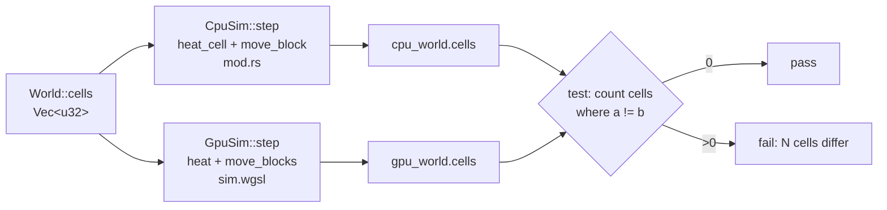

# Lesson 11: The WGSL port and bit-exact determinism

> Source for this lesson: commit `31aed2d`. Read the two files side by side:
> `git show 31aed2d:sand/src/physics/mod.rs` (the Rust rules) and
> `git show 31aed2d:sand/src/physics/sim.wgsl` (the GPU copy).

## 1. What you will build

Lesson 10 gave you the wgpu plumbing: a device, buffers, a compute pipeline, and a way to read results back. That plumbing runs whatever shader you give it. This lesson is about the shader: **`sim.wgsl`, a line-by-line WGSL copy of the Rust rules `heat_cell` and `move_block`**. It is written so that the GPU produces exactly the same `u32` in every cell as the CPU does, after hundreds of steps.



The guarantee comes from one fact you should keep in mind for the whole lesson:

> **Integer operations on fixed-width integers are fully defined, and they are defined the same way in Rust and in WGSL.** If every step of the computation is an integer operation, in the same order, then the two machines *must* agree. Floats are different: the result can depend on the hardware and the compiler.

The rest of the lesson builds on that.

By the end you will have:
- read WGSL fluently enough to check `sim.wgsl` against `mod.rs`,
- a small standalone crate (`wgsl-port`) with a Rust rule, its WGSL copy, and a test that checks they agree bit for bit,
- seen what breaks determinism and what the failing test looks like.

---

## 2. Concepts

### 2.1 WGSL for a Rust programmer

WGSL (WebGPU Shading Language) looks a lot like Rust on purpose. Most of what you know carries over. These are the differences that matter here.

#### Scalar types

| Rust | WGSL | Notes |
|---|---|---|
| `u32` | `u32` | literals need the `u` suffix in mixed contexts: `0u`, `0xFu` |
| `i32` | `i32` | a plain literal such as `5` is an "abstract int" that turns into whatever type the context needs |
| `bool` | `bool` | |
| `f32` | `f32` | we never use it in the simulation (see §2.4) |
| `usize` | none | indices are `u32` or `i32`. Rust's `m as usize` just disappears |
| `[T; N]` | `array<T, N>` | |
| — | `vec3<u32>` | small vectors with `.x .y .z` |

WGSL has **no implicit conversions**. `u32 + i32` is a compile error, just like in Rust. Conversions look like function calls: `u32(x)`, `i32(x)`. Those convert the *value*. `bitcast<T>(x)` keeps the *bits* (more on that below).

#### `let`, `var`, `const`

```wgsl
const T_SCALE: i32 = 256;   // compile-time constant, like Rust `const`
let w = params.width;       // immutable, like Rust `let`
var flux = 0;               // mutable, like Rust `let mut`
```

So Rust's `let` is WGSL's `let`, and Rust's `let mut` is WGSL's `var`. A `var` declared without a value starts at zero (`var js: array<u32, 4>;` is four zeros). Rust never lets you read an uninitialised variable. WGSL zero-fills it instead.

#### `var<private>` tables: indexing with a runtime value

In Rust, the material tables are `const` arrays and we index them with a value computed at runtime:

```rust
// sand/src/physics/mod.rs @ 31aed2d
pub const COND: [i32; MATERIAL_COUNT] = [15, 100, 40, 120, 40, 80, 20, 40, 80, 150, 15];
let k_self = COND[m as usize];
```

The WGSL spec only lets you index a `const` array with a value known at compile time. Some compilers accept `COND[m]` with a runtime `m` anyway, and some reject it. The portable fix is to make the table a module-scope variable in the `private` address space. That means every invocation gets its own copy, which it can index freely:

```wgsl
// sand/src/physics/sim.wgsl @ 31aed2d
// `var<private>` (not `const`) so they can be indexed with a runtime value.
var<private> KIND: array<u32, 11> = array<u32, 11>(GAS, SOLID, POWDER, LIQUID, LIQUID, LIQUID, GAS, SOLID, GAS, SOLID, GAS);
var<private> COND: array<i32, 11> = array<i32, 11>(15, 100, 40, 120, 40, 80, 20, 40, 80, 150, 15);
```

The same rule applies to local arrays. `idx` and `cells` in `move_blocks` are indexed with a loop counter, so they are declared as `let`/`var` locals, not `const`.

#### Resources: `@group`, `@binding`, address spaces

A shader cannot see your Rust variables. It sees **bindings**: slots that the Rust side fills with buffers through a bind group (lesson 10).

```wgsl
@group(0) @binding(0) var<uniform> params: Params;
@group(0) @binding(1) var<storage, read> cells_in: array<u32>;
@group(0) @binding(2) var<storage, read_write> cells_out: array<u32>;
```

- `@group(0) @binding(1)` is the address. It must match the `BindGroupLayoutEntry { binding: 1, .. }` in `gpu.rs`.
- `var<uniform>` is small, read-only data that every thread reads (width, height, frame). Uniform structs have strict layout rules, which is why `Params` has a `_pad: u32` that makes it 16 bytes.
- `var<storage, read>` is a big buffer the shader can only read. In Rust terms it behaves like `&[u32]`.
- `var<storage, read_write>` is a big buffer the shader can write. In Rust terms it behaves like `&mut [u32]`, except that thousands of threads hold it at once and **nothing stops two of them writing the same element**. The algorithm has to rule that out. Heat writes only `cells_out[i]` for its own `i`, and each block writes only its own 4 cells.
- `array<u32>` with no length is a *runtime-sized* array. Its length is the size of the bound buffer.

`gpu.rs` mirrors this on the Rust side:

```rust
// sand/src/physics/gpu.rs @ 31aed2d
storage(1, true),   // read_only: true  -> var<storage, read>
storage(2, false),  // read_only: false -> var<storage, read_write>
```

#### Entry points: `@compute`, `@workgroup_size`, `@builtin`

```wgsl
@compute @workgroup_size(16, 16)
fn heat(@builtin(global_invocation_id) id: vec3<u32>) {
    let x = id.x;
    let y = id.y;
    if (x >= w || y >= h) { return; }
    ...
}
```

- `@compute` marks a function that the Rust side can name as an `entry_point`.
- `@workgroup_size(16, 16)` says the GPU runs threads in tiles of 16×16 = 256. Rust dispatches `ceil(w/16) × ceil(h/16)` tiles (`self.width.div_ceil(WORKGROUP)`), so the grid is covered with a little overhang.
- `@builtin(global_invocation_id)` is this thread's coordinate across the whole dispatch. **The function body is the inside of the CPU's `for y { for x { ... } }`**. The loops are gone because the GPU runs every `(x, y)` at once.
- The overhang is why the early `return` exists. A 250-wide grid still gets 256 threads per row, and threads 250..255 must do nothing.

#### Built-in functions you will see

| WGSL | Rust equivalent |
|---|---|
| `min(a, b)`, `max(a, b)` | `a.min(b)`, `a.max(b)` |
| `clamp(t, lo, hi)` | `t.clamp(lo, hi)` |
| `select(f, t, cond)` | `if cond { t } else { f }` (note: **false value first**) |
| `bitcast<i32>(u)` | `u as i32` (same bits) |
| `bitcast<u32>(i)` | `i as u32` (same bits) |
| `i32(u)` / `u32(i)` | value conversion. For the values used here it gives the same result as `as` |

`select` catches people out because of its argument order:

```wgsl
next = select(SAND, STONE, supported);   // supported ? STONE : SAND
```
```rust
next = if supported { STONE } else { SAND };
```

### 2.2 Mapping each Rust construct to WGSL

Rust has features that WGSL lacks: `match` with guards, closures, methods on integers, `swap`. Porting means rewriting each one into something WGSL has, **without changing what is computed or in what order**.

#### `wrapping_mul` → plain `*`

Rust panics on `u32` overflow in debug builds, so the hash spells out that it wants wrapping:

```rust
// mod.rs @ 31aed2d
pub fn pcg(v: u32) -> u32 {
    let state = v.wrapping_mul(747_796_405).wrapping_add(2_891_336_453);
    let word = ((state >> ((state >> 28) + 4)) ^ state).wrapping_mul(277_803_737);
    (word >> 22) ^ word
}
```

In WGSL, integer arithmetic always wraps (two's complement, modulo $2^{32}$). It never traps:

```wgsl
// sim.wgsl @ 31aed2d
// u32 arithmetic in WGSL wraps around, like wrapping_mul / wrapping_add in Rust.
fn pcg(v: u32) -> u32 {
    let state = v * 747796405u + 2891336453u;
    let word = ((state >> ((state >> 28u) + 4u)) ^ state) * 277803737u;
    return (word >> 22u) ^ word;
}
```

Both compute $\text{state} = (v \cdot 747796405 + 2891336453) \bmod 2^{32}$, so the bits match exactly. `hash3` is a composition of `pcg` and `^`, so it matches as well. One trap remains: WGSL's `+` on `i32` also wraps silently, while Rust's panics in debug. Any overflow you never noticed on the CPU (because you only ran release builds) will not show up on the GPU either. Both wrap in release, so they still agree.

Note `(state >> 28u) + 4u` is at most 19, so the shift amount is always valid. WGSL takes shift counts modulo 32 for `u32`, and Rust panics in debug on a shift ≥ 32. Keep shift counts in range and the question never comes up.

#### `match` with guards → `if / else if` chains

```rust
// mod.rs @ 31aed2d (excerpt)
match m {
    WATER if t >= celsius(100) => next = STEAM,
    WATER if t <= celsius(-2) => next = ICE,
    ICE if t >= celsius(1) => next = WATER,
    LAVA if t < celsius(800) => next = if supported { STONE } else { SAND },
    ...
    _ => {}
}
```

```wgsl
// sim.wgsl @ 31aed2d (excerpt)
if (m == WATER) {
    if (t >= celsius(100)) { next = STEAM; } else if (t <= celsius(-2)) { next = ICE; }
} else if (m == ICE) {
    if (t >= celsius(1)) { next = WATER; }
} else if (m == LAVA) {
    if (t < celsius(800)) { next = select(SAND, STONE, supported); }
}
```

A Rust `match` tries its arms top to bottom and takes the first one that matches, including the guard. The two `WATER` arms become an outer `m == WATER` test with an inner `if / else if`, which gives the same first-match-wins order. WGSL does have a `switch`, but its cases cannot carry guards, so a chain of `if`s is the most direct translation.

#### Closures → a loop over a small array

The Rust heat pass uses a closure that captures `flux` and `touches_water` mutably and runs once per existing neighbour:

```rust
// mod.rs @ 31aed2d
let mut neighbour = |j: usize| {
    let mn = material(cells[j]);
    let k = k_self.min(COND[mn as usize]);
    flux += (temp(cells[j]) - t0) * k / 1024;
    touches_water |= mn == WATER;
};
if x > 0 { neighbour(i - 1); }
if x + 1 < w { neighbour(i + 1); }
if y > 0 { neighbour(i - w); }
if y + 1 < h { neighbour(i + w); }
```

WGSL has no closures. The port collects the neighbour indices into a small array, **in the same order**, and loops over them:

```wgsl
// sim.wgsl @ 31aed2d
var js: array<u32, 4>;
var n = 0u;
if (x > 0u) { js[n] = i - 1u; n += 1u; }
if (x + 1u < w) { js[n] = i + 1u; n += 1u; }
if (y > 0u) { js[n] = i - w; n += 1u; }
if (y + 1u < h) { js[n] = i + w; n += 1u; }
for (var k = 0u; k < n; k += 1u) {
    let other = cells_in[js[k]];
    let mn = material(other);
    let c = min(k_self, COND[mn]);
    flux += (temp(other) - t0) * c / 1024;
    touches_water = touches_water || mn == WATER;
}
```

The order matters even though integer `+` is associative. Each term is divided *before* it is added, so the terms themselves are what must match. Keeping the same order is the habit that keeps you safe once the order does matter (it would with floats, or with a clamp inside the loop).

The tiny Rust closure `let fluid = |k: u32| k == GAS || k == LIQUID;` inside `spreads` becomes a plain function, `fn is_fluid(k: u32) -> bool`.

#### `cells.swap(a, b)` → three assignments

```wgsl
let c = cells[top]; cells[top] = cells[bottom]; cells[bottom] = c;
```

#### `idx.map(|i| world.cells[i])` → a loop

```wgsl
var cells: array<u32, 4>;
for (var k = 0u; k < 4u; k += 1u) {
    cells[k] = cells_out[idx[k]];
}
```

#### `as i32` reinterpretation → `bitcast`

```rust
pub const fn temp(cell: u32) -> i32 { (cell as i32) >> 12 }
```
```wgsl
// >> on an i32 is an arithmetic shift: it keeps the sign.
fn temp(cell: u32) -> i32 { return bitcast<i32>(cell) >> 12u; }
```

Rust's `u32 as i32` keeps the same 32 bits and reads them as a signed number. WGSL's `i32(u)` is a *value* conversion. The spec defines it as bit-preserving too, but `bitcast` says "same bits" outright, so use it. In WGSL the right-hand side of a shift must be `u32` even when the left side is `i32`, hence `12u`.

#### Index bounds

`cells[i + w]` in Rust panics if it is out of range. In WGSL an out-of-bounds read returns *some* value (often 0 or a clamped index) and an out-of-bounds write may be dropped. **The GPU never panics, so an indexing bug shows up as wrong cells, not a crash.** That is one more reason the equality test is the safety net. Look at how `supported` is ported:

```rust
let supported = y + 1 >= h || KIND[material(cells[i + w]) as usize] >= POWDER;
```
```wgsl
var supported = true;
if (y + 1u < h) {
    supported = KIND[material(cells_in[i + w])] >= POWDER;
}
```

In Rust, `||` stops early, so `cells[i + w]` is never read on the bottom row. WGSL's `||` also stops early, but the port uses an explicit `if` so that nobody can misread it.

### 2.3 The rules that make CPU and GPU agree bit for bit

Every rule below follows from the fact stated at the top: same integer operations in the same order give the same bits.

1. **Integer-only maths.** Temperatures are fixed point, $T_{\text{stored}} = 256 \cdot T_{°C}$ (`T_SCALE = 256`). Densities, flow chances and conductivities are small integers. Probabilities are "roll < k out of 256".

2. **Signed division truncates toward zero, on both sides.** Rust's `i32 / i32` rounds toward zero: $-7/2 = -3$. WGSL's `i32 / i32` does the same. The conduction term
   $$\Delta = \left\lfloor \frac{(T_j - T_i)\cdot k}{1024} \right\rfloor_{\to 0}$$
   is therefore identical, and it is also exactly antisymmetric: the heat flowing $j \to i$ is minus the heat flowing $i \to j$, so conduction conserves heat (the `conduction_conserves_heat` test). If you "optimise" `/ 1024` into `>> 10`, you get *floor* division instead ($-7 \gg 1 = -4$). That breaks heat conservation, and if you change only one side it breaks CPU/GPU equality too.

3. **Right shift on a signed integer is arithmetic.** It copies the sign bit down, in both languages. That is how `temp()` gets a negative temperature back out of bits 12–31. Without it, $-40\,°C$ would come out as a huge positive number.

4. **Identical hash.** No `rand` crate, no running RNG state. Every random number is `hash3(position, frame)`, a pure function. The GPU has thousands of threads with no shared state, so this is the only kind of randomness it can reproduce, and the CPU uses the same kind. The *inputs* must match too: heat uses `hash3(x, y, frame ^ 0xA511E9B3)`, and the move pass uses `hash3(bx, by, frame)` with **block** coordinates (not cell coordinates) on both sides.

5. **Identical evaluation order inside a block.** `move_block` runs three phases in order: fall per column, then slide diagonally, then spread sideways. Each phase reads the cells the previous phase changed. The WGSL keeps the same phases, the same `col` loop order, and the same bit slices of `r` and `r2` (`(r >> (col * 8)) & 255` and so on).

6. **No data races.** Heat reads only `cells_in` and writes only `cells_out[i]`. The move pass reads and writes only its own 2×2 block. So the result does not depend on which GPU threads happen to run first, and it also does not depend on rayon's scheduling on the CPU.

7. **No floats.** That is the subject of the next section.

### 2.4 Why floats would break this

Suppose the conduction used `f32`: `flux += (tj - ti) * k;`. Each of these can make the GPU disagree with the CPU in the last bit:

- **FMA (fused multiply-add).** `a * b + c` can be computed with one rounding (FMA) or with two (multiply, round, add, round). GPU compilers fuse freely. Rust on x86-64 normally does not. The results differ in the last bit, and that bit decides whether `t >= celsius(100)` is true. Once one cell boils on one machine and not on the other, the difference spreads through the grid within a few steps.
- **Precision is not guaranteed.** WGSL only requires that many float operations are accurate to within some ULPs, not correctly rounded. Division, `exp` and `sqrt` may differ between vendors.
- **Denormals and rounding modes.** GPUs may flush subnormal numbers to zero, and the CPU does not.
- **Reordering.** Shader compilers may reassociate float sums, and $(a+b)+c \ne a+(b+c)$ in floating point.

With floats you could at best test that the two results are *close*. In a chaotic simulation even "close" fails after a few hundred steps, so you would end up with no test at all. Integers let the test demand **equality**, and an equality test catches any typo in the port.

### 2.5 The testing strategy

```rust
// sand/src/physics/mod.rs @ 31aed2d
#[test]
fn gpu_gives_identical_world_to_cpu() {
    let mut cpu_world = scene(4, 256, 160);
    let mut gpu_world = cpu_world.clone();
    let mut gpu = match gpu::GpuSim::new(&gpu_world) {
        Ok(g) => g,
        Err(e) => {
            eprintln!("no GPU adapter, skipping: {e}");
            return;
        }
    };
    run(&mut cpu_world, 200);
    gpu.step(200);
    gpu.download(&mut gpu_world);
    assert_eq!(cpu_world.frame, gpu_world.frame);
    let diff = (0..cpu_world.cells.len()).filter(|&i| cpu_world.cells[i] != gpu_world.cells[i]).count();
    assert_eq!(diff, 0, "{diff} cells differ between CPU and GPU");
}
```

Design choices worth copying:

- **A busy scene** (`scene(4)`, "benchmark"). It contains every material and every phase change, so every branch of both shaders runs. A test on an empty world would pass even with a broken port.
- **Many steps (200).** A bug in a rare branch (fire burning out, smoke dying) needs time to fire. Because the simulation is chaotic, one wrong cell spreads into many, which makes the bug easy to see.
- **Compare every cell, report the count.** `assert_eq!(a, b)` on two 40,960-element `Vec`s would print a wall of numbers. A count is easy to read. *0* means pass. *A handful* points to a rare branch or an edge (look at boundaries). *Nearly all* points to something global, such as a wrong constant, the wrong hash input or a wrong bit layout.
- **Check `frame` too.** If one side ran 199 steps, every cell would differ, and this assert tells you why.
- **Skip, don't fail, when there is no GPU.** CI machines often have no adapter. `GpuSim::new` returns `Result`, so the test can print a message and return.

#### The maintenance risk

The material tables (`KIND`, `DENSITY`, `FLOW`, `COND`), the constants (`T_SCALE`, `AMBIENT`, `T_MIN/T_MAX`), the bit layout and every rule now exist **twice**: once in Rust and once in WGSL. Nothing in the compiler connects them. Change `DENSITY[OIL]` in `mod.rs` and forget `sim.wgsl`, and both files still compile and the game still looks plausible. Both files carry a warning comment ("keep the two in sync"), but the real protection is `gpu_gives_identical_world_to_cpu`. Run `cargo test` after every rule change. (Exercise 6 shows a way to generate the WGSL tables from Rust so they cannot drift.)

---

## 3. Build it yourself

Goal: a standalone crate with a small 1-D "heat" rule in Rust, its WGSL port, and an equality test. It uses the same patterns as the real project at a smaller size: packed cell, signed temperature, `pcg`/`hash3`, a closure that becomes a loop, a `match` that becomes an `if` chain, and a table indexed at runtime.

A cell packs `kind` (bits 0–3) and a signed temperature (bits 4–31). Each step, heat flows to the two neighbours. A hash-driven random cold snap removes 500 units from about 3 in 256 cells. Then the kind is recomputed from the temperature.

### Step 1: create the crate

```sh
cargo new --lib wgsl-port
cd wgsl-port
```

`Cargo.toml` (same crate versions as the sand project):

```toml
[package]
name = "wgsl-port"
version = "0.1.0"
edition = "2024"

[dependencies]
bytemuck = { version = "1.25.2", features = ["derive"] }
pollster = "1.0.1"
wgpu = "30.0.1"
```

### Step 2: the Rust rule (the reference): `src/lib.rs`

```rust
pub const COLD: u32 = 0;
pub const WARM: u32 = 1;
pub const HOT: u32 = 2;

pub const COND: [i32; 3] = [40, 120, 200];

pub fn kind(cell: u32) -> u32 {
    cell & 0xF
}
pub fn temp(cell: u32) -> i32 {
    (cell as i32) >> 4 // arithmetic shift keeps the sign
}
pub fn pack(k: u32, t: i32) -> u32 {
    k | ((t.clamp(-100_000, 100_000) as u32) << 4)
}

pub fn pcg(v: u32) -> u32 {
    let state = v.wrapping_mul(747_796_405).wrapping_add(2_891_336_453);
    let word = ((state >> ((state >> 28) + 4)) ^ state).wrapping_mul(277_803_737);
    (word >> 22) ^ word
}

pub fn hash3(a: u32, b: u32, c: u32) -> u32 {
    pcg(a ^ pcg(b ^ pcg(c)))
}

/// The rule for one cell. Reads only `cells` (the old row).
pub fn step_cell(cells: &[u32], i: usize, frame: u32) -> u32 {
    let n = cells.len();
    let t0 = temp(cells[i]);
    let k_self = COND[kind(cells[i]) as usize];

    let mut flux = 0;
    let mut neighbour = |j: usize| {
        let c = k_self.min(COND[kind(cells[j]) as usize]);
        flux += (temp(cells[j]) - t0) * c / 1024;
    };
    if i > 0 {
        neighbour(i - 1);
    }
    if i + 1 < n {
        neighbour(i + 1);
    }
    let mut t = t0 + flux;

    let r = hash3(i as u32, frame, 7);
    if r & 255 < 3 {
        t -= 500;
    }

    let next = match t {
        t if t >= 2000 => HOT,
        t if t >= 0 => WARM,
        _ => COLD,
    };
    pack(next, t)
}

pub fn cpu_steps(cells: &mut Vec<u32>, steps: u32) {
    let mut next = vec![0; cells.len()];
    for frame in 0..steps {
        for i in 0..cells.len() {
            next[i] = step_cell(cells, i, frame);
        }
        std::mem::swap(cells, &mut next);
    }
}

pub mod gpu;

/// A reproducible starting row: temperatures from -2000 to 3999.
pub fn start_row(n: usize) -> Vec<u32> {
    (0..n)
        .map(|i| {
            let t = (hash3(i as u32, 0, 99) % 6000) as i32 - 2000;
            pack(WARM, t)
        })
        .collect()
}
```

### Step 3: the WGSL port: `src/rule.wgsl`

Put the Rust file on the left of your screen and port it line by line:

```wgsl
struct Params {
    n: u32,
    frame: u32,
    _pad0: u32, // uniforms are laid out in 16-byte chunks
    _pad1: u32,
}

@group(0) @binding(0) var<uniform> params: Params;
@group(0) @binding(1) var<storage, read> cells_in: array<u32>;
@group(0) @binding(2) var<storage, read_write> cells_out: array<u32>;

const COLD: u32 = 0u;
const WARM: u32 = 1u;
const HOT: u32 = 2u;

// var<private> so it can be indexed with a runtime value
var<private> COND: array<i32, 3> = array<i32, 3>(40, 120, 200);

fn kind(cell: u32) -> u32 { return cell & 0xFu; }
fn temp(cell: u32) -> i32 { return bitcast<i32>(cell) >> 4u; }
fn pack(k: u32, t: i32) -> u32 {
    return k | (bitcast<u32>(clamp(t, -100000, 100000)) << 4u);
}

fn pcg(v: u32) -> u32 {
    let state = v * 747796405u + 2891336453u;
    let word = ((state >> ((state >> 28u) + 4u)) ^ state) * 277803737u;
    return (word >> 22u) ^ word;
}

fn hash3(a: u32, b: u32, c: u32) -> u32 {
    return pcg(a ^ pcg(b ^ pcg(c)));
}

@compute @workgroup_size(64)
fn step(@builtin(global_invocation_id) id: vec3<u32>) {
    let i = id.x;
    let n = params.n;
    if (i >= n) {
        return; // overhang threads of the last workgroup
    }
    let me = cells_in[i];
    let t0 = temp(me);
    let k_self = COND[kind(me)];

    // the closure becomes: collect neighbours in the same order, then loop
    var js: array<u32, 2>;
    var count = 0u;
    if (i > 0u) { js[count] = i - 1u; count += 1u; }
    if (i + 1u < n) { js[count] = i + 1u; count += 1u; }

    var flux = 0;
    for (var k = 0u; k < count; k += 1u) {
        let other = cells_in[js[k]];
        let c = min(k_self, COND[kind(other)]);
        flux += (temp(other) - t0) * c / 1024;
    }
    var t = t0 + flux;

    let r = hash3(i, params.frame, 7u);
    if ((r & 255u) < 3u) {
        t -= 500;
    }

    // the match with guards becomes an if chain, same order
    var next = COLD;
    if (t >= 2000) {
        next = HOT;
    } else if (t >= 0) {
        next = WARM;
    }
    cells_out[i] = pack(next, t);
}
```

### Step 4: the GPU runner: `src/gpu.rs`

This is lesson 10's plumbing in its shortest form. It uses `layout: None`, which tells wgpu to work out the bind group layout from the shader, and it does one submit per step so that each step sees its own `frame`.

```rust
#[repr(C)]
#[derive(Clone, Copy, bytemuck::Pod, bytemuck::Zeroable)]
struct Params {
    n: u32,
    frame: u32,
    _pad0: u32,
    _pad1: u32,
}

/// Run `steps` steps of rule.wgsl on the GPU and return the final row.
pub fn gpu_steps(start: &[u32], steps: u32) -> Result<Vec<u32>, String> {
    pollster::block_on(run(start, steps))
}

async fn run(start: &[u32], steps: u32) -> Result<Vec<u32>, String> {
    use wgpu::util::DeviceExt;

    let instance = wgpu::Instance::new(wgpu::InstanceDescriptor::new_without_display_handle());
    let adapter = instance
        .request_adapter(&wgpu::RequestAdapterOptions::default())
        .await
        .map_err(|e| e.to_string())?;
    let (device, queue) = adapter
        .request_device(&wgpu::DeviceDescriptor::default())
        .await
        .map_err(|e| e.to_string())?;

    let shader = device.create_shader_module(wgpu::ShaderModuleDescriptor {
        label: Some("rule.wgsl"),
        source: wgpu::ShaderSource::Wgsl(include_str!("rule.wgsl").into()),
    });
    // layout: None asks wgpu to work the bind group layout out from the shader.
    let pipeline = device.create_compute_pipeline(&wgpu::ComputePipelineDescriptor {
        label: Some("step"),
        layout: None,
        module: &shader,
        entry_point: Some("step"),
        compilation_options: Default::default(),
        cache: None,
    });

    let bytes = (start.len() * 4) as u64;
    let usage = wgpu::BufferUsages::STORAGE | wgpu::BufferUsages::COPY_SRC | wgpu::BufferUsages::COPY_DST;
    let cells = [
        device.create_buffer_init(&wgpu::util::BufferInitDescriptor {
            label: Some("cells0"),
            contents: bytemuck::cast_slice(start),
            usage,
        }),
        device.create_buffer(&wgpu::BufferDescriptor { label: Some("cells1"), size: bytes, usage, mapped_at_creation: false }),
    ];
    let staging = device.create_buffer(&wgpu::BufferDescriptor {
        label: Some("staging"),
        size: bytes,
        usage: wgpu::BufferUsages::MAP_READ | wgpu::BufferUsages::COPY_DST,
        mapped_at_creation: false,
    });
    let params = device.create_buffer(&wgpu::BufferDescriptor {
        label: Some("params"),
        size: size_of::<Params>() as u64,
        usage: wgpu::BufferUsages::UNIFORM | wgpu::BufferUsages::COPY_DST,
        mapped_at_creation: false,
    });

    let layout = pipeline.get_bind_group_layout(0);
    let group = |src: usize| {
        device.create_bind_group(&wgpu::BindGroupDescriptor {
            label: None,
            layout: &layout,
            entries: &[
                wgpu::BindGroupEntry { binding: 0, resource: params.as_entire_binding() },
                wgpu::BindGroupEntry { binding: 1, resource: cells[src].as_entire_binding() },
                wgpu::BindGroupEntry { binding: 2, resource: cells[1 - src].as_entire_binding() },
            ],
        })
    };
    let groups = [group(0), group(1)];

    let mut current = 0;
    for frame in 0..steps {
        // One submit per step keeps this simple: write_buffer lands before the submit that follows it.
        let p = Params { n: start.len() as u32, frame, _pad0: 0, _pad1: 0 };
        queue.write_buffer(&params, 0, bytemuck::bytes_of(&p));
        let mut encoder = device.create_command_encoder(&Default::default());
        {
            let mut pass = encoder.begin_compute_pass(&Default::default());
            pass.set_pipeline(&pipeline);
            pass.set_bind_group(0, &groups[current], &[]);
            pass.dispatch_workgroups((start.len() as u32).div_ceil(64), 1, 1);
        }
        queue.submit([encoder.finish()]);
        current = 1 - current;
    }

    let mut encoder = device.create_command_encoder(&Default::default());
    encoder.copy_buffer_to_buffer(&cells[current], 0, &staging, 0, bytes);
    queue.submit([encoder.finish()]);
    staging.map_async(wgpu::MapMode::Read, .., |r| r.expect("map failed"));
    device.poll(wgpu::PollType::wait_indefinitely()).map_err(|e| e.to_string())?;
    let out = {
        let view = staging.get_mapped_range(..).expect("mapped");
        bytemuck::cast_slice::<u8, u32>(&view).to_vec()
    };
    staging.unmap();
    Ok(out)
}
```

### Step 5: the equality test: append to `src/lib.rs`

```rust
#[cfg(test)]
mod tests {
    use super::*;

    #[test]
    fn gpu_matches_cpu_bit_for_bit() {
        let start = start_row(10_000);
        let mut cpu = start.clone();
        cpu_steps(&mut cpu, 100);
        let gpu = match gpu::gpu_steps(&start, 100) {
            Ok(v) => v,
            Err(e) => {
                eprintln!("no GPU adapter, skipping: {e}");
                return;
            }
        };
        let diff = (0..cpu.len()).filter(|&i| cpu[i] != gpu[i]).count();
        if diff > 0 {
            let first = (0..cpu.len()).find(|&i| cpu[i] != gpu[i]).unwrap();
            eprintln!("first diff at {first}: cpu {:#010x} gpu {:#010x}", cpu[first], gpu[first]);
        }
        assert_eq!(diff, 0, "{diff} cells differ between CPU and GPU");
    }

    #[test]
    fn negative_temps_survive_packing() {
        assert_eq!(temp(pack(COLD, -1234)), -1234);
    }

    #[test]
    fn division_truncates_toward_zero() {
        assert_eq!(-7 / 2, -3);  // what both Rust and WGSL `/` do
        assert_eq!(-7 >> 1, -4); // what a shift does: floor, not the same
    }
}
```

### Step 6: a `main` to look at: `src/main.rs`

```rust
use wgsl_port::*;

fn main() {
    let start = start_row(10_000);
    let mut cpu = start.clone();
    cpu_steps(&mut cpu, 100);
    let gpu = gpu::gpu_steps(&start, 100).expect("no GPU");
    let diff = (0..cpu.len()).filter(|&i| cpu[i] != gpu[i]).count();
    println!("cells: {}  differing: {diff}", cpu.len());
    println!("first 5 temps (cpu): {:?}", cpu[..5].iter().map(|&c| temp(c)).collect::<Vec<_>>());
}
```

```sh
cargo test
cargo run
```

Expected (tested on Apple Silicon / Metal):

```
cells: 10000  differing: 0
first 5 temps (cpu): [309, 317, 317, 301, 283]
```

---

## 4. Live examples

**A. Break it on purpose: shift instead of divide.** In `rule.wgsl` only, change

```wgsl
flux += (temp(other) - t0) * c / 1024;
```
to
```wgsl
flux += (temp(other) - t0) * c >> 10u;
```

and `cargo run`:

```
cells: 10000  differing: 10000
```

Every cell differs after 100 steps. Rounding only changes when the term is negative (−1 instead of 0 for small negative gaps), but that small bias reaches every cell. Put it back.

**B. Break the hash input.** Change `hash3(i, params.frame, 7u)` to `hash3(i, params.frame, 8u)`. The cold snaps now hit different cells, and the diff count jumps. This is the "nearly all cells differ" signature of a global bug.

**C. Break one rare branch.** Change `if (t >= 2000)` to `if (t > 2000)`. Only cells that land on *exactly* 2000 change kind. The kind does not feed back into `COND` here except through neighbours, so you will see a small diff count, possibly 0 on some runs. This shows why the test scene must exercise edges: a bug that only shows on exact boundary values needs many cells and many steps to surface.

**D. In the real project.**

```sh
cd sand
cargo test --release gpu_gives_identical_world_to_cpu -- --nocapture
cargo test --release single_thread_and_rayon_give_identical_worlds
```

The second test applies the same idea one level down: single-threaded vs rayon must be identical too. You can try example A in the project by editing `sand/src/physics/sim.wgsl` in a scratch branch, and you will get a message like `N cells differ between CPU and GPU`.

---

## 5. Exercises

1. **(Easy) `select` warm-up.** In `rule.wgsl`, rewrite the `if / else if` that sets `next` as a single nested `select` expression. The test must still pass.
   *Hint:* `select(false_value, true_value, cond)`. Nest the `t >= 0` choice inside the false side of the `t >= 2000` choice.

2. **(Easy) Port a new table.** Add a table `DECAY: [i32; 3] = [0, 2, 5]`. After conduction, subtract `DECAY[kind]` from `t`. Add it to both Rust and WGSL, and make sure the test passes.
   *Hint:* in WGSL it must be `var<private>`, not `const`, because `kind(me)` is a runtime value.

3. **(Medium) Port a `match` with a guard and a body.** Add a rule: a `HOT` cell whose hash roll `(r >> 8) & 255` is below 10 releases a burst, setting `t = t.max(3000)`. Write it as a `match` arm in Rust and as an `if` in WGSL.
   *Hint:* use the *old* kind (`kind(me)`) and the same bit slice of `r` on both sides. `max` exists in WGSL.

4. **(Medium) A better failure report.** Extend the test so that on failure it prints the first 5 differing indices with both values decoded (`kind`, `temp`) and the absolute temperature difference.
   *Hint:* `.filter(..).take(5)`, and `i32::abs_diff` returns a `u32`.

5. **(Hard) Find the first divergent step.** Write a test helper that, when the 100-step comparison fails, re-runs CPU and GPU one step at a time from the start and reports the first `frame` at which any cell differs. (A bug introduced at step 3 that spreads looks like a bug at step 100. This finds where it starts.)
   *Hint:* `gpu_steps(&start, k)` for `k = 1..=steps` is slow but simple. Compare it against a CPU row you advance by one step each iteration.

6. **(Stretch) Remove the duplication.** Make the Rust tables the single source of truth: generate the WGSL table declarations from Rust at runtime, and put them in front of the shader source before `create_shader_module`.
   *Hint:* `format!("var<private> COND: array<i32, {}> = array<i32, {}>({});\n", ...)`, then `ShaderSource::Wgsl((prelude + include_str!("rule.wgsl")).into())`. Delete the hand-written line from `rule.wgsl`.

---

## 6. Common mistakes and how to read the errors

**WGSL errors appear at runtime, not at `cargo build`.** `include_str!` only pastes the text in. The shader is compiled when `create_shader_module` runs, so a WGSL typo shows up as a panic while the test runs:

```
wgpu error: Validation Error
Caused by:
  In Device::create_shader_module, label = 'rule.wgsl'
    Shader 'rule.wgsl' parsing error: ...
```

Read the `label` to find the file, then the line/column caret that naga prints underneath.

| Symptom | Cause | Fix |
|---|---|---|
| `automatic conversions cannot convert ... u32 to i32` / "expected i32, found u32" | mixed `u32`/`i32`, often `x >> 12` with an `i32` shift count, or comparing a `u32` with a plain `i32` variable | shift counts are `u32` (`12u`). Convert with `i32(..)`/`u32(..)` or `bitcast` |
| error about indexing a `const` array with a non-constant index | table declared `const` | declare it `var<private>` |
| `Entry point step not found` | `entry_point: Some("...")` does not match the WGSL `fn` name, or the fn has no `@compute` | match the names exactly |
| bind group "binding 2 is not present in layout" (with `layout: None`) | the shader never *uses* binding 2, so the auto layout drops it | use the binding, or write an explicit layout like `gpu.rs` does |
| validation error about buffer binding size / uniform alignment | `Params` struct sizes differ between Rust and WGSL | add `_pad` fields so both are 16 bytes. Keep `#[repr(C)]` |
| test reports *all* cells differ | wrong constant, wrong hash input, wrong bit layout, `>>` vs `/`, or one side ran a different number of steps | check `frame` first, then constants and the hash call |
| test reports a *few* cells differ | rare branch differs, or boundary cells (`x == 0`, last row, odd widths) | print the first differing index and decode its `(x, y)` |
| GPU result has zeros or garbage near the end | dispatched too few workgroups (`n / 64` instead of `div_ceil`) or missing early `return` | use `div_ceil` and keep the bounds check |
| test passes on your machine, fails elsewhere | a float slipped in, or an out-of-bounds read whose value is implementation-defined | grep the shader for `f32` and `.0`. Check every index |
| `attempt to multiply with overflow` in Rust debug only | you wrote `v * 747_796_405` in Rust | `wrapping_mul` in Rust. WGSL wraps by default |

---

## 7. Recap

- WGSL maps closely onto Rust: `let` = `let`, `var` = `let mut`, `const` = `const`. No implicit conversions, `bitcast` for bit reinterpretation, `select(f, t, c)` for an inline `if`.
- Tables indexed at runtime are `var<private>` arrays. Inputs are `var<storage, read>`, outputs are `var<storage, read_write>`, parameters are `var<uniform>`, each at an `@group/@binding` that matches the Rust bind group layout.
- A compute entry point is the *body* of the CPU's nested loops. `global_invocation_id` replaces the loop counters, and an early `return` handles the overhang.
- Porting rewrites Rust features WGSL lacks (match guards → `if` chains, closures → loops over a small array, `swap` → three assignments, `wrapping_mul` → `*`) **while keeping the order of operations**.
- Determinism comes from integers only: truncating signed division on both sides, arithmetic right shift, a pure hash of (position, frame), no races, and no floats (FMA, loose float accuracy and reordering would all break exactness).
- The test runs both engines on a busy scene for 200 steps and reports **how many cells differ**. That number has to be zero, and it is the only thing keeping two hand-maintained copies of the rules in sync.

**Next lesson (12, Benchmarking honestly):** now that you know the GPU computes exactly the same world, you can compare speeds fairly. That means warm-up, waiting for the GPU before you stop the clock, measuring steps per second at several grid sizes, and not fooling yourself with an asynchronous `submit`.

---

## Solutions

<details><summary>Solution 1: nested select</summary>

```wgsl
let next = select(select(COLD, WARM, t >= 0), HOT, t >= 2000);
cells_out[i] = pack(next, t);
```

Delete the `var next = COLD;` and the `if` chain. The inner `select` is evaluated first, but it has no side effects, so the result is the same as the Rust `match`.
</details>

<details><summary>Solution 2: a new table</summary>

Rust (`lib.rs`):
```rust
pub const DECAY: [i32; 3] = [0, 2, 5];
// in step_cell, right after `let mut t = t0 + flux;`
t -= DECAY[kind(cells[i]) as usize];
```

WGSL (`rule.wgsl`):
```wgsl
var<private> DECAY: array<i32, 3> = array<i32, 3>(0, 2, 5);
// in step, right after `var t = t0 + flux;`
t -= DECAY[kind(me)];
```

Put it at the same point in both files. If you put it after the cold snap in one file and before in the other, the result happens to be the same here because both are plain subtractions, but get into the habit of matching positions anyway.
</details>

<details><summary>Solution 3: match arm with guard and body</summary>

Rust: introduce the old kind and a rule before computing `next`:
```rust
let k_old = kind(cells[i]);
match k_old {
    HOT if (r >> 8) & 255 < 10 => {
        t = t.max(3000);
    }
    _ => {}
}
```

WGSL:
```wgsl
let k_old = kind(me);
if (k_old == HOT) {
    if (((r >> 8u) & 255u) < 10u) {
        t = max(t, 3000);
    }
}
```

Place both directly after the cold-snap block. Keep the WGSL parentheses. Without them, naga reads `(r >> 8u) & 255u < 10u` as `(r >> 8u) & (255u < 10u)` and rejects it with `Operation And can't work with ... Uint ... and ... Bool`. Rust's `&` binds tighter than `<`, so the Rust line is fine without them.
</details>

<details><summary>Solution 4: better failure report</summary>

```rust
let bad: Vec<usize> = (0..cpu.len()).filter(|&i| cpu[i] != gpu[i]).collect();
for &i in bad.iter().take(5) {
    let (a, b) = (cpu[i], gpu[i]);
    eprintln!(
        "cell {i}: cpu kind {} temp {} | gpu kind {} temp {} | |dt| = {}",
        kind(a), temp(a), kind(b), temp(b), temp(a).abs_diff(temp(b))
    );
}
assert_eq!(bad.len(), 0, "{} cells differ between CPU and GPU", bad.len());
```
</details>

<details><summary>Solution 5: first divergent step</summary>

```rust
fn first_divergent_step(start: &[u32], steps: u32) -> Option<u32> {
    let mut cpu = start.to_vec();
    for k in 1..=steps {
        cpu_steps_from(&mut cpu, k - 1, 1); // advance CPU by exactly one step
        let gpu = gpu::gpu_steps(start, k).ok()?;
        if cpu != gpu {
            return Some(k);
        }
    }
    None
}

/// Like cpu_steps, but starting at `first_frame` (the frame number feeds the hash).
pub fn cpu_steps_from(cells: &mut Vec<u32>, first_frame: u32, steps: u32) {
    let mut next = vec![0; cells.len()];
    for frame in first_frame..first_frame + steps {
        for i in 0..cells.len() {
            next[i] = step_cell(cells, i, frame);
        }
        std::mem::swap(cells, &mut next);
    }
}
```

Then in the test, on failure: `eprintln!("first divergence at step {:?}", first_divergent_step(&start, 100));`. The key detail is that the frame number is part of the hash, so advancing the CPU "one more step" must use the right `frame`, not restart at 0. Each GPU call here creates a new device, so this is O(steps²) and slow. That is fine for a diagnostic you only run when the test fails.
</details>

<details><summary>Solution 6: generate the tables from Rust</summary>

In `rule.wgsl`, delete the `var<private> COND ...` line. In `gpu.rs`:

```rust
fn wgsl_array(name: &str, ty: &str, values: &[i32]) -> String {
    let list: Vec<String> = values.iter().map(|v| v.to_string()).collect();
    let n = values.len();
    format!("var<private> {name}: array<{ty}, {n}> = array<{ty}, {n}>({});\n", list.join(", "))
}

// in run(), replacing the create_shader_module call:
let source = wgsl_array("COND", "i32", &crate::COND) + include_str!("rule.wgsl");
let shader = device.create_shader_module(wgpu::ShaderModuleDescriptor {
    label: Some("rule.wgsl"),
    source: wgpu::ShaderSource::Wgsl(source.into()),
});
```

Module-scope declarations in WGSL can appear in any order, so putting the tables first is fine. The tables can no longer drift, but the *rules* are still written twice, so you still need the equality test. A `build.rs` could do the same at compile time. Doing it at runtime is simpler, and naga compiles the shader at runtime anyway.
</details>
