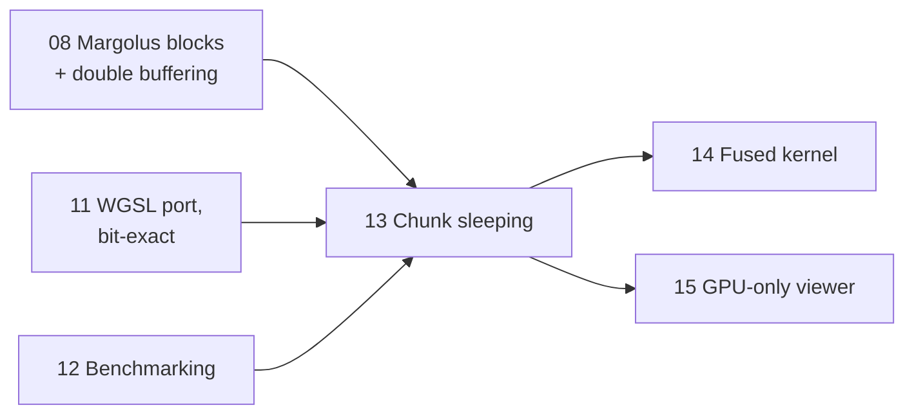

# Lesson 13: Chunk sleeping

> Source: commit `1157366` ("perf(sand): chunk sleeping on GPU and CPU, bit-exact with no sleeping").
> Files: `sand/src/physics/mod.rs` (the rule and its proof), `cpu.rs`, `gpu.rs`, `sim.wgsl`, `bin/bench.rs`.
> Read any of them with `git show 1157366:sand/src/physics/mod.rs`.

> [!note] Later commits changed parts of this
> This lesson teaches commit `1157366`, where the GPU still ran **two passes** (heat, then move) and a whole workgroup slept or ran together. Two later commits touch the sleeping code:
> - `6c1cebc` merged sleeping into the fused one-dispatch kernel of [[14-gpu-perf-fused-kernel]]. Each GPU thread now checks the chunks of its own 4 cells, and activity is stamped with atomics.
> - `07fcf0b` ([[16-real-units-velocity-clock]]) added random rounding to the heat pass. "Did the heat pass change the cell?" is no longer enough: a chunk is now active when a heat update **could change for some random number**. `heat_cell` returns `(u32, bool)`.
>
> The rule and the proof in this lesson still hold. See "What changed later" at the end for the current code.

---

## 1. What you will build

After lesson 12 we have two engines, CPU and GPU, that produce the same world bit for bit, and a benchmark that times them honestly. The benchmark exposes something wasteful: **every step touches every cell**, even when most of the world has come to rest. A 4K world where sand has settled into heaps still costs about 4.1–4.5 ms per GPU step, and almost all of that time goes to cells that come out of the step unchanged.

This lesson adds **chunk sleeping**:

- Cut the grid into fixed 32×32 **chunks**.
- Keep a little bookkeeping per chunk: was anything going on here recently?
- Skip chunks where nothing can happen. On the GPU (at `1157366`), a skipped chunk's workgroups return straight away. On the CPU, the loop moves on to the next chunk.

There is a hard requirement. **Sleeping must never change the result.** A run with sleeping must be bit-identical to a run without it. Otherwise the CPU and GPU would drift apart depending on which chunks each one skipped, and every test from lessons 11–12 would stop meaning anything.

Here are the measured results from `bench` on the author's machine:

| GPU, 3840×2160 | sleep off | sleep on | awake chunks |
|---|---|---|---|
| settled world (scene 0 after 6000 steps) | ~4.1–4.5 ms | ~0.5–1.1 ms | 471 / 8160 |
| busy benchmark scene | baseline | a bit faster | most |

Where this lesson sits:



At the end you will have written a small, self-contained falling-sand crate with dirty-chunk tracking, plus a test that proves sleeping and not sleeping give identical worlds.

---

## 2. Concepts

### 2.1 The idea, starting from scratch

One fact holds whatever else we decide:

> **A step can only change a cell if some rule that touches that cell fires.**

So if we can *prove* that no rule touching a chunk can fire this step, we may skip the chunk, and the result is the same as running it. Everything in this lesson is about making that proof cheap and airtight.

The first idea that comes to mind is: "skip a chunk if nothing in it changed last step." That idea is **wrong**, and seeing why is the key to the whole lesson.

### 2.2 Why "nothing changed last step" is not enough

Our rules are random. In `move_block` (lesson 8), a water cell above oil swaps only when the roll `r` is below some threshold. A sand grain slides diagonally only on some rolls. Look at a water/oil pair that happened not to swap for two steps in a row. Nothing changed, but the pair **is not settled. It was unlucky.** Next step the roll may come up, and they swap.

If we put that chunk to sleep, the swap never happens. The no-sleep run has the swap and the sleep run does not. The results differ, and the requirement is broken.

So the question to ask about a block is not "did it move?" but:

> **Could it move for *some* random number?**

That is `block_can_move` in `mod.rs` at `1157366`:

```rust
/// Could `move_block` change this block for SOME random number `r`?
/// `sinks(.., 0)` / `spreads(.., 0)` are true exactly when some roll would
/// make them true, ...
pub fn block_can_move(cells: &[u32; 4]) -> bool {
    let diagonal = |col: usize| {
        let m = material(cells[col]) as usize;
        (KIND[m] == POWDER || KIND[m] == LIQUID) && FLOW[m] > 0 && sinks(cells[col], cells[3 - col], 0)
    };
    sinks(cells[0], cells[2], 0)
        || sinks(cells[1], cells[3], 0)
        || diagonal(0)
        || diagonal(1)
        || spreads(cells[0], cells[1], 0)
        || spreads(cells[2], cells[3], 0)
}
```

The trick: `sinks(top, bottom, roll)` is "the densities allow it **and** `roll < threshold`". Pass `roll = 0`, the smallest possible roll. Then the test is true exactly when *some* roll would make it true. One check covers all $2^{32}$ possible random numbers.

The heat pass has a matching property, stated in the comment block. When a heat update leaves a cell unchanged, it did not depend on the random number. The random number is only used by updates that always change the cell: ignition, and fire/smoke, which change every step. So for heat (at `1157366`), "did change" really is enough. Since `07fcf0b` this is no longer true: heat uses random rounding, so a cell can come out unchanged by luck. The rule became "could change for some random number" (see "What changed later").

### 2.3 The exact rule

From the "Chunk sleeping" comment block in `sand/src/physics/mod.rs` (`1157366`):

```text
During step n a chunk is ACTIVE if
  - the heat pass changed one of its cells (new value != old value), or
  - a 2x2 block it OWNS (the chunk holding the block's top-left cell) could
    move for SOME random number (`block_can_move`), whether it moved or not.

Rule: chunk c is AWAKE in step n if c or any of its 8 neighbours was active
in step n-1 or n-2. Asleep chunks run neither pass (no reads, no writes).
```

There are three ideas inside this rule:

1. **Ownership.** A 2×2 block can straddle two chunks. We need exactly one chunk to answer for it, so the chunk holding the block's **top-left** cell owns it.
2. **Neighbours.** A block owned by the chunk on the left can reach one cell into its right neighbour, and heat reads the 4 neighbouring cells. Activity next door can therefore change our cells, which is why the 8 surrounding chunks count.
3. **Two steps of history**, not one. That gets its own section.

### 2.4 Why two steps

Two parts of the engine alternate with period 2:

- **The block offset.** `block_offset(frame) = frame & 1`. Even frames pair cells (0,1),(2,3)… and odd frames pair (1,2),(3,4)…. A block arrangement that cannot move with offset 0 might move with offset 1. Step $n$ uses the **same** offset as step $n-2$, not $n-1$. So "nothing could move in step $n-2$, and nothing changed since" is the statement that carries over to step $n$.
- **Ping-pong buffers.** The heat pass reads buffer A and writes buffer B. Next step it reads B and writes A. When we skip the heat pass for a chunk, nobody writes its cells into the output buffer. That is only correct if the output buffer **already holds** the right values. The output buffer of step $n$ is the input buffer of step $n-1$. If the chunk didn't change in step $n-1$, that buffer holds exactly the current values. Both buffers agree.

The proof in the comment is an induction on $n$. Here it is in brief. Assume $N(c)$, the 3×3 chunk neighbourhood of $c$, was inactive in steps $n-1$ and $n-2$. Then:

1. Every cell within 2 cells of $c$ is unchanged across steps $n-2$, $n-1$ and $n$. A cell like that can only be changed by its own heat update or by a block whose top-left is within 3 cells of $c$, and those blocks are all owned by chunks in $N(c)$ (because `CHUNK` $\ge 3$).
2. **Heat:** each such cell has the same inputs as in step $n-1$, where it changed nothing, and an unchanged update does not depend on the frame. So it changes nothing in step $n$.
3. **Move:** step $n$ has the same offset as step $n-2$. Every block touching $c$ sees the same cells it saw then, and it could not move then for any roll. So it cannot move now.
4. **Buffers:** the skipped heat pass would have written values the output buffer already holds.

You can check the "2" for yourself in the Build section: change `< 2` to `< 1` and the equality test fails at step 1.

### 2.5 Timestamps with wrapping arithmetic

How do we store "active in step $n-1$ or $n-2$"? We could keep two boolean arrays and shift them each step. The code does something simpler. It stores **one `u32` per chunk: the last frame in which it was active.**

```rust
fn is_awake(active: &[u32], cw: usize, ch: usize, cx: usize, cy: usize, frame: u32) -> bool {
    let last = frame.wrapping_sub(1);
    for ny in cy.saturating_sub(1)..(cy + 2).min(ch) {
        for nx in cx.saturating_sub(1)..(cx + 2).min(cw) {
            if last.wrapping_sub(active[ny * cw + nx]) < 2 {
                return true;
            }
        }
    }
    false
}
```
(`sand/src/physics/cpu.rs`, `1157366`)

**Rust concept: integer overflow.** In a debug build, `a - b` on `u32` *panics* if the result would go below 0. In a release build it silently wraps. The frame counter is a `u32` that ticks forever, so after $2^{32}$ steps it wraps to 0. `wrapping_sub` and `wrapping_add` say clearly that we *want* modular arithmetic. They behave the same in debug and release:

```rust
fn main() {
    let frame: u32 = 0;
    let stamp: u32 = u32::MAX;            // "active in the frame before 0"
    let last = frame.wrapping_sub(1);     // u32::MAX
    println!("{}", last.wrapping_sub(stamp)); // 0  -> awake
    // println!("{}", frame - 1);         // debug build: panic "attempt to subtract with overflow"
    println!("{}", 3u32.saturating_sub(5)); // 0: clamps instead of wrapping
}
```

`last.wrapping_sub(stamp) < 2` is "the stamp is `last` or `last - 1`", and it stays correct across the wrap. A very old stamp that happens to wrap around into the window after $2^{32}$ steps just wakes a chunk for nothing. Waking is always safe.

In the same function, `saturating_sub(1)` on `usize` clamps at 0, so chunk 0's "left neighbour" range starts at 0 instead of underflowing. That is the right tool for indices.

**Starting state.** "Unknown history" is written as "every chunk was active last step": `vec![world.frame.wrapping_sub(1); cw * ch]`. Everything then runs for two steps, and both ping-pong buffers get rewritten before anything sleeps.

### 2.6 Edits behind the simulator's back: a snapshot and `Option<u32>`

The viewer paints into `world.cells` between steps, and it may even swap in a whole new world. It doesn't tell the simulator. If a painted chunk was asleep, it would stay asleep, and the painted sand would hang in the air. The CPU sim guards against this with two fields:

```rust
/// The world as this simulator left it after its last step. ...
snapshot: Vec<u32>,
/// `world.frame` we expect next time; anything else means the history
/// is unknown and every chunk is woken.
expected_frame: Option<u32>,
```

**Rust concept: `Option<T>` for "maybe unknown".** `Option<u32>` is either `Some(n)` or `None`. `step_no_sleep` sets `self.expected_frame = None` because it doesn't keep the sleep bookkeeping, so afterwards *no* frame value matches. Comparing `self.expected_frame != Some(world.frame)` is a plain equality check on the enum. `None` never equals `Some(_)`, so it always triggers a reset. No sentinel value like `u32::MAX` that might collide with a real frame.

`prepare` runs before each step:

```rust
fn prepare(&mut self, world: &World, parallel: bool) {
    if (world.width, world.height) != (self.width, self.height) || self.expected_frame != Some(world.frame) {
        self.reset(world);
        return;
    }
    ...
    let stamp = world.frame.wrapping_sub(1);
    let rows = CHUNK * w;
    let detect = |(cells, (snap, active)): (&[u32], (&[u32], &mut [u32]))| {
        mark_edits(cells, snap, active, w, stamp);
    };
    ...
    world.cells.chunks(rows).zip(self.snapshot.chunks(rows).zip(self.active.chunks_mut(cw))).for_each(detect);
```

Any chunk whose cells differ from the snapshot gets stamped "active in the previous step". That wakes it and its neighbours for two steps, which is exactly the "unknown history" treatment, applied locally. `finish` copies the world into `snapshot` after the step.

**Rust concept: `chunks` / `chunks_mut` and nested `zip`.** `slice.chunks(k)` yields consecutive sub-slices of length `k` (the last may be shorter). `chunks_mut` does the same with `&mut` sub-slices that **do not overlap**, so the borrow checker lets you hold all of them at once. `a.zip(b)` walks two iterators in lockstep, yielding tuples. Zipping three streams gives a nested tuple `(x, (y, z))`, and the closure pattern destructures it in its parameter list. A tiny version:

```rust
fn main() {
    let grid = [1, 1, 2, 2, 3, 9];   // 3 "rows" of width 2
    let snap = [1, 1, 2, 2, 3, 3];
    let mut dirty = [false; 3];       // one flag per row
    grid.chunks(2)
        .zip(snap.chunks(2).zip(dirty.iter_mut()))
        .for_each(|(g, (s, d))| *d = g != s);
    println!("{dirty:?}");            // [false, false, true]
}
```

In the real code one "row" is a whole chunk row: `CHUNK * w` cells of the grid, `CHUNK * w` of the snapshot, and `cw` stamps. Swapping `chunks` for rayon's `par_chunks` / `par_chunks_mut` (lesson 9) gives the parallel version with **literally the same closure**. That is why `step` and `step_parallel` share `step_impl`.

### 2.7 The CPU passes, chunk by chunk

`heat_chunk_row` skips asleep chunks and records whether any cell changed:

```rust
for cx in 0..awake.len() {
    if !awake[cx] {
        continue; // `out` already holds these cells (mod.rs, point 4)
    }
    ...
    changed |= v != cells[y * w + x];
    ...
    if changed {
        active[cx] = frame;
    }
}
```

`move_chunk_row` does the same for blocks. It first asks `block_can_move`, and a stuck block gets **no writes at all**:

```rust
if !block_can_move(&cells) {
    continue;
}
live = true;
move_block(&mut cells, hash3(bx as u32, by as u32, frame));
```

Note that `live = true` comes *before* `move_block`. The chunk counts as active whether or not the roll made the block move. That line is §2.2 in code.

### 2.8 GPU side: early return, atomics, a tiny wake pass

(This section describes the two-pass GPU code at `1157366`. Since `6c1cebc` the GPU uses one fused dispatch with per-cell checks: see "What changed later".)

The GPU has two storage buffers, one `u32` per chunk: `chunk_active` (stamps) and `awake` (flags). Workgroups map onto chunks. A 16×16 heat workgroup is a quarter chunk, and a 16×16 move workgroup of 2×2 blocks is exactly one chunk.

**Per-workgroup early return.** From `sim.wgsl`:

```wgsl
let chunk = (wg.y / 2u) * chunks_x() + wg.x / 2u;
if (li == 0u) {
    wg_awake = awake[chunk];
    atomicStore(&wg_active, 0u);
}
if (workgroupUniformLoad(&wg_awake) == 0u) {
    return;
}
```

Thread 0 reads the flag into workgroup memory. `workgroupUniformLoad` is a barrier plus a load, and WGSL guarantees its result is **uniform**, meaning the same for every thread in the group. So the whole workgroup returns together. That matters because the shader later calls `workgroupBarrier()`, which must be reached by all threads of a workgroup or none of them.

**Atomics vs one writer per workgroup.** Many threads may find "my cell changed". If 256 threads all wrote to the global `chunk_active[chunk]`, that would be 256 global writes to one address. Instead each thread sets a **workgroup-local** flag, and only thread 0 writes the global stamp:

```wgsl
if (new_cell != old) {
    atomicStore(&wg_active, 1u);
}
workgroupBarrier();
if (li == 0u && atomicLoad(&wg_active) != 0u) {
    atomicStore(&chunk_active[chunk], params.frame);
}
```

The four heat workgroups of one chunk may each store the same value, `params.frame`, to the same stamp. That is why `chunk_active` is `array<atomic<u32>>`: concurrent stores are well defined, and since they all store the same frame it doesn't matter who wins.

**The wake pass.** After `move_blocks`, a third dispatch runs one thread per chunk and turns stamps into next step's flags. It is the WGSL twin of `is_awake`:

```wgsl
@compute @workgroup_size(8, 8)
fn wake(@builtin(global_invocation_id) id: vec3<u32>) {
    ...
            if (params.frame - atomicLoad(&chunk_active[ny * cw + nx]) < 2u) {
                a = 1u;
            }
    ...
    awake[id.y * cw + id.x] = a;
}
```

WGSL `u32` subtraction always wraps, so `params.frame - stamp` is already `wrapping_sub`. It's a separate pass because every chunk must read its neighbours' *final* stamps for this step. Inside `move_blocks` there's no guarantee that other workgroups have finished. For 8160 chunks this pass costs next to nothing.

On the Rust side (`gpu.rs`), `upload` calls `wake_all`. The GPU cannot see what you painted, so it treats everything as unknown:

```rust
fn wake_all(&self) {
    let n = (self.chunks.0 * self.chunks.1) as usize;
    let stamps = vec![self.frame.wrapping_sub(1); n];
    self.queue.write_buffer(&self.active, 0, bytemuck::cast_slice(&stamps));
    self.queue.write_buffer(&self.awake, 0, bytemuck::cast_slice(&vec![1u32; n]));
}
```

`set_sleeping(false)` simply stops dispatching `wake`, so the all-ones `awake` buffer stays all ones. `awake_chunks()` copies `awake` to a staging buffer and counts the non-zero entries. It is slow (it waits for the GPU), so it's only used in tests and benches.

### 2.9 Property tests: `block_can_move_is_never_wrong`

The whole proof rests on one claim: *if `block_can_move` says no, `move_block` changes nothing for any roll.* So the claim gets its own test (`mod.rs`, `1157366`):

```rust
#[test]
fn block_can_move_is_never_wrong() {
    let mut seen_stuck = 0;
    for s in 0..20_000u32 {
        let cells: [u32; 4] = std::array::from_fn(|k| {
            let r = hash3(s, k as u32, 77);
            let m = r % MATERIAL_COUNT as u32;
            pack(m, default_aux(m), AMBIENT + ((r >> 8) % 4096) as i32 * 4 - 8192)
        });
        if block_can_move(&cells) {
            continue;
        }
        seen_stuck += 1;
        for t in 0..64 {
            let mut moved = cells;
            move_block(&mut moved, hash3(s, t, 5));
            assert_eq!(moved, cells, "block said stuck but moved: {cells:x?}");
        }
    }
    assert!(seen_stuck > 1000);
}
```

Things to copy from it:

- `std::array::from_fn(|k| ...)` builds a fixed-size array by calling the closure with each index. It's handy for generating random inputs without `unsafe` or a mutable fill loop.
- The test generates **many random inputs** and checks a **property**, rather than a few hand-picked cases. Our own `hash3` is the generator, so the test is deterministic and needs no crate.
- `assert!(seen_stuck > 1000)` guards the test itself. If a bug made `block_can_move` always return `true`, the inner loop would never run, and the test would pass without checking anything. This line catches that.
- `{cells:x?}` prints the array in hex Debug format, which is readable for packed cells.

The other new tests check the end-to-end claim. `sleeping_gives_identical_world_to_no_sleeping` runs every scene at the odd size 257×161 (partial chunks at the edges), paints behind the sim's back at step 500, alternates `step` and `step_parallel`, and compares against `step_no_sleep`. `settled_scene_sleeps_on_cpu_and_gpu` checks that fewer than 10% of chunks stay awake, that the CPU and GPU agree chunk for chunk, and that an upload wakes everything.

---

## 3. Build it yourself

You'll build `sleepy`, a minimal Margolus sand sim (sand, walls, empty) with:

- a plain `step_no_sleep` reference,
- a `Sim` with per-chunk stamps and the exact rule above,
- tests proving the two give identical worlds.

There is no heat pass and no ping-pong buffer here. Moves happen in place, as in lesson 8. So only the *block offset* half of §2.4 applies, but it alone still forces two steps of history.

```bash
cargo new --lib sleepy
cd sleepy
```

Set `edition = "2024"` in `Cargo.toml`. No dependencies.

Write the file in this order (the complete file follows):

1. **World, hash, block rule.** `World` and `move_block` work as in lesson 8. The diagonal slide only happens on one roll in four, which gives us the "unlucky pair" from §2.2.
2. **`block_can_move`.** List every swap `move_block` could make, and test each one's precondition with the roll ignored.
3. **The reference `step_no_sleep`.** Every block, every step, with no bookkeeping.
4. **`Sim`.** Per-chunk `stamps`, `is_awake`, `paint` and a sleeping `step`.
5. **Tests.** The property test, the equality test and the "it actually sleeps" test.

Replace `src/lib.rs` with:

```rust
//! A tiny Margolus falling-sand sim with exact chunk sleeping.

/// Chunk side in cells. Must be at least 3 for the proof to hold.
pub const CHUNK: usize = 16;

#[derive(Clone, Copy, PartialEq, Eq, Debug)]
pub enum Cell {
    Empty,
    Sand,
    Wall,
}
use Cell::*;

#[derive(Clone, PartialEq, Debug)]
pub struct World {
    pub width: usize,
    pub height: usize,
    pub cells: Vec<Cell>,
    pub frame: u32,
}

impl World {
    pub fn new(width: usize, height: usize) -> Self {
        World { width, height, cells: vec![Empty; width * height], frame: 0 }
    }

    pub fn fill(&mut self, x0: usize, y0: usize, x1: usize, y1: usize, c: Cell) {
        for y in y0..y1.min(self.height) {
            for x in x0..x1.min(self.width) {
                self.cells[y * self.width + x] = c;
            }
        }
    }
}

/// A cheap integer hash: the "random number" for a block in a frame.
pub fn hash(a: u32, b: u32, c: u32) -> u32 {
    let mut h = a.wrapping_mul(0x9E37_79B9) ^ b.wrapping_mul(0x85EB_CA6B) ^ c.wrapping_mul(0xC2B2_AE35);
    h ^= h >> 16;
    h = h.wrapping_mul(0x7FEB_352D);
    h ^= h >> 15;
    h = h.wrapping_mul(0x846C_A68B);
    h ^ (h >> 16)
}

/// Block layout: [top-left, top-right, bottom-left, bottom-right].
pub fn move_block(b: &mut [Cell; 4], r: u32) {
    // Straight down, always.
    for col in 0..2 {
        if b[col] == Sand && b[col + 2] == Empty {
            b.swap(col, col + 2);
        }
    }
    // Diagonal slide, only on one roll in four.
    if r % 4 == 0 {
        if b[0] == Sand && b[3] == Empty {
            b.swap(0, 3);
        } else if b[1] == Sand && b[2] == Empty {
            b.swap(1, 2);
        }
    }
}

/// Could `move_block` change this block for SOME roll `r`?
pub fn block_can_move(b: &[Cell; 4]) -> bool {
    (b[0] == Sand && b[2] == Empty)
        || (b[1] == Sand && b[3] == Empty)
        || (b[0] == Sand && b[3] == Empty)
        || (b[1] == Sand && b[2] == Empty)
}

fn block_indices(w: usize, x: usize, y: usize) -> [usize; 4] {
    [y * w + x, y * w + x + 1, (y + 1) * w + x, (y + 1) * w + x + 1]
}

/// The reference: every block, every step.
pub fn step_no_sleep(world: &mut World) {
    let (w, h, frame) = (world.width, world.height, world.frame);
    let o = (frame & 1) as usize;
    for by in 0..h / 2 {
        let y = 2 * by + o;
        if y + 1 >= h {
            continue;
        }
        for bx in 0..w / 2 {
            let x = 2 * bx + o;
            if x + 1 >= w {
                continue;
            }
            let idx = block_indices(w, x, y);
            let mut b = idx.map(|i| world.cells[i]);
            move_block(&mut b, hash(bx as u32, by as u32, frame));
            for k in 0..4 {
                world.cells[idx[k]] = b[k];
            }
        }
    }
    world.frame = frame.wrapping_add(1);
}

pub struct Sim {
    cw: usize,
    ch: usize,
    /// Per chunk: the last frame in which it was active.
    stamps: Vec<u32>,
    /// Per chunk: does it run in the step being computed.
    awake: Vec<bool>,
}

impl Sim {
    pub fn new(world: &World) -> Self {
        let (cw, ch) = (world.width.div_ceil(CHUNK), world.height.div_ceil(CHUNK));
        // Unknown history: pretend every chunk was active in the last step.
        Sim { cw, ch, stamps: vec![world.frame.wrapping_sub(1); cw * ch], awake: vec![true; cw * ch] }
    }

    pub fn chunk_count(&self) -> usize {
        self.stamps.len()
    }

    /// Chunk (cx, cy) runs in step `frame` if it or a neighbour was
    /// active in step frame-1 or frame-2.
    fn is_awake(&self, cx: usize, cy: usize, frame: u32) -> bool {
        let last = frame.wrapping_sub(1);
        for ny in cy.saturating_sub(1)..(cy + 2).min(self.ch) {
            for nx in cx.saturating_sub(1)..(cx + 2).min(self.cw) {
                if last.wrapping_sub(self.stamps[ny * self.cw + nx]) < 2 {
                    return true;
                }
            }
        }
        false
    }

    pub fn awake_chunks(&self, world: &World) -> usize {
        (0..self.chunk_count()).filter(|&c| self.is_awake(c % self.cw, c / self.cw, world.frame)).count()
    }

    /// Change a cell through the simulator, so it can wake the chunk.
    pub fn paint(&mut self, world: &mut World, x: usize, y: usize, c: Cell) {
        world.cells[y * world.width + x] = c;
        self.stamps[(y / CHUNK) * self.cw + x / CHUNK] = world.frame.wrapping_sub(1);
    }

    pub fn step(&mut self, world: &mut World) {
        let (w, h, frame) = (world.width, world.height, world.frame);
        for c in 0..self.chunk_count() {
            self.awake[c] = self.is_awake(c % self.cw, c / self.cw, frame);
        }
        let o = (frame & 1) as usize;
        for by in 0..h / 2 {
            let y = 2 * by + o;
            if y + 1 >= h {
                continue;
            }
            for bx in 0..w / 2 {
                let x = 2 * bx + o;
                if x + 1 >= w {
                    continue;
                }
                // The chunk holding the top-left cell owns the block.
                let owner = (y / CHUNK) * self.cw + x / CHUNK;
                if !self.awake[owner] {
                    continue;
                }
                let idx = block_indices(w, x, y);
                let mut b = idx.map(|i| world.cells[i]);
                if !block_can_move(&b) {
                    continue; // same result as move_block, and no writes
                }
                self.stamps[owner] = frame; // active: could move, moved or not
                move_block(&mut b, hash(bx as u32, by as u32, frame));
                for k in 0..4 {
                    world.cells[idx[k]] = b[k];
                }
            }
        }
        world.frame = frame.wrapping_add(1);
    }
}

#[cfg(test)]
mod tests {
    use super::*;

    fn scene(w: usize, h: usize) -> World {
        let mut g = World::new(w, h);
        g.fill(0, h - 2, w, h, Wall);
        g.fill(w / 2, h / 2, w / 2 + 3, h - 2, Wall);
        g.fill(w / 8, h / 6, w / 3, h / 2, Sand);
        g.fill(w * 2 / 3, 2, w * 2 / 3 + 6, 30, Sand);
        g
    }

    #[test]
    fn block_can_move_is_never_wrong() {
        // 3 cell kinds, 4 cells: all 81 blocks, so this one is exhaustive.
        let all = [Empty, Sand, Wall];
        for n in 0..81 {
            let b: [Cell; 4] = std::array::from_fn(|k| all[(n / 3usize.pow(k as u32)) % 3]);
            if block_can_move(&b) {
                continue;
            }
            for r in 0..8 {
                let mut moved = b;
                move_block(&mut moved, r);
                assert_eq!(moved, b, "said stuck but moved: {b:?} r={r}");
            }
        }
    }

    #[test]
    fn sleeping_gives_identical_world_to_no_sleeping() {
        // Odd size on purpose: partial chunks at the right and bottom.
        let mut reference = scene(101, 67);
        let mut world = reference.clone();
        let mut sim = Sim::new(&world);
        for step in 0..3000 {
            if step % 700 == 699 {
                for (x, y) in [(10, 3), (90, 5), (50, 20)] {
                    reference.cells[y * reference.width + x] = Sand;
                    sim.paint(&mut world, x, y, Sand);
                }
            }
            step_no_sleep(&mut reference);
            sim.step(&mut world);
            assert_eq!(world, reference, "step {step}");
        }
    }

    #[test]
    fn settled_world_sleeps() {
        let mut world = scene(101, 67);
        let mut sim = Sim::new(&world);
        assert_eq!(sim.awake_chunks(&world), sim.chunk_count());
        for _ in 0..3000 {
            sim.step(&mut world);
        }
        assert_eq!(sim.awake_chunks(&world), 0);
    }
}
```

Run it:

```bash
cargo test
# test result: ok. 3 passed
```

A few design choices mirror the real project:

- `CHUNK = 16` here (the project uses 32 because a GPU workgroup of 16×16 blocks is 32×32 cells). The proof only needs `CHUNK >= 3`.
- `self.awake` is computed for *all* chunks **before** any block runs, because `step` writes new stamps as it goes. Reading `is_awake` mid-loop would see this step's stamps and give the wrong answer. That is the CPU version of "the GPU needs a separate wake pass".
- `paint` stamps `frame - 1`, the same "unknown history" trick as `wake_all`.

---

## 4. Live examples

### 4.1 Watch chunks fall asleep

Add `src/main.rs` to the `sleepy` crate:

```rust
use sleepy::{step_no_sleep, Cell::*, Sim, World};
use std::time::Instant;

fn main() {
    let (w, h) = (800, 480);
    let mut world = World::new(w, h);
    world.fill(0, h - 2, w, h, Wall);
    world.fill(w / 8, h / 6, w / 3, h / 2, Sand);
    let mut plain = world.clone();
    let mut sim = Sim::new(&world);

    for round in 0..10 {
        let t = Instant::now();
        for _ in 0..500 {
            sim.step(&mut world);
        }
        let sleepy_ms = t.elapsed().as_secs_f64() * 1000.0 / 500.0;
        let t = Instant::now();
        for _ in 0..500 {
            step_no_sleep(&mut plain);
        }
        let plain_ms = t.elapsed().as_secs_f64() * 1000.0 / 500.0;
        assert_eq!(world, plain);
        println!(
            "steps {:>5}: awake {:>4}/{}  sleep {:.3} ms  no-sleep {:.3} ms",
            (round + 1) * 500,
            sim.awake_chunks(&world),
            sim.chunk_count(),
            sleepy_ms,
            plain_ms
        );
    }
}
```

```bash
cargo run --release
```

Sample output:

```text
steps   500: awake   74/1500  sleep 0.227 ms  no-sleep 0.740 ms
steps  1000: awake   76/1500  sleep 0.125 ms  no-sleep 0.708 ms
...
steps  5000: awake   92/1500  sleep 0.113 ms  no-sleep 0.588 ms
```

Only the slowly spreading edge of the heap stays awake. Things to try:

- Change `CHUNK` to 8 or 64. Smaller chunks make sleeping finer-grained (fewer cells awake), but there are more stamps to check each step.
- Change the diagonal roll from `r % 4 == 0` to `r % 64 == 0`. The heap now spreads much more slowly but stays awake just as long. "Could move" doesn't care how unlikely the move is.

### 4.2 Break it on purpose

Each of these edits makes `sleeping_gives_identical_world_to_no_sleeping` fail. The author ran both:

| Edit | Fails at | Why |
|---|---|---|
| `< 2` → `< 1` in `is_awake` | step 1 | One step of history ignores the other block offset. |
| stamp only when `b != before` after `move_block` | step ~109 | An unlucky diagonal (roll said no) falls asleep. |

That is §2.2 and §2.4 turned into failing tests you can watch.

### 4.3 In the real repo

To run the code exactly as of this commit without disturbing your checkout, use a separate worktree:

```bash
git worktree add ../rusty-1157366 1157366
cd ../rusty-1157366/sand
cargo test --release sleeping            # sleeping == no sleeping, settled scene sleeps
cargo test --release block_can_move      # the property test
cargo run --release --bin bench          # second table: busy/settled x sleep on/off, awake chunks
```

The bench's second table prints `settled awake` as e.g. `471/8160` at 3840×2160 ($120 \times 68 = 8160$ chunks). Fewer than 6% of chunks run, which is where the ~4–8× speed-up on the settled world comes from.

---

## 5. Exercises

**1. (easy) Count the cost.** Make `Sim::step` also return how many *blocks* it actually ran `move_block` on. Print it in `main.rs` next to the awake count.
*Hint:* a `let mut ran = 0usize;` counter, incremented after the `block_can_move` check, and `-> usize`.

**2. (easy) Explain the wrap.** Write a test that starts `world.frame` at `u32::MAX - 5`, runs 500 steps of both `Sim` and `step_no_sleep`, and asserts the worlds are equal at every step.
*Hint:* everything that touches `frame` already uses `wrapping_*`. `frame & 1` keeps alternating through the wrap because `u32::MAX` is odd and 0 is even.

**3. (medium) Only self, no neighbours.** Change `is_awake` to look at the chunk itself only. Does the equality test fail? Then explain *which* block breaks it.
*Hint:* look at a block owned by chunk A whose right column lies in chunk B.

**4. (medium) Edits behind the back.** The viewer writes into `world.cells` directly instead of calling `paint`. Build a `SnapSim` wrapper that keeps a `snapshot: Vec<Cell>` and an `expected_frame: Option<u32>`, detects edited chunks with `chunks` + `zip`, and stamps them `frame - 1`. Test it by filling a rectangle of sand into both worlds every 500 steps.
*Hint:* compare chunk rows of `CHUNK * w` cells, then within each row compare the columns `x0..x1` of each chunk.

**5. (stretch) Parallel chunk rows.** Add `rayon = "1.12"` and make a `step_parallel` like `cpu.rs`: process one chunk row per task with `par_chunks_mut(CHUNK * w)` zipped with `stamps.par_chunks_mut(cw)`. Your equality test must still pass.
*Hint:* slice the grid from row `o` (`&mut world.cells[o * w..]`) so that each task's blocks lie inside its own slice. The last block row reaches one row into the next slice's *start offset*, which is the reason the real code cuts from `o`. Read the comment above `let moves =` in `cpu.rs`.

**6. (stretch) Prove a property exhaustively.** Our `block_can_move_is_never_wrong` loops over all 81 blocks. Why is checking rolls `0..8` enough, when the real test samples 64 hashed rolls?
*Hint:* what part of `r` does `move_block` look at?

---

## 6. Common mistakes and compiler errors

**`attempt to subtract with overflow`** (panic in debug, at runtime)

```text
thread 'main' panicked at src/lib.rs:..: attempt to subtract with overflow
```

You wrote `frame - 1` or `last - stamp` on `u32`. At frame 0 this underflows. Use `wrapping_sub` for timestamps and `saturating_sub` for indices like `cx - 1`. Release builds don't panic, they silently wrap, so a test that only runs in release can hide the bug.

**`cannot borrow `*self` as immutable because it is also borrowed as mutable`**

This happens if you call `self.is_awake(...)` inside a loop that holds `&mut self.stamps` (for example while iterating `self.stamps.iter_mut()`). Compute the `awake` flags first in their own loop, then run the pass. That ordering is also what correctness needs (§3).

**`expected `&[u32]`, found `(&[u32], &mut [u32])`` in a zip closure**

```text
error[E0308]: mismatched types
```

A three-way zip yields `(a, (b, c))`, not `(a, b, c)`. Match the nesting in the closure pattern: `|(cells, (snap, active))| ...`.

**Test passes, but nothing was tested.** If `block_can_move` always returned `true`, the property test's inner loop would never run. Add a counter and `assert!(seen_stuck > N)`, as the real test does.

**Sand hangs in mid-air after painting.** You edited `world.cells` without waking the chunk. Either go through `paint`, compare against a snapshot (exercise 4), or reset everything (`Sim::new`) as `GpuSim::upload` does.

**Off-by-one ownership.** If you pick the owner from the block's *bottom-right* cell for activity, but skip by the *top-left* cell's chunk, then an asleep chunk can skip a block that an awake chunk was counting on. Use one owner rule everywhere. At `1157366` the GPU gets it for free because one move workgroup = one chunk. The fused kernel since `6c1cebc` uses the top-left cell's chunk explicitly (`wake[0]`).

**`workgroupBarrier` inside non-uniform control flow (WGSL).** If you early-return with a per-thread value (`if (awake[chunk] == 0u) { return; }` read by each thread separately), naga may reject the later barrier as non-uniform. `workgroupUniformLoad` exists to give you a value the compiler knows is uniform.

---

## 7. Recap

- Sleeping is a **pure optimisation**: a chunk is skipped only when we can *prove* every cell in it comes out unchanged, so sleep on/off and CPU/GPU stay bit-identical.
- With random rules, "nothing changed" is not "nothing can change". Use **could move for some roll** (`block_can_move`, the roll-0 trick). For heat, "did change" is enough, because unchanged heat updates don't use the roll.
- **Active** = heat changed a cell, or an owned block could move. **Awake** = self or one of the 8 neighbours was active in step $n-1$ or $n-2$. Two steps, because the block offset and the ping-pong buffers both have period 2.
- One `u32` stamp per chunk with `wrapping_sub(...) < 2`. Unknown history is written as "stamp = frame − 1".
- CPU: a `snapshot` plus `Option<u32>` expected frame catches edits made behind its back. `chunks`/`chunks_mut` zips let the serial and rayon versions share one closure.
- GPU (at `1157366`): per-workgroup early return via `workgroupUniformLoad`, a workgroup-local atomic flag so one thread writes the global stamp, and a tiny `wake` pass.
- Result: a settled 4K world goes from ~4.1–4.5 ms to ~0.5–1.1 ms per GPU step with 471/8160 chunks awake. The busy scene is still a bit faster.

**Next, lesson 14 (GPU performance tuning: the fused kernel):** three dispatches per step (heat, move, wake) each pay launch and memory-traffic costs. Lesson 14 fuses them into a single dispatch per step (branch commit `9b8dd55`) and measures what that buys.

---

## Solutions

<details><summary>Solution 1: count blocks run</summary>

```rust
pub fn step(&mut self, world: &mut World) -> usize {
    let (w, h, frame) = (world.width, world.height, world.frame);
    for c in 0..self.chunk_count() {
        self.awake[c] = self.is_awake(c % self.cw, c / self.cw, frame);
    }
    let o = (frame & 1) as usize;
    let mut ran = 0usize;
    for by in 0..h / 2 {
        let y = 2 * by + o;
        if y + 1 >= h { continue; }
        for bx in 0..w / 2 {
            let x = 2 * bx + o;
            if x + 1 >= w { continue; }
            let owner = (y / CHUNK) * self.cw + x / CHUNK;
            if !self.awake[owner] { continue; }
            let idx = block_indices(w, x, y);
            let mut b = idx.map(|i| world.cells[i]);
            if !block_can_move(&b) { continue; }
            ran += 1;
            self.stamps[owner] = frame;
            move_block(&mut b, hash(bx as u32, by as u32, frame));
            for k in 0..4 { world.cells[idx[k]] = b[k]; }
        }
    }
    world.frame = frame.wrapping_add(1);
    ran
}
```

Existing callers that ignore the return value still compile. In `main.rs`, sum `sim.step(&mut world)` over the 500 steps and print it.
</details>

<details><summary>Solution 2: wraparound test</summary>

```rust
#[test]
fn survives_frame_counter_wraparound() {
    let mut reference = World::new(101, 67);
    reference.fill(0, 65, 101, 67, Wall);
    reference.fill(10, 10, 40, 30, Sand);
    reference.frame = u32::MAX - 5;
    let mut world = reference.clone();
    let mut sim = Sim::new(&world);
    for _ in 0..500 {
        step_no_sleep(&mut reference);
        sim.step(&mut world);
        assert_eq!(world, reference);
    }
    assert!(world.frame < 1000, "frame wrapped to {}", world.frame);
}
```

This passes (the author ran it). At frame 0, `last = 0u32.wrapping_sub(1) = u32::MAX`, and a stamp of `u32::MAX` or `u32::MAX - 1` gives a difference of 0 or 1, so the chunk is awake. The window simply wraps with the counter.
</details>

<details><summary>Solution 3: why neighbours are needed</summary>

```rust
fn is_awake(&self, cx: usize, cy: usize, frame: u32) -> bool {
    frame.wrapping_sub(1).wrapping_sub(self.stamps[cy * self.cw + cx]) < 2
}
```

The equality test fails (at step 4 in the author's run). Take chunk A on the left, settled for two steps, so it's asleep. Its right neighbour B is busy: sand falls in B right next to the border. A block **owned by A** (top-left in A's last column) has its right column in B's first column. When sand arrives there, or the empty cell below it opens, that block *could* move. But its owner A is asleep and B doesn't own it, so nobody runs it. The no-sleep run moves the grain and the sleep run doesn't. With the 3×3 neighbourhood, B's activity wakes A.
</details>

<details><summary>Solution 4: SnapSim with snapshot + Option&lt;u32&gt;</summary>

Put this in `lib.rs` (same module, so it can read `Sim`'s private fields):

```rust
pub struct SnapSim {
    inner: Sim,
    snapshot: Vec<Cell>,
    expected_frame: Option<u32>,
}

impl SnapSim {
    pub fn new(world: &World) -> Self {
        SnapSim { inner: Sim::new(world), snapshot: world.cells.clone(), expected_frame: Some(world.frame) }
    }

    pub fn step(&mut self, world: &mut World) {
        if self.expected_frame != Some(world.frame) || self.snapshot.len() != world.cells.len() {
            // History unknown: start over, everything awake.
            *self = SnapSim::new(world);
        } else {
            let w = world.width;
            let stamp = world.frame.wrapping_sub(1);
            let cw = self.inner.cw;
            let rows = CHUNK * w;
            for (cy, (cells, snap)) in world.cells.chunks(rows).zip(self.snapshot.chunks(rows)).enumerate() {
                for cx in 0..cw {
                    let (x0, x1) = (cx * CHUNK, ((cx + 1) * CHUNK).min(w));
                    if cells.chunks(w).zip(snap.chunks(w)).any(|(r, s)| r[x0..x1] != s[x0..x1]) {
                        self.inner.stamps[cy * cw + cx] = stamp;
                    }
                }
            }
        }
        self.inner.step(world);
        self.snapshot.copy_from_slice(&world.cells);
        self.expected_frame = Some(world.frame);
    }
}

#[cfg(test)]
mod snap_tests {
    use super::*;

    #[test]
    fn snapshot_catches_edits_behind_our_back() {
        let mut reference = World::new(101, 67);
        reference.fill(0, 65, 101, 67, Wall);
        reference.fill(10, 10, 40, 30, Sand);
        let mut world = reference.clone();
        let mut sim = SnapSim::new(&world);
        for step in 0..2000 {
            if step % 500 == 499 {
                for w in [&mut world, &mut reference] {
                    w.fill(60, 5, 70, 12, Sand);
                }
            }
            step_no_sleep(&mut reference);
            sim.step(&mut world);
            assert_eq!(world, reference, "step {step}");
        }
    }
}
```

`r[x0..x1] != s[x0..x1]` compares two slices element by element. `Vec`/slice `PartialEq` does that for you. `*self = SnapSim::new(world)` replaces the whole struct in place, which is the "reset" from `cpu.rs`. Note the borrow in the loop: `world.cells.chunks(..)` and `self.snapshot.chunks(..)` are shared borrows, and `self.inner.stamps[..] = ..` is a mutable borrow of a *different field*. Rust allows disjoint field borrows inside one function body.
</details>

<details><summary>Solution 5: parallel chunk rows with rayon</summary>

```rust
use rayon::prelude::*;

impl Sim {
    pub fn step_parallel(&mut self, world: &mut World) {
        let (w, frame, cw) = (world.width, world.frame, self.cw);
        for c in 0..self.chunk_count() {
            self.awake[c] = self.is_awake(c % cw, c / cw, frame);
        }
        let o = (frame & 1) as usize;
        let awake = &self.awake;
        let half = CHUNK / 2;
        world.cells[o * w..]
            .par_chunks_mut(CHUNK * w)
            .zip(self.stamps.par_chunks_mut(cw))
            .enumerate()
            .for_each(|(cy, (rows, stamps))| {
                let n_rows = rows.len() / w;
                for cx in 0..cw {
                    if !awake[cy * cw + cx] { continue; }
                    for lb in 0..half {
                        let ly = 2 * lb;
                        if ly + 1 >= n_rows { break; }
                        let by = cy * half + lb;
                        for bx in cx * half..((cx + 1) * half).min(w / 2) {
                            let x = 2 * bx + o;
                            if x + 1 >= w { continue; }
                            let idx = [ly * w + x, ly * w + x + 1, (ly + 1) * w + x, (ly + 1) * w + x + 1];
                            let mut b = idx.map(|i| rows[i]);
                            if !block_can_move(&b) { continue; }
                            stamps[cx] = frame;
                            move_block(&mut b, hash(bx as u32, by as u32, frame));
                            for k in 0..4 { rows[idx[k]] = b[k]; }
                        }
                    }
                }
            });
        world.frame = frame.wrapping_add(1);
    }
}
```

Why slicing from row `o` works: chunk row `cy` owns blocks with top-left rows `cy*CHUNK + o, +2, …, +CHUNK-2+o`, so its blocks span rows `cy*CHUNK + o ..= cy*CHUNK + o + CHUNK - 1`. That is exactly `CHUNK` rows starting at `cy*CHUNK + o`. The slices don't overlap, so `par_chunks_mut` can hand them out safely. In the test, call `step_parallel` on every third step and `step` otherwise, as the real test does.
</details>

<details><summary>Solution 6: why rolls 0..8 suffice</summary>

`move_block` only looks at `r % 4`. Rolls `0..8` cover every residue twice, so they cover *every* behaviour the function can have. Together with all 81 blocks the test is a complete proof for this tiny sim, not a sample. The real `move_block` compares `r`, and values derived from it with `pcg`, against several thresholds, across $2^{32}$ possible values. Exhaustive testing is impossible there, so the real test samples 20,000 blocks × 64 rolls. The argument in `block_can_move`'s doc comment (the roll-0 trick) carries the real proof.
</details>

---

## What changed later

The rule ("a chunk runs if it or a neighbour was active in the last two steps") and the proof did not change. What changed is **how the GPU applies it** (`6c1cebc`) and **what counts as active in the heat pass** (`07fcf0b`).

### 1. "Could change", not "did change" (`07fcf0b`)

Lesson [[16-real-units-velocity-clock]] gives heat conduction **random rounding**. Each edge's tiny flow is rounded up or down by a random number, and gravity rounds a cell's speed-up the same way. So a cell can now come out of the heat pass *unchanged by luck*. With a different random number it would have changed. If its chunk then fell asleep, the run with sleeping would differ from the run without it.

The fix is the same idea as `block_can_move`. `heat_cell` now returns a second value: could this update have changed the cell for *some* random number? From `sand/src/physics/mod.rs` @ `07fcf0b`:

```rust
pub fn heat_cell(cells: &[u32], w: usize, h: usize, x: usize, y: usize, frame: u32) -> (u32, bool) {
    // ...
    let mut maybe = false; // could a random number have changed something?
    let mut edge = |j: usize, ours: bool, edge_cell: usize, down: u32| {
        // ...
        if tn == t0 {
            return; // no gap, no flow (and no need for a random number)
        }
        maybe = true;
        // ... random-rounded flow across this edge
    };
    // gases relaxing to 20°C:   maybe |= t0 != AMBIENT;
    // gravity speed-up:         maybe = true; // the random rounding of the speed-up
    // FIRE and SMOKE:           maybe = true;
    // ...
    (new, maybe || new != me)
}
```

The CPU chunk loop uses the flag instead of comparing values (`cpu.rs` @ `07fcf0b`):

```rust
// Active if it changed, or if a random number could have
// changed it (stochastic rounding, fire, gravity): see mod.rs.
let (v, maybe) = heat_cell(cells, w, h, x, y, frame);
changed |= maybe;
out[ly * w + x] = v;
```

The WGSL `heat` returns a struct `HeatOut { cell: u32, maybe: bool }` with the same meaning. A settled heap still sleeps, because cells at one temperature with nowhere to fall need no random number at all.

### 2. Sleeping inside the fused kernel (`6c1cebc`)

In `6c1cebc` the GPU step became one dispatch: one thread per 2×2 block, which heats its 4 cells and then moves them ([[14-gpu-perf-fused-kernel]]). A thread's block can straddle up to 4 chunks, so the "one workgroup = one chunk" shortcut from §2.8 is gone. Instead each thread checks its own cells (`sim.wgsl` @ `6c1cebc`):

```wgsl
for (var k = 0u; k < 4u; k += 1u) {
    let dx = k & 1u;
    let dy = k >> 1u;
    if (in_x[dx] && in_y[dy]) {
        chunk[k] = chunk_of(ux + dx, uy + dy);
        wake[k] = awake[chunk[k]] != 0u;
        any_awake = any_awake || wake[k];
    }
}
// Everything this thread owns is asleep: cells_out already holds it.
if (!any_awake) {
    return;
}
```

The three rules from this lesson map onto the fused thread like this:

- **A sleeping cell keeps its old value.** Its heat result *is* its old value, and the ping-pong argument says `cells_out` already holds it. So heat is computed only `if (wake[k])` and the cell isn't written.
- **The owner chunk gates the move.** The move runs only if the block's top-left cell's chunk is awake: `if (whole && wake[0] && may_move(cells) && block_can_move(cells))`. That is the same owner rule as on the CPU, and when a block moves, all 4 cells are written.
- **Activity is stamped with atomics, load before store.** There is no workgroup-local flag any more. Each thread stamps the global array directly, but reads first, because most active chunks already hold this frame's stamp and a load is cheaper than contended stores:

```wgsl
fn mark_active(chunk: u32) {
    if (atomicLoad(&chunk_active[chunk]) != params.frame) {
        atomicStore(&chunk_active[chunk], params.frame);
    }
}
```

The `wake` pass is still a separate small dispatch after `step`, unchanged from §2.8. And `write_cells` (paint) still wakes every chunk, because the edit only lands in the current buffer and both ping-pong buffers must be rewritten.

The CPU engine is unchanged in `6c1cebc`: it still runs heat and move as two chunk-row passes, as in this lesson.

**Numbers after the merge** (Apple M5, 3840×2160): the settled world costs **0.557 ms** per GPU step with 471 / 8160 chunks awake. The busy scene costs about 30% more with sleeping than the fused kernel alone, because every thread pays for the awake checks and the stamps. Lesson 14's "What changed later" has the full table.
