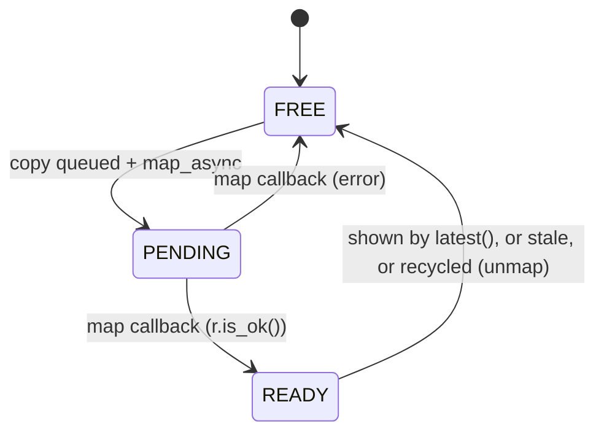
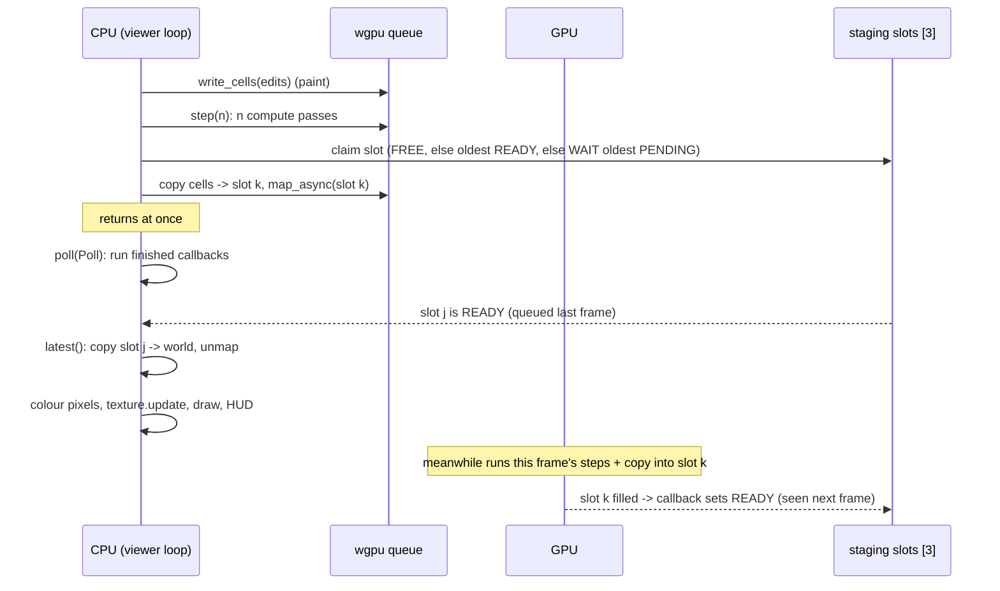

# Lesson 15: The GPU-only viewer, pipelined readback and painting

> Sources for this lesson:
> - old viewer: `git show 2fbcad6:sand/src/bin/physics.rs` (CPU/GPU toggle, blocking `download`)
> - new viewer: `git show d94ade6:sand/src/bin/physics.rs`
> - readback machinery: `git show d94ade6:sand/src/physics/gpu.rs` (`Readback`, `step_and_readback`, `latest`, `upload`, `write_cells`, `gpu_time_ms`)

> [!note] The viewer's step count changed later
> This lesson teaches `d94ade6`, where the viewer ran a fixed `steps_per_frame` (keys `-` / `=`, 1 to 64). In `07fcf0b` ([[16-real-units-velocity-clock]]) a world-time `Clock` replaced it: the viewer runs as many steps as the chosen speed needs (real time by default), within a budget computed from the GPU timestamps of this lesson. New keys: `,` slower, `.` faster, `/` real time. The HUD shows world time and the speed actually reached. The readback pipeline, epochs and `write_cells` are unchanged. In between, `6c1cebc` swapped the GPU step for the fused kernel ([[14-gpu-perf-fused-kernel]]), which `GpuSim`'s API hides from the viewer. See "What changed later" at the end.

---

## 1. What you will build

In lessons 10 to 14 you moved the physics onto the GPU. The window, though, still runs on the CPU: macroquad draws pixels the CPU hands it. So every frame, the grid has to travel **GPU → CPU** before you can see it. This lesson is about making that trip without freezing the frame.

At the end you will have:

- a viewer loop that queues GPU work, **never waits for it**, and draws the newest grid that has come back (usually one frame old);
- three staging buffers in rotation, each with a tiny state machine `FREE → PENDING → READY → FREE`;
- **back-pressure**: the CPU blocks only when all three are still in flight;
- **epochs**, a version number that throws away readbacks of a world you have replaced;
- **painting sent straight to the GPU** with `write_cells`, which merges neighbouring cells into a single write;
- the drawing side: `Image` → `Texture2D::update` → `draw_texture_ex` with `FilterMode::Nearest`, temperature colours with `lerp`, and a HUD built with `format!`.

Where it sits: `sand/src/bin/physics.rs` is the window binary. It uses the library crate `sand` (lesson 06), and from it `GpuSim` in `sand/src/physics/gpu.rs` (lessons 10 to 14). In commit `d94ade6` the viewer stopped offering a CPU/GPU toggle and became GPU-only. The CPU engine is still used by the benchmark (lesson 12) and the tests.

---

## 2. Concepts

### 2.1 The one fact everything rests on

**The CPU and the GPU are two separate processors that run at the same time. The CPU never runs GPU work itself. It only *submits* commands to a queue, and the GPU works through that queue later.**

Everything in this lesson follows from that fact. `queue.submit(...)` returns right away, as soon as the commands are handed over. The GPU may start them a millisecond later and finish ten milliseconds later. So when the CPU wants to *read* a GPU result, it has two choices:

1. **Wait** until the GPU reaches that point in the queue (a "sync" or "stall").
2. **Ask to be told** when it gets there, and do something useful in the meantime.

### 2.2 The problem: a blocking download stalls the frame

Here is the old viewer's GPU branch (`2fbcad6:sand/src/bin/physics.rs`):

```rust
(Backend::Gpu, Some(g)) => {
    if gpu_stale {
        g.upload(&world);
        gpu_stale = false;
    }
    g.step(steps);
    g.download(&mut world); // waits for the GPU, then copies the grid back to draw it
}
```

And `download` (`d94ade6:sand/src/physics/gpu.rs`, the same as before):

```rust
pub fn download(&self, world: &mut World) {
    let mut encoder = self.device.create_command_encoder(&Default::default());
    encoder.copy_buffer_to_buffer(&self.cells[self.current], 0, &self.staging, 0, self.staging.size());
    self.queue.submit([encoder.finish()]);

    // Mapping is asynchronous: ask for it, then poll until it is done.
    self.staging.map_async(wgpu::MapMode::Read, .., |r| r.expect("map failed"));
    self.wait();
    // ... copy out, unmap
}
```

`self.wait()` is `device.poll(PollType::wait_indefinitely())`, which blocks the thread until the GPU has drained the queue. Lay one frame out on a timeline:

$$
t_\text{frame} = t_\text{CPU record} + \underbrace{t_\text{GPU steps} + t_\text{copy} + t_\text{wake-up}}_{\text{CPU sits idle}} + t_\text{CPU draw}
$$

While the CPU waits, the GPU is busy. While the CPU draws, the GPU is **idle**, because nothing new has been queued yet. Each processor waits for the other in turn. That is the classic serialisation bug.

### 2.3 The fix: pipelining, drawing one frame behind

Remove the wait and you get this loop: queue this frame's steps and a copy, then draw whichever copy *already* came back (last frame's). The two processors now overlap:

$$
t_\text{frame} \approx \max(t_\text{CPU},\ t_\text{GPU})
\quad\text{instead of}\quad
t_\text{CPU} + t_\text{GPU}
$$

The cost is **latency**. The picture you see is about one frame old. At 60 fps that is about 16 ms, which you won't notice.

You cannot copy into the same staging buffer every frame, though. While a buffer is mapped (the CPU is reading it) or a copy into it is still queued, the GPU may not write into it again. So you need **several** staging buffers in rotation. How many?

- one the CPU is reading (being drawn from),
- one the GPU is filling (in flight),
- one spare, so a slightly slow frame doesn't force a wait.

That is the reason behind `const READBACK_SLOTS: usize = 3;`. The source comment says: *"3 = one being drawn from, one in flight, one spare, so the CPU never has to wait for the GPU in steady state."*

### 2.4 Back-pressure: block only when every slot is busy

What if the GPU really is slower than the CPU (64 steps per frame on a huge grid)? If the CPU never waited, it would queue work faster than the GPU could finish it. Latency would grow without limit, and so would memory. The fix is to wait **only when there is no slot to copy into**. That bounds how far ahead the CPU can get: at most `READBACK_SLOTS` copies are ever in flight. This rule is called back-pressure. A full pipe pushes back on whoever is filling it.

`claim_readback_slot` (`d94ade6:sand/src/physics/gpu.rs`) tries the cheap options first:

```rust
fn claim_readback_slot(&mut self) -> usize {
    let _ = self.device.poll(wgpu::PollType::Poll);           // run any finished callbacks, never block
    if let Some(i) = self.readbacks.iter().position(|r| r.state() == FREE) {
        return i;                                              // 1. a free slot: take it
    }
    let oldest = |rs: &[Readback], state: u8| (0..rs.len()).filter(|&i| rs[i].state() == state).min_by_key(|&i| rs[i].seq);
    // A copy that arrived but nobody picked up: the one we are about to queue is newer.
    if let Some(i) = oldest(&self.readbacks, READY) {
        self.readbacks[i].release();                           // 2. recycle an unread arrival
        return i;
    }
    // All in flight: the GPU is far behind. Wait for the oldest copy.
    let i = oldest(&self.readbacks, PENDING).expect("readback slots are free, ready or pending");
    let submission = self.readbacks[i].submission.clone();
    self.device
        .poll(wgpu::PollType::Wait { submission_index: submission, timeout: None })
        .expect("GPU poll failed");                            // 3. back-pressure: block
    if self.readbacks[i].state() == READY {
        self.readbacks[i].release();
    }
    i
}
```

Note `PollType::Wait { submission_index, .. }`. It waits for **one specific submission**, not for the whole queue. `queue.submit` returns a `SubmissionIndex`, and each readback stores its own so it can wait for exactly that copy.

### 2.5 A state machine in a `Vec` of structs

Each staging buffer carries its own state:



In the code:

```rust
const FREE: u8 = 0;    // unmapped, not used by any queued command
const PENDING: u8 = 1; // copy queued, map requested, not ready yet
const READY: u8 = 2;   // mapped: the CPU may read it

struct Readback {
    buffer: wgpu::Buffer,
    state: Arc<AtomicU8>,
    frame: u32,                                // world.frame of the copied grid
    epoch: u64,                                // GpuSim::epoch when it was queued
    seq: u64,                                  // queue order, to find the newest
    submission: Option<wgpu::SubmissionIndex>, // to wait for it if we must
}
```

`GpuSim` holds `readbacks: Vec<Readback>`, built with an iterator:

```rust
let readbacks = (0..READBACK_SLOTS).map(|_| Readback::new(&device, cell_count * 4)).collect();
```

The `Vec` of structs here works like a small table of slots. Every question the code asks is an iterator query over that table: "any FREE?" is `position`, "the oldest READY?" is `filter` + `min_by_key(seq)`, and "the newest usable?" is `filter` + `max_by_key(seq)`. `seq` is a counter that goes up once per queued copy. It gives "oldest" and "newest" an exact meaning, because slot indices say nothing about order once the slots start rotating.

**Why `u8` constants and not an `enum`?** In ordinary Rust you would write `enum State { Free, Pending, Ready }`. The old viewer did exactly that for its `Backend { CpuOneThread, CpuAllCores, Gpu }`. Here, though, the state must live inside an **atomic** (next section). The standard library has `AtomicU8` but no `Atomic<MyEnum>`. So the states are plain `u8` values. Giving them named `const`s keeps the code readable.

### 2.6 Why `Arc<AtomicU8>`: the `'static + Send` callback

`map_async` does not return the data. It takes a **callback** that wgpu calls later, from inside some future `device.poll(...)`. Its signature in wgpu 30.0.1 (`wgpu-30.0.1/src/api/buffer.rs`):

```rust
pub fn map_async<S: RangeBounds<BufferAddress>>(
    &self,
    mode: MapMode,
    bounds: S,
    callback: impl FnOnce(Result<(), BufferAsyncError>) + WasmNotSend + 'static,
)
```

On native targets `WasmNotSend` just means `Send` (`wgpu-types-30.0.1/src/send_sync.rs`: `impl<T: Send> WasmNotSend for T {}`). So the closure must be:

- **`'static`**: it may not borrow anything from the current stack frame. wgpu keeps the closure after `map_async` returns, so a borrow like `&mut self.readbacks[i].state` could outlive its owner. The borrow checker rejects it. The closure must **own** everything it touches, hence `move`.
- **`Send`**: wgpu may call it on another thread, so whatever it owns must be safe to send between threads.

You also need the *same* state to be visible from two places: the closure writes it, and `GpuSim` reads it. "Shared ownership" in Rust means a reference-counted pointer. "Mutate through a shared pointer" means interior mutability. There are two options:

| Shared pointer | Interior mutability | `Send`? |
|---|---|---|
| `Rc<Cell<u8>>` | `Cell` (single-thread) | no, `Rc`'s counter is not atomic |
| `Arc<AtomicU8>` | atomic load/store | yes |

Only the second one compiles. Here is the project's helper:

```rust
fn map_read(buffer: &wgpu::Buffer, state: &Arc<AtomicU8>) {
    state.store(PENDING, Ordering::Release);
    let state = state.clone();            // a second owner, for the closure
    buffer.map_async(wgpu::MapMode::Read, .., move |r| {
        state.store(if r.is_ok() { READY } else { FREE }, Ordering::Release);
    });
}
```

`state.clone()` on an `Arc` copies the **pointer** and bumps the count. The `AtomicU8` is not copied. `move` puts that clone inside the closure. Writes use `Ordering::Release` and reads use `Ordering::Acquire`: a reader that sees `READY` also sees everything the writer did before setting it. (`SeqCst` would be correct too, just more than needed.)

A tiny standalone version of the same pattern, using threads:

```rust
use std::sync::{Arc, atomic::{AtomicU8, Ordering}};

fn main() {
    let state = Arc::new(AtomicU8::new(0));
    let s = state.clone();
    let t = std::thread::spawn(move || s.store(2, Ordering::Release)); // 'static + Send
    t.join().unwrap();
    println!("state = {}", state.load(Ordering::Acquire)); // 2
}
```

`thread::spawn` has the same `'static + Send` bound as `map_async`, so it makes a good playground for it.

### 2.7 `latest`: take the newest, drop the rest

```rust
pub fn latest(&mut self, world: &mut World) -> bool {
    let _ = self.device.poll(wgpu::PollType::Poll);
    let epoch = self.epoch;
    let usable = |r: &Readback| r.epoch == epoch && r.state() == READY;
    // (first-frame special case omitted here: see below)
    let best = (0..self.readbacks.len()).filter(|&i| usable(&self.readbacks[i])).max_by_key(|&i| self.readbacks[i].seq);
    if let Some(i) = best {
        let rb = &self.readbacks[i];
        {
            let view = rb.buffer.get_mapped_range(..).expect("mapped");
            world.cells.copy_from_slice(bytemuck::cast_slice(&view));
        } // the view must be dropped before unmapping
        world.frame = rb.frame;
        self.delivered_any = true;
    }
    // Everything that has arrived is now either shown or out of date.
    let best_seq = best.map_or(0, |i| self.readbacks[i].seq);
    for rb in &mut self.readbacks {
        if rb.state() == READY && (rb.epoch != epoch || rb.seq <= best_seq) {
            rb.release();
        }
    }
    best.is_some()
}
```

Three details:

- `PollType::Poll` means "run any finished callbacks, but don't block". This is the moment the `PENDING → READY` transitions actually happen.
- The inner `{ ... }` block exists for **drop order**. `get_mapped_range` returns a guard (`BufferView`) that borrows the mapped memory. `unmap` while that view is alive would panic, so the scope ends it first.
- The special case left out above: until the very first readback has arrived (`delivered_any == false`), `latest` *does* wait for the newest pending one. Otherwise the first frame would draw a black screen.

### 2.8 Epochs: versioning on the cheap

Press `R` to reload the scene. The viewer builds a fresh `World` on the CPU and calls `gpu.upload(&world)`. But up to three readbacks of the **old** world may still be in flight. If `latest` then showed one, the old scene would flash back for a frame.

The fix is to tag every readback with a version number and bump that number whenever you replace the world:

```rust
pub fn upload(&mut self, world: &World) {
    assert_eq!((world.width as u32, world.height as u32), (self.width, self.height));
    self.queue.write_buffer(&self.cells[self.current], 0, bytemuck::cast_slice(&world.cells));
    self.frame = world.frame;
    // Readbacks already in flight hold the old world: never show them.
    self.epoch += 1;
    self.wake_all();
}
```

`step_and_readback` stamps each slot with `rb.epoch = self.epoch;`. `latest` only accepts `r.epoch == epoch` and releases the rest. You can't cancel GPU work that is already queued, but you can decide to ignore its result, and a single `u64` comparison is enough to do it.

### 2.9 Painting: why it goes straight to the GPU

The old viewer painted into the CPU `world` and then re-uploaded the whole thing (`gpu_stale |= paint(&mut world, ...)` followed by `g.upload(&world)`). That only worked because `download` had **just** made `world` an exact copy of the GPU state. With pipelining, `world` is always a frame or more behind. Look at the two obvious options:

1. **Paint into `world` and upload it.** The GPU state is replaced by an older snapshot. Every frame you paint, the simulation rewinds by the frames that were in flight, so falling sand seems to hang in the air while the mouse is down. On top of that, `upload` bumps the epoch, which throws away every in-flight readback.
2. **Paint into `world` and don't upload.** The next `latest` overwrites `world` with a readback that has no paint in it. The paint appears for one frame, disappears, and never reaches the physics. That is flicker.

The only copy that matters is the GPU's. So the edit goes there, and the new viewer says so (`d94ade6:sand/src/bin/physics.rs`):

```rust
// Paint goes straight into the GPU's grid and shows up with the next
// readback (about a frame later). Painting into `world` instead would
// flicker: readbacks already in flight do not have the paint yet.
edits.clear();
paint(&world, brush, brush_size, &mut edits);
if !edits.is_empty() {
    gpu.write_cells(&edits);
}
```

Note that `paint` now takes `&World`, not `&mut World`. It only needs `world.index(x, y)` for bounds checking, and the signature itself shows that the CPU copy is read-only.

`write_cells` works without an epoch bump, because the edit lands in the queue **after** the in-flight copies and **before** the next step. Older readbacks simply lack the paint, which is fine since they are older. To save calls, consecutive indices are merged into one `write_buffer`:

```rust
pub fn write_cells(&mut self, edits: &[(usize, u32)]) {
    let cells = &self.cells[self.current];
    let queue = &self.queue;
    let flush = |start: usize, run: &mut Vec<u32>| {
        if !run.is_empty() {
            queue.write_buffer(cells, start as u64 * 4, bytemuck::cast_slice(run));
            run.clear();
        }
    };
    let (mut run, mut run_start) = (Vec::new(), 0usize);
    for &(i, cell) in edits {
        assert!(i < (self.width * self.height) as usize, "cell index out of range");
        if run.is_empty() || i != run_start + run.len() {
            flush(run_start, &mut run);
            run_start = i;
        }
        run.push(cell);
    }
    flush(run_start, &mut run);
    if !edits.is_empty() {
        self.wake_all();
    }
}
```

A brush is a disc of rows, and `paint` loops `dy` outside and `dx` inside, so within a row the indices are consecutive and each row becomes one write. The test `run.is_empty() || i != run_start + run.len()` asks: "does this cell continue the current run?" `flush` is a closure that captures `cells` and `queue` by shared reference. That is fine because it only reads them. It takes `run` as an explicit `&mut` argument rather than capturing it, because the loop body also needs to push to `run`. If `flush` captured `run` mutably, that borrow would last as long as the closure, and the `run.push` would be rejected.

The byte offset is `start as u64 * 4`, because each cell is one packed `u32` (lesson 06). `wake_all` exists because of chunk sleeping (lesson 13): a sleeping chunk would otherwise ignore the paint.

### 2.10 One frame, end to end



### 2.11 Drawing with macroquad

The drawing path (both commits):

```rust
let mut image = Image::gen_image_color(W as u16, H as u16, BLACK); // RGBA8 bytes on the CPU
let texture = Texture2D::from_image(&image);                       // a GPU texture (macroquad's GL)
texture.set_filter(FilterMode::Nearest);                            // crisp pixels when scaled up
// every frame:
for i in 0..W * H {
    let cell = world.cells[i];
    let rgb = if heat_view { heat_color(temp(cell)) } else { cell_color(cell, temp(cell), i) };
    image.bytes[i * 4..i * 4 + 4].copy_from_slice(&[rgb[0], rgb[1], rgb[2], 255]);
}
texture.update(&image);                                             // re-upload the bytes
draw_texture_ex(&texture, 0.0, 0.0, WHITE, DrawTextureParams {
    dest_size: Some(vec2(W as f32 * SCALE, H as f32 * SCALE)),      // stretch 640x360 to 1280x720
    ..Default::default()
});
```

- `Image.bytes` is a `Vec<u8>` holding 4 bytes per pixel, so pixel `i` sits at `i*4..i*4+4`. That works because the grid is row-major, just like the image.
- `FilterMode::Nearest`: without it, a 2x upscale blurs each cell into its neighbours (`Linear`). Sand should look like pixels.
- `WHITE` is the tint. Multiplying by white leaves the colours unchanged.
- `..Default::default()` is struct update syntax: fill in every field you didn't name from `Default`.
- `texture.update(&image)` takes `&self` (`macroquad-0.4.16/src/texture.rs`, `pub fn update(&self, image: &Image)`), so `texture` does not need to be `mut`.

Two GPU APIs are involved here: wgpu for physics and macroquad's OpenGL/Metal context for drawing. They don't share buffers, which is why the bytes have to go GPU → CPU → GPU. Avoiding that round trip would mean rendering with wgpu itself, which is a possible capstone project.

### 2.12 Colour from temperature: `lerp`

**Linear interpolation** blends from $a$ to $b$ by a fraction $f \in [0,1]$:

$$
\operatorname{lerp}(a, b, f) = a + (b - a)\,f
$$

```rust
fn lerp(a: [u8; 3], b: [u8; 3], f: f32) -> [u8; 3] {
    let f = f.clamp(0.0, 1.0);
    [0, 1, 2].map(|k| (a[k] as f32 + (b[k] as f32 - a[k] as f32) * f) as u8)
}
```

`[0, 1, 2].map(...)` is the array version of `map`. It returns a new `[u8; 3]` directly, with no `Vec` and no allocation. The `clamp` means you can pass a raw ratio like `(c - 450.0) / 600.0` without checking its range.

`cell_color` uses it in three ways:

- **Lava** glows by temperature: `lerp([150,25,10], [255,210,70], (c - 800.0) / 800.0)`, dull red at 800°C and yellow at 1600°C.
- **Incandescence**: any non-gas above 450°C blends toward orange, `lerp(base, [255,140,50], (c - 450.0) / 600.0)`, so hot stone glows.
- **Hot air** tints faintly, so you can see convection plumes.

Then a per-cell "grain" is subtracted, `((i.wrapping_mul(2654435761)) >> 28) as u8 % 24`. That is a cheap hash of the index, so the noise is fixed per cell and doesn't shimmer. `saturating_sub` stops at 0 instead of wrapping around to 255.

`heat_color` is a **thermal camera** palette. It chains `lerp`s piecewise: blue for cold, near-black at room temperature, red, then yellow, then white for hot. Temperatures are fixed point (lesson 07), so the first line is `let c = temp as f32 / T_SCALE as f32;`.

### 2.13 The HUD: `format!`, `Option`, and the GPU's own clock

```rust
let probe = under_mouse.map_or(String::new(), |i| {
    format!("under mouse: {} {:.0}°C", NAMES[material(world.cells[i]) as usize],
            temp(world.cells[i]) as f32 / T_SCALE as f32)
});
let gpu_ms = match gpu.gpu_time_ms() {
    Some(ms) => format!("gpu {ms:.3} ms/step"),
    None if gpu.has_timestamps() => "gpu ... ms/step".to_string(),
    None => "gpu ms/step n/a (no timestamps)".to_string(),
};
```

- `world.index(x, y)` returns `Option<usize>`, and it is `None` when the mouse is off the grid. `map_or(default, f)` turns that into a `String` in one call.
- `{ms:.3}` is an inline named argument with 3 decimal places, and `{:.0}` rounds to a whole number.
- `None if ... =>` is a match guard. The same `None` gets two different messages depending on whether timestamps are supported at all.
- `gpu_time_ms` is read back exactly like the grid: `TIMER_SLOTS = 4` staging buffers, each with an `Arc<AtomicU8>`, and `harvest()` collects whichever slots are `READY`, without blocking. It measures ticks on the GPU's own clock, so the number excludes CPU recording and wake-up time. That is why the HUD shows *both* `gpu ms/step` and `cpu ms/frame`.
- The CPU time is smoothed with an exponential moving average: `cpu_ms * 0.95 + now * 0.05`.

### 2.14 `Option<GpuSim>` vs `std::process::exit`

The old viewer could run without a GPU, so a missing GPU simply meant one fewer backend:

```rust
let mut gpu = match GpuSim::new(&world) {
    Ok(g) => Some(g),
    Err(e) => { eprintln!("GPU backend unavailable: {e}"); None }
};
// ... later: match (backend, gpu.as_mut()) { (Backend::Gpu, Some(g)) => ..., }
```

`gpu.as_mut()` turns `&mut Option<GpuSim>` into `Option<&mut GpuSim>`, so you can match on it without moving the sim out.

The new viewer has nothing to show without a GPU, so it exits cleanly:

```rust
let mut gpu = match GpuSim::new(&world) {
    Ok(g) => g,
    Err(e) => {
        eprintln!("no usable GPU: {e}");
        std::process::exit(1);
    }
};
```

`std::process::exit` returns `!` (the never type), so the `Err` arm type-checks as a `GpuSim`, and from then on `gpu` is a plain `GpuSim` with no `Option` to unwrap. `exit` ends the process immediately **without running destructors**. That is fine here, since nothing has been created yet. Exit code `1` tells a shell that the program failed. Prefer this over `panic!`/`unwrap()` for an expected failure like "no GPU": the user gets one readable line instead of a backtrace. `GpuSim::new` returns `Result<Self, String>` (`.map_err(|e| e.to_string())?`) so that the caller can make that choice.

---

## 3. Build it yourself

You will build a standalone crate, `readback-demo`: a toy GPU sim (dots fall one row per step) plus a macroquad viewer with triple-buffered readback, epochs and direct GPU painting. It uses the same structure as `GpuSim`, minus the physics. It was compiled and tested against wgpu 30.0.1 and macroquad 0.4.16.

### Step 1: the crate

```bash
cargo new readback-demo && cd readback-demo
```

`Cargo.toml`:

```toml
[package]
name = "readback-demo"
version = "0.1.0"
edition = "2024"

[dependencies]
bytemuck = "1.25.2"
macroquad = "0.4.16"
pollster = "1.0.1"
wgpu = "30.0.1"

[profile.dev.package."*"]
opt-level = 3
```

### Step 2: `src/gpu.rs`, the device, the toy shader and the slots

The shader's rule: a filled cell stays put if it is on the bottom row or the cell below is filled, and otherwise becomes empty. An empty cell copies whatever is above it. Each column is independent, so no two threads ever write the same cell. `format!` injects `W` and `H` into the WGSL as constants. Inside a `format!` string, literal braces must be doubled: `{{` `}}`.

```rust
//! A tiny GPU "falling dots" sim with pipelined (triple-buffered) readback.

use std::sync::Arc;
use std::sync::atomic::{AtomicU8, Ordering};

const SLOTS: usize = 3;

// Life of one staging buffer.
const FREE: u8 = 0; // unmapped, nobody is using it
const PENDING: u8 = 1; // copy queued + map requested, not arrived yet
const READY: u8 = 2; // mapped: the CPU may read it

struct Readback {
    buffer: wgpu::Buffer,
    state: Arc<AtomicU8>,
    epoch: u64,
    seq: u64,
    submission: Option<wgpu::SubmissionIndex>,
}

impl Readback {
    fn state(&self) -> u8 {
        self.state.load(Ordering::Acquire)
    }
    fn release(&mut self) {
        self.buffer.unmap();
        self.state.store(FREE, Ordering::Release);
    }
}

fn map_read(buffer: &wgpu::Buffer, state: &Arc<AtomicU8>) {
    state.store(PENDING, Ordering::Release);
    let state = state.clone(); // the closure gets its own handle
    buffer.map_async(wgpu::MapMode::Read, .., move |r| {
        state.store(if r.is_ok() { READY } else { FREE }, Ordering::Release);
    });
}

pub struct Gpu {
    device: wgpu::Device,
    queue: wgpu::Queue,
    pipeline: wgpu::ComputePipeline,
    cells: [wgpu::Buffer; 2],
    groups: [wgpu::BindGroup; 2],
    current: usize,
    width: u32,
    height: u32,
    readbacks: Vec<Readback>,
    epoch: u64,
    seq: u64,
    pub waits: u64, // how often back-pressure made us block
}

impl Gpu {
    pub fn new(width: u32, height: u32) -> Result<Self, String> {
        pollster::block_on(Self::new_async(width, height))
    }

    async fn new_async(width: u32, height: u32) -> Result<Self, String> {
        let instance = wgpu::Instance::new(wgpu::InstanceDescriptor::new_without_display_handle());
        let adapter = instance
            .request_adapter(&wgpu::RequestAdapterOptions::default())
            .await
            .map_err(|e| e.to_string())?;
        let (device, queue) = adapter
            .request_device(&wgpu::DeviceDescriptor::default())
            .await
            .map_err(|e| e.to_string())?;

        // Each cell falls one row if the cell below is empty. Every column is
        // independent, so no two threads ever fight over a cell.
        let source = format!(
            r#"
const W: u32 = {width}u;
const H: u32 = {height}u;
@group(0) @binding(0) var<storage, read> src: array<u32>;
@group(0) @binding(1) var<storage, read_write> dst: array<u32>;

@compute @workgroup_size(16, 16)
fn main(@builtin(global_invocation_id) id: vec3<u32>) {{
    let x = id.x; let y = id.y;
    if (x >= W || y >= H) {{ return; }}
    let i = y * W + x;
    let here = src[i];
    if (here != 0u) {{
        let blocked = y == H - 1u || src[i + W] != 0u;
        dst[i] = select(0u, here, blocked);
    }} else {{
        var above = 0u;
        if (y > 0u) {{ above = src[i - W]; }}
        dst[i] = above;
    }}
}}
"#
        );
        let shader = device.create_shader_module(wgpu::ShaderModuleDescriptor {
            label: Some("fall"),
            source: wgpu::ShaderSource::Wgsl(source.into()),
        });
        let pipeline = device.create_compute_pipeline(&wgpu::ComputePipelineDescriptor {
            label: Some("fall"),
            layout: None, // let wgpu derive the layout from the shader
            module: &shader,
            entry_point: Some("main"),
            compilation_options: Default::default(),
            cache: None,
        });

        let size = (width * height) as u64 * 4;
        let make = |label: &str, usage: wgpu::BufferUsages| {
            device.create_buffer(&wgpu::BufferDescriptor { label: Some(label), size, usage, mapped_at_creation: false })
        };
        let grid = wgpu::BufferUsages::STORAGE | wgpu::BufferUsages::COPY_DST | wgpu::BufferUsages::COPY_SRC;
        let cells = [make("cells0", grid), make("cells1", grid)];
        let layout = pipeline.get_bind_group_layout(0);
        let group = |src: usize| {
            device.create_bind_group(&wgpu::BindGroupDescriptor {
                label: None,
                layout: &layout,
                entries: &[
                    wgpu::BindGroupEntry { binding: 0, resource: cells[src].as_entire_binding() },
                    wgpu::BindGroupEntry { binding: 1, resource: cells[1 - src].as_entire_binding() },
                ],
            })
        };
        let groups = [group(0), group(1)];
        let readbacks = (0..SLOTS)
            .map(|_| Readback {
                buffer: make("readback", wgpu::BufferUsages::MAP_READ | wgpu::BufferUsages::COPY_DST),
                state: Arc::new(AtomicU8::new(FREE)),
                epoch: 0,
                seq: 0,
                submission: None,
            })
            .collect();
        Ok(Gpu { device, queue, pipeline, cells, groups, current: 0, width, height, readbacks, epoch: 0, seq: 0, waits: 0 })
    }
```

### Step 3: `upload`, `write_cells`, `step_and_readback`, `claim_slot`, `latest`

Continue inside `impl Gpu`:

```rust
    /// Replace the whole grid. Readbacks already in flight show the old one.
    pub fn upload(&mut self, cells: &[u32]) {
        self.queue.write_buffer(&self.cells[self.current], 0, bytemuck::cast_slice(cells));
        self.epoch += 1;
    }

    /// Overwrite single cells; runs of consecutive indices become one write.
    pub fn write_cells(&mut self, edits: &[(usize, u32)]) {
        let cells = &self.cells[self.current];
        let queue = &self.queue;
        let flush = |start: usize, run: &mut Vec<u32>| {
            if !run.is_empty() {
                queue.write_buffer(cells, start as u64 * 4, bytemuck::cast_slice(run));
                run.clear();
            }
        };
        let (mut run, mut run_start) = (Vec::new(), 0usize);
        for &(i, cell) in edits {
            if run.is_empty() || i != run_start + run.len() {
                flush(run_start, &mut run);
                run_start = i;
            }
            run.push(cell);
        }
        flush(run_start, &mut run);
    }

    /// Queue `steps` steps plus a copy into a free staging buffer. Returns at once
    /// unless every slot is still in flight (back-pressure).
    pub fn step_and_readback(&mut self, steps: u32) {
        let mut encoder = self.device.create_command_encoder(&Default::default());
        for _ in 0..steps {
            let mut pass = encoder.begin_compute_pass(&Default::default());
            pass.set_pipeline(&self.pipeline);
            pass.set_bind_group(0, &self.groups[self.current], &[]);
            pass.dispatch_workgroups(self.width.div_ceil(16), self.height.div_ceil(16), 1);
            drop(pass);
            self.current = 1 - self.current;
        }
        self.queue.submit([encoder.finish()]);

        let slot = self.claim_slot();
        let mut encoder = self.device.create_command_encoder(&Default::default());
        let rb = &self.readbacks[slot];
        encoder.copy_buffer_to_buffer(&self.cells[self.current], 0, &rb.buffer, 0, rb.buffer.size());
        let submission = self.queue.submit([encoder.finish()]);
        self.seq += 1;
        let rb = &mut self.readbacks[slot];
        rb.epoch = self.epoch;
        rb.seq = self.seq;
        rb.submission = Some(submission);
        map_read(&rb.buffer, &rb.state);
    }

    fn claim_slot(&mut self) -> usize {
        let _ = self.device.poll(wgpu::PollType::Poll);
        if let Some(i) = self.readbacks.iter().position(|r| r.state() == FREE) {
            return i;
        }
        let oldest = |rs: &[Readback], s: u8| (0..rs.len()).filter(|&i| rs[i].state() == s).min_by_key(|&i| rs[i].seq);
        if let Some(i) = oldest(&self.readbacks, READY) {
            self.readbacks[i].release(); // arrived but never shown: we are about to queue a newer one
            return i;
        }
        // Every slot is in flight: block until the oldest lands.
        self.waits += 1;
        let i = oldest(&self.readbacks, PENDING).expect("slots are free, ready or pending");
        let submission = self.readbacks[i].submission.clone();
        self.device
            .poll(wgpu::PollType::Wait { submission_index: submission, timeout: None })
            .expect("GPU poll failed");
        if self.readbacks[i].state() == READY {
            self.readbacks[i].release();
        }
        i
    }

    /// Copy the newest arrived readback of the current epoch into `out`.
    /// Never waits. Returns false if nothing new arrived.
    pub fn latest(&mut self, out: &mut [u32]) -> bool {
        let _ = self.device.poll(wgpu::PollType::Poll);
        let epoch = self.epoch;
        let usable = |r: &Readback| r.epoch == epoch && r.state() == READY;
        let best = (0..self.readbacks.len()).filter(|&i| usable(&self.readbacks[i])).max_by_key(|&i| self.readbacks[i].seq);
        if let Some(i) = best {
            let view = self.readbacks[i].buffer.get_mapped_range(..).expect("mapped");
            out.copy_from_slice(bytemuck::cast_slice(&view));
        } // `view` is dropped here, before any unmap below
        let best_seq = best.map_or(0, |i| self.readbacks[i].seq);
        for rb in &mut self.readbacks {
            if rb.state() == READY && (rb.epoch != epoch || rb.seq <= best_seq) {
                rb.release();
            }
        }
        best.is_some()
    }
}
```

Two borrow-checker details:

- In `step_and_readback`, `let rb = &self.readbacks[slot];` is a shared borrow, used while recording the copy. Then `self.seq += 1` needs `&mut self`, which is only allowed because the first `rb` is no longer used. Then `let rb = &mut self.readbacks[slot];` reborrows mutably. Two short borrows, one after the other, never overlapping.
- `drop(pass)` ends the compute pass, which borrows `encoder`, before the loop flips `current` and before `encoder.finish()` consumes the encoder.

### Step 4: `src/main.rs`, the viewer loop

```rust
mod gpu;

use gpu::Gpu;
use macroquad::prelude::*;

const W: usize = 320;
const H: usize = 180;
const SCALE: f32 = 4.0;

fn window_conf() -> Conf {
    Conf {
        window_title: "pipelined readback".to_owned(),
        window_width: (W as f32 * SCALE) as i32,
        window_height: (H as f32 * SCALE) as i32,
        window_resizable: false,
        ..Default::default()
    }
}

fn colour(v: u32) -> [u8; 4] {
    match v {
        0 => [20, 20, 28, 255],
        _ => [220, 190, 110, 255],
    }
}

#[macroquad::main(window_conf)]
async fn main() {
    let mut gpu = match Gpu::new(W as u32, H as u32) {
        Ok(g) => g,
        Err(e) => {
            eprintln!("no usable GPU: {e}");
            std::process::exit(1);
        }
    };
    let mut cells = vec![0u32; W * H]; // the CPU's copy: for drawing only
    let mut edits: Vec<(usize, u32)> = Vec::new();
    let mut image = Image::gen_image_color(W as u16, H as u16, BLACK);
    let texture = Texture2D::from_image(&image);
    texture.set_filter(FilterMode::Nearest);
    let mut stale_frames = 0u64;

    loop {
        if is_key_pressed(KeyCode::C) {
            cells.fill(0);
            gpu.upload(&cells); // bumps the epoch: in-flight copies of the old grid are dropped
        }

        // Paint straight into the GPU's grid.
        edits.clear();
        if is_mouse_button_down(MouseButton::Left) {
            let (mx, my) = mouse_position();
            let (cx, cy) = ((mx / SCALE) as i32, (my / SCALE) as i32);
            for dy in -3..=3 {
                for dx in -3..=3 {
                    let (x, y) = (cx + dx, cy + dy);
                    if x >= 0 && y >= 0 && (x as usize) < W && (y as usize) < H {
                        edits.push((y as usize * W + x as usize, 1));
                    }
                }
            }
        }
        if !edits.is_empty() {
            gpu.write_cells(&edits);
        }

        gpu.step_and_readback(1); // returns at once
        if !gpu.latest(&mut cells) {
            stale_frames += 1; // nothing new arrived: draw last frame's copy again
        }

        for (i, &v) in cells.iter().enumerate() {
            image.bytes[i * 4..i * 4 + 4].copy_from_slice(&colour(v));
        }
        texture.update(&image);
        draw_texture_ex(
            &texture,
            0.0,
            0.0,
            WHITE,
            DrawTextureParams { dest_size: Some(vec2(W as f32 * SCALE, H as f32 * SCALE)), ..Default::default() },
        );
        let hud = format!(
            "{} fps | stale frames {stale_frames} | back-pressure waits {} | drag to paint, C clears",
            get_fps(),
            gpu.waits
        );
        draw_text(&hud, 10.0, 24.0, 24.0, WHITE);
        next_frame().await;
    }
}
```

Run it with `cargo run`. Drag to drop sand. It falls one row per frame and piles up on the bottom. The first frame or two are blank, because this simplified `latest` never waits. The real `GpuSim::latest` waits once (the `delivered_any` check) to avoid that.

### Step 5: a headless test (optional, very useful)

Append this to `src/gpu.rs` and run `cargo test -- --nocapture`. It checks the whole pipeline without a window:

```rust
#[cfg(test)]
mod tests {
    #[test]
    fn falls() {
        let mut g = super::Gpu::new(4, 4).unwrap();
        g.upload(&[0u32; 16]);
        g.write_cells(&[(1, 1), (2, 1)]);
        let mut out = vec![0u32; 16];
        for _ in 0..10 { g.step_and_readback(1); }
        g.device.poll(wgpu::PollType::wait_indefinitely()).unwrap();
        assert!(g.latest(&mut out));
        println!("{out:?} waits {}", g.waits);
        assert_eq!(out[13], 1); // the two dots ended up on the bottom row
        assert_eq!(out[14], 1);
    }
}
```

Ten back-to-back calls with no frame in between fill all three slots, so you will typically see `waits 1` or more. That is back-pressure at work.

---

## 4. Live examples

Run the real viewer from this repo:

```bash
cd sand
cargo run --release --bin physics
```

Things to try:

- **`+` / `=` repeatedly** up to 64 steps/frame (at `d94ade6`; since `07fcf0b` press `.` for a faster world clock instead, up to 16x). Watch `gpu ms/step` (GPU clock) against `cpu ms/frame`. The CPU number stays small while the GPU does more work. That gap is what pipelining buys you.
- **Paint while it runs.** Paint appears about a frame later and the sand keeps falling under the brush. Nothing rewinds.
- **Tab / R** while sand is falling. The new scene appears with no flash of the old one. That is the epoch check.
- **H** switches to the thermal camera palette. Paint lava (`8`) on ice (`9`) and watch the blue-black-red-yellow-white gradient.

To feel the old blocking behaviour, run commit `2fbcad6` in a separate worktree, so your own checkout stays untouched. Press `G` twice to reach the GPU backend:

```bash
git worktree add ../rusty-old 2fbcad6
cd ../rusty-old/sand && cargo run --release --bin physics
# when done: cd - && git worktree remove ../rusty-old
```

To compare the two viewers' code directly:

```bash
git diff 2fbcad6 d94ade6 -- sand/src/bin/physics.rs
```

In the `readback-demo` crate:

- Change `const SLOTS: usize = 3;` to `1`. Every frame now hits back-pressure: `waits` climbs by one per frame and you are back to a blocking download. Try `2` as well.
- Change `gpu.step_and_readback(1)` to `(200)`. On a slow GPU, `stale_frames` and `waits` start counting up. The CPU is now waiting for the GPU, and the counters show it.
- Delete `self.epoch += 1;` in `upload`, paint a big pile, and press `C` while it falls. You may catch a frame of the old pile after the clear. That flash is exactly what epochs prevent. (It is easier to see with `step_and_readback(50)`.)

---

## 5. Exercises

1. **(easy) Frames behind.** Add a `pub fn in_flight(&self) -> usize` to the demo's `Gpu` that counts slots in `PENDING`, and show it in the HUD.
   *Hint:* `iter().filter(...).count()`.

2. **(easy) Thermal palette.** Give the demo a temperature: treat the cell value `v` as a "heat" 1..=255. Paint values that grow with `y`, and write `fn heat(v: u32) -> [u8; 4]` with a `lerp` from blue through red to yellow.
   *Hint:* copy `lerp` from the project. Split the range at 128.

3. **(medium) Mouse probe.** Show `"under mouse: filled"` / `"under mouse: empty"`, or nothing when off-grid, using an `Option<usize>` index and `map_or`.
   *Hint:* write `fn index(x: i32, y: i32) -> Option<usize>` that returns `None` out of bounds.

4. **(medium) First frame without a blank.** Add `delivered_any: bool` to the demo's `Gpu`. In `latest`, if nothing has ever been delivered and nothing of the current epoch is `READY`, wait for the newest `PENDING` slot of the current epoch.
   *Hint:* mirror the real code: `max_by_key(seq)` over pending slots of the current epoch, then `PollType::Wait { submission_index, timeout: None }`.

5. **(medium) Prove `Rc<Cell>` can't work.** In `map_read`, replace `Arc<AtomicU8>` with `Rc<Cell<u8>>` and read the compiler error. Then explain in one sentence why `Arc` alone (without the atomic, e.g. `Arc<u8>`) is also not enough.
   *Hint:* `Arc<T>` only gives out `&T`.

6. **(stretch) Count coalesced writes.** Make `write_cells` return how many `write_buffer` calls it made, and show "edits N cells in M writes" in the HUD. Then change the paint loop to go `dx` outside / `dy` inside and watch M jump.
   *Hint:* `flush` can't easily mutate a captured counter while also being called in the loop. Return `bool` from it, or count in the loop instead.

---

## 6. Common mistakes and compiler errors

**`Rc` in a map callback**

```
error[E0277]: `Rc<Cell<u8>>` cannot be sent between threads safely
   |     buffer.map_async(wgpu::MapMode::Read, .., move |r| {
   |            ^^^^^^^^^ `Rc<Cell<u8>>` cannot be sent between threads safely
   = note: required for `{closure}` to implement `WasmNotSend`
```

Read it as: the callback bound is `Send` (shown as `WasmNotSend`), and your closure owns an `Rc`, which is not `Send`. Fix: `Arc<AtomicU8>`.

**Borrowing into the callback**

```
error[E0521]: borrowed data escapes outside of method
   |     buffer.map_async(.., |r| { self.readbacks[i].ready = true; });
   = note: argument requires that `'1` must outlive `'static`
```

The callback must be `'static`, and `self` is only borrowed for this call. Fix: give the closure an owned handle (`let state = state.clone();` then `move |r| ...`).

**Forgetting `move`**: `closure may outlive the current function, but it borrows `state``. The compiler even suggests `move`.

**Unmapping with a live view** (a runtime panic, not a compile error): wgpu panics if you `unmap` while a `BufferView` from `get_mapped_range` is still alive. Put the view in its own `{ }` block or `drop(view)` first.

**Mapping a buffer twice**: calling `map_async` on a slot that is still `PENDING` or `READY` (mapped) is an error. wgpu reports it as a validation error or a failed callback. The `FREE`-only rule in `claim_slot` is what prevents this. If you add a new code path that picks slots, keep that rule.

**Never polling**: on native wgpu, callbacks only run inside `device.poll(...)`. If you forget `poll(PollType::Poll)` in `latest`, slots stay `PENDING` forever and the picture freezes, until back-pressure finally does a blocking `Wait`.

**Forgetting `{{ }}` in `format!` WGSL**: `error: invalid format string: expected `}`, found ...`. Every literal brace in a `format!` string must be doubled.

**Buffer usage mismatch** (a runtime validation error): a staging buffer needs `MAP_READ | COPY_DST`, and the grid buffer needs `COPY_SRC` to be copied from and `COPY_DST` to be written by `write_buffer`. The panic message names the missing usage flag.

**Painting the CPU copy**: it compiles fine and looks wrong (flicker). If paint shows up for one frame and then vanishes, you are writing to the drawing copy, not the GPU.

**Blurry pixels**: you forgot `texture.set_filter(FilterMode::Nearest)`.

---

## 7. Recap

- CPU and GPU run at the same time. `submit` only queues work. Reading results means either waiting or being called back later.
- A blocking download makes the two processors take turns. Pipelining lets them overlap, at the cost of drawing one frame behind.
- You need a *ring* of staging buffers (3 here), each with a `FREE/PENDING/READY` state machine stored as a `Vec` of structs, and you use `seq` to find the oldest or newest.
- Back-pressure: block only when every slot is in flight. This caps both latency and queued work.
- `map_async` callbacks must be `'static + Send`, so shared state goes in `Arc<AtomicU8>`, cloned into a `move` closure.
- Epochs: bump a counter on `upload` and ignore readbacks stamped with an older value.
- Paint goes straight to the GPU with `write_cells`, which merges runs of consecutive cells into one write. Re-uploading would rewind the simulation, and painting the CPU copy would flicker.
- Drawing: `Image` bytes → `texture.update` → `draw_texture_ex` with `FilterMode::Nearest`. Colours come from `lerp` by temperature. The HUD uses `format!`, `Option::map_or`, match guards, and GPU timestamps read back the same way as the grid.
- `std::process::exit(1)` returns `!`, which allows the clean "no GPU" exit. The old viewer's `Option<GpuSim>` allowed a graceful fallback instead.

**Next, [[16-real-units-velocity-clock]]:** real units (1 cell = 5 mm, 1 step = 1/1200 s), gravity with a stored speed, and the world-time clock that now decides how many steps each frame runs. After that, [[17-capstone-roadmap]] has suggested capstone projects, such as rendering directly from the wgpu buffers so the readback round trip disappears entirely.

---

## Solutions

<details><summary>Solution 1: frames behind</summary>

```rust
// in impl Gpu (gpu.rs)
pub fn in_flight(&self) -> usize {
    self.readbacks.iter().filter(|r| r.state() == PENDING).count()
}
```

```rust
// main.rs HUD
let hud = format!(
    "{} fps | in flight {} | stale {stale_frames} | waits {}",
    get_fps(), gpu.in_flight(), gpu.waits
);
```

In steady state you will usually see 1 (the copy queued this frame). With heavy `steps` it climbs toward 3.
</details>

<details><summary>Solution 2: thermal palette</summary>

```rust
fn lerp(a: [u8; 3], b: [u8; 3], f: f32) -> [u8; 3] {
    let f = f.clamp(0.0, 1.0);
    [0, 1, 2].map(|k| (a[k] as f32 + (b[k] as f32 - a[k] as f32) * f) as u8)
}

fn heat(v: u32) -> [u8; 4] {
    if v == 0 {
        return [20, 20, 28, 255];
    }
    let v = v as f32;
    let [r, g, b] = if v < 128.0 {
        lerp([60, 140, 255], [200, 30, 20], v / 128.0)
    } else {
        lerp([200, 30, 20], [255, 220, 40], (v - 128.0) / 127.0)
    };
    [r, g, b, 255]
}
```

In the paint loop, push `(index, (1 + y as u32 * 255 / H as u32).min(255))` instead of `1`, and call `heat(v)` instead of `colour(v)`. Higher paint is hotter. Because cells carry their value as they fall, the colours fall with them.
</details>

<details><summary>Solution 3: mouse probe</summary>

```rust
fn index(x: i32, y: i32) -> Option<usize> {
    (x >= 0 && y >= 0 && (x as usize) < W && (y as usize) < H).then(|| y as usize * W + x as usize)
}

// in the loop, after `latest`:
let (mx, my) = mouse_position();
let probe = index((mx / SCALE) as i32, (my / SCALE) as i32).map_or(String::new(), |i| {
    format!("under mouse: {}", if cells[i] == 0 { "empty" } else { "filled" })
});
draw_text(&probe, 10.0, 52.0, 24.0, WHITE);
```

`bool::then` turns a condition into an `Option`. You can reuse `index` in the paint loop too.
</details>

<details><summary>Solution 4: no blank first frame</summary>

```rust
// field in Gpu: delivered_any: bool   (initialise to false in new_async)

pub fn latest(&mut self, out: &mut [u32]) -> bool {
    let _ = self.device.poll(wgpu::PollType::Poll);
    let epoch = self.epoch;
    let usable = |r: &Readback| r.epoch == epoch && r.state() == READY;
    if !self.delivered_any && !self.readbacks.iter().any(usable) {
        let newest = self
            .readbacks
            .iter()
            .filter(|r| r.epoch == epoch && r.state() == PENDING)
            .max_by_key(|r| r.seq);
        if let Some(r) = newest {
            let submission = r.submission.clone();
            self.device
                .poll(wgpu::PollType::Wait { submission_index: submission, timeout: None })
                .expect("GPU poll failed");
        }
    }
    let best = (0..self.readbacks.len()).filter(|&i| usable(&self.readbacks[i])).max_by_key(|&i| self.readbacks[i].seq);
    if let Some(i) = best {
        let view = self.readbacks[i].buffer.get_mapped_range(..).expect("mapped");
        out.copy_from_slice(bytemuck::cast_slice(&view));
        self.delivered_any = true;
    }
    let best_seq = best.map_or(0, |i| self.readbacks[i].seq);
    for rb in &mut self.readbacks {
        if rb.state() == READY && (rb.epoch != epoch || rb.seq <= best_seq) {
            rb.release();
        }
    }
    best.is_some()
}
```

Note that `submission` is cloned out of `r` before calling `self.device.poll`. `r` borrows `self.readbacks`, and while `poll` only needs `&self.device` (a different field), cloning ends the borrow neatly. It also matches what the project does. The wait happens at most once per program run, because after that `delivered_any` is true.
</details>

<details><summary>Solution 5: why Rc<Cell> and Arc<u8> fail</summary>

With `Rc<Cell<u8>>`:

```rust
use std::{cell::Cell, rc::Rc};
fn map_read(buffer: &wgpu::Buffer, state: &Rc<Cell<u8>>) {
    let state = state.clone();
    buffer.map_async(wgpu::MapMode::Read, .., move |r| state.set(if r.is_ok() { 2 } else { 0 }));
}
```

This fails with E0277: `Rc<Cell<u8>>` cannot be sent between threads safely, required for the closure to implement `WasmNotSend`. `Rc`'s reference count is a plain integer, so two threads cloning or dropping at once could corrupt it.

`Arc<u8>` fixes the sending problem but not the writing problem. `Arc<T>` only hands out `&T`, a shared reference, and you can't change a `u8` through `&u8`. You need interior mutability that is also thread-safe, and that is an atomic (`AtomicU8::store(&self, ..)`) or a `Mutex<u8>`. The atomic is the cheapest option for a single byte.
</details>

<details><summary>Solution 6: counting coalesced writes</summary>

```rust
pub fn write_cells(&mut self, edits: &[(usize, u32)]) -> usize {
    let cells = &self.cells[self.current];
    let queue = &self.queue;
    let flush = |start: usize, run: &mut Vec<u32>| -> bool {
        if run.is_empty() {
            return false;
        }
        queue.write_buffer(cells, start as u64 * 4, bytemuck::cast_slice(run));
        run.clear();
        true
    };
    let (mut run, mut run_start, mut writes) = (Vec::new(), 0usize, 0usize);
    for &(i, cell) in edits {
        if run.is_empty() || i != run_start + run.len() {
            writes += flush(run_start, &mut run) as usize;
            run_start = i;
        }
        run.push(cell);
    }
    writes += flush(run_start, &mut run) as usize;
    writes
}
```

```rust
// main.rs
let mut last_writes = 0;
if !edits.is_empty() {
    last_writes = gpu.write_cells(&edits);
}
// HUD: format!("edits {} cells in {} writes", edits.len(), last_writes)
```

With `dy` outside / `dx` inside, a 7×7 brush is 49 cells in about 7 writes (one per row). Swap the loops and consecutive edits sit `W` apart, so each one becomes its own write: about 49. `bool as usize` is 0 or 1, which makes counting easy.
</details>

---

## What changed later

### 1. The clock decides the step count (`07fcf0b`)

At `d94ade6` the viewer ran a fixed number of steps per frame, so how fast the world moved depended on the frame rate and on which key you'd pressed. In `07fcf0b` each step became a fixed slice of world time, $1/1200$ s ([[16-real-units-velocity-clock]]), and a `Clock` (`sand/src/physics/clock.rs`) turns wall time into steps. From `sand/src/bin/physics.rs` @ `07fcf0b`:

```rust
let mut clock = Clock::default(); // replaces `let mut steps_per_frame = 4u32;`
// ...
// As many steps as the chosen speed needs for the time this frame
// took, but no more than about 12 ms of GPU work per frame.
let budget = match gpu.gpu_time_ms() {
    Some(ms) if ms > 0.0 => (12.0 / ms).clamp(1.0, 20_000.0) as u32,
    _ => 2_000,
};
let mut steps = clock.steps_for_frame(get_frame_time() as f64, budget, paused);
if paused && is_key_pressed(KeyCode::N) {
    steps = STEPS_PER_SECOND / 60; // advance 1/60 s of world time
    clock.add_steps(steps);
}
if steps > 0 || !edits.is_empty() {
    gpu.step_and_readback(steps); // returns at once, exactly as in this lesson
}
```

Two things from this lesson now carry more weight:

- **GPU timestamps set the budget.** `gpu_time_ms()` (§2.13) is no longer only a HUD number. It caps the steps per frame at about 12 ms of GPU work, so a slow GPU drops steps instead of piling up work. Back-pressure in `claim_readback_slot` is still the safety net behind it.
- **`steps` varies every frame.** At real time and 60 fps it is 20 steps per frame. At 0.01× it is one step every 5 frames: `Clock` keeps the fraction in a `debt` field and carries it to the next frame. `step_and_readback(0)` still works, for frames that only show paint.

`N` while paused now advances $1/60$ s of world time (20 steps) instead of one step. Loading a scene calls `clock.reset()` next to `gpu.upload(&world)`.

### 2. Keys and HUD (`07fcf0b`)

| key | at `d94ade6` | at `07fcf0b` |
|---|---|---|
| `-` / `=` | halve / double steps per frame (1..64) | removed |
| `,` / `.` | | slower / faster world clock: 0.01× … 16× |
| `/` | | back to real time (1×) |
| `N` (paused) | one step | 1/60 s of world time |

The HUD's second line went from `"{adapter} | {n} steps/frame | {gpu_ms} | cpu .. ms/frame | frame .. ms, .. fps"` to:

```rust
format!(
    "world time {:.2} s | speed {}x{} | {} steps/frame | {gpu_ms} | cpu {:.2} ms/frame | {} fps",
    clock.world_seconds,
    clock.speed(),
    if paused {
        String::new()
    } else if clock.behind {
        format!(" (GPU too slow: reaching {:.2}x)", clock.achieved)
    } else {
        format!(" (reaching {:.2}x)", clock.achieved)
    },
    steps,
    cpu_ms,
    get_fps(),
),
```

`clock.achieved` is a smoothed "world seconds per wall second". When the budget cuts steps, `clock.behind` is true and the HUD says so. In the real 640×360 viewer on an Apple M5 the GPU step costs about 0.12 ms at `07fcf0b`, so real time (1200 steps per second) fits easily. At 4K it would not (about 0.3×). The bottom right of the window also has a 10 cm scale bar (20 cells, since a cell is 5 mm).

### 3. What did not change

`Readback`, the `FREE → PENDING → READY` slots, epochs, `latest`, `write_cells` with its run merging and `wake_all`, and the timestamp machinery are the same at `07fcf0b` as at `d94ade6`. In `6c1cebc` only the GPU step behind `step_and_readback` changed, from two passes to the fused kernel with sleeping ([[14-gpu-perf-fused-kernel]]).
