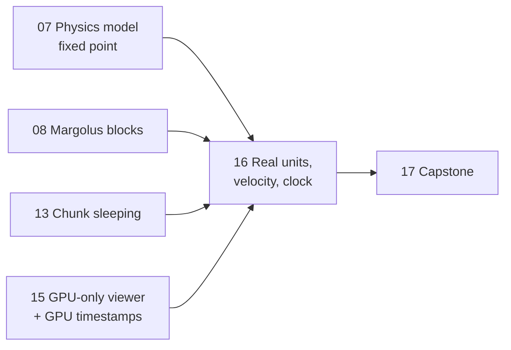
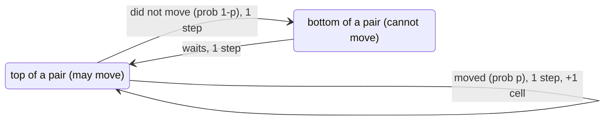
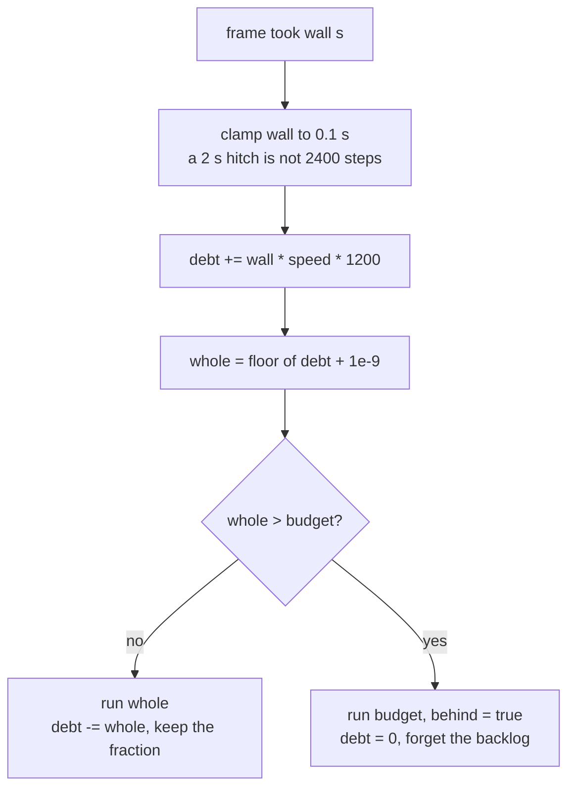

# Lesson 16: Real units, gravity with velocity, and a world-time clock

> Source: commit `07fcf0b` ("feat(sand): real units, gravity with velocity, and world-time clock").
> Files: `sand/src/physics/mod.rs` (units, tables, rules), `sand/src/physics/clock.rs` (new), `sand/src/bin/physics.rs` (keys, budget, HUD), `sand/src/physics/sim.wgsl` (the GPU mirror), `cpu.rs` (one-line change for sleeping).
> Read any of them with `git show 07fcf0b:sand/src/physics/clock.rs`, and the whole change with `git diff 6c1cebc 07fcf0b`.

---

## 1. What you will build

Up to lesson 15, a "step" was just a tick. Sand fell one cell per step when its roll came up, heat moved `COND/1024` of a gap per step, fire lived 80 steps. The viewer ran `steps_per_frame` (4 by default, `-`/`=` to change it). That gave a nice-looking toy, but it raised a question nobody could answer: **how fast is the world running?** Is 4 steps a frame real time? Slow motion? Nobody knew, because a step meant nothing in seconds.

This commit gives every number a unit:

- One cell is **5 mm**. One step is **1/1200 s**. A 640×360 world is 3.2 m × 1.8 m.
- Cells now carry a **speed**. Gravity accelerates them at $9.81\ \text{m/s}^2$, and a grain dropped 1.19 m lands in about 0.49 s, as it would in real life (there is a test for it).
- Densities are in kg/m³, heat conduction uses real **thermal diffusivities**, fire and smoke lives are in seconds.
- A new `Clock` turns wall time into steps. The viewer runs in **real time** by default, `,` and `.` slow it to 0.01× or speed it to 16×, `/` goes back to 1×. If the GPU cannot keep up, the HUD says so and shows the speed actually reached.

Where this lesson sits:



At the end you will have a standalone crate, `fallclock`: a 1-D column with Margolus pairs, speed levels, stochastic gravity, and a `Clock`, with tests that check free fall against $t=\sqrt{2h/g}$ and that slow motion carries fractions of a step between frames.

---

## 2. Concepts

### 2.1 The unconditional truth: time can only be scaled if a step *is* some time

Start from one fact that holds whatever else we decide:

> **The simulation only ever advances by whole steps.**

Everything else follows. If we want "1 s on screen = 1 s in the world", we need to know how many steps make one second. If we want 0.1× slow motion, we need one tenth of that number per second. Neither question has an answer while a step is "whatever looks nice".

So before any clock can exist, a step must be given a physical duration $\Delta t$, and a cell a physical size $\Delta x$. Then **every rule** has to be rewritten so that it does the right thing *per $\Delta t$*: gravity adds $g\,\Delta t$ of speed, heat flows at a rate set by $\Delta t$, fire burns for $N$ seconds = $N/\Delta t$ steps. Only after that does the number "steps per second" mean anything, and only then can the clock scale it.

That is why this commit touches almost every rule: the clock in `clock.rs` is 145 lines, but it is only *correct* because of the 500 lines in `mod.rs`.

### 2.2 Choosing $\Delta x$ and $\Delta t$

We have two knobs. They are not free. One hard constraint comes from the Margolus scheme (lesson 8):

> **A cell moves at most one cell per step.**

A 2×2 block can only swap neighbours. So the fastest anything can go is

$$v_{\max} = \frac{\Delta x}{\Delta t}.$$

How fast must things be able to go? The fastest ordinary thing in a sand box is something that has fallen the whole window height $h$. From energy conservation, $\tfrac12 m v^2 = m g h$, so

$$v = \sqrt{2 g h}.$$

The window is 360 cells tall. With $\Delta x = 5\text{ mm}$, that is $h = 1.8\text{ m}$, and

$$v = \sqrt{2 \cdot 9.81 \cdot 1.8} \approx 5.94\ \text{m/s}.$$

So we need $v_{\max} \ge 6\text{ m/s}$. With $\Delta x = 0.005$:

$$\Delta t = \frac{\Delta x}{v_{\max}} = \frac{0.005}{6} = \frac{1}{1200}\ \text{s}.$$

That is where the constants come from (`mod.rs`, Units section):

```rust
/// One cell is 5 mm across: a 640x360 world is 3.2 m x 1.8 m.
pub const CELL_METERS: f64 = 0.005;
/// One step is 1/1200 s of world time.
pub const STEPS_PER_SECOND: u32 = 1200;
pub const STEP_SECONDS: f64 = 1.0 / STEPS_PER_SECOND as f64;
/// Nothing moves faster than one cell per step: 6 m/s. That is enough to
/// fall the whole 1.8 m window height (5.9 m/s at the bottom).
pub const MAX_SPEED: f64 = CELL_METERS / STEP_SECONDS;
pub const GRAVITY: f64 = 9.81;
```

The price is visible right away. Real time at 60 fps needs $1200/60 = 20$ steps every frame. The old viewer ran 4. Section 2.11 shows what that costs on the GPU.

Why not bigger cells? A cell of 1 cm would halve the step rate, but then the window is 3.6 m tall and a sand grain is a centimetre cube. 5 mm keeps the world sand-box sized.

### 2.3 Speed levels: velocity in one byte

A cell is a packed `u32`: 4 bits material, 8 bits `aux`, 20 bits temperature (lesson 6). There is no room for a float velocity, but the `aux` byte was only used by fire and smoke (for their life). So materials that move by gravity now store their **speed** there:

```rust
pub const fn has_speed(m: u32) -> bool {
    matches!(m, SAND | WATER | OIL | LAVA | STEAM)
}
pub const fn speed(cell: u32) -> u32 {
    if has_speed(material(cell)) { aux(cell) } else { 0 }
}
```

A speed is a **level** from 0 to 255, where level 256 would be $v_{\max}$. So level $L$ means $L/256$ cells per step, or $L/256 \cdot 6\ \text{m/s}$. A `const fn` converts real speeds into levels at compile time:

```rust
pub const fn level(meters_per_second: f64) -> u32 {
    (meters_per_second / MAX_SPEED * 256.0) as u32
}
```

`level(1.0)` is $\lfloor 256/6 \rfloor = 42$. That number shows up all over the tables (`FLOW` for water, `GAS_RISE`).

### 2.4 Gravity as a stochastic increment

Each step, gravity adds $g\,\Delta t$ to a falling cell's speed:

$$g\,\Delta t = 9.81 \cdot \tfrac{1}{1200} = 8.2\ \text{mm/s per step}.$$

In levels, that is $8.2\text{ mm/s} / 6\text{ m/s} \cdot 256 = 0.349$ levels. **Less than one.** If we added it to an integer level with normal rounding, we would add 0 every step and nothing would ever fall.

The fix is the same idea as in lesson 7's fixed point, plus one more trick. Keep gravity in finer units, 1/256 of a level:

```rust
/// Gravity adds this much speed per step, in 1/256 of a level
/// (9.81 m/s^2 * 1/1200 s = 8.2 mm/s per step = 0.349 levels = 89/256).
pub const G_Q: i32 = (GRAVITY * STEP_SECONDS / MAX_SPEED * 65536.0) as i32;
```

Now add it with **stochastic rounding**: with a random `roll` uniform in $0..255$,

$$\Delta L = \left\lfloor \frac{q + \text{roll}}{256} \right\rfloor .$$

For $0 \le q < 256$ this is 1 exactly when $\text{roll} \ge 256 - q$, which happens with probability $q/256$, and 0 otherwise. So the **expected** increment is exactly $q/256$ levels: $89/256 = 0.348$, which is $g\,\Delta t$. Any single step is wrong (0 or 1), but over the tens of steps it takes to fall a few cells, the errors average out. That is the whole point of stochastic rounding: **the mean is exact, the noise cancels**.

Here is `accelerate`, which also handles buoyancy and the speed cap (next sections):

```rust
fn accelerate(cell: u32, heavy: u32, light: u32, medium: u32, roll: u32) -> u32 {
    let (dh, dl) = (density(heavy), density(light));
    let q = (G_Q * (dh - dl) / dh) as u32;
    let m = material(cell) as usize;
    let cap = if KIND[material(medium) as usize] == LIQUID { VT_LIQUID[m] } else { VT_GAS[m] };
    (speed(cell) + ((q + roll) >> 8)).min(cap)
}
```

It runs **in the heat pass**, not the move pass. The heat pass already visits every cell once per step and reads its neighbours, which is exactly what gravity needs: "is the cell below me something I can sink into?" A cell that is free speeds up. A cell that is blocked slows to the speed of whatever blocks it:

```rust
fn blocked_speed(cell: u32, in_way: u32) -> u32 {
    let same_way = has_speed(material(in_way)) && sinker(material(in_way)) == sinker(material(cell));
    speed(cell).min(if same_way { speed(in_way) } else { 0 })
}
```

That rule makes a falling column of sand fall *together*: the grain on top cannot be faster than the grain under it. Against stone or a resting heap, `in_way` has speed 0 and the cell stops dead.

### 2.5 Buoyancy: $g(\rho_h - \rho_l)/\rho_h$

Sand in water does not fall at $g$. Archimedes: a body of density $\rho_h$ in a fluid of density $\rho_l$ feels weight $\rho_h V g$ and buoyancy $\rho_l V g$. Net force over mass:

$$a = \frac{(\rho_h - \rho_l) V g}{\rho_h V} = g\,\frac{\rho_h - \rho_l}{\rho_h}.$$

That is the `G_Q * (dh - dl) / dh` line. It only makes sense if densities are real, so the table is now in units of 0.1 kg/m³:

```rust
//                                  air  stone  sand  water oil  lava  steam wood fire ice  smoke
pub const DENSITY: [i32; MATERIAL_COUNT] = [12, 26000, 16000, 10000, 9000, 26000, 8, 6000, 3, 9170, 12];
```

Water is 10000 (1000 kg/m³), air 12 (1.2 kg/m³), dry sand 16000. Check the numbers:

- Sand in air: $(16000-12)/16000 \approx 0.999$. Full gravity, as it should be.
- Sand in water: $(16000-10000)/16000 = 0.375$. Sand accelerates at $0.375\,g$.
- Oil under water: here the *water* is heavy, $(10000-9000)/10000 = 0.1$. Slow.

The same formula drives rising. Steam is lighter than air, so `sinker(STEAM)` is false; the heavy cell is the air above it and the light one is the steam, and the steam's speed grows.

Gases also expand when hot (ideal gas law: $\rho T$ = constant at fixed pressure), so `density()` scales gas densities by $293\,\text{K} / (T + 273\,\text{K})$. Hot air at 313 °C has half the density of room air, and rises. Flames are excluded, or they would fly off whatever they burn.

### 2.6 Terminal velocity caps

Buoyancy alone would let sand accelerate forever through water at $0.375\,g$. Real sand reaches a **terminal velocity** in water of roughly 0.1 m/s within a few centimetres, because drag grows with speed. Modelling drag properly needs floats and per-material shapes. The commit uses something much cheaper: a **cap** on the speed, chosen per material and per medium:

```rust
/// Top speed (level) when sinking or rising through a liquid: viscous drag.
/// About 0.1 m/s for sand, water, oil; 0.3 lava; a steam bubble 0.25 m/s.
pub const VT_LIQUID: [u32; MATERIAL_COUNT] = [0, 0, 4, 4, 4, 12, 10, 0, 0, 0, 0];
/// Top speed (level) through a gas. No air resistance is modelled, so
/// falling things are only limited by MAX_SPEED; steam is capped at 2 m/s.
pub const VT_GAS: [u32; MATERIAL_COUNT] = [0, 0, 255, 255, 255, 255, 85, 0, 0, 0, 0];
```

Level 4 is $4/256 \cdot 6 = 0.094$ m/s. At $0.375\,g \approx 3.7\ \text{m/s}^2$ the grain gets there in $0.094/3.7 \approx 25$ ms, about 30 steps. After that it sinks at a constant speed, so 0.6 m of water takes $0.6/0.094 \approx 6.4$ s. Through the same height of air it takes $\sqrt{2\cdot 0.6/9.81} = 0.35$ s. The test `sand_sinks_slowly_through_water` checks for 4.5–9 s.

### 2.7 From speed to motion: why the chance is $p = 2s/(1+s)$

We now have a speed $s$ in **cells per step** ($s = L/256$). The move pass needs to turn that into "swap or not this step". The obvious idea is: swap with probability $s$. On average that moves $s$ cells per step. Right?

**Wrong, because of the Margolus grid.** Recall lesson 8: blocks start at an offset that alternates every step. In a column, the pairs are rows $(0,1),(2,3),\dots$ on even steps and $(1,2),(3,4),\dots$ on odd steps. A cell can only fall if it is the **top** of its pair. Follow a grain sitting on top of a pair at step $n$:



- If it moves (probability $p$), it goes down one row. The offset flips, so next step it is again the top of a pair. Cost: 1 step, gain: 1 cell.
- If it does not move (probability $1-p$), it stays in place. The offset flips, so next step it is the **bottom** of a pair and cannot move at all. The step after, it is a top again. Cost: 2 steps, gain: nothing, and we are back where we started.

Let $T$ be the expected number of steps to advance one cell, starting from "top of a pair". Then

$$T = p \cdot 1 + (1-p)\,(2 + T).$$

Solve for $T$:

$$T - (1-p)T = p + 2(1-p) \quad\Rightarrow\quad pT = 2 - p \quad\Rightarrow\quad T = \frac{2-p}{p}.$$

The speed in cells per step is $1/T$. We want it to equal $s$:

$$s = \frac{p}{2-p} \quad\Rightarrow\quad s(2-p) = p \quad\Rightarrow\quad p = \frac{2s}{1+s}.$$

Check the ends: $s=0 \Rightarrow p=0$; $s=1 \Rightarrow p=1$, every step a move, one cell per step. And in the middle, the naive $p = s = 0.5$ would give $0.5/1.5 = 1/3$ cell per step, **a third slower than intended**. That is a large, systematic error. Sand would take 1.5× longer to sink through water, and the free-fall test would fail.

In integer form, with $s = S/256$ and the chance out of 256:

$$p\cdot 256 = \frac{2 S/256}{1 + S/256}\cdot 256 = \frac{512\,S}{256 + S}.$$

```rust
pub fn move_chance(s: u32) -> u32 {
    512 * s / (256 + s)
}
```

You will verify this numerically in the build-it-yourself crate: with the correction a grain at level 128 averages 0.495 cells per step, without it 0.334.

### 2.8 The move pass, rewritten around speed

`pair_chance(top, bottom)` decides the chance for one column of a block. It finds the **body** that moves (the top cell if it is heavier than air, else the bottom one, a gas rising) and uses its speed:

```rust
fn pair_chance(top: u32, bottom: u32) -> u32 {
    if !sinks(top, bottom) {
        return 0;
    }
    let body = if sinker(material(top)) { top } else { bottom };
    if has_speed(material(body)) {
        move_chance(speed(body))
    } else {
        let (dt, db) = (density(top), density(bottom));
        move_chance((GAS_RISE * (dt - db) / dt) as u32)
    }
}
```

Fire, smoke and hot air use their `aux` byte for something else (life), so they have no stored speed. They rise at `GAS_RISE` (1 m/s) times the relative density gap, which is a terminal-velocity style rule.

Three more pieces:

- **`can_slide`**: a powder or liquid only slides diagonally when it is *resting* (`speed == 0`) and cannot fall straight down. The chance is `FLOW[m]`, now a speed level: sand 21 (0.5 m/s), water 42 (1 m/s), lava 2 (0.05 m/s, very viscous).
- **`spread_chance`**: two resting, different fluids side by side swap with chance `min(FLOW)`.
- **`displace`**: when a mover swaps with a cell, the pushed cell's speed is set to 0. Its speed described its own motion, not being shoved aside.

```rust
fn displace(cells: &mut [u32; 4], mover: usize, pushed: usize) {
    if has_speed(material(cells[pushed])) {
        cells[pushed] = with_aux(cells[pushed], 0);
    }
    cells.swap(mover, pushed);
}
```

`with_aux` is a small bit trick: clear bits 4..12 with `!(0xFF << 4)` and OR in the new byte. Temperature and material stay as they were.

### 2.9 Heat in real units: $k = \alpha\,\Delta t/\Delta x^2$

Lesson 7 used the discrete heat equation with made-up conductivities. The real heat equation is

$$\frac{\partial T}{\partial t} = \alpha\,\nabla^2 T,$$

where $\alpha$ is the **thermal diffusivity** in m²/s. On a grid, the Laplacian is "sum of the differences to the 4 neighbours, over $\Delta x^2$". One explicit step of length $\Delta t$ is

$$T_i \leftarrow T_i + \frac{\alpha\,\Delta t}{\Delta x^2}\sum_{j \in N(i)} (T_j - T_i).$$

So the per-step, per-edge rate is a pure number:

$$k = \frac{\alpha\,\Delta t}{\Delta x^2}.$$

Plug in granite, $\alpha = 1.1\times 10^{-6}\ \text{m}^2/\text{s}$:

$$k = \frac{1.1\times10^{-6} \cdot \tfrac{1}{1200}}{(0.005)^2} = \frac{9.17\times 10^{-10}}{2.5\times10^{-5}} = 3.67\times10^{-5}.$$

That is tiny. The table stores it times $2^{20}$ to keep integers: $3.67\times10^{-5}\cdot 1\,048\,576 = 38$.

```rust
/// Heat: thermal diffusivity alpha (m^2/s) turned into a per-step rate,
/// alpha * STEP_SECONDS / CELL^2, times 2^20. Real values: air 2.2e-5,
/// granite 1.1e-6, dry sand 2.5e-7, water 1.43e-7, oil 9e-8, lava 5e-7,
/// steam 2e-5, wood 1.5e-7, flame gas 2e-4, ice 1.2e-6, smoke 2.2e-5.
pub const HEAT_K: [i32; MATERIAL_COUNT] = [769, 38, 9, 5, 3, 17, 699, 5, 6990, 42, 769];
```

**Why real conduction at 5 mm is slow.** The time for heat to diffuse across one cell is about

$$\tau \approx \frac{\Delta x^2}{\alpha}.$$

For granite, $2.5\times10^{-5}/1.1\times10^{-6} \approx 23$ s. For water, about 175 s. Real heat moves through solids and still liquids at millimetres per second or slower; what feels fast in real life is mostly convection (moving hot fluid), which the sim does by moving cells. That is why the conduction test now runs for 1 s and only checks that heat reached **the next cell**, not 15 cells away. And why `lava_ignites_wood` takes 35 s of world time: lava sitting on a plank needs about 20 s to bring the top of the wood to 300 °C.

Between two materials, the edge rate is the **harmonic mean** of the two, like two resistors in series (each half-cell is one layer):

```rust
fn pair_k(a: u32, b: u32) -> i32 {
    let (ka, kb) = (HEAT_K[a as usize], HEAT_K[b as usize]);
    2 * ka * kb / (ka + kb)
}
```

The harmonic mean is dominated by the **smaller** value, which is physically right: a thin layer of insulator stops heat however good the conductor next to it is.

### 2.10 Why plain integer division rounds heat to zero, and stochastic rounding fixes it

The flow across one edge, in fixed point, is

$$\Delta T = \frac{(T_j - T_i)\cdot K}{2^{20}}.$$

Take water, $K = 5$, and a 1 °C gap. Temperatures have 256 units per degree, so the gap is 256:

$$\frac{256 \cdot 5}{1\,048\,576} = 0.0012 \text{ units}.$$

Integer division gives **0**. In fact, for water any gap below $2^{20}/5 \approx 209\,715$ units, i.e. **819 °C**, would round to zero flow. Real-unit conduction with plain division means water never conducts heat at all. (Lesson 7's "T_SCALE = 16" story was the same bug at a smaller scale.)

The fix is the trick from gravity. Add a random number uniform in $[0, 2^{20})$ before shifting:

```rust
fn edge_flow(t: i32, other: i32, k: i32, roll: i32) -> i32 {
    ((other - t) * k + roll) >> 20
}
```

If the exact value is $n + f$ with $0 \le f < 1$, then `(x + roll) >> 20` is $n+1$ with probability $f$ and $n$ otherwise. The expectation is $n + f$, **exactly the real flow**. A 1 °C gap in water now moves one unit with probability 0.0012 per step, which over thousands of steps adds up to the right amount.

(Arithmetic shift `>> 20` on a negative `i32` is floor division, so the same argument works for negative flows.)

### 2.11 Exact conservation: name the edge, not the cell

Lesson 7 conserved heat because truncating division is symmetric: $(-x)/k = -(x/k)$. With random rounding, symmetry is not automatic. Suppose each cell rolled its **own** random number for the edge it shares with its neighbour. Cell $i$ might round $+0.3$ up to $1$, while cell $j$ rounds $-0.3$ to $0$. Heat appears from nowhere. Over millions of edges and steps, the total heat drifts.

The commit's rule: **both cells of an edge must compute the same number, and one of them negates it.** To make that possible, an edge is named by the index of its **left or upper** cell plus a direction bit:

```rust
fn edge_roll(i: usize, down: u32, key: u32) -> i32 {
    (pcg((2 * i as u32 + down) ^ key) & 0xF_FFFF) as i32
}
```

In `heat_cell`, edges to the right and below are "ours": we compute the flow into us directly. Edges to the left and above belong to the neighbour, so we compute **the neighbour's** flow, with the neighbour's temperatures and the same roll, and take minus it:

```rust
let mut edge = |j: usize, ours: bool, edge_cell: usize, down: u32| {
    let other = cells[j];
    let (tn, mn) = (temp(other), material(other));
    touches_water |= mn == WATER;
    if tn == t0 {
        return; // no gap, no flow (and no need for a random number)
    }
    maybe = true;
    let (k, roll) = (pair_k(m, mn), edge_roll(edge_cell, down, key));
    t += if ours { edge_flow(t0, tn, k, roll) } else { -edge_flow(tn, t0, k, roll) };
};
if x + 1 < w { edge(i + 1, true, i, 0); }
if x > 0     { edge(i - 1, false, i - 1, 0); }
if y + 1 < h { edge(i + w, true, i, 1); }
if y > 0     { edge(i - w, false, i - w, 1); }
```

Look at one horizontal edge between cell $a$ (left) and $b$ (right):

- $a$ calls `edge(b, ours = true, a, 0)`: gains $f = \texttt{edge\_flow}(T_a, T_b, k, r_{a,0})$.
- $b$ calls `edge(a, ours = false, a, 0)`: gains $-\texttt{edge\_flow}(T_a, T_b, k, r_{a,0})$, **the same expression**, negated.

Same arguments (`pair_k` is symmetric, the roll is keyed by `a`), so the same integer comes out, and $f + (-f) = 0$ exactly. This is **antisymmetry by construction**: we do not rely on any rounding property at all. The test `conduction_conserves_heat` sums every temperature before and after 1 s and asserts they are equal, to the unit.

Note `key = pcg(frame ^ EDGE_SALT)` is computed **once per step**, not per edge. That matters for speed (next section).

### 2.12 What it cost, and the hashing fix

Twenty steps a frame is 5× the old default, and each step now does more work. Measured GPU time per step after the change, and the best speed the viewer can reach while spending ~12 ms per frame on the GPU:

| World | GPU ms / step | Max speed |
|---|---|---|
| 640×360 | 0.123 | 6.8× real time |
| 1280×720 | 0.358 | 2.3× |
| 1920×1080 | 0.794 | ~1× |
| 3840×2160 (4K) | 2.87 | 0.3× |

The default viewer world is 640×360, so it has plenty of headroom. 4K cannot run in real time, and the clock (section 2.14) handles that honestly.

**The first version was 2.6× slower than this.** It used `hash3(x, y, frame)` for every edge roll: three `pcg` calls, for each of the 4 edges, for every cell, so 12 hashes per cell per step, on top of everything else. Two changes fixed it:

1. **One `pcg` per edge.** Hash the per-frame salt once (`key`), then mix in the edge index with a single `pcg((2*i + down) ^ key)`. The randomness is still good enough for rounding.
2. **Skip equal temperatures.** Most of a world sits at 20 °C. If $T_j = T_i$, the flow is zero for every roll (`(0*k + roll) >> 20` is 0 because `roll < 2^20`), so there is no reason to hash at all. The early `return` saves the hash on most edges.

### 2.13 Chunk sleeping must now ask "could it change for some random number?"

Lesson 13's proof said: a heat update that leaves a cell unchanged did not use its random number, so "did change" was enough for the heat pass. **That is no longer true.** A cell 1 °C warmer than its neighbour changes only with probability ~0.001 per step. Most steps it stays the same, but it is not settled; it is unlucky. Put its chunk to sleep and the heat stops flowing, and the sleeping run diverges from the non-sleeping one.

So `heat_cell` now returns a second value:

```rust
pub fn heat_cell(cells: &[u32], w: usize, h: usize, x: usize, y: usize, frame: u32) -> (u32, bool)
```

`maybe` is set whenever a random number takes part: any temperature gap to a neighbour, a gas away from 20 °C (it relaxes toward ambient with stochastic rounding too, `RELAX_K` = 3 s time constant), a cell free to fall (the gravity roll), fire and smoke (their life ticks down at random, see below). The CPU chunk loop changed from

```rust
changed |= v != cells[y * w + x];
```

to

```rust
let (v, maybe) = heat_cell(cells, w, h, x, y, frame);
changed |= maybe;
```

and the function itself returns `maybe || new != me`. It is the same "roll = 0 trick" idea from `block_can_move`, applied to heat: be active if **some** roll would change something.

The consequence: a chunk with any temperature gradient stays awake until the gradient is gone completely. That is the honest price of real (slow) conduction. The skip on `tn == t0` is now doing double duty: it saves the hash, and it is what lets uniformly warm regions fall asleep.

Fire and smoke used to lose one life point per step. At 1200 steps/s that would be 66 ms of fire. Now life counts **ticks** of 64 steps, and each step one tick passes with chance 1/64 (`pcg(r) % TICK_STEPS == 0`). Fire placed with `aux = 80` lasts on average $80 \cdot 64 / 1200 = 4.3$ s.

### 2.14 The clock: fixed timestep with a debt

Now that a step is $1/1200$ s, the viewer's job each frame is: "this frame took `wall` seconds; how many steps should I run?" At speed $\sigma$ the world should advance $\sigma\cdot\text{wall}$ seconds, which is

$$n = \sigma \cdot \text{wall} \cdot 1200 \text{ steps}.$$

That is almost never a whole number. At 60 fps and 0.01×, it is $0.01 \cdot \tfrac{1}{60}\cdot 1200 = 0.2$. Rounding each frame would give 0 forever. This is the classic **fixed-timestep accumulator** (also called "fix your timestep"): keep a running **debt** of steps owed, run the whole part, carry the fraction.

```rust
pub fn steps_for_frame(&mut self, wall_seconds: f64, max_steps: u32, paused: bool) -> u32 {
    let wall = wall_seconds.clamp(0.0, 0.1);
    let steps = if paused {
        self.debt = 0.0;
        0
    } else {
        self.debt += wall * self.speed() * STEPS_PER_SECOND as f64;
        // The epsilon stops 0.2 + 0.2 + ... = 0.99999 from losing a step.
        let whole = (self.debt + 1e-9).floor();
        self.behind = whole > max_steps as f64;
        let run = whole.min(max_steps as f64);
        // Keep the fraction; drop what we could not afford.
        self.debt = if self.behind { 0.0 } else { self.debt - run };
        run as u32
    };
    self.add_steps(steps);
    // ... smoothed `achieved` speed, see below
    steps
}
```

Each line answers a specific failure:



- **Carry the fraction.** At 0.01× the debt goes 0.2, 0.4, 0.6, 0.8, 1.0 → run 1, keep 0.0. One step every 5 frames.
- **Clamp long frames.** Dragging the window or hitting a breakpoint can produce a 2 s frame. Treating it as 0.1 s means 120 steps, not 2400. The world briefly runs slower than real time instead of freezing to catch up.
- **Cap and drop.** If the GPU can only afford `max_steps`, run that many and **set the debt to zero**. If we kept the backlog, the next frame would owe even more, take longer, owe more again: the "spiral of death". Dropping it means the world simply runs slower than requested, and `behind` tells the HUD.
- **Pause owes nothing.** Pausing clears the debt, so unpausing does not fire off a burst.

**The 1e-9 bug.** Without the epsilon, the slow-motion test failed. In `f64`, $\tfrac{1}{60}\cdot 0.01 \cdot 1200$ is not exactly 0.2. Run it:

```text
frame:  1                    2                    3    4                    5
debt:   0.19999999999999998  0.39999999999999997  0.6  0.7999999999999999  0.9999999999999999 -> floor = 0!
frame:  6    7                   8                   9                   10
debt:   1.2  0.3999999999999999  0.5999999999999999  0.7999999999999998  0.9999999999999998 -> floor = 0 again
```

The step due on frame 5 only ran on frame 6, and the one due on frame 10 did not run at all: ten frames ran **1** step instead of 2. Adding $10^{-9}$ before `floor` absorbs the rounding error (it is far smaller than any real fraction of a step, and far bigger than `f64` noise at these magnitudes). The real-time test still allows `1199..=1200` because of the same effect at the end of the run.

**Achieved speed.** After each frame:

$$\text{now} = \frac{\text{steps}/1200}{\text{wall}}, \qquad \text{achieved} \leftarrow 0.9\,\text{achieved} + 0.1\,\text{now}.$$

That is an exponential moving average of world-seconds per wall-second. When the budget cuts steps, `achieved` drops below the requested speed and the HUD shows `(GPU too slow: reaching 0.31x)`.

### 2.15 The viewer: budget from GPU timestamps, keys, HUD, scale bar

Lesson 15 added GPU timestamp queries, so `gpu.gpu_time_ms()` reports the measured time per step. The budget is simply "12 ms of GPU work per frame":

```rust
let budget = match gpu.gpu_time_ms() {
    Some(ms) if ms > 0.0 => (12.0 / ms).clamp(1.0, 20_000.0) as u32,
    _ => 2_000,
};
let mut steps = clock.steps_for_frame(get_frame_time() as f64, budget, paused);
if paused && is_key_pressed(KeyCode::N) {
    steps = STEPS_PER_SECOND / 60; // advance 1/60 s of world time
    clock.add_steps(steps);
}
```

12 ms leaves room in a 16.7 ms frame for drawing. Before the first timestamps arrive, 2000 steps is a safe guess. At 4K, $12/2.87 \approx 4$ steps per frame, which is $4 \cdot 60/1200 = 0.2$–$0.3\times$.

The `N` key used to advance one step. One step is now 0.83 ms of world time, invisible, so `N` advances 1/60 s (20 steps). `add_steps` keeps `world_seconds` correct for steps run outside `steps_for_frame`.

Keys: `,` slower, `.` faster, `/` real time, through `SPEEDS = [0.01, 0.02, 0.05, 0.1, 0.25, 0.5, 1, 2, 4, 8, 16]`. Loading a new scene calls `clock.reset()`. The HUD prints world time, speed, achieved speed, steps this frame. And there is a **10 cm scale bar**: `(0.1 / CELL_METERS) as f32 * SCALE` = 20 cells, drawn bottom-right. Units you can see.

### 2.16 The WGSL mirror

`sim.wgsl` gets every rule again, line by line (lesson 11), so CPU and GPU stay bit-exact. One detail worth noticing: lookup tables. Small tables (`FLOW`, `VT_LIQUID`, `VT_GAS`, all ≤ 255) are packed 4 bytes per `u32` in a `vec3<u32>` and read with `table_byte`. `DENSITY` (up to 26000) and `HEAT_K` (up to 6990) do not fit a byte, so they are `switch` statements:

```wgsl
fn heat_k(m: u32) -> i32 {
    switch m {
        case 0u: { return 769; }
        case 1u: { return 38; }
        // ...
        default: { return 769; }
    }
}
```

One subtlety: `FLOW` for air is 256 in Rust, which does not fit a byte, so WGSL stores 255. The comment proves it changes nothing: air's flow is only used as `min` with a different material, and that min is at most 42.

### 2.17 The debugging story: the sand heap that would not settle

After the change, the chunk-sleeping test (lesson 13) failed. It builds `settling_scene` (a water tank and a heap of sand dropped on dry ground), runs 3000 steps, and asserts most chunks have gone to sleep.

The sleeping logic was fine. The **physics** had changed. Before, sand slid down a slope with chance 200/256 per step: the heap collapsed to its angle of repose in a fraction of a second of steps. Now sand slides at a realistic 0.5 m/s, `FLOW[SAND] = 21`. In real units, 3000 steps is only 2.5 s, and a free heap keeps creeping down its own slope for **20+ seconds** of world time, a grain here, a grain there. Every creeping grain keeps its chunk awake. The test was asking a realistic heap to settle in an unrealistically short time.

The fix was in the **test scene**, not the code: the sand now falls into a **walled bin** (two stone walls) and lands flat, so there is no slope to creep down. And the test runs 9000 steps (7.5 s). Lesson: when you make a simulation more realistic, old tests encode old time scales. Check what a test *means* in seconds before deciding the code is wrong.

The same thing happened to `hot_fire_ignites_wood`. A painted flame now lives ~4 s and wood conducts slowly, so it does not light a plank (true in real life, too). The test became `lava_ignites_wood`: lava on a plank, 35 s.

---

## 3. Build it yourself: `fallclock`

A standalone crate, no graphics: a 1-D column with Margolus pairs, speed levels, stochastic gravity, the `move_chance` correction, and the `Clock`. All code below was compiled and run.

### Step 1: create the crate

```bash
cargo new --lib fallclock
cd fallclock
```

We will have `src/lib.rs` (units and the column), `src/clock.rs`, and `src/main.rs` (a little demo). A crate can have a library and a binary at the same time; `main.rs` uses the library by its crate name.

### Step 2: units and helpers (`src/lib.rs`, top)

```rust
//! A 1-D falling-sand column in real units, with Margolus-style pairs.

pub mod clock;

/// One cell is 5 mm.
pub const CELL_METERS: f64 = 0.005;
/// One step is 1/1200 s.
pub const STEPS_PER_SECOND: u32 = 1200;
pub const STEP_SECONDS: f64 = 1.0 / STEPS_PER_SECOND as f64;
/// One cell per step: 6 m/s.
pub const MAX_SPEED: f64 = CELL_METERS / STEP_SECONDS;
pub const GRAVITY: f64 = 9.81;

/// Speed in m/s -> level 0..=255 (256 would be MAX_SPEED).
pub const fn level(mps: f64) -> u32 {
    (mps / MAX_SPEED * 256.0) as u32
}

/// Gravity per step, in 1/256 of a level.
pub const G_Q: u32 = (GRAVITY * STEP_SECONDS / MAX_SPEED * 65536.0) as u32;

pub fn pcg(v: u32) -> u32 {
    let state = v.wrapping_mul(747_796_405).wrapping_add(2_891_336_453);
    let word = ((state >> ((state >> 28) + 4)) ^ state).wrapping_mul(277_803_737);
    (word >> 22) ^ word
}

/// Chance out of 256 to move, for speed level `s`, given that a cell is
/// only eligible every other step unless it keeps moving.
pub fn move_chance(s: u32) -> u32 {
    512 * s / (256 + s)
}
```

Floating-point arithmetic is allowed in `const` items, and `as u32` truncates. So `G_Q` is computed by the compiler: $9.81/1200/6\cdot 65536 = 89.3 \to 89$.

### Step 3: the column

An `enum` with data in a variant keeps the speed attached to the sand (instead of bit-packing; we have no GPU here).

```rust
#[derive(Clone, Copy, Debug, PartialEq, Eq)]
pub enum Cell {
    Air,
    Sand { speed: u32 },
}

pub struct Column {
    pub cells: Vec<Cell>,
    pub frame: u32,
    /// Use the corrected move chance (true) or naive p = s (false).
    pub corrected: bool,
    /// Turn gravity off to test a constant speed.
    pub gravity: bool,
}

impl Column {
    pub fn new(height: usize) -> Self {
        Column { cells: vec![Cell::Air; height], frame: 0, corrected: true, gravity: true }
    }

    pub fn step(&mut self) {
        let n = self.cells.len();
        let key = pcg(self.frame);
        // 1. Gravity: free cells speed up (stochastic rounding), blocked stop.
        if self.gravity {
            for y in 0..n {
                if let Cell::Sand { speed } = self.cells[y] {
                    let free = y + 1 < n && self.cells[y + 1] == Cell::Air;
                    let roll = pcg(y as u32 ^ key) & 255;
                    let new = if free { (speed + ((G_Q + roll) >> 8)).min(255) } else { 0 };
                    self.cells[y] = Cell::Sand { speed: new };
                }
            }
        }
        // 2. Move: pairs (o, o+1), (o+2, o+3), ... with o alternating.
        let o = (self.frame & 1) as usize;
        let mut top = o;
        while top + 1 < n {
            if let (Cell::Sand { speed }, Cell::Air) = (self.cells[top], self.cells[top + 1]) {
                let p = if self.corrected { move_chance(speed) } else { speed };
                let roll = pcg((top as u32) ^ pcg(key)) & 255;
                if roll < p {
                    self.cells.swap(top, top + 1);
                }
            }
            top += 2;
        }
        self.frame = self.frame.wrapping_add(1);
    }

    pub fn sand_y(&self) -> Option<usize> {
        self.cells.iter().position(|c| matches!(c, Cell::Sand { .. }))
    }
}
```

Rust notes:

- `if let (Cell::Sand { speed }, Cell::Air) = (a, b)` matches a **tuple** of two patterns at once. It binds `speed` only when both match.
- Gravity reads `self.cells[y + 1]` while it rewrites `self.cells[y]`. That is fine in 1-D because gravity only changes speeds, never materials, so "is the cell below air?" is unaffected. The real sim reads the old buffer and writes a new one (lesson 8), which is needed in 2-D.
- `matches!(c, Cell::Sand { .. })` is a boolean pattern test; `..` ignores the fields.

### Step 4: tests for the physics (`src/lib.rs`, bottom)

```rust
#[cfg(test)]
mod tests {
    use super::*;

    #[test]
    fn gravity_constant_is_89() {
        assert_eq!(G_Q, 89);
        assert_eq!(level(1.0), 42);
    }

    /// Mean steps for a grain dropped at y=0 to reach the bottom cell.
    fn mean_fall_steps(height: usize, corrected: bool, trials: u32) -> f64 {
        let mut total = 0u64;
        for t in 0..trials {
            let mut c = Column::new(height);
            c.corrected = corrected;
            c.frame = t * 7919; // different random numbers per trial
            c.cells[0] = Cell::Sand { speed: 0 };
            let mut steps = 0;
            while c.sand_y() != Some(height - 1) {
                c.step();
                steps += 1;
                assert!(steps < 100_000, "never landed");
            }
            total += steps;
        }
        total as f64 / trials as f64
    }

    #[test]
    fn free_fall_matches_sqrt_2h_over_g() {
        let height = 240; // 239 cells = 1.195 m
        let h = (height - 1) as f64 * CELL_METERS;
        let expected = (2.0 * h / GRAVITY).sqrt() * STEPS_PER_SECOND as f64;
        let got = mean_fall_steps(height, true, 20);
        let err = (got - expected).abs() / expected;
        println!("fell in {got:.0} steps, expected {expected:.0} ({:.1}% off)", err * 100.0);
        assert!(err < 0.05);
    }

    fn cells_per_step(speed: u32, corrected: bool) -> f64 {
        let mut c = Column::new(4000);
        c.gravity = false;
        c.corrected = corrected;
        c.cells[0] = Cell::Sand { speed };
        for _ in 0..4000 {
            c.step();
            if c.sand_y().unwrap() >= 3990 {
                break;
            }
        }
        c.sand_y().unwrap() as f64 / c.frame as f64
    }

    #[test]
    fn corrected_chance_gives_the_stored_speed() {
        let s = 128; // half a cell per step
        let got = cells_per_step(s, true);
        let naive = cells_per_step(s, false);
        println!("corrected {got:.3}, naive {naive:.3}, wanted 0.500");
        assert!((got - 0.5).abs() < 0.03);
        // Naive p = s gives p/(2-p) = 1/3.
        assert!((naive - 1.0 / 3.0).abs() < 0.03);
    }
}
```

Averaging several grains (20 trials, each starting at a different `frame` so it sees different rolls) is the same idea as `mean_landing_step` in the real test: one grain is noisy, the mean is not.

### Step 5: the clock (`src/clock.rs`)

The same logic as the real `Clock`, minus pause and `achieved`:

```rust
//! How many fixed steps to run for a frame of wall time.

use crate::STEPS_PER_SECOND;

pub const SPEEDS: [f64; 11] = [0.01, 0.02, 0.05, 0.1, 0.25, 0.5, 1.0, 2.0, 4.0, 8.0, 16.0];
pub const REAL_TIME: usize = 6;

pub struct Clock {
    pub speed_index: usize,
    pub world_seconds: f64,
    debt: f64,
    pub behind: bool,
}

impl Default for Clock {
    fn default() -> Self {
        Clock { speed_index: REAL_TIME, world_seconds: 0.0, debt: 0.0, behind: false }
    }
}

impl Clock {
    pub fn speed(&self) -> f64 {
        SPEEDS[self.speed_index]
    }
    pub fn slower(&mut self) {
        self.speed_index = self.speed_index.saturating_sub(1);
    }
    pub fn faster(&mut self) {
        self.speed_index = (self.speed_index + 1).min(SPEEDS.len() - 1);
    }

    pub fn steps_for_frame(&mut self, wall_seconds: f64, max_steps: u32) -> u32 {
        let wall = wall_seconds.clamp(0.0, 0.1);
        self.debt += wall * self.speed() * STEPS_PER_SECOND as f64;
        let whole = (self.debt + 1e-9).floor();
        self.behind = whole > max_steps as f64;
        let run = whole.min(max_steps as f64);
        self.debt = if self.behind { 0.0 } else { self.debt - run };
        self.world_seconds += run / STEPS_PER_SECOND as f64;
        run as u32
    }
}

#[cfg(test)]
mod tests {
    use super::*;

    #[test]
    fn real_time_is_20_steps_a_frame() {
        let mut c = Clock::default();
        let total: u32 = (0..60).map(|_| c.steps_for_frame(1.0 / 60.0, 10_000)).sum();
        assert!((1199..=1200).contains(&total), "{total}");
    }

    #[test]
    fn slow_motion_carries_fractions() {
        let mut c = Clock { speed_index: 0, ..Default::default() }; // 0.01x
        let steps: Vec<u32> = (0..10).map(|_| c.steps_for_frame(1.0 / 60.0, 10_000)).collect();
        println!("{steps:?}");
        assert_eq!(steps.iter().sum::<u32>(), 2);
    }

    #[test]
    fn budget_drops_the_backlog() {
        let mut c = Clock::default();
        for _ in 0..4 {
            c.faster(); // 16x: 320 steps a frame
        }
        assert_eq!(c.steps_for_frame(1.0 / 60.0, 100), 100);
        assert!(c.behind);
        assert_eq!(c.steps_for_frame(1.0 / 60.0, 100), 100, "no snowball");
    }

    #[test]
    fn long_frames_are_clamped() {
        let mut c = Clock::default();
        assert_eq!(c.steps_for_frame(2.0, 10_000), 120);
    }
}
```

Rust notes:

- `debt` is private (no `pub`), so only `Clock`'s own methods can change it. Even the test module can read it, because a child module sees its parent's private items; but `main.rs` cannot.
- `Clock { speed_index: 0, ..Default::default() }` is **struct update syntax**: set one field, take the rest from another value. It needs `Default`.
- `use crate::STEPS_PER_SECOND;` reaches the library root from a submodule. In the real code it is `use super::STEPS_PER_SECOND;` because `clock` is a child of `physics`.

### Step 6: a demo (`src/main.rs`)

```rust
use fallclock::{clock::Clock, Cell, Column, CELL_METERS, STEPS_PER_SECOND};

fn main() {
    // Drop a grain down a 1.2 m column, printing its depth every 0.1 s.
    let mut col = Column::new(240);
    col.cells[0] = Cell::Sand { speed: 0 };
    let mut clock = Clock::default();
    let frame = 1.0 / 60.0;
    let mut next_print = 0.0;
    while col.sand_y() != Some(239) {
        for _ in 0..clock.steps_for_frame(frame, 10_000) {
            col.step();
        }
        if clock.world_seconds >= next_print {
            let y = col.sand_y().unwrap();
            let speed = match col.cells[y] { Cell::Sand { speed } => speed, _ => 0 };
            println!(
                "t = {:.3} s  depth = {:.3} m  speed = {:.2} m/s",
                clock.world_seconds,
                y as f64 * CELL_METERS,
                speed as f64 / 256.0 * 6.0
            );
            next_print += 0.1;
        }
    }
    println!("landed after {} steps = {:.3} s", col.frame, col.frame as f64 / STEPS_PER_SECOND as f64);
}
```

### Step 7: run it

```bash
cargo test --release -- --nocapture
cargo run --release
```

Output on the author's machine:

```text
fell in 596 steps, expected 592 (0.5% off)
corrected 0.495, naive 0.334, wanted 0.500
[0, 0, 0, 0, 1, 0, 0, 0, 0, 1]
test result: ok. 7 passed; 0 failed

t = 0.017 s  depth = 0.000 m  speed = 0.14 m/s
t = 0.117 s  depth = 0.055 m  speed = 1.05 m/s
t = 0.217 s  depth = 0.240 m  speed = 2.06 m/s
t = 0.317 s  depth = 0.520 m  speed = 2.91 m/s
t = 0.417 s  depth = 0.880 m  speed = 4.01 m/s
landed after 600 steps = 0.500 s
```

Check it against physics: at $t = 0.417$ s, $v = gt = 4.09$ m/s and $d = \tfrac12 g t^2 = 0.85$ m. The column says 4.01 m/s and 0.88 m. The slow-motion list shows the carried fraction: one step on frame 5 and one on frame 10.

---

## 4. Live examples in the real project

From `/Users/anujbarve/Documents/rusty/sand`:

```bash
cargo run --release --bin physics
```

- Watch the HUD: `world time ... | speed 1x (reaching 1.00x) | 20 steps/frame`. Count seconds on a clock: world time should keep pace.
- Press `,` a few times down to 0.05×. Drop sand (key `1`, click near the top). Each frame now runs 1 step; the HUD's steps/frame flickers between 0 and 1. You can see the grain accelerate.
- Press `.` up to 16×. At 640×360 the GPU can reach about 6.8×, so the HUD switches to `(GPU too slow: reaching 6.xx x)`.
- Press `/` to return to real time. Pause with `Space` and press `N`: each press is 1/60 s of world time.
- Find the 10 cm scale bar at the bottom right. Paint water (`2`) and sand into it: sand sinks visibly slower in water.

The physics tests (in release mode, they run tens of thousands of steps):

```bash
cargo test --release free_fall -- --nocapture
cargo test --release sand_sinks_slowly_through_water
cargo test --release conduction_conserves_heat
cargo test --release lava_ignites_wood
cargo test --release clock
```

`free_fall_takes_the_right_time` drops 8 grains 238 cells (1.19 m) and expects $\sqrt{2h/g}\cdot 1200 \approx 592$ steps, within 10%. With `--nocapture` you only see output if it fails (the message prints `fell in N steps, expected M`), so to see the number, temporarily change the bound or add a `println!`.

---

## 5. Exercises

### Exercise 1: choose your own units

Suppose you wanted a 10 m tall world on a 500-row grid. What are $\Delta x$, the fastest needed speed, and $\Delta t$? How many steps per frame is real time at 60 fps?

<details><summary>Solution 1</summary>

$\Delta x = 10/500 = 0.02$ m (2 cm). $v = \sqrt{2\cdot 9.81\cdot 10} = 14.0$ m/s. $\Delta t = \Delta x / v = 0.02/14 \approx 1/700$ s; round to 1/720 for headroom ($v_{\max} = 14.4$ m/s). Real time is $720/60 = 12$ steps per frame. Note that $\Delta t \propto \Delta x/\sqrt{h}$: bigger worlds need fewer steps per second for the same grid height, because $h$ grows with $\Delta x$ but $v$ only with $\sqrt{h}$.
</details>

### Exercise 2: break the correction

In `fallclock`, set `corrected = false` in `free_fall_matches_sqrt_2h_over_g` (call `mean_fall_steps(height, false, 20)`). Predict whether the fall gets slower or faster and by roughly how much, then run it.

<details><summary>Solution 2</summary>

Slower. With $p = s$ the real speed is $s/(2-s) < s$. Early in the fall $s$ is small, so $s/(2-s) \approx s/2$: half speed. Near the end, $s \approx 0.7$ and the ratio is $1/(2-0.7) \approx 0.77$. Measured: about 690 steps instead of 592, roughly 17% slow, and the 5% assertion fails. (The slow-down is smaller than "half speed" suggests, because a slower grain spends longer at each speed and gravity keeps adding speed meanwhile; the error is in distance per speed, not in the speed-up.) That is the size of error the $2s/(1+s)$ formula removes.
</details>

### Exercise 3: terminal velocity in a column

Add a `water: bool` flag to `Column`: when true, treat `Air` cells as water. Gravity becomes $g\cdot(16000-10000)/16000$ (compute the scaled `q` as `G_Q * 6000 / 16000`), and speed is capped at level 4. Write a test that a grain falls 120 cells in about $120\cdot 0.005/0.094 \approx 6.4$ s.

<details><summary>Solution 3</summary>

In `step`, replace the gravity line with:

```rust
let (q, cap) = if self.water { (G_Q * 6000 / 16000, 4) } else { (G_Q, 255) };
let new = if free { (speed + ((q + roll) >> 8)).min(cap) } else { 0 };
```

Test:

```rust
#[test]
fn sinks_at_terminal_speed() {
    let mut c = Column::new(121);
    c.water = true;
    c.cells[0] = Cell::Sand { speed: 0 };
    while c.sand_y() != Some(120) { c.step(); }
    let secs = c.frame as f64 / STEPS_PER_SECOND as f64;
    assert!((5.5..7.5).contains(&secs), "{secs}");
}
```

Level 4 is $4/256 = 1/64$ cell per step, so 120 cells is $120\cdot 64 = 7680$ steps $= 6.4$ s, plus ~30 steps to reach the cap.
</details>

### Exercise 4: show that per-cell rounding breaks conservation

Write a 1-D heat bar of 64 cells, `Vec<i32>` temperatures, rate `k = 5000` (out of $2^{20}$; bigger than water's 5 so something happens quickly). Put 1000 °C (`256 * 1000`) in cell 32. Version A ("per cell"): each cell rolls its **own** random number for its left edge. Version B ("per edge"): both cells of an edge use the roll keyed by the **left** cell, and the right cell takes minus the left cell's flow. Run 100 000 steps of each and print the total before and after.

<details><summary>Solution 4</summary>

Put this in `tests/ex.rs` of `fallclock` (it uses the crate's `pcg`):

```rust
use fallclock::*;

fn flow(t: i32, other: i32, k: i32, roll: i32) -> i32 { ((other - t) * k + roll) >> 20 }

fn step(t: &[i32], frame: u32, per_edge: bool) -> Vec<i32> {
    let n = t.len();
    let key = pcg(frame);
    let mut out = t.to_vec();
    for i in 0..n {
        if i + 1 < n {
            // edge (i, i+1), seen from i: the edge's own roll
            let roll = (pcg(2 * i as u32 ^ key) & 0xF_FFFF) as i32;
            out[i] += flow(t[i], t[i + 1], 5000, roll);
        }
        if i > 0 {
            // edge (i-1, i), seen from i
            if per_edge {
                let roll = (pcg(2 * (i - 1) as u32 ^ key) & 0xF_FFFF) as i32; // same roll cell i-1 used
                out[i] -= flow(t[i - 1], t[i], 5000, roll);
            } else {
                let roll = (pcg((2 * i as u32 + 1) ^ key) & 0xF_FFFF) as i32; // its own roll
                out[i] += flow(t[i], t[i - 1], 5000, roll);
            }
        }
    }
    out
}

#[test]
fn per_edge_rounding_conserves() {
    for per_edge in [true, false] {
        let mut t = vec![0i32; 64];
        t[32] = 256 * 1000;
        let before: i64 = t.iter().map(|&x| x as i64).sum();
        for f in 0..100_000 { t = step(&t, f, per_edge); }
        let after: i64 = t.iter().map(|&x| x as i64).sum();
        println!("per_edge={per_edge}: {before} -> {after}");
    }
}
```

Measured output:

```text
per_edge=true: 256000 -> 256000
per_edge=false: 256000 -> 255305
```

Per edge keeps the sum identical, every step. Per cell drifts: the two sides round independently, so on a given step one may round up while the other rounds down. Each error is unbiased, so the total does a random walk. That can look fine in a short run, which is exactly why the real test asserts exact equality and not "close".
</details>

### Exercise 5: add pause and `achieved` to the clock

Extend `fallclock`'s `Clock` with `paused: bool` in `steps_for_frame` (clears the debt, runs 0) and the `achieved` moving average. Test: at 16× with a budget of 100 steps per 1/60 s frame, after 100 frames `achieved` is close to $100\cdot 60/1200 = 5$.

<details><summary>Solution 5</summary>

```rust
pub achieved: f64, // add to the struct, 0.0 in Default

// at the end of steps_for_frame, before returning:
if wall > 0.0 {
    let now = run / STEPS_PER_SECOND as f64 / wall;
    self.achieved = if self.achieved == 0.0 { now } else { self.achieved * 0.9 + now * 0.1 };
}
```

For pause, wrap the body: `if paused { self.debt = 0.0; return 0; }`. Each frame runs 100 steps in 1/60 s, so `now` = $100/1200 \cdot 60 = 5$ exactly, and `achieved` is 5 from the first frame on. Starting the average at the first sample (the `== 0.0` check) avoids a slow climb from 0.
</details>

### Exercise 6: remove the epsilon

Delete `+ 1e-9` in `steps_for_frame` and run `cargo test slow_motion -- --nocapture`. What does the step list look like, and why does it not affect `real_time_is_20_steps_a_frame`?

<details><summary>Solution 6</summary>

The list becomes `[0, 0, 0, 0, 0, 1, 0, 0, 0, 0]` (sum 1, assertion fails): the debt reaches 0.9999999999999999 on frame 5 and 0.9999999999999998 on frame 10, and `floor` gives 0 both times. Each step comes one frame late. At 1× the per-frame increment is 20 (1/60 × 1200 rounds to exactly 20.0 in `f64`), so there is no fraction to lose. The bug only shows at speeds where the per-frame step count is fractional, which is why the slow-motion test, not the real-time test, caught it.
</details>

---

## 6. Common mistakes

- **Adding sub-unit quantities with plain rounding.** $g\,\Delta t$ is 0.35 levels, water's heat rate is 0.0012 units per °C. Integer arithmetic silently turns both into 0. Whenever a per-step increment is below one unit, you need finer units *and* stochastic rounding.
- **Rolling independently on both sides of a shared quantity.** Anything that moves from one cell to another (heat, mass) must be computed once per *edge* and applied as $+f$ / $-f$. Name the edge by one canonical cell (left/upper) so both sides find the same roll.
- **Using `p = s` with Margolus blocks.** The alternating offset makes a non-moving cell lose an extra step. Use $p = 2s/(1+s)$.
- **Keeping the backlog when the GPU is too slow.** An accumulator that never drops debt turns one slow frame into a permanent stall. Cap the steps and zero the debt.
- **Forgetting to clamp the frame time.** A 2-second frame (debugger, window drag) should not demand 2400 steps.
- **`floor` on accumulated floats.** $0.2$ added five times is not $1.0$. Add a tiny epsilon before flooring, or count in integers (e.g. microseconds) instead.
- **"Did change" in chunk sleeping when rules are random.** With stochastic heat, a cell can be unchanged and still not settled. Report "could change for some roll".
- **Blaming the code when a test's time scale is wrong.** 3000 steps used to be "a long time". Now it is 2.5 s. Translate every step count in a test into seconds and ask if the real thing would finish in that time.
- **WGSL: byte tables for big values.** A `vec3<u32>` byte table silently truncates 26000. Values over 255 need a `switch` (or a storage buffer).
- **Integer overflow in `const` conversions.** `level(7.0)` is 298, beyond a byte. Speeds are stored in 8 bits; caps like `VT_GAS = 255` keep them in range. Clamp anything you put into `aux`.

---

## 7. Recap

- A clock can only scale time if a step **is** some time. So first: $\Delta x = 5$ mm, $\Delta t = 1/1200$ s, chosen so $v_{\max} = \Delta x/\Delta t = 6$ m/s covers a full-window fall, $\sqrt{2gh} = 5.94$ m/s.
- Speeds live in the `aux` byte as levels (256 = one cell per step). Gravity adds $89/256$ of a level per step, by **stochastic rounding**, so its mean is exactly $g\,\Delta t$.
- Buoyancy scales gravity by $(\rho_h - \rho_l)/\rho_h$ with real densities; terminal velocity is a per-material cap (`VT_LIQUID`, `VT_GAS`).
- With Margolus pairs, a cell that doesn't move waits an extra step, so $T = (2-p)/p$ and the move chance must be $p = 2s/(1+s)$.
- Heat uses $k = \alpha\,\Delta t/\Delta x^2$ from real diffusivities. That makes conduction slow (~23 s per cell in granite) and the rates tiny, so flows are stochastically rounded. Naming each edge by its left/upper cell and negating on the other side keeps heat **exactly** conserved.
- Chunk sleeping now asks whether a cell **could** change for some random number; `heat_cell` returns `(u32, bool)`.
- `Clock` is a fixed-timestep accumulator: debt, carried fraction, clamped frames, a budget from GPU timestamps, dropped backlog, and a smoothed achieved speed. A $10^{-9}$ epsilon fixes $0.2 \times 5 \ne 1$.
- Cost: 0.123 ms/step at 640×360 (6.8× real time max) up to 2.87 ms at 4K (0.3×), after cutting edge hashing from `hash3` to one `pcg` per edge and skipping equal temperatures (the first version was 2.6× slower).
- Realistic physics changes time scales, and old tests must be re-read in seconds: the free heap creeps for 20+ s, so the settling test now uses a walled bin.

Next, lesson 17 ties the whole project together into a capstone roadmap for rebuilding it yourself.
