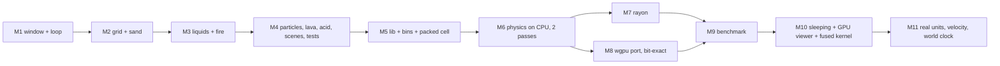

# Capstone: Build the Whole Thing Yourself

The lessons showed you why each piece of the project looks the way it does. This roadmap takes the lessons away. Start from an empty folder and rebuild the project, one milestone at a time, until you have a GPU engine with chunk sleeping, an honest benchmark, and physics in real units that plays in real time.

Each milestone has the same parts:

- **Goal**: what you are building.
- **Done when**: acceptance criteria. Don't move on until every box is ticked.
- **Time**: a rough estimate for someone new to Rust. It's fine to take twice as long.
- **Review**: the lessons to reread if you get stuck.
- **Check against**: the real commit. Look at it only *after* your version works (`git show <sha>:<path>`).

The performance numbers below come from the repo README (Apple M5, 10 CPU threads). Your machine will differ. What matters is the *ratios*: GPU against one CPU thread, all cores against one thread.

## The one rule that runs through everything

From M6 on, every step obeys one rule: **every cell is written by exactly one worker, and that worker reads only the old state.** Double buffering, Margolus blocks, rayon threads, GPU threads, chunk sleeping and the fused kernel are all ways of keeping that rule true. When a milestone feels hard, ask "who writes this cell, and what does it read?" The answer usually tells you what's wrong.

The second rule is **all maths in a step is integers, and randomness is a hash of (position, step).** (From M11 on, `f64` appears only in `const` unit conversions and in the viewer's clock, never inside a step.) That rule is what lets CPU and GPU agree bit for bit, so `assert_eq!` on two whole grids works as a test.

---

## M1: An empty window that runs a game loop

**Goal:** `cargo new sand-mine`, add `macroquad`, open a 1280x720 window, clear it each frame, and draw a square where the mouse is.

**Done when:**
- [ ] `cargo run` opens a window titled with your project's name.
- [ ] The square follows the mouse, and pressing Escape quits.
- [ ] Your `Cargo.toml` sets `[profile.dev] opt-level = 1` and `[profile.dev.package."*"] opt-level = 3`, and you can explain why (lesson 01).
- [ ] `cargo clippy` is clean.

**Time:** 1-2 hours. **Review:** [[01-setup-cargo-game-loop]]. **Check against:** `8da72fa` (`sand/Cargo.toml`, `window_conf`, `main`).

## M2: A grid of cells and falling sand

**Goal:** A `Cell` enum (`Empty`, `Sand`, `Stone`), a `Grid` struct over a flat `Vec<Cell>`, painting with the mouse, and sand that falls and piles up. Draw the grid by writing pixels into an `Image` and uploading it once per frame, not by calling `draw_rectangle` per cell.

**Done when:**
- [ ] Sand poured on a stone ledge forms a pile with sloped sides, and the slope isn't biased left or right.
- [ ] A grain moves at most one cell per step. If grains teleport to the floor in one frame, you have the "already updated" bug from lesson 03.
- [ ] Painting outside the grid doesn't panic (bounds checks return early instead of indexing out of range).
- [ ] 640x360 cells at 2x scale run at 60 fps in a debug build.

**Time:** 3-5 hours. **Review:** [[02-grid-enums-structs]], [[03-falling-sand-rules]].

## M3: Water, wood, fire, smoke, gunpowder

**Goal:** Liquids that spread sideways, fire with a life counter stored in the enum variant (`Fire(u8)`), smoke that rises and fades, wood that burns, gunpowder that explodes.

**Done when:**
- [ ] Water fills a container and levels out. Sand sinks through water.
- [ ] Fire spreads through a wooden block and leaves smoke, and the smoke disappears.
- [ ] A line of gunpowder burns from one end to the other.
- [ ] Number keys pick the brush, and the right mouse button erases.

**Time:** 4-6 hours. **Review:** [[03-falling-sand-rules]], [[04-fire-explosions-particles]].

## M4: Particles, bombs, lava, acid, scenes and the first tests

**Goal:** Explosions that throw cells as flying particles (`Vec<Particle>` with gravity, capped at a maximum count), an `E` key bomb, lava that turns water into stone, acid that eats through stone, a list of scenes as `Scene { name, build: fn(&mut Grid) }`, and a `#[cfg(test)] mod tests`.

**Done when:**
- [ ] A bomb at a corner of the grid doesn't panic.
- [ ] `cargo test` passes tests equivalent to the real ones: `gunpowder_chain_reaction_runs_without_crashing`, `lava_and_water_make_stone`, `acid_eats_through_stone`, `every_scene_runs_without_crashing`, `emitters_run_dry`, `bomb_at_edges_is_safe`.
- [ ] Tests don't open a window: the simulation step doesn't depend on macroquad drawing.

**Time:** 5-8 hours. **Review:** [[04-fire-explosions-particles]], [[05-lava-acid-scenes-tests]]. **Check against:** `a022b3c`.

This is the end of Part 1. You now have a complete, playable game in one file. Take a break before M5. Everything after this is a new engine.

## M5: Library, binaries, and a packed cell

**Goal:** Add `src/lib.rs` with `pub mod physics;`, a `physics/mod.rs` that holds materials as `u32` constants plus property tables (`KIND`, `DENSITY`, `FLOW`, `COND`), and a cell packed into one `u32`: bits 0-3 material, bits 4-11 aux, bits 12-31 signed temperature. Add `src/bin/physics.rs` (an empty viewer for now) and set `default-run = "sand"` so the old game still starts with `cargo run`.

**Done when:**
- [ ] `cargo run` starts the old game and `cargo run --bin physics` starts the new viewer.
- [ ] A test round-trips `pack`/`material`/`aux`/`temp` for negative temperatures, `T_MIN`, `T_MAX`, and values outside the range (which must clamp).
- [ ] You can explain why `temp(cell)` is `(cell as i32) >> 12` and not `cell >> 12`.

**Time:** 2-4 hours. **Review:** [[06-lib-bins-modules-bitpacking]]. **Check against:** `2fbcad6` (the module split), `31aed2d` (the packing).

## M6: The physics model on one CPU thread

**Goal:** A `World` (width, height, `Vec<u32>`), a `CpuSim::step` that runs two passes: `heat_cell` (reads the old grid, writes a new one: conduction, phase changes, burning) and `move_block` on 2x2 Margolus blocks, with the block grid offset by one cell on every other step. Randomness comes from `hash3(x, y, step)`, never from a running generator. Temperatures are fixed point, `T_SCALE = 256` units per degree.

**Done when:**
- [ ] `oil_floats_on_water`, `lava_boils_water_and_turns_to_stone`, `hot_fire_ignites_wood` pass.
- [ ] `conduction_conserves_heat` passes: in a closed box with no phase changes, the sum of all temperatures stays the same (allowing only the error your rounding scheme permits). This is the test that catches lopsided integer division.
- [ ] Running the same scene twice from the same start gives identical grids (`assert_eq!` on the `Vec<u32>`).
- [ ] In the viewer, sand falls fast through air but slowly through water, steam rises and rains back down, and lava poured into water crusts over.
- [ ] Rough speed: about 8 ms per step at 1280x720 in `--release`.

**Time:** 8-12 hours. This is the biggest milestone. **Review:** [[07-physics-model-fixed-point]], [[08-margolus-double-buffering]].

## M7: All cores with rayon

**Goal:** `CpuSim::step_parallel`, which hands bands of rows to rayon with `par_chunks_mut`. Both passes run the same per-row code as `step`, so the result can't differ.

**Done when:**
- [ ] `single_thread_and_rayon_give_identical_worlds` passes on every scene.
- [ ] Your code has no `unsafe`, no `Mutex` on the grid, and the borrow checker accepted it. If you needed a lock, you broke the one-writer rule somewhere.
- [ ] Rough speed: 4-6x faster than one thread on a 10-thread machine (README: 8.2 ms becomes 1.6 ms at 1280x720).

**Time:** 2-4 hours. **Review:** [[09-parallel-cpu-rayon]].

## M8: The same step on the GPU, bit for bit

**Goal:** `GpuSim` in `physics/gpu.rs`: request an adapter and device (`pollster::block_on`), create storage buffers for the old and new grid and a uniform buffer for (width, height, step), build compute pipelines from `sim.wgsl` loaded with `include_str!`, dispatch heat then move, and `download()` the grid by copying into a staging buffer and calling `map_async`. Use `bytemuck::cast_slice` for every CPU-to-GPU byte copy.

**Done when:**
- [ ] `gpu_gives_identical_world_to_cpu` passes: same scene, many steps, `assert_eq!` on the whole grid.
- [ ] A test like `gpu_matches_cpu_on_odd_sizes` passes for sizes that aren't multiples of the workgroup size (try 257x161, 100x37, 33x18, 3x3).
- [ ] The viewer can switch between CPU and GPU with a key, and the picture doesn't change when you switch.
- [ ] Rough speed: about 0.3 ms per step at 1280x720 for GPU steps alone, and 0.7 ms with a readback every step.

**Time:** 8-15 hours. **Review:** [[10-wgpu-fundamentals]], [[11-wgsl-port-determinism]].

When the GPU and CPU disagree, don't stare at the shader. Shrink the grid to 4x4, run one step, print both grids, and find the first cell that differs.

## M9: An honest benchmark

**Goal:** `src/bin/bench.rs`. For each size from 640x360 to 3840x2160, check that all backends agree first, then time "cpu 1 thread", "cpu all cores", "gpu" (many steps queued back to back) and "gpu + readback". Print a table with speedups.

**Done when:**
- [ ] The bench refuses to print timings if any backend's result differs.
- [ ] `time_it` warms up before timing and runs for a time budget, not a fixed step count.
- [ ] GPU timing waits for the GPU to finish. If your GPU column is suspiciously fast, you are timing how long it takes to *queue* work.
- [ ] Your table shows the same shape as the README: GPU about 20-30x faster than one thread and about 5x faster than all cores, with readback roughly doubling the GPU cost at 720p.

**Time:** 3-5 hours. **Review:** [[12-benchmarking-honestly]]. **Check against:** `2fbcad6:sand/src/bin/bench.rs`.

## M10: Sleeping chunks, a GPU-only viewer, and a fused kernel

Three parts. Do them in this order and keep every earlier test green throughout.

**10a. Chunk sleeping.** 32x32 chunks. A chunk is *active* if heat changed one of its cells or one of its blocks could move. A chunk runs in step $n$ only if it or a neighbour was active in step $n-1$ or $n-2$. Same rule on CPU and GPU (on the GPU, sleeping workgroups return at once).

- [ ] `sleeping_gives_identical_world_to_no_sleeping` passes on every scene at 257x161, including painting between steps.
- [ ] `block_can_move_is_never_wrong` and `settled_scene_sleeps_on_cpu_and_gpu` pass.
- [ ] You can write down, in a few sentences, why skipping a sleeping chunk can never change the result (lesson 13).
- [ ] A settled scene runs several times faster with sleeping on than off. The bench prints a second table: busy/settled x sleep on/off, with the awake chunk count.

**10b. GPU-only viewer with pipelined readback.** Three staging buffers in rotation, so the viewer draws the newest finished readback and never blocks. Painting goes to the GPU through `write_cells`. An epoch counter throws away readbacks queued before an upload. GPU timestamp queries report true GPU ms per step. Turn on `lto = "fat"`, `codegen-units = 1` and `panic = "abort"` in `[profile.release]`.

- [ ] `pipelined_readback_and_paint_match_cpu` passes, and a test proves stale readbacks are discarded.
- [ ] The HUD shows GPU ms/step, CPU ms/frame and frame time, and the CPU frame time no longer includes waiting for the GPU.

**10c. Fused kernel, with sleeping.** One dispatch per step instead of two: one thread per 2x2 block, which heats its 4 cells from the old grid and then moves them. Add an interior fast path without bounds checks and a "uniform block" shortcut. Keep 10a's sleeping working inside it: each thread checks the awake flag of each of its 4 cells' chunks, a sleeping cell keeps its old value and isn't written, the move runs only if the block's owner chunk (top-left cell) is awake, and activity is stamped with atomics (load before store). The repo did this merge by hand in `6c1cebc`.

- [ ] Every equivalence test still passes, especially the odd sizes (partial blocks at the edges are heated but not moved).
- [ ] `sleeping_gives_identical_world_to_no_sleeping` and `settled_scene_sleeps_on_cpu_and_gpu` still pass with the fused kernel.
- [ ] You measured each optimisation separately and kept only the ones that helped. (The real commit found that staging a tile in workgroup memory was 20-25% *slower* than reading the old grid directly on an Apple M5.)
- [ ] You measured what sleeping costs when everything is awake. (In `6c1cebc` the bookkeeping cost about 30% on the busy scene vs fused alone, while a settled 4K world dropped to about 0.56 ms per step.)

**Time:** 10-20 hours for all three. **Review:** [[13-chunk-sleeping]], [[14-gpu-perf-fused-kernel]], [[15-gpu-viewer-pipelined-readback]]. **Check against:** `1157366`, `d94ade6`, `6c1cebc` (fused kernel merged with sleeping). The standalone fused experiment `9b8dd55` (without sleeping) exists only in the author's local clone as branch `fused-kernel-standalone`. It is not on GitHub, so use lesson 14's snippets or `6c1cebc`.

## M11: Real units, velocity and a world clock

**Goal:** Give the engine real units: 1 cell = 5 mm, 1 step = 1/1200 s, gravity 9.81 m/s². Moving cells store a speed level in their aux bits, gravity accelerates it every step in the heat pass, and liquids cap sinking at a terminal speed. Heat uses real diffusivities, with each edge's tiny flow rounded at random so the average is right and heat is still conserved exactly. Chunk sleeping must count a cell as active if it *could* change for some random number, not only if it did. In the viewer, replace steps-per-frame with a `Clock` that turns wall time into world time at a chosen speed (0.01x to 16x, real time by default), within a step budget taken from the GPU timestamps.

**Done when:**
- [ ] A free-fall test passes: grains dropped through about 1.2 m of air land within 10% of $t = \sqrt{2h/g}$.
- [ ] A sinking test passes: sand dropped into 0.6 m of water reaches the bottom in 4.5-9 s (about 0.1 m/s), where the same drop through air takes well under a second.
- [ ] `conduction_conserves_heat` still passes with random rounding: the total stays *exactly* the same, because each edge's rounded flow is added to one side and subtracted from the other.
- [ ] Every equivalence test still passes: CPU == GPU, rayon == one thread, sleeping == no sleeping, odd sizes.
- [ ] Clock tests pass: real time at 60 fps gives about 20 steps per frame, 0.01x carries fractions over (one step every 5 frames, never zero forever), fast forward respects the budget without building up a backlog, and a 2 s hitch counts as 0.1 s.
- [ ] The 640x360 viewer runs at real time (the HUD shows world time and the achieved speed reaching 1.00x), and `,` `.` `/` change the speed.
- [ ] The bench prints a "gpu max speed" column: how many times faster than real time the GPU alone could run.

**Time:** 8-15 hours. **Review:** [[16-real-units-velocity-clock]]. **Check against:** `07fcf0b` (`sand/src/physics/clock.rs`, `mod.rs` tests `free_fall_takes_the_right_time` and `sand_sinks_slowly_through_water`).

**Total:** roughly 55-95 hours. Spread it over weeks, not days.

---

## Stretch goals

None of these exist in the repo (except number 7, kept as an optional exercise). Each one needs you to keep the two rules: one writer per cell, and integer-only, deterministic maths. That keeps CPU and GPU in agreement.

1. **Water pressure.** Water in the current engine levels out slowly and can't push up a U-tube. Add a per-cell pressure value in the spare bits (or a second buffer) that builds up with depth and lets liquid move upward when pressure on the far side is higher. Test it: a U-tube filled from one side should end with equal levels.
2. **Latent heat and heat capacity.** Right now water flips to steam the moment it crosses 100°C. Give each material a heat capacity $c$ so a temperature change is $\Delta T = Q / c$, and a latent heat $L$: a cell at its boiling point soaks up $L$ units of energy before changing phase. A pot of water should then stay at 100°C for a while as it boils. Keep `conduction_conserves_heat` passing; update it to conserve *energy*, not temperature.
3. **Lighting and glow.** Write a fragment shader (macroquad `material` or a wgpu render pass) that makes lava and fire glow, with a blur on hot cells, and colours each cell by temperature.
4. **Audio from material counts.** Count fire, water and lava cells each frame (on the GPU, a small reduction pass) and use `macroquad::audio` to fade loops in and out: crackling grows with the number of fire cells, hissing plays when steam appears.
5. **Render straight from GPU buffers.** Swap macroquad for `winit` + `wgpu` in the viewer, and draw with a render pipeline that reads the cell storage buffer directly. The readback disappears, so "gpu + readback" should become "gpu". Measure it.
6. **Indirect dispatch of awake chunks.** Instead of launching a workgroup for every chunk and letting sleepers return at once, build a list of awake chunk ids on the GPU and use `dispatch_workgroups_indirect`. A settled 4K scene should then cost close to nothing.
7. **Optional exercise: merge sleeping into the fused kernel yourself.** The repo has done this (`6c1cebc`), and 10c now asks for it. If you built 10c without sleeping first, do the merge on your own before reading `6c1cebc`, then compare. Try to beat its ~30% all-awake overhead, for example by checking awake flags once per workgroup when a workgroup lies inside a single chunk.

## Self-assessment checklist

Tick these honestly once you're done. Every box you can't tick points to a lesson to reread.

**Language basics**
- [ ] I can choose between `struct`, `enum` with data, and plain `u32` constants for a model, and explain the trade-off.
- [ ] I can write `match` with guards and nested patterns without looking up the syntax.
- [ ] I know when to use `usize`, `i32` and `u32`, and where `as` silently wraps or truncates.
- [ ] I can do bit packing with shifts and masks, including signed fields.

**Ownership and borrowing**
- [ ] I can explain why `&mut grid` and `&grid` can't both be alive, and fix the error by restructuring instead of cloning.
- [ ] I can split one `&mut [T]` into non-overlapping pieces (`split_at_mut`, `chunks_mut`) and say why that's allowed.
- [ ] I know what `Send` and `Sync` mean and why rayon needs them.

**Abstraction**
- [ ] I can write a function that takes a closure (`impl FnMut() -> u32`) and say when a closure needs `move`.
- [ ] I can derive traits (`Clone`, `Copy`, `PartialEq`, `Debug`, bytemuck's `Pod`/`Zeroable`) and know what each derive requires.
- [ ] I can lay out a crate as a library plus several binaries with `pub` and `use` used deliberately.

**Errors, async, resources**
- [ ] I can use `Option` and `Result` with `?`, and I know when `expect` is acceptable.
- [ ] I can call an async API from sync code with `pollster::block_on` and explain what `.await` does.
- [ ] I understand that wgpu resources free themselves on `Drop`, and I can share state with a callback using `Arc` and an atomic.

**Testing and performance**
- [ ] I write equivalence tests (fast version == reference version) before optimising.
- [ ] I can design a benchmark that warms up, waits for the GPU, and checks correctness before timing.
- [ ] I know what `--release`, `opt-level`, `lto`, `codegen-units` and `panic = "abort"` each change.
- [ ] I can find the first differing cell between two grids and work back to the bug.

**GPU**
- [ ] I can set up a wgpu compute pipeline from memory: device, buffers, bind group layout, pipeline, dispatch, readback.
- [ ] I can port a Rust function to WGSL and keep it bit-identical.
- [ ] I can explain why the GPU is about 5x faster than all CPU cores here, and why it isn't 100x (memory bandwidth, not arithmetic, is the limit).
